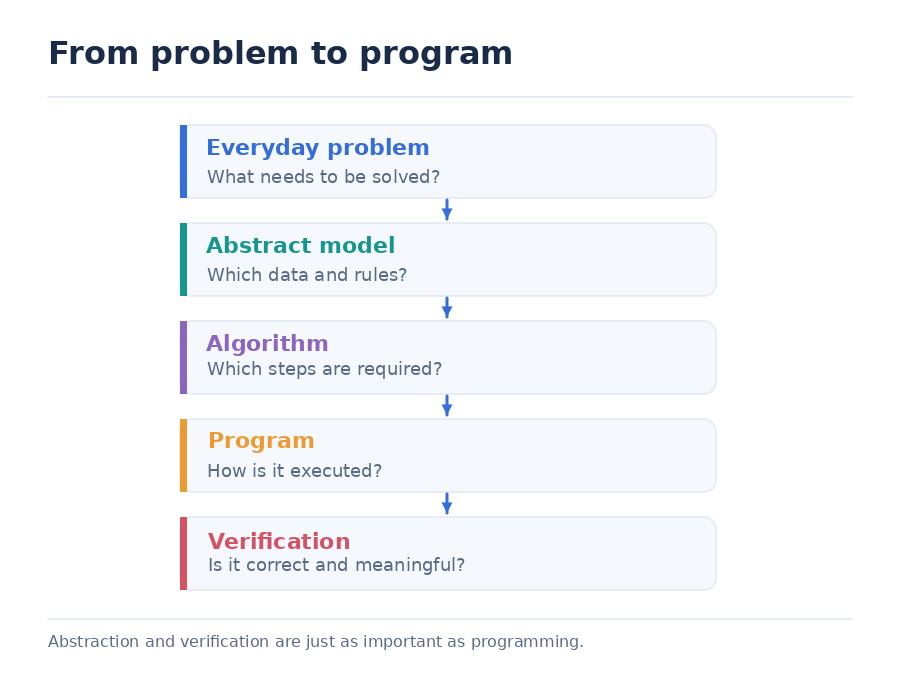

# M1-L1 – What is computer science? {#L1}

**Course area:** M1 – Bachelor’s: Foundations of computer science

**Level:** Bachelor’s

**Prior knowledge:** No fixed prerequisites specified.

**Learning objective:** Understand computer science as a scientific discipline, distinguish programming from it, and relate the concepts of data, information, algorithms, models, abstraction, computability and computational cost to real software systems.

## Overview: Behind every program is a model of the world {#S1}

Imagine a program that manages a large collection of films. On the surface, you see input fields, lists and search results. Underneath, fundamental questions arise: What exactly is a film? Does an alternative language version belong to the same work? How unambiguous is a title? How do you find an entry quickly without searching through everything? What happens if two people make changes at the same time?

{alt="Sequence of problem, model, algorithm, program and evaluation"}


The choice of programming language alone does not answer these questions. They concern **computer science**: the systematic description and processing of information through formal models and executable procedures. Computer science investigates which tasks are computable in principle, which methods work well and how reliable technical systems can be built from them.

**Programming** means expressing a solution in a programming language. **Software development** also includes planning, testing, modification, release and maintenance. Both are important practical activities, but neither encompasses the entire discipline. A computer scientist who is not currently writing a single line of code can still analyse algorithms, design a data model or assess the security of an architecture.

``` text
Everyday problem: ‘Find a film even if its title differs.’
                   │
                   ▼
Domain model: work, title variants, language, identifier
                   │
                   ▼
Procedure: normalise, search, rank matches
                   │
                   ▼
Program: user interface + search logic + data store
                   │
                   ▼
Evaluation: correct matches, runtime, error cases, data protection
```

This is a first guiding principle for the entire course: **What makes a system good is not the number of servers, but the suitability of its models and methods for the actual problem.**

## Data is not yet understandable information {#S2}

Suppose a file contains `12, 18, 25, 19`. These are initially **data**: recorded symbols or values. If they are interpreted as temperatures in degrees Celsius on four days, a meaningful context emerges. If instead they are visitor counts or prices, their meaning changes.

**Information** is not an independent substance automatically contained in a number. It arises when data is placed in a meaningful context and interpreted. The unit, time, origin and measurement method can sometimes be just as important as the actual value.

At a low level, a computer stores only encoded states. Whether a bit sequence represents a number, a letter, a pixel or a machine instruction depends on rules and conventions. Even text must be **encoded**: a character encoding maps characters to particular byte sequences. A database supplements the encoding with a schema that describes, among other things, which fields belong together.

In a media archive, for example, the following information may be important:

| Stored value | Understandable only in context |
| --- | --- |
| `2024` | Year of release or file size? |
| `de` | Language code, country identifier or part of a name? |
| `000417` | Unique identifier or a number whose leading zeros could be omitted? |
| `3,7` | Rating on which scale and in which decimal format? |

A common software problem is therefore not a calculation error but an **incorrect interpretation of data**. If leading zeros are removed from an identifier, a stored key can lose its meaning. If time zones are ignored, events appear in the wrong order.

### The relationship between data, information and knowledge

A data record can capture an observation. A pattern may be inferred from a series of observations. Whether that pattern constitutes a reliable explanation or a suitable basis for decisions must be checked separately. These levels should not be equated: a statistical chart can be calculated correctly and still be misleading because the data is incomplete.

## An algorithm is a generally specified procedure {#S3}

An **algorithm** describes a task through well-defined steps. The description itself is not yet a particular JavaScript, PureBasic or Python program. An implementation translates the procedure into a specific language and runtime environment.

Example: Find the largest value in the list `12, 18, 25, 19`.

1.  Take the first value as the provisional maximum.
2.  Compare each subsequent value with this maximum in turn.
3.  If a value is greater, record it as the new maximum.
4.  At the end, output the recorded value.

``` text
Start: Maximum = 12
18 > 12  → Maximum = 18
25 > 18  → Maximum = 25
19 > 25  → Maximum remains 25
Result: 25
```

The strength of the rule is that it is not designed specifically for these four numbers. It also works for other **non-empty** lists of numbers. The condition ‘non-empty’ is one of its assumptions. For an empty list, one must specify whether there is no result or an explicitly defined special value.

A further point: an algorithm is usually understood as a finitely describable, step-by-step procedure with a clear goal condition. **Not every arbitrary computer program halts for all inputs.** Programs may, for example, deliberately wait indefinitely for events. For a specific algorithm, the inputs and the intended termination must therefore be specified precisely.

### Correctness and computational cost are different questions

The maximum-finding algorithm must satisfy two requirements: it should produce the **correct result** while incurring an acceptable **computational cost**. For a list with a million values, the linear procedure examines every value in principle. This is reasonable here if no additional prior information is available.

An already sorted list may allow a simpler query. A database with an index can use different access paths. However, the index must be created, stored and updated when changes occur. **Faster reads can mean more storage and slower writes.** Such trade-offs are a recurring topic in computer science.

In **M1-L3 – Algorithms and data structures**, such methods and their growth rates are discussed in detail. Here the basic idea is sufficient: we assess not only an individual program execution, but also how the cost develops for larger inputs.

## Abstraction: Selecting the relevant part {#S4}

An **abstraction** describes a problem while omitting details that are unnecessary for the question at hand. This makes complex relationships manageable in the first place.

For an order management system, one could initially define the following domain model:

``` text
Customer (customer ID)
   │  one-to-many
   ▼
Order (order ID, date, status)
   │  one-to-many
   ▼
Order item (product, quantity, unit price)
```

The diagram is neither a database schema nor finished software. It merely describes relationships. One can then decide how to organise this information as tables, documents or files and which rules the system should enforce.

A **model** is thus a purpose-oriented representation of reality or of a technical process. Models are useful because they allow us to discuss and examine a problem before choosing a specific implementation.

However, every abstraction has limits. A model that only recognises ‘order is paid’ may, for instance, fail when dealing with partial payments, refunds or simultaneous payment attempts. An abstraction becomes faulty not because it is simple, but when it **omits essential properties** needed to make a particular statement.

### Three levels that should be distinguished

| Level | Example | Question it answers |
| --- | --- | --- |
| Domain model | A work has several alternative titles | What does an entity mean? |
| Logical model | Tables, fields and unique keys | How is the information related? |
| Technical implementation | SQLite file, PostgreSQL server, API | What technology does the solution run on? |

A good separation makes later changes possible. One can replace the storage system and largely retain the domain model; however, an unsuitable domain model **cannot** be repaired by adding more hardware.

## The four traditional perspectives of computer science {#S5}

The division into **theoretical, practical, technical and applied computer science** is widely used as a means of orientation in German-speaking countries. It is not an exhaustive, globally uniform list of disciplines. Modern curricula distinguish numerous other areas of knowledge, such as security, human-computer interaction and artificial intelligence.

### Theoretical computer science – What is possible in principle?

This area deals with formal languages, logic, computability, algorithms and their limits. One guiding question is: does a procedure exist for a precisely defined task that always finds the correct answer? Another is: how quickly does the required computational cost grow as the input becomes larger?

Theoretical computer science is therefore not merely ‘mathematics without application’. It provides foundations for compilers, cryptography, databases and the assessment of algorithms.

### Practical computer science – How is complex software developed?

It deals, among other things, with programming languages, software engineering, operating systems, databases and the organisation of software systems. Typical questions are: which interfaces are reliable? How are changes tested? How can concurrent access be prevented from damaging data?

### Technical computer science – How does a physical computer perform computations?

This area brings together digital circuits, computer architecture, memory, networks and embedded systems. It explains why a processor can execute instructions, why memory access takes time and why a graphics processing unit may be better suited to certain tasks than a general-purpose processor.

### Applied computer science – Which solution suits a domain-specific task?

Here, methods are developed and adapted for specific fields: medicine, media management, business, manufacturing, science, robotics or administration. A reliable system often requires all three of the other perspectives.

``` text
Theory       → Is a procedure possible, and how costly is it?
Practice     → How can it become maintainable software?
Technology   → How does the underlying machine work?
Application  → Does the solution meet the actual need?
```

As a disciplinary reference, the joint **CS2023 curriculum from ACM, IEEE Computer Society and AAAI** lists, among other things, algorithms, computer architecture, data management, operating systems, security, software engineering, artificial intelligence and mathematical and statistical foundations. A reading course can organise these topics in an understandable way, but it replaces neither the full scope nor the assessed work of an accredited degree programme.

## Computability is not the same as practical solvability {#S6}

Computer science problems can be divided into three deliberately simplified groups.

1. **Computable and manageable in everyday practice.** Adding a list of numbers or finding its maximum can be done with a straightforward procedure even for large data sets.

2. **Computable in principle, but potentially very costly.** In some planning and combinatorial optimisation problems, the number of possible solutions grows extremely quickly. An exact result may then be too costly for large inputs; approximation methods or heuristics may be more practical. ‘Difficult’ does not automatically mean ‘unsolvable’ here.

3. **Algorithmically undecidable in general.** The classical **halting problem** asks whether an arbitrary program eventually terminates on an arbitrary input. There is no general procedure that correctly decides this question for all programs and inputs. For particular restricted programs, of course, it can still be answered.

This distinction is important: **More processors help with some resource bottlenecks, but not with undecidability in principle.** Artificial intelligence does not remove this limit either; it can, however, provide useful estimates or suggested solutions for many concrete problems.

## Correctness, quality and responsibility {#S7}

An application can run technically and still be wrong in terms of the domain. Three levels help with assessment:

- **Domain correctness:** Do the results correspond to the agreed problem and its exceptions?
- **Technical reliability:** Can the system withstand incorrect inputs, interrupted connections and concurrent use?
- **Appropriate responsibility:** Are rights, sensitive information, retention periods and the consequences of incorrect results taken into account?

A program that searches local files has different risks from a publicly accessible service with customer accounts. An AI system that recommends texts requires different safeguards from a robot that drives a motor. These differences affect architecture and cost as early as the modelling phase.

**Tests** can reveal individual errors or increase confidence in an implementation. However, they do not automatically prove that all conceivable cases are handled correctly. Conversely, mathematical proofs can establish certain properties under clearly stated assumptions; a formal proof does not replace checking whether the assumptions fit the real environment.

## Three practical scenarios {#S8}

### Scenario A – Local media catalogue

**Initial problem:** A person manages many files and wants to find duplicates and alternative titles.

**Appropriate solution:** A data model with stable identifiers, a local database or initially a file, together with search and comparison methods. The user can check results before entries are merged.

**What would be oversized?** A cloud cluster consisting of many servers. For a single local collection, hosting, data protection and maintenance costs would often outweigh the benefits.

### Scenario B – Small online analysis tool

**Initial problem:** Several customers should be able to upload an analysis and retrieve results.

``` text
Browser → Application/API → Processing → Database
                   │
                   └── Authorisation checks, logging, error handling
```

The domain logic may be similar to the local version; additional considerations are permissions, shared use, failures and ongoing hosting costs. **API** means *Application Programming Interface*, a defined interface between programs. Whether this application is initially operated on a single server or distributed across several depends on load and risk, not on a fashionable term.

### Scenario C – AI assistance and distributed processing

**Initial problem:** Many documents or media files are to be evaluated and categorised automatically.

**Appropriate solution:** First define, from the domain perspective, which statements should be checked and how misclassifications can be detected. Then choose an appropriate algorithm or model. Under heavy load, a queue can distribute jobs among several processing programs.

**Limit:** A powerful AI model does not necessarily produce a factually correct assessment. Data provenance and confidentiality, as well as opportunities for human correction, remain important. The later lessons M5-L2–M6-L6 explain how such models work technically and how they are operated.

## When is which level of computer science effort needed? {#S9}

| Situation | Usually helpful first step | Typically unnecessary at the start |
| --- | --- | --- |
| Small one-off data conversion | Simple procedure, plausibility check | Distributed system |
| Growing local database | Sound data model, suitable index, backup | Multiple database regions |
| Public web application | Permissions, tests, secure deployment, measurement | Complex microservice landscape |
| AI processing with many jobs | Quality metric, queue, cost limit | Training an enormous foundation model of one's own |
| Safety-critical control system | Verifiable constraints and independent protective functions | Uncontrolled LLM access to actuators |

Sometimes the correct solution is to use **less** technology. A manageable program is often easier to check, cheaper to maintain and safer to operate than an unnecessarily complex system.

## Summary and transition {#S10}

Computer science investigates the representation, processing and transmission of information. Its tools include not only programming languages but also **abstractions, models, algorithms, reasoning about correctness and architectural decisions**. The best technical solution is the one that solves the specific problem reliably and economically under realistic constraints.

**Further reading:** [M1-L2 – How computers really work](M1-L2.md) explains the machine behind the program. [M1-L3 – Algorithms and data structures](M1-L3.md) explores the choice of procedures in more depth. The connections to mathematics are explained in the provisional mathematics bridge; specific mathematics module identifiers have not yet been verified.


## Sources {#S11}


- [ACM/IEEE-CS/AAAI, CS2023 – Knowledge Areas](https://csed.acm.org/knowledge-areas/) · curricular context · Last accessed: 2026-11-22
- [**ACM/IEEE-CS/AAAI, CS2023 – Overview:**](https://csed.acm.org/) · Thematic relevance to lesson: S5: The four traditional perspectives of computer science · Last accessed: 2026-11-22
- Further foundations in the course: [M1-L2](M1-L2.md)–[M1-L7](M1-L7.md); the distinction between practical and theoretical computer science is to be understood as a didactic classification, not as a complete list of disciplines.
