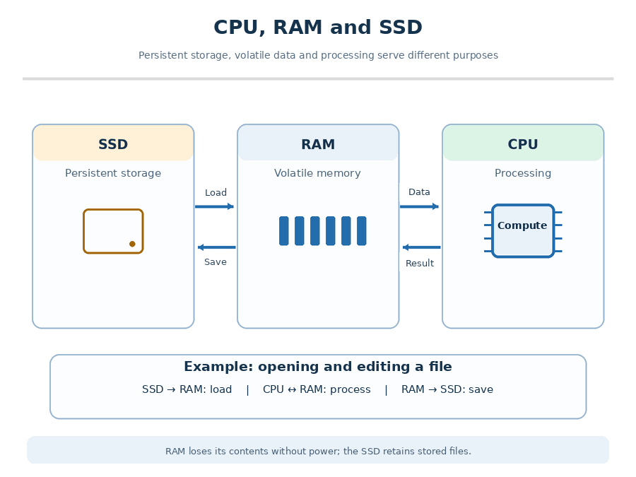

# M1-L2 – How computers really work {#L2}

**Course area:** M1 – Bachelor’s: Foundations of computer science

**Level:** Bachelor’s

**Prior knowledge:** No fixed prerequisites specified.

**Learning objective:** Trace the path from an individual bit through the operation of a processor and operating system to the launch of a program, understanding why computers can perform calculations and what limitations their hardware imposes on desktop, server and AI applications.

## Overview: From a stored file to a running application {#S1}

From the outside, a computer appears to be a single unit: you open an application, click “Search”, and shortly afterwards a result appears. In reality, several layers must work together. A persistently stored program is made executable with the help of the operating system; a processor handles instructions; memory keeps data available; devices provide input and receive output.

``` text
Human / another program
          │
          ▼
Application (user interface, business logic)
          │
          ▼
Operating system (processes, memory, files, devices)
          │
          ▼
CPU ─────── Cache ─────── RAM
 │                         │
 ├── Devices / network     │
 ├── GPU (optional)         │
 └──────── SSD / other persistent storage
```

This is a **functional diagram**, not an exact circuit diagram. A modern computer has multiple cores, controllers, caches and connections. The following sections break the overall picture into understandable parts.

## Bits, bytes and the meaning of encoding {#S2}

A **bit**, from *binary digit*, can logically represent one of two values: `0` or `1`. Eight bits form a **byte**. This allows $2^{8} = 256$ bit patterns. Whether a pattern is understood as an unsigned number, part of a text or something else is determined by its **encoding**.

The **binary system** uses the place values 1, 2, 4, 8, 16, 32 and so on instead of the decimal place values 1, 10, 100.

| Bit position (from the right) | Value |
| --- | ---: |
| 0 | 1 |
| 1 | 2 |
| 2 | 4 |
| 3 | 8 |
| 4 | 16 |
| 5 | 32 |
| 6 | 64 |
| 7 | 128 |

The bit pattern `00001101`, interpreted as an **unsigned** binary number, means $8 + 4 + 1 = 13$. Under the same interpretation, the pattern `11111111` represents `255`. Without further specification, eight bits **cannot** represent every integer. Depending on the data type, negative numbers, other ranges of values or special encodings may also be used.

### Why the same sequence of bytes can have different meanings

A particular byte can represent a letter under a character encoding, an integer under a numerical encoding, or part of a colour value in an image file. **UTF-8** is a widely used character encoding that converts Unicode characters into one or more bytes. Thus, a computer does not inherently “know” that a sequence of bytes represents a word: programs and file formats provide the rules for interpreting it.

This is crucial in a database: a film identifier `000417` should be retained as an identifier. If it is carelessly interpreted as a number, the leading zeros may disappear. Even at this point, computer architecture, computer science models and the data management discussed in M1-L5 intersect.

### When the range of values is insufficient

In an **unsigned** calculation restricted to eight bits, $200 + 100 = 300$. This value cannot be represented in eight bits. If the system simply truncated the result to the lowest eight bits, `44` would remain, because $300 = 256 + 44$. Other execution environments detect overflow, use larger data types or define a different behaviour. **A mathematically correct result does not necessarily fit every technical data type.**

## Logic gates: calculation through simple decisions {#S3}

Digital electronics uses distinguishable electrical states. These are often simplified to `0` and `1`. This does not mean that “zero volts” and “a fixed voltage for one” apply everywhere: electrical signal levels, noise margins and circuit families vary.

A **transistor** can, in a simplified description, be used as a controllable switch in digital circuits. Many transistors form **logic gates**, which implement specific logical functions. Three fundamental functions of **Boolean algebra** are:

- **AND:** the output is `1` if both inputs are `1`.
- **OR:** the output is `1` if at least one input is `1`.
- **NOT:** a single input is logically inverted.

| A | B | A AND B | A OR B |
| --- | --- | --- | --- |
| 0 | 0 | 0 | 0 |
| 0 | 1 | 0 | 1 |
| 1 | 0 | 0 | 1 |
| 1 | 1 | 1 | 1 |

There is also the **XOR** function (*exclusive OR*): it produces `1` if exactly one of the two inputs is `1`. XOR and AND can be used to construct a simple **half adder**:

``` text
Inputs A, B
     │
     ├── XOR ──► Sum bit
     └── AND ──► Carry bit

Example: 1 + 1 → Sum bit 0, carry 1
                 Result 10₂ = 2₁₀
```

Multiple adders, memory components and control logic enable more complex computational steps. This is the transition from individual logical rules to a machine capable of executing instructions.

### Computational logic and stored state

In the basic model, a gate responds only to its current inputs. However, a machine must also be able to **remember** something. For this purpose, digital electronics uses circuits with state, such as flip-flops; these can be used to build registers and other memory structures. A computer continuously combines **combinational logic** (computation) and **storage logic** (retaining state).

## The most important hardware components {#S4}



*Figure: The arrows show typical logical operations. The actual path through the operating system, memory controller, cache and input/output is more complex; the CPU, RAM and SSD do not communicate via direct point-to-point connections in every architecture.*

| Component | Full name / function | Key point |
| --- | --- | --- |
| **CPU** | *Central Processing Unit*, central processor | Executes general machine instructions |
| **RAM** | *Random Access Memory*, working memory | Keeps currently required data and code available |
| **SSD** | *Solid State Drive*, flash-based mass storage | Normally retains files without power |
| **GPU** | *Graphics Processing Unit*, graphics/parallel processor | Accelerates suitable large numbers of similar computational operations |
| **Cache** | Fast intermediate memory | Avoids some accesses to slower memory |

Other components include the motherboard, controllers, network interfaces, power supply and interconnections. In computer architecture, the word **bus** describes a transmission path or system for exchanging data and control signals. Modern computers have various point-to-point connections and bus structures rather than a single connection through which everything must pass.

A computer is not powerful simply because its CPU is fast. Data must be available in time. A fast CPU may wait for data, a GPU may remain unused because of insufficient memory, and a server may be slowed down by slow storage access or network traffic.

## What the CPU does when executing an instruction {#S5}

A processor executes **machine instructions**, for example to load, add or compare values, store results or jump to another location in the program.

The simplified basic principle is often called **Fetch–Decode–Execute**:

``` text
Fetch the machine instruction
             │
             ▼
Decode the instruction
             │
             ▼
Execute the operation
             │
             ▼
Make the result available → further instructions
```

**Registers** are small, very fast storage areas directly within the processor. An **arithmetic logic unit** (**ALU**) performs operations including addition and logical operations. The control logic coordinates which steps take place. For example, addition requires operands to be available in a suitable form; the result is stored in a register or later at another location.

### Instruction set and specific processor design

An **instruction set architecture** (**ISA**) describes the contract visible to programs: which instructions, registers and rules a processor provides. Examples include **x86-64** and various **Arm** architectures. A specific **microarchitecture**, by contrast, determines *how* a particular processor fulfils this contract internally.

Two processors can therefore understand the same instruction set but differ in speed, energy efficiency or cost. Modern processors can overlap operations in **pipelines**, prepare some instructions **out of their original order** and operate in parallel across several **cores**. Nevertheless, the simple fetch–decode–execute sequence remains a useful conceptual model.

A clock frequency of three gigahertz, for example, means, in simplified terms, three billion clock cycles per second – **not** three billion completed lines of program code. The amount of work that can be completed per cycle varies depending on the processor, instruction and operating state.

## Memory hierarchy: why data paths matter so much {#S6}

The processor needs data, but not all kinds of memory are equally fast, large or expensive. Several levels are therefore combined:

``` text
CPU registers        very close, very small
      ▲
CPU caches (L1/L2/L3) fast, limited capacity
      ▲
RAM                  larger, normally volatile
      ▲
SSD / mass storage   persistent, slower for many accesses
      ▲
Backup / archive     additional, separately protected copy
```

The arrows do not represent a mandatory physical series connection. Instead, the diagram shows a typical hierarchy of access types. A **cache** stores frequently or predictably needed information close to the processing unit. If the working data set fits well in a cache, a program can run quickly. If significantly slower memory must constantly be accessed, the situation changes.

With conventional technology, **RAM** loses its contents without power. **SSDs** use non-volatile memory and normally retain data without power. Nevertheless, an SSD is not automatically a backup: a file deleted by mistake, a faulty drive or malicious software can destroy data there as well. **Data storage**, **data durability** and **recoverability** are different properties.

Consider a media management application: the large video file is on the SSD; ideally, a search requires only its small metadata. A search index can prevent the program from having to search every video again. This is why data structure and memory access strategy may be more important than an even faster CPU.

### Do not confuse RAM, paging files and virtual memory

The operating system usually provides a process with a **virtual address space**. The program uses virtual addresses; the hardware and operating system map these to suitable physical memory areas. This protects processes from one another and facilitates memory management.

**Virtual memory does not automatically mean paging to an SSD.** Many virtual memory pages reside in RAM or are mapped to files on demand. Only under certain circumstances can suitable memory pages be moved to mass storage via a paging file or swap partition. Frequently loading data from slower storage can severely degrade performance. Additional swap space is therefore not necessarily a substitute for insufficient RAM.

## CPU and GPU: different kinds of work {#S7}

A **CPU** is suited to diverse program logic involving many decisions and changing tasks. A **GPU** has a large number of computing units particularly well suited to processing related, data-parallel operations. In addition to graphics, GPU hardware is therefore used for certain matrix calculations in artificial intelligence.

``` text
CPU:  Decision logic → many different operations
GPU:  Large data sets → many similar partial calculations in parallel
```

This is not an absolute distinction: CPUs are also parallel, and GPUs can execute complex programs. Not every algorithm can be parallelised effectively. If small amounts of data first have to be transferred between main memory and graphics memory at considerable cost, a GPU may be a poor choice in a particular case, despite its higher theoretical computing power.

**VRAM** (*Video Random Access Memory*) is the everyday term for graphics memory. For large language models, it can become a limiting factor. Model weights themselves, intermediate results, context and concurrent requests require memory – a relationship explained in more detail in **M6-L6 – AI infrastructure and distributed computing**.

## From source code to an executable instruction {#S8}

A processor does not directly understand the syntax of a high-level programming language. A **compiler** translates program text into another form, often ahead of time into machine instructions or via intermediate stages. **Assembly language** is a machine-oriented textual representation of instructions; the term **assembler** refers to the tool that translates it and is also used to refer to the language itself.

An **interpreter** processes a program representation with the help of an execution environment. Some systems combine both techniques. **JIT** stands for *Just-in-Time* compilation: suitable code is translated into machine code only at run time, often to speed up repeated execution.

``` text
PureBasic source code → Compiler → Executable file → CPU

JavaScript text       → JavaScript engine
                      → Interpretation and/or JIT compilation
                      → Executable operations on the CPU
```

These examples are simplified, typical execution paths, not mandatory rules for every possible implementation. The **runtime environment** often provides additional functions, such as memory management, standard libraries, error handling and access to specific interfaces.

A machine-code program is also tied to the agreed **processor architecture** and frequently to a specific operating system format. The same source code may have to be compiled again for different target systems. “It runs on my computer” therefore does not automatically mean “it runs unchanged on every server”.

## What the operating system manages {#S9}

Windows, Linux and macOS handle tasks including process management, memory management, file access, device control, user permissions and network communication. The **kernel** is the particularly privileged core of the operating system, which manages fundamental resources and provides interfaces to programs.

A **program** is initially a stored description of instructions. A **process** is a running instance of a program with allocated resources and normally its own virtual address space. A process can contain multiple **threads** – execution flows. They share key resources but have their own execution states.

``` text
             Operating system / scheduler
                       │
             ┌─────────┼─────────┐
             │         │         │
          Browser   Database   Media tool
          process   process    process
             │
        multiple threads possible
```

A **scheduler** determines when execution flows receive computing time. **Concurrency** means that multiple tasks make progress over overlapping periods; **parallelism** means that they actually run at the same time. A computer with one core can work on tasks concurrently by switching between them without executing them in parallel at the same instant.

### Concurrent changes need rules

Two threads read the same counter with a value of `0`. Both want to increment it. If both first read `0`, independently calculate `1` and then write back `1`, the result is `1` rather than `2`. This is a problem known as a **race condition**: the result depends on the temporal order of events.

Such situations may require **synchronisation**, for example suitable locks or atomic operations. In a single-user application this may be easy to manage; in an online service with many concurrent changes, it becomes considerably more important. Later lessons M1-L7 and M3-L5 discuss the details.

## Devices, input and output, interrupts {#S10}

**Input/output** (**I/O**) encompasses data exchange with SSDs, keyboards, cameras, network devices and many other components. Applications normally use operating system functions for this rather than controlling the electronics of each device directly.

A device or controller can request attention through an **interrupt**. The CPU does not therefore have to keep checking by itself whether, for example, new input has arrived. For larger data transfers, specialised mechanisms such as **Direct Memory Access** (**DMA**) can enable data movements without requiring the CPU to copy every single byte itself. This does not mean that the CPU no longer performs any organisational work in the process.

``` text
Application → Operating system interface → Device driver
                                          │
                                          ▼
                                    Device controller
                                          │
                                          ▼
                                       SSD / network
```

Slow file or network access is therefore not necessarily slow computation. The process may be waiting for an external response. This is an important distinction in the later performance analysis of servers.

## File systems and persistent data {#S11}

A **file system** organises files, directories, access permissions, metadata and the allocation of content to storage areas. Examples include **NTFS** on Windows, **ext4** on Linux and **APFS** on macOS. Depending on its configuration, a particular operating system can also use other file systems.

``` text
Application → Operating system → File system → SSD
```

The application knows a file name. The file system manages where the associated content is stored and how it can be found again. File systems may have mechanisms for limiting certain structural errors after a crash. However, they do not automatically guarantee that a change currently being made by the application has been written completely and correctly.

A database extends simple file storage with queries, consistency rules and often transactions. A **backup**, in turn, creates a separate copy in case the original data is lost. Details follow in M1-L5 and M3-L6.

## Launching a program – the complete sequence {#S12}

When an application is launched, the following happens in simplified terms:

1.  The operating system receives the request to start an executable program file.
2.  It checks basic access and execution conditions and establishes a process.
3.  Required code and data are mapped into the virtual address space; not everything has to be copied immediately and completely from the SSD into RAM.
4.  The system allocates execution time. The CPU starts processing the appropriate machine instructions.
5.  As required, the program requests files, graphics rendering, network messages or other services.
6.  When the program terminates, resources are released again; typically, only explicitly saved or otherwise persisted data remains.

``` text
Program file on SSD
         │
         ▼
Operating system loader → Process / virtual address space
         │
         ▼
Scheduler → CPU processes instructions
         │
         ├── Data from cache and RAM
         ├── File/network access via operating system
         └── GPU for suitable tasks
         │
         ▼
Output / persistent storage
```

This completes the journey from the bit pattern to the actual application: the layers are different, but they continually interact.

## Three practical examples: how hardware knowledge changes decisions {#S13}

### Scenario A – Local media catalogue

A local application manages film titles and file paths. The database query is slow. A more expensive processor might help, but first it is worth determining whether every search reads the entire data set again. A suitable **index** can make a much greater difference than additional CPU power. Frequent SSD access or the unnecessary loading of large preview images may also become a bottleneck.

**Useful operational question:** How can the archive be protected against failure, operator error and faulty imports? For a local application, a simple backup strategy may be more important than a server architecture.

### Scenario B – Small public service

Several users send requests at the same time. Here, processes, threads, RAM, the network and storage have to be considered together. If a slow-responding database causes the delay, a more powerful web server CPU may not solve the problem.

``` text
Browser ──Network──► Web application ──► Database
                        │                   │
                       CPU/RAM          Index/SSD/RAM
                        └── Metrics + logs ─┘
```

**Operational implications:** Updates, user permissions, monitoring, backups, encryption, data protection and ongoing costs are all part of the picture. A straightforward application on a single rented server may initially be more appropriate than a complicated cluster.

### Scenario C – Processing images and AI

An image or AI application may use a GPU. Whether this helps depends on the potential for parallelisation, the model size and memory paths. A graphics card with high computing power but insufficient graphics memory may be unsuitable for a particular model. If image files are first loaded slowly from storage or the network, additional GPU power may be of little benefit.

**Operational implications:** Power demand, waste heat, memory capacity, software compatibility, computing time and, for cloud GPUs, ongoing rental costs. For infrequent tasks, using a remote service may be more appropriate; for confidential data, local operation may offer advantages but creates maintenance obligations of its own.

## Common misconceptions {#S14}

| Assumption | More technically precise explanation |
| --- | --- |
| “Twice the clock frequency means twice the speed.” | Instructions per cycle, cores, memory and workload affect performance. |
| “Virtual memory is simply storage space on an SSD.” | Virtual addresses are an addressing and protection concept; paging is only one possible mechanism. |
| “More threads make every program faster.” | Additional threads may compete for resources and require synchronisation. |
| “The SSD is persistent, so I do not need a backup.” | Persistence during power loss does not protect against deletion, failure or attacks. |
| “A GPU is fundamentally faster than a CPU.” | The advantage depends on the type of task, data movement, memory and software. |
| “A server is a completely different kind of computer.” | A server primarily denotes a role; hardware and operation may be designed at a different scale. |

## Summary and transition {#S15}

Electronic circuits represent logical states as bits. Logic gates, registers and further components form processors that execute specified machine instructions. Operating systems coordinate processes, threads, files, memory and devices. Cache, RAM, SSDs, CPUs and GPUs differ in their properties and tasks. These differences lead to performance limits as well as architectural decisions.

**Further reading:** [M1-L3 – Algorithms and data structures](M1-L3.md) explores the selection of efficient methods in greater depth. [M1-L7 – Further areas of computer science](M1-L7.md) explains further aspects of concurrency and compilers. [M2-L1 – From PCs to servers](M2-L1.md) builds directly on the hardware and operating system foundations.


## Sources {#S16}

**Last source review:** 04.11.2026

- **Arm Developer – Introducing the Arm architecture:** [https://developer.arm.com/-/media/Arm%20Developer%20Community/PDF/Learn%20the%20Architecture/Introducing%20the%20Arm%20architecture.pdf?revision=0b6b67ea-edd7-4975-b23c-d4904ac0cb35](https://developer.arm.com/-/media/Arm%20Developer%20Community/PDF/Learn%20the%20Architecture/Introducing%20the%20Arm%20architecture.pdf?revision=0b6b67ea-edd7-4975-b23c-d4904ac0cb35) (instruction set, registers, software/hardware contract; reviewed 04.11.2026).
- **Linux kernel documentation – Memory Management:** [https://docs.kernel.org/admin-guide/mm/index.html](https://docs.kernel.org/admin-guide/mm/index.html) (virtual memory, demand paging, processes; reviewed 04.11.2026).
- **Mozilla Developer Network – JavaScript Engine:** [https://developer.mozilla.org/en-US/docs/Glossary/Engine/JavaScript](https://developer.mozilla.org/en-US/docs/Glossary/Engine/JavaScript) (interpretation and JIT compilation; reviewed 04.11.2026).
- **ACM/IEEE-CS/AAAI – CS2023 Computer Architecture and Organization:** [https://csed.acm.org/knowledge-areas/](https://csed.acm.org/knowledge-areas/) (academic context; reviewed 04.11.2026).
