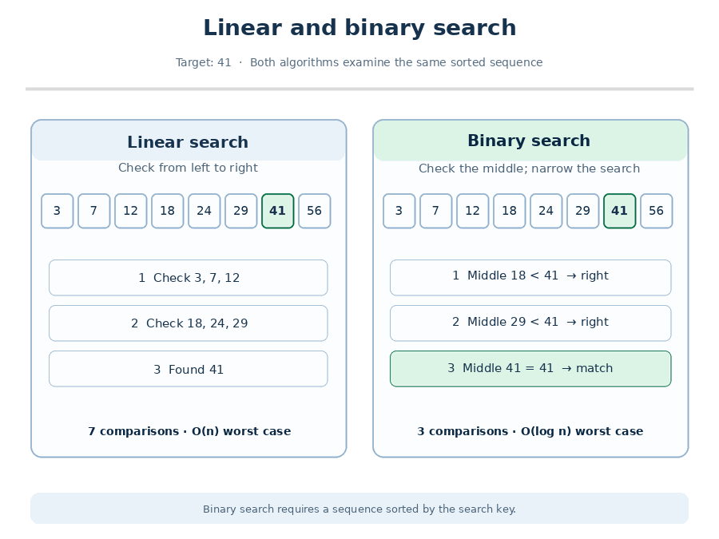

# M1-L3 – Algorithms and data structures {#L3}

**Course area:** M1 – Bachelor’s: Foundations of computer science

**Level:** Bachelor’s

**Prior knowledge:** [M1-L1](M1-L1.md) · [M1-L2](M1-L2.md)

**Further study:** [M1-L4 – Software engineering and system design](M1-L4.md) · [M8-L4 – Algorithms and data structures in depth](M8-L4.md)

## Overview: Why the right algorithm can be more important than a fast processor {#S1}

Suppose a program manages a collection of files. It needs to find the entry with a particular identifier. With 20 entries, the search method hardly matters. With ten million entries, the same decision about how to organise the data can make the difference between an almost immediate response and many unnecessary comparisons.

Computer science therefore examines not only *how* a program is written, but also **which procedure** solves a problem and **how** the data are made available for that purpose.

- An **algorithm** is a precisely described, finite sequence of steps for solving a class of tasks.
- A **data structure** is an organised way of storing and accessing data.
- **Complexity analysis** considers how much time and memory a procedure requires depending on the size of the input.

A good data structure makes certain algorithms efficient. A good algorithm takes advantage of the properties of the data structure. The two decisions belong together.

### Mini-architecture

``` text
Request: "Find customer 4711"
              │
              ▼
     Algorithm (search rule)
              │
              ▼
  Data structure (e.g. list,
       hash table, tree)
              │
              ▼
       Result / not found
```

**Initial problem:** Without suitable organisation, the application may have to examine many irrelevant records. **When is it unnecessary?** For a small list that is rarely searched, a complicated structure is often more costly to develop and maintain than a simple loop.

------------------------------------------------------------------------

## Searching: From sequential scanning to targeted access {#S2}

### Linear search {#11-lineare-suche}



*Illustration: Teaching example for these eight values and the search value 41. The number of comparisons depends on the position; the worst-case estimates $O(n)$ and $O(\log n)$ apply under the respective assumptions. Binary search requires a suitably sorted sequence.*

**Linear search** checks one entry after another until the desired value is found or all entries have been checked. It works even if the data are completely unordered. Its advantage is simplicity; it requires no special search index. Its disadvantage: in the worst case, it has to check every entry.

``` text
[Anna] [Berta] [Cem] [Dora] [Emil]
  ↓       ↓      ↓      ↓
     Search for "Dora"
```

With `n` entries, approximately `n` comparisons are required in the worst case: **$O(n)$**, read as “big O of n”.

### Binary search {#12-binäre-suche}

If the data are **sorted** and middle elements can be accessed directly, half of the remaining search range can be excluded at each step. We first compare with the middle entry and then continue the search only to the left or only to the right. This process is repeated until the entry is found or the search range is empty.

``` text
Sorted identifiers:  [ 2  5  8  12  17  21  28  35 ]
                              │
                       Compare middle
                        /           \
                 smaller values   larger values
                   │                 │
                       halve again
```

For around one million entries, at most roughly 20 such halving steps are needed, provided we can access every position directly. The growth is **$O(\log n)$**, more precisely usually with base 2 in this case. The base does not matter for the broad big-O classification.

**Important limitation:** The data must already be sorted or must be sorted first. A sorted structure built once can accelerate many subsequent searches; if changes arrive constantly, maintaining it can be a significant cost. In a singly linked list, accessing the middle element is not readily achievable at high speed – binary search is therefore not automatically a sensible choice even if the values are sorted.

### Searching with a hash table {#13-suche-per-hash-tabelle}

A **hash function** calculates a value from a search key that is used to select a storage area. Rather than traversing the list from the beginning, the application can go directly to the relevant area. This works particularly well when the exact identifier is known, such as a customer ID.

``` text
Customer ID "4711"
       │
       ▼
  Hash function
       │
       ▼
    Bucket 42 ──► [Entry with ID 4711]
```

Under usual conditions, a well-organised hash table performs searches, insertions and deletions with **expected $O(1)$** cost, meaning that the effort does not increase in proportion to the total number of entries. This is **not** an absolute guarantee: different keys may be assigned to the same area (**collision**). An unsuitable hash function, a poor load factor or deliberately chosen inputs can significantly slow access. Moreover, a conventional hash table does not automatically keep its keys in sorted order.

**Key point:** A hash table can be ideal for exact key lookups; for ordered ranges such as “all orders between two dates”, a search tree or database index is often more suitable.

------------------------------------------------------------------------

## Sorting: Why the method matters for large data sets {#S3}

Sorting means arranging entries in a specified order, for example by name, date or amount. The ordering can simplify subsequent searching, filtering and analysis. Simple sorting procedures compare and move elements repeatedly; more powerful procedures divide the task into smaller parts or use additional auxiliary structures.

### Three typical strategies

**Insertion Sort:** Take one value at a time and insert it into the already sorted part. This can work very well for small or nearly sorted data sets. In the worst case, however, approximately a quadratic number of moves and comparisons is required.

**Merge Sort:** The input is repeatedly divided into smaller parts. The sorted parts are then merged in a controlled manner. The running time is typically **$O(n\log n)$** even in the worst case; the usual array implementation requires additional memory of order **$O(n)$**.

**Quicksort:** A selected comparison value (*pivot*) separates the data into regions that are sorted recursively. On average, standard comparison-based variants are very fast and require **$O(n\log n)$** time. With an unfavourable partition, however, a simple variant can deteriorate to **$O(n^2)$**. Good implementations use safeguards or change strategy when necessary.

| Procedure | Typical or guaranteed time cost | Strength | Limitation |
| --- | --- | --- | --- |
| Insertion Sort | Worst case $O(n^2)$ | Simple; small or nearly sorted data sets | Large, unfavourably ordered data sets |
| Merge Sort | $O(n\log n)$, including the worst case | Reliably predictable | Additional memory in the common array implementation |
| Quicksort | Average $O(n\log n)$ | Often fast in practice | Worst case $O(n^2)$ for simple variants |

**Sort stability** is another concept: a stable sort preserves the original order of elements with equal sort keys. This can be important, for example, when sorting first by name and then stably by place of residence. A blanket statement that “algorithm X is always the fastest” would be false – data patterns, memory usage and the implementation also matter.

### Mini-process of a merge sort

``` text
[8, 3, 7, 1]
     │ divide
[8, 3]     [7, 1]
  │           │
[3, 8]     [1, 7]
     │ merge
 [1, 3, 7, 8]
```

**When is it unnecessary?** If only a few values are traversed once, sorting them beforehand may cost more than the subsequent saving. A database index is not free either: it takes up storage space and must be maintained whenever changes occur.

------------------------------------------------------------------------

## Data structures: Not everything is a list {#S4}

The right structure depends on *which operation is performed frequently*. A queue requires different properties from a customer search or a representation of a road network.

### Array {#31-array-feld}

An **array** stores elements in an ordered sequence, usually allowing fast access by position number. In a conventional contiguous array, access to a known element is **$O(1)$**. Insertion in the middle of a densely populated array, on the other hand, may require shifting many subsequent elements, giving **$O(n)$**.

``` text
Index:  0     1     2     3
Value: [12]  [18]  [25]  [19]
                    ▲
               direct access
```

Dynamic arrays can grow; occasionally they have to request a larger memory area and copy values. Individual expansions are more expensive, but with common strategies, repeated appending often has an **amortised $O(1)$** cost. This means constant cost averaged over many append operations, not guaranteed constant cost every time.

### Linked list {#32-verkettete-liste}

A **linked list** consists of elements that contain references to their successors (and sometimes predecessors). Inserting an element at the beginning does not require shifting all subsequent elements. However, an arbitrary entry cannot be accessed directly by its position number; normally, the references are followed in sequence. References also require additional memory and often make efficient use of modern processor caches more difficult.

``` text
[Anna | →] ─► [Berta | →] ─► [Cem | End]
```

**Useful:** When linking or removing elements at known positions is frequent. **Over-engineered:** When managing simple sequential data with frequent positional access – an array is often more practical here.

### Stack and queue {#33-stack-stapel-und-queue-warteschlange}

A **stack** operates according to **LIFO (Last In, First Out)**: the most recently stored entry is removed first. Typical examples are managing nested function calls or an undo function.

A **queue** operates according to **FIFO (First In, First Out)**: the first entry to arrive is processed first. Typical examples are print jobs, tasks for background processes or the orderly processing of messages.

``` text
Stack:  in → [A, B, C] → out: C first
Queue:  in → [A, B, C] → out: A first
```

Both are initially abstract access rules. They can be implemented using arrays, linked lists or specialised structures. We will encounter queues again later in the context of server workers and distributed applications.

### Trees {#34-bäume}

A **tree** arranges elements hierarchically: a root node has children, which in turn may have children of their own. A **binary search tree** organises keys such that smaller values lie to the left and larger values to the right (with appropriate handling of equal values). A search can therefore exclude a subtree at each step.

``` text
             [20]
            /    \
         [10]    [30]
         /  \      \
       [5] [15]    [40]
```

If the tree remains **balanced**, searching, insertion and deletion are **$O(\log n)$** in common balanced search trees. A poorly grown, unbalanced tree can instead become like a long list and require **$O(n)$** in the worst case.

Databases often use variants of **B-trees/B+-trees** as indices: their nodes hold multiple keys, which is particularly suitable for block-oriented storage access. The particular database type and its index implementation are to be distinguished in lessons M1-L5 and M3-L1.

### Graphs {#35-graphen}

A **graph** describes a set of **nodes (vertices)** and **edges**, that is, relationships between those nodes. Unlike a tree, a graph can have arbitrary branches, cycles and multiple connections. Road networks, social relationships, dependencies between software modules and communication networks can all be modelled in this way.

``` text
    [A] ───── [B]
     │       / │
     │      /  │
    [C] ───── [D]
```

**Breadth-first search** (BFS) explores a graph step by step according to distance measured in edges. In an unweighted graph, it finds a path with the fewest possible edges. **Depth-first search** (DFS), by contrast, follows a path as deeply as possible before returning. When the graph is represented using adjacency lists, both require **$O(V+E)$** in the usual model, with `V` denoting the number of vertices and `E` the number of edges.

**Limitation:** The “shortest path” depends on what *short* means. If roads have different lengths or costs, a simple breadth-first search is insufficient; weighted pathfinding algorithms are then used.

------------------------------------------------------------------------

## Three important design strategies {#S5}

### Recursion: Describing a problem in terms of itself {#41-rekursion-ein-problem-mit-sich-selbst-beschreiben}

A function can tackle the same type of problem again for a smaller part. This principle is called **recursion**. A **base case** is essential so that the calls eventually terminate. Directory trees, nested documents and tree structures can often be processed particularly clearly in this way.

``` text
Process folder
  ├─ Process file
  └─ Subfolder found
        └─ Process subfolder
```

**Limitations:** Each recursive call typically requires bookkeeping information on the call stack. Very deep recursion can cause a stack overflow. An iterative solution with its own work list may be more robust.

### Dynamic programming: Avoiding repeated computation of results {#42-dynamische-programmierung-ergebnisse-nicht-immer-neu-berechnen}

Some tasks contain **overlapping subproblems**. When the same subproblem occurs repeatedly, its result can be stored and reused. This principle is called **dynamic programming**. Results can be retained during a recursive calculation (**memoisation**), or the subproblems can be built up in a suitable order (**tabulation**).

A well-known example is calculating a sequence whose new value is derived from earlier values. Without storing intermediate results, naive recursive procedures can repeat identical subproblems very many times. By storing the results, each required intermediate value is calculated only once.

``` text
Solve subproblem ─► Store result
      ▲                     │
      └──── Reuse it later ──┘
```

**Disadvantage:** Additional memory is often required, and the subproblems that can actually be reused must be identified. For a simple one-off result, this technique may be unnecessary.

### Greedy algorithms: Making the best local choice now {#43-greedy-algorithmen-jetzt-die-beste-lokale-wahl-treffen}

A **greedy algorithm** chooses an apparently favourable local option at each step and does not normally revise it retrospectively. This can be simple and fast. For some problems, an appropriately chosen local rule is guaranteed to lead to the globally best result.

Example: If the goal is to select as many **equally valuable, non-overlapping appointments** as possible from a schedule, the optimal choice at each step is the still feasible appointment that ends earliest. For other objectives, such as appointments of differing importance with different weights, the same rule is not necessarily sufficient.

**Key point:** Greedy is an approach, not a proof of an optimal result. Whether the local decision is globally correct depends on the problem.

------------------------------------------------------------------------

## What does big-O notation really mean? {#S6}

**Landau notation, or big-O notation**, describes an upper bound on the asymptotic growth of cost for large inputs. In simplified terms, we ask: *How rapidly does the work increase as the amount of data `n` increases?* Constant factors and smaller growth terms are omitted for this broad classification. **$O(n)$** is therefore not a measured time and does not automatically describe the average case exactly.

| Notation | Intuitive growth | Typical example under suitable assumptions |
| --- | --- | --- |
| $O(1)$ | Bounded independently of `n` | Array access by known index |
| $O(\log n)$ | Grows very slowly | Binary search in a sorted array |
| $O(n)$ | Proportional to `n` | Traversing an entire list once |
| $O(n\log n)$ | Somewhat faster than linear growth | Merge Sort |
| $O(n^2)$ | Quadratic | Comparing all pairs in a list |
| $O(2^n)$ | Exponential | Naive exhaustive checking of many subsets |

### Mini-comparison: 1,000 versus 1,000,000 records {#mini-vergleich-1000-gegenüber-1000000-datensätzen}

| Growth | For $n=1\,000$ | For $n=1\,000\,000$ |
| --- | ---: | ---: |
| $\log_2(n)$, approximately | 10 | 20 |
| n | 1,000 | 1,000,000 |
| $n^2$ | 1,000,000 | 1,000,000,000,000 |

These figures are **model quantities, not values in milliseconds or measurements of a particular program**. Nevertheless, they make the difference in magnitude visible: a quadratic procedure quickly becomes problematic with very large inputs.

**Further important distinctions:**

- **Best Case / Average Case / Worst Case:** the most favourable, average and least favourable cases can differ considerably.
- **Time complexity / space complexity:** a faster procedure may require more working memory.
- **Amortised cost:** expensive individual steps may be inexpensive on average over long sequences of operations.
- **Constants still matter in practice:** for small data sets, a procedure that scales worse in theory may be faster because of low fixed costs.

Other mathematical notations are **Omega (Ω)** for an asymptotic lower bound and **Theta (Θ)** for a matching upper *and* lower bound. A statement such as $O(n^{2})$ initially means only that, under the stated assumptions, the cost being considered **grows no faster than a quadratic upper bound**. It does not prove that the algorithm actually requires quadratic time; for example, a linear running time also belongs to the class $O(n^{2})$. It is `Θ(n)` that describes a matching linear order of growth in the asymptotic sense. Similarly, **expected cost** (under a specified random or input model) and **amortised cost** (over a sequence of operations) are different statements – neither is automatically a worst-case guarantee. These distinctions are explored formally in [M7-L2](M7-L2.md).

------------------------------------------------------------------------

## Limits of computability and difficult optimisation {#S7}

Not every clearly formulated problem can be decided by a general algorithm for all conceivable inputs. A classic example is the **halting problem**: there is no general procedure that reliably decides for every arbitrary program and input whether that program will eventually halt. This is a **fundamental limit of computability**, not a question of more expensive hardware.

We must distinguish this from **difficult but computable problems**. In many optimisation tasks, we can check each individual proposed solution, but to guarantee the best solution we may have to consider an enormous number of possibilities. Such problems occur, for example, in route planning, schedule optimisation and combining numerous constraints.

An important class is called **NP-hard**. This is a term from complexity theory and is not synonymous with “unsolvable”. For some of these problems, practitioners use heuristics, approximation methods or special properties of the input data. A **heuristic** is a practical rule that often produces useful results without guaranteeing a perfect solution under all conditions. The precise distinction between NP, NP-complete and NP-hard is reserved for a later optional theoretical excursion.

**When is it relevant?** When a service needs not only to search for data, but to derive an *optimal* plan from millions of combinations. More cloud servers may accelerate computation, but do not automatically change the fundamental difficulty of the problem.

------------------------------------------------------------------------

## Connections to your own software ideas and later cloud architecture {#S8}

Imagine a locally developed tool that manages video metadata, file directories or customer identifiers. For a few hundred entries, a simple table is sufficient. As the collection grows, we should first examine the actual operation: are we searching for an identifier, sorting chronologically, filtering by category or traversing a network of relationships? Only then can a suitable data structure be chosen.

### Example A – Local media catalogue

``` text
Requested video ID
       │
       ▼
Index / hash table ──► Record
       │
       └─ instead of reading every video individually
```

An ordered index can also be useful when sorting by publication date or searching for a date range. However, indices require disk space and must be updated when records are added or changed.

### Example B – Small online service

``` text
Browser → Application → Database query
                             │
                         Use index?
                             │
                       Return matches
```

In an SQL database (Structured Query Language = language for relational data queries), the **query plan**, for example, can determine whether an existing index is used or an entire table has to be read. The official SQLite documentation explains how indices can accelerate both search and sorting operations and how a cost-based planner chooses between approaches.

### Example C – Distributed AI work

``` text
Jobs → Queue → Available workers → Results
```

The queue organises the order of available tasks. Initially, this is a data structure issue. Only later does technical distribution across multiple machines come into play: what happens if a worker fails, how do we prevent duplicate processing and where do we store results? We address these operational questions in M4-L1 and in the AI section M6-L6.

**Implications for costs and operations:** Better algorithms can reduce computing time, energy consumption and cloud costs. Additional indices, on the other hand, require storage space, maintenance effort and, in some circumstances, longer write operations. Graphs and cache structures require synchronisation and can be more difficult to operate when there are frequent changes. The entire amount of work therefore matters when making a choice, not merely the speed of an individual search.

------------------------------------------------------------------------

## Decision guide: What is appropriate and when? {#S9}

| Initial situation | Often a sensible starting point | When more is needed |
| --- | --- | --- |
| Few entries, infrequent searches | Simple list/array | When search times become noticeable |
| Exact search by unique ID | Hash table or database index | For range queries or sorting requirements |
| Sorted order and range search | Balanced tree / database index | When storage and write costs become problematic |
| Process jobs in order | Queue | When failure handling, retries and distribution are needed |
| Dependencies, paths, networks | Graph | When the underlying model becomes too large or dynamic |
| Repeated similar subproblems | Dynamic programming | When the cost of intermediate storage outweighs the benefit |

**Understand first rather than scale first:** An inefficient algorithm does not automatically become good when it runs on a larger server. It is often more economical to improve the search strategy, data model or query plan before renting additional infrastructure.

## Summary and transition {#S10}

1.  **Algorithms and data structures form a pair:** the stored form determines which processing operations are simple or expensive.
2.  **Searching and sorting are fundamental building blocks:** linear search, binary search and hashing meet different requirements.
3.  **Arrays, lists, stacks, queues, trees and graphs** organise data for different access patterns.
4.  **Recursion, dynamic programming and greedy strategies** are general design methods, but not universal solutions.
5.  **Big-O notation describes growth**, not measured seconds. The average case, worst case and memory consumption must be considered separately.
6.  **Fundamental uncomputability and high computational cost are different problems.** More hardware does not remove every limit.

**Next lesson: [M1-L4 – Software engineering and system design](M1-L4.md).** It deals with the organisation of *entire applications*: modules, interfaces, tests, version control and the question of when a simple application is preferable to a system comprising many services.


## Sources {#S11}

**Last source review:** 03.11.2026

**Source review:** 03.11.2026; specific clarification of cost bounds on 05.11.2026. This lesson deals primarily with enduring fundamentals; it contains no current provider prices or short-lived product claims.

- Massachusetts Institute of Technology (MIT), *6.006 Introduction to Algorithms*, lecture notes (fundamentals of asymptotic analysis, hashing, sorting, graph search and dynamic programming): [https://ocw.mit.edu/courses/6-006-introduction-to-algorithms-spring-2008/pages/lecture-notes/](https://ocw.mit.edu/courses/6-006-introduction-to-algorithms-spring-2008/pages/lecture-notes/)
- Pat Morin, *Open Data Structures: An Introduction*, Athabasca University Press (2013): [https://www.aupress.ca/books/120226-open-data-structures/](https://www.aupress.ca/books/120226-open-data-structures/)
- SQLite Project, *Query Planning* (search indices, sorting and query plans): [https://www.sqlite.org/queryplanner.html](https://www.sqlite.org/queryplanner.html)

The examples, architectural sketches and comparison table are teaching simplifications. Actual running times depend on data, hardware, implementation and the storage structure used.
