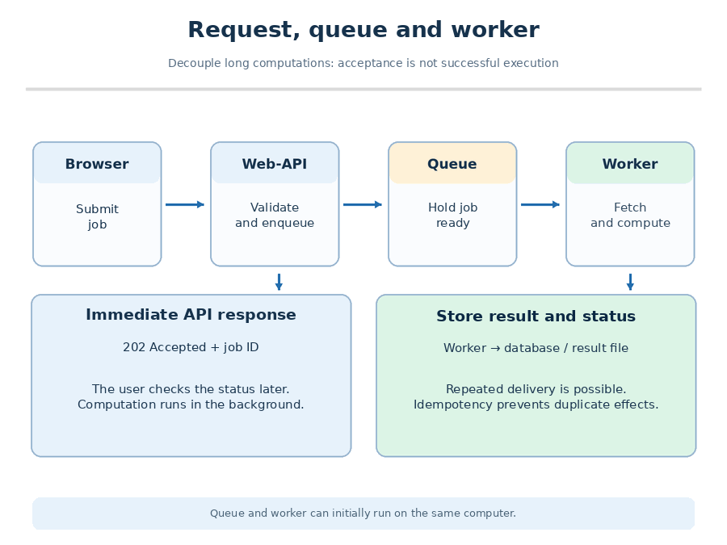

# M1-L4 – Software engineering and system design {#L4}

**Course area:** M1 – Bachelor’s: Foundations of computer science

**Level:** Bachelor’s

**Prior knowledge:** [M1-L1](M1-L1.md) · [M1-L2](M1-L2.md) · [M1-L3](M1-L3.md)

**Further study:** [M1-L5 – Data and databases](M1-L5.md)

## Overview – When a program becomes a long-lived system {#S1}

A small program may consist of a few manageable functions. It reads a file, processes data and displays a result. Later, however, it may need to manage users, communicate with a database, receive updates and be accessible on the internet. The main difficulty is then no longer simply writing a particular algorithm: **The entire system must remain understandable, testable and reliable even after many changes.**

**Software engineering** deals with methods and tools for developing software in a planned manner and maintaining it in the long term. **System design** (software design or architecture) determines the major building blocks, their responsibilities and how they work together. An architecture need not be large: even a small PHP project has an architecture, whether or not it has ever been explicitly documented.

### Initial problem and mini-architecture

``` text
User interface
      │
      ▼
Application logic ──► File or database access
      │
      ▼
Feedback to user
```

As long as these tasks are clearly separated, they can often be adapted independently. If all inputs, database accesses, calculations and presentation are mixed in one large block of code, however, every small change creates greater risk. Software architecture therefore primarily addresses a **maintainability problem**, not necessarily a performance problem.

## Modules, interfaces and abstraction {#S2}

### Modularity: Dividing a system by responsibility {#11-modularität-ein-system-in-verantwortlichkeiten-gliedern}

A **module** is a cohesive software component with as clearly defined a task as possible. A media catalogue might have modules for import, metadata, search and export. They need not be separate programs or servers. A module may simply be a file, a package or a clearly delimited part of the same application.

``` text
Media catalogue (one application)
  ├─ Import: recognise and read files
  ├─ Catalogue: manage entries
  ├─ Search: identify matches
  └─ Export: output selected data
```

This structure is particularly helpful when making changes: if a new import format is added, ideally the search logic should not need to change. A common design goal is **high cohesion** (related tasks stay together) with **low coupling** (few unnecessary dependencies between modules).

**When is it excessive?** A program with ten clear instructions generally does not need an architecture with twelve layers. Too many tiny modules can make navigation as difficult as one enormous block.

### Interfaces: Agreements between components {#12-schnittstellen-verabredungen-zwischen-bausteinen}

An **interface** describes how a component can be accessed and what it returns. It may take the form of a function call within a program or a network connection between different programs.

For example, the search module receives a search term and returns a list of results. The rest of the application does not need to know whether a simple loop or a database index is used internally.

``` text
Interface ──► Search("winter jacket")
                      │
                Search module
                      │
                 Result list
                      │
Interface ◄───────────┘
```

A good interface clearly defines **which inputs are valid, what the result means and which errors can occur**. It makes it possible to change the internal implementation without modifying every caller. The downside is that a poorly chosen interface published too early can make subsequent changes difficult.

### Distinguishing abstraction from encapsulation {#13-abstraktion-und-kapselung-unterscheiden}

**Abstraction** omits details that are unimportant for a particular perspective. For the caller, what matters is 'find a record', not the search algorithm used.

**Encapsulation** restricts direct access to a module's internals. Rather than changing the same internal fields from several places, a defined operation such as 'change status' is used. This is particularly important for shared data, since rules can then be checked in one place.

``` text
Not ideal: Interface ──► internal tables + internal states

Better:    Interface ──► defined catalogue functions
                                      │
                              hidden implementation
```

Encapsulation does not make errors impossible. It does, however, reduce the number of places where business rules can be bypassed.

### Layered architecture: One application, different tasks {#14-schichtenarchitektur-gleiche-anwendung-verschiedene-aufgaben}

A **layer** describes a kind of responsibility. A common but non-mandatory basic model separates presentation, business logic and data access.

``` text
Presentation (HTML / desktop interface)
                │
                ▼
Business logic (rules, validation, calculation)
                │
                ▼
Data access (file, SQLite, external service)
```

If a local tool is later to be offered as a web application, the business logic may be able to remain while the interface is replaced. In practice, this is not straightforward for every program: if file paths, window dialogues and database commands are mixed everywhere, restructuring will require more effort.

**Important:** Layers are not a law of nature. Some applications benefit from a feature-oriented structure in which all parts of a use case are located together. What matters is clear dependencies and boundaries.

## APIs and data formats – Programs communicate with one another {#S3}

An **API** (*Application Programming Interface*) defines how software functions can be used. Within an application this can be a function call; a **web API**, by contrast, is accessible over a network. The 'A' in API does not therefore automatically imply internet access.

A possible web API for a media catalogue might answer the request 'Return the data for entry 4711'. This often happens via **HTTP** (*Hypertext Transfer Protocol*, a web transfer protocol), which we discuss more closely in M1-L6.

``` text
Browser / other program
        │ Request: entry 4711
        ▼
      Web API
        │
        ▼
   Catalogue logic
        │
        ▼
      Database
        │
        └─► Response with data or error message
```

The response requires an agreed **data format**. Examples are **JSON** (*JavaScript Object Notation*, a structured text format), **XML** (*Extensible Markup Language*) and **CSV** (*Comma-Separated Values*, tabular text data). JSON is often suitable for nested objects; CSV for simple tables. The appropriate format depends on the shape of the data and the participants, not on buzzwords.

An API must govern more than the format: which fields are required? Is an identifier a string or a number? What happens when records are missing? Which users may make changes? How do existing clients remain functional when the API changes? These agreements are called an **interface contract**, or simply a *contract*.

**When is it unnecessary?** For an isolated desktop program that reads and writes its own data, a public web API is generally excessive. A clearly defined internal interface can still be useful.

## State machines and events – Making behaviour visible {#S4}

### State machines instead of confusing special cases {#31-zustandsautomaten-statt-unübersichtlicher-sonderfälle}

A **state machine** describes the possible states of a system and the permitted transitions. For example, a background job may be 'new', 'in progress', 'completed' or 'failed'. A completed job must not be arbitrarily reset to 'new' simply because a user refreshes a page.

``` text
         Job received
               │
               ▼
              NEW
               │ Worker takes over
               ▼
          IN PROGRESS
           /       \
  Success /         \ Error
         ▼           ▼
    COMPLETED      FAILED
                      │ Retry according to rule
                      └────────► NEW
```

The advantage is that for every transition it is possible to specify who may trigger it and which data are changed. Such models are particularly useful for orders, payments, uploads and AI processing jobs. The limitation is that a state machine covers only the explicitly modelled cases; real systems may need additional states, such as 'cancelled' or 'awaiting approval'.

### Event processing: 'Something has happened' {#32-ereignisverarbeitung-etwas-ist-passiert}

In **event-driven processing** (*Event-Driven Architecture*), a component reacts to an event that has occurred, such as 'video uploaded'. One component may process the file, another generate thumbnails and a third prepare a notification.

``` text
Upload completed
         │
         ▼
 Event "File arrived"
         │
     ┌───┴──────────┐
     ▼              ▼
Read metadata   Generate preview
     │              │
     └──────┬───────┘
            ▼
          Results
```

This can happen within **one** program, or later via a queue on multiple computers. Event processing and microservices are therefore not the same thing.

**Limitations:** Events may arrive late, more than once or in an unexpected order. A system must then define whether duplicate processing is permitted. For a very simple action that can be performed immediately, a direct function call is usually clearer.

An important protective concept is **idempotence**: if the same operation is executed again because of a repeated message, this must not produce an unintended second business effect. For example, an upload with the unique job identifier `4711` is reported twice. The program checks the identifier and does not accidentally create two chargeable processing jobs. This can be implemented using unique keys, controlled state transitions or a separate processing history. Idempotence does **not** mean that every technical intermediate step is executed only once; what matters is that the business result remains correct when the operation is repeated.

**Concurrent retries:** Simply asking 'Has job 4711 already been completed?' before writing is not always sufficient: two workers might read 'no' at the same time and then both create a new job. If protection relies on a database, a **unique key with an atomic insert attempt** followed by a state check can, for example, prevent a duplicate *local* change. This does not yet guarantee exactly one external payment, email or other effect; additional idempotency keys of the target system or an appropriate distributed workflow may be required. For further study, see [M4-L1](M4-L1.md) and [M1-L5](M1-L5.md).

## Tests – Checking requirements without claiming the absence of errors {#S5}

Software contains errors even when developed carefully. Tests can compare **specifically observed behaviour** with requirements and reduce risks; however, they do not normally prove that a complex system is free from errors in every conceivable situation. A passed test is evidence for the cases tested, not a general proof of correctness (see [M7-L2](M7-L2.md)).

| Type of test | Primarily checks | Example | Typical limitation |
| --- | --- | --- | --- |
| **Unit test** (component test) | Small function or unit | Does the filter sort the results correctly? | Often does not detect interaction errors |
| **Integration test** | Interaction between real components | Does the application store a record and read it back correctly? | Requires more infrastructure and maintenance |
| **End-to-end test** (E2E) | A complete workflow | A user signs in and exports a report | Slower, may be vulnerable to environmental problems |
| **Contract test** | Agreed API structure | Are the required fields present in a response? | Does not automatically check all business logic |
| **Security testing** | Selected vulnerabilities | Is unauthorised access to other users' data blocked? | No substitute for secure architecture or ongoing maintenance |

A **regression test** checks whether a change has inadvertently broken behaviour that already worked; it may consist of several of the types of tests mentioned above. A realistic collection of tests covers, as far as possible, normal cases, edge cases and error paths: empty inputs, invalid identifiers, interrupted connections and unexpected data.

### Mini-workflow

``` text
 Change to program
         │
         ▼
Small tests ──► Integration tests ──► A few important complete workflows
         │                                │
         └───────── Error? ───────────────┘
                      │
                      ▼
                   Fix cause
```

**When is it excessive?** A short-lived personal utility script may not need a fully automated E2E testing infrastructure. Nevertheless, even a small reproducible test case can prevent the same error recurring. Systematic testing becomes considerably more important for paid services and other users' data.

## Version control and deployment – Keeping changes manageable {#S6}

### Git and versions {#51-git-und-versionen}

**Version control** records changes to files so that they can be traced. **Git** is a widely used distributed version control system. A **commit** records a particular state of changes. A **branch** allows work on a variant without immediately changing the main line of development. A **release version**, by contrast, is a deliberately published state of the software; it need not coincide with every commit.

``` text
Stable version ───────────► New release
       │                        ▲
       └─► Development branch ──┘
             Check changes
```

This does not automatically prevent bad changes, but it makes them visible and, if necessary, reversible. Git is not a substitute for external backups and does not store ongoing database transactions.

### CI: Checking changes automatically {#52-ci-änderungen-automatisch-prüfen}

**CI** (*Continuous Integration*) describes frequently merging and automatically checking code changes. After a change, a service can, for example, build the software, run tests and warn of notable problems. This is particularly useful when several developers are involved, but can also relieve individual developers of recurring checks.

``` text
Change in Git
      │
      ▼
Automated build
      │
      ▼
Tests / checks
      │
      ├─ Failure ──► Revise change
      │
      └─ Success ─► Release possible
```

**CD** is ambiguous and should be specified more precisely:

- **Continuous Delivery** means that a checked version can be released with little additional effort; the actual release may deliberately remain manual.
- **Continuous Deployment** means that changes which pass the specified checks are automatically deployed to production.

An automated pipeline is a chain of such steps, not necessarily a large cloud system. The official GitHub Actions documentation describes CI checks, automated deployments and approval gates. It is a **product example**, not the definition of the general principles.

**Operational risks:** A green test indicator means only that the defined checks were passed. Faulty checks, compromised dependencies or inadequate release permissions remain possible. Uncontrolled automatic production deployment can distribute an error to all users very quickly. For a small local tool, manually tested, versioned releases are often sufficient.

## Monoliths and microservices – An architectural decision, not a ranking of progress {#S7}

A **monolith** is an application built and deployed as a single unit. This initially says nothing about how well it is organised internally. A well-structured monolith may consist of many clearly separated modules.

**Microservices**, by contrast, are multiple smaller services separated according to business responsibilities, which can be deployed independently and usually work together via network interfaces.

### Two variants of the same business task

``` text
VARIANT A – MODULAR MONOLITH

Browser ──► [Web application: User | Catalogue | Search]
                                  │
                               Database

VARIANT B – MICROSERVICES

Browser ──► [API entry point]
                │
          ┌─────┼────────┐
          ▼     ▼        ▼
        User Catalogue Search
          │     │        │
        separate responsibilities / data access
```

| Question | Modular monolith | Microservices |
| --- | --- | --- |
| Changes to several business areas | Often possible in a single release | Independent releases possible; coordination may be necessary |
| Network communication between modules | Often local function calls | Additional network failures and latency |
| Operations | Fewer separate services | More deployments, access permissions and monitoring |
| Scaling | Often the entire application initially | Individual services can be scaled as appropriate |
| Data consistency | Often easier within one database transaction | More difficult across service boundaries |
| Small individual developer projects | Often very appropriate | Frequently unnecessary effort |

**When do microservices help?** For example, when different teams need to work independently or one part consistently has markedly different performance and availability requirements. **When are they less suitable?** When an individual developer offers a manageable online tool with a limited number of users. Here, a simple, cleanly modularised monolith often provides greater benefit.

The architecture author Martin Fowler describes both benefits such as independent deployment and costs arising from distributed data storage and more complex operations. This implies **no universal rule**, but an important warning: many small services are not automatically better than one carefully developed program.

## Maintainability, technical debt and documentation {#S8}

**Maintainability** describes how easily a system can be understood, corrected, tested and extended. This includes meaningful names, manageable modules, clear error handling, a clear data structure and brief documentation of important decisions.

**Technical debt** consists of deliberate or unintentional shortcuts that may make future changes more expensive. For example, owing to time constraints, every part of a program accesses database tables directly. This works initially but makes a later change to the data structure expensive. Not every simple solution is technical debt: simplicity may be precisely what makes an architecture more durable.

``` text
Quick workaround
       │
       ▼
Less development effort in the short term
       │
       └─► If repeated frequently:
             Changes become riskier
             Testing becomes more demanding
             Restructuring becomes more expensive
```

Useful documentation need not be a large collection of texts. An architectural overview, the major interfaces, data formats, known limitations and the reasons for unusual decisions are often enough. Documentation itself has maintenance costs: outdated instructions can be more harmful than brief, up-to-date notes.

## Security begins with design {#S9}

Security is not a problem only when software becomes publicly accessible on the internet. System design should already establish which data need protection and who may perform which actions.

- **Authentication** establishes who is signing in.
- **Authorisation** establishes which actions that user may perform. Successful authentication does not automatically grant access to every record.
- **Least privilege** means that modules and users receive only the permissions they need.
- **Input validation** checks whether received data have the expected types, sizes and values; it does not replace appropriate security measures such as parameterised database queries.
- **Secrets** such as access tokens and passwords must not be hard-coded in published source code or included in logs.
- **Secure defaults** ensure that unnecessary features and permissions do not have to be disabled retrospectively.

### Mini-architecture: No direct access to other users' data

``` text
Authenticated user
        │ Request for record 4711
        ▼
   Web application
        │
        ▼
Check: May this user read 4711?
       / \
     yes  no
     │      │
     ▼      ▼
 Response  Access denied
```

These principles are also stated in the OWASP guidelines (*Open Worldwide Application Security Project*, an international security project). For a purely local data converter some measures are simpler, whereas for a public multi-user system they are indispensable. A security concept must also take into account updates, backups and incident response.

## Three practical scenarios – From a desktop tool to an online service {#S10}

### Example A: Local media catalogue

You have a tool that recognises video files, imports metadata and exports a report. A sensible architecture could comprise an import module, catalogue logic, search and export. Everything runs in a single process and can use a local file or SQLite database. Neither a web API nor containers nor microservices are needed.

### Example B: The same tool as a paid online service

Later, other users access it via a browser. The system now needs a web interface, protected sign-in, access rules, reliable data storage and a process for deploying new versions. This is often still possible as **one** application with a database.

``` text
Browser ──► Web application
                 │
           ┌─────┴───────┐
           ▼             ▼
      User permissions  Catalogue logic
                         │
                      Database
```

Operating costs arise: hosting, backups, security updates, possibly email delivery, support and legal obligations. The architecture should enable such tasks, not make them more difficult through unnecessary technical diversity.

### Example C: Background AI jobs

An application processes uploaded images with a local or remote AI model. Such computations sometimes take longer than an ordinary web request. A **background worker** can then be useful, processing jobs independently of the web interface.

``` text
Browser ──► Web application ──► Job list
                                 │
                                 ▼
                             AI worker
                                 │
                                 ▼
                             Result file
```

Multiple servers are not immediately required for this: initially, the web application and worker can run on the same computer. Only higher loads or differing hardware requirements make separation worthwhile. Details on queues, retries and distributed operations follow in M4-L1 and M6-L6.



*Figure: Schematic workflow of a longer job: for example, the API can return **202 Accepted** and a job identifier before execution is complete. The status is queried later. Whether the queue provides persistent storage and how it redelivers jobs after failures depend on the specific implementation; idempotence for repeated effects must be ensured separately (see M4-L1).*

## Decision guide – How much architecture is appropriate? {#S11}

| Situation | Often a good starting point | Reason for expansion |
| --- | --- | --- |
| A small utility program | A few clear functions | Recurring extensions and shared rules |
| Medium-sized desktop catalogue | Modules with defined interfaces | Very different access methods or data sources |
| A small web application | Modular monolith | Separate teams, substantial differences in load or particular availability requirements |
| Public API | Clear contract, permission checks, tests | Many independent integrations and versions |
| Time-consuming AI processing | Background job and worker | Multiple computers or GPU types, queues, fault tolerance |

**Guiding question:** What specific problem does the additional layer, service or automation solve? If no credible answer can be found, the more complex technology is probably not needed yet.

## Summary and transition {#S12}

1.  **Modularity, abstraction and encapsulation** help manage the internal complexity of an application.
2.  **Interfaces and data formats** make collaboration between components verifiable; an API is not necessarily an internet service.
3.  **State machines and events** describe when particular processing is permitted or triggered.
4.  **Tests, version control and CI/CD** help check and deploy changes in a traceable way; they do not guarantee the absence of errors.
5.  **Monoliths and microservices** are different organisational solutions. For small applications a modular monolith can be simpler and more economical in the long term.
6.  **Maintainability and security** belong in the design from the outset, not just when fixing errors after launch.

**Next lesson: [M1-L5 – Data and databases](M1-L5.md).** There we consider how data can be stored reliably, linked together, indexed and changed in transactions – a foundation for later cluster and cloud databases.


## Sources {#S13}

**Last source review:** 03.11.2026

**Source review:** 03.11.2026; additions on idempotence and the interpretation of tests on 05.11.2026. General architectural principles are stable over time; product details concerning GitHub Actions and security guidelines were checked against the official documentation current at that time. Examples and diagrams are simplified for teaching purposes.

- GitHub Docs, *Continuous integration* (CI, builds, tests): [https://docs.github.com/en/actions/get-started/continuous-integration](https://docs.github.com/en/actions/get-started/continuous-integration)
- GitHub Docs, *Continuous deployment* (automated deployment, approvals): [https://docs.github.com/en/actions/get-started/continuous-deployment](https://docs.github.com/en/actions/get-started/continuous-deployment)
- GitHub Docs, *Understanding GitHub Actions* (workflow, build/test/deployment pipeline): [https://docs.github.com/en/actions/get-started/understand-github-actions](https://docs.github.com/en/actions/get-started/understand-github-actions)
- Martin Fowler, *Microservice Trade-Offs* (benefits and operating costs of distributed services, 2015): [https://martinfowler.com/articles/microservice-trade-offs.html](https://martinfowler.com/articles/microservice-trade-offs.html)
- Martin Fowler, *Monolith First* (caution when splitting small applications early, 2015): [https://martinfowler.com/bliki/MonolithFirst.html](https://martinfowler.com/bliki/MonolithFirst.html)
- OWASP Cheat Sheet Series, *Secure Product Design* (security in design): [https://cheatsheetseries.owasp.org/cheatsheets/Secure_Product_Design_Cheat_Sheet.html](https://cheatsheetseries.owasp.org/cheatsheets/Secure_Product_Design_Cheat_Sheet.html)
- OWASP Cheat Sheet Series, *Authorization* (permission checking and least privilege): [https://cheatsheetseries.owasp.org/cheatsheets/Authorization_Cheat_Sheet.html](https://cheatsheetseries.owasp.org/cheatsheets/Authorization_Cheat_Sheet.html)
