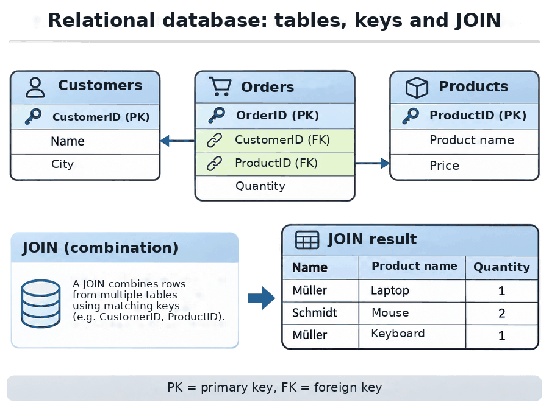
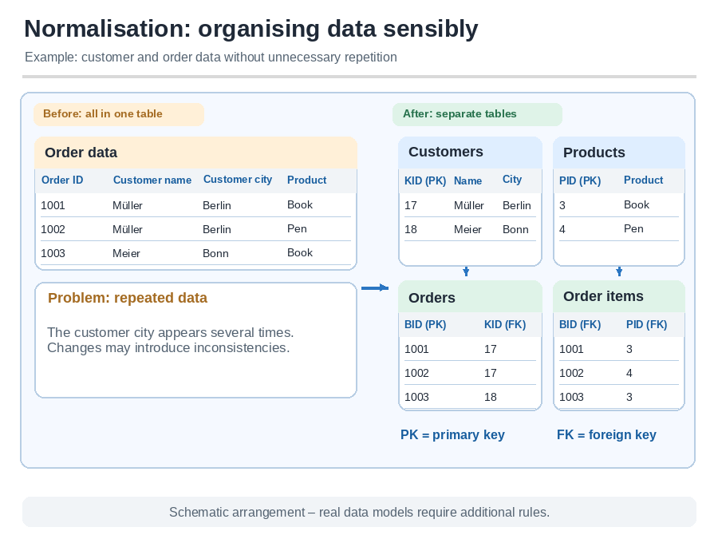

# M1-L5 – Data and databases {#L5}

**Course area:** M1 – Bachelor’s: Foundations of computer science

**Level:** Bachelor’s

**Prior knowledge:** No fixed prerequisites specified.

## Overview: Why data management is more than saving a file {#S1}

An application often needs not only to *calculate* something but also to *remember* something: users' names, the properties of a video, the contents of an order, or the processing status of an AI job. This information should remain available after the program has ended. It must also be retrievable, modifiable and — where there are multiple users — as consistent as possible.

All information could be stored in text files. This works for small, manageable programs. It becomes more difficult when many entries are related, are changed simultaneously, or when a request such as “Show the twenty most recent videos in this category, but only those not yet processed” must be answered quickly. **Database systems do not simply solve the problem of storage; they bring together methods for structured access, integrity and controlled changes.**

This lesson covers files, relational databases, data models, keys, the SQL query language, indexes, transactions and alternatives such as document and key–value stores. Distribution across multiple servers is *not* yet the subject: that is covered in detail in lessons M3-L1–M3-L6.

## Files, databases and database management systems {#S2}

A **file** is first of all a unit that a file system manages persistently. CSV (*Comma-Separated Values*, a simple text-based tabular format), JSON (*JavaScript Object Notation*, a structured text format) and Markdown are possible file contents. They are often ideal for exporting, exchanging, configuring or archiving documents.

A **database** is an organised collection of related data. The **database management system (DBMS)** is the software that manages these data: it receives queries, reads and writes data, checks certain rules and organises access. In everyday language both are often referred to together as a “database”.

``` text
Application
    │  "Find media with tag X"
    ▼
Database management system (DBMS)
    │  Search, permissions, integrity, writes
    ▼
Persistent data (file(s), storage structures, indexes)
```

**Important:** The distinction between a file and a database is not a physical either-or question. For example, an SQLite database is often itself a file on the storage medium. The difference lies in the rules and functions used to manage that file.

### When is a file sufficient?

Markdown files are particularly suitable for our course: each lesson is a self-contained text, easily backed up and readable without special software. An SQLite database for all the teaching texts would offer additional benefits only if, for example, we wanted to manage complex links, a search index or individual reading progress. It need not therefore become the authoritative content source.

A small local program with a rarely changed list can also use a JSON or CSV file. A database becomes valuable when multiple properties, relationships, queries and simultaneous changes must be systematically coordinated.

## The relational model: tables, rows and columns {#S3}

In a **relational database system**, data are logically organised as relations — usually called tables in everyday language. A table contains rows (records) and columns (properties). The tables follow a defined schema.

Example of a media catalogue:

**Table `Medien`**

    medien_id titel             jahr status
  ----------- --------------- ------ ---------
          101 Wintervideo       2025 geprüft
          102 Stadtaufnahme     2026 offen
          103 Kurzfilm          2024 geprüft

The `medien_id` identifies the record. Two media items may have the same title; the ID should nevertheless be unique.

**A schema** specifies which tables, columns, data types and rules are provided. For example, a year can be defined as an integer, the title as text and an ID as a unique key. A schema does not replace every domain-specific check: a numeric field, for example, does not automatically prevent an implausible year value unless an appropriate rule is in place.

The decisive advantage is that the DBMS can answer structured questions without the application having to inspect every file and record manually.

## Keys, relationships and referential integrity {#S4}

A **primary key (Primary Key)** uniquely identifies a row within a table. A **foreign key (Foreign Key)** refers to a corresponding key in another table. Foreign keys can enforce relationships: an order, for instance, may refer only to an existing customer.

Suppose a media catalogue is also to contain channels:

``` text
Channels (Kanäle)
  kanal_id = 7, name = "Technik"
  kanal_id = 8, name = "Natur"
          │
          │ One channel can contain several media items
          ▼
Media (Medien)
  medien_id = 101, kanal_id = 7
  medien_id = 102, kanal_id = 7
  medien_id = 103, kanal_id = 8
```

`kanal_id` is the primary key in the `Kanäle` table and a foreign key in the `Medien` table. Consequently, the channel name need not be stored again in every media row.

There are different relationship types:

- **One-to-one (1:1):** A user has exactly one associated profile entry — *if that is how the domain is defined*.
- **One-to-many (1:n):** A channel contains many media items; in this simplified model, a media item belongs to one channel.
- **Many-to-many (n:m):** A media item can have several tags, and a tag can occur on many media items. This relationship is normally represented using a separate association table, `Medien_Tags`.

**Referential integrity** prevents references to non-existent records, provided that the corresponding rules are enabled and modelled correctly. The consequences of deleting a linked entry must be explicitly decided: prohibiting deletion, removing references or also deleting dependent records are different options with different risks.

**SQLite-specific detail:** SQLite supports foreign keys, but enforcement is not automatically enabled in typical configurations. Applications should explicitly set and check the desired setting for their connections. PostgreSQL uses different defaults here. Such details are a good illustration of why *the relational model* and *a particular database product* are not the same thing.

## SQL: The language is not the database system {#S5}

**SQL** stands for *Structured Query Language*. SQL is a language used particularly to define, query and modify relational data. **SQLite, PostgreSQL, MySQL and Oracle Database, by contrast, are particular database systems** that support SQL — with different extensions, type rules, features and operating models.

The product name **Oracle Database** refers to a specific database system; **Oracle** alone may also refer to the company or other Oracle products, depending on the context.

SQL is primarily **declarative**: one describes *which* records are wanted, rather than the exact sequence of access steps. The DBMS chooses an execution plan for this purpose.

Three short examples to read (not an exercise):

``` sql
SELECT titel, jahr FROM Medien WHERE status = 'geprüft';
```

This means: return the title and year of records whose status is “geprüft” (checked).

``` sql
INSERT INTO Medien (medien_id, titel, jahr, status)
VALUES (104, 'Archivfilm', 2023, 'offen');
```

This inserts a new record. A real schema may require additional columns and rules; the examples serve only to help readers understand the language.

``` sql
UPDATE Medien SET status = 'geprüft' WHERE medien_id = 104;
```

This changes the status of the selected media item. The `WHERE` condition is especially important: without an appropriate restriction, an update statement might affect very many rows.

Overview of important SQL keywords: `SELECT` (query), `INSERT` (insert), `UPDATE` (modify), `DELETE` (delete), `WHERE` (condition), `JOIN` (combine tables), `ORDER BY` (sort), `GROUP BY` (group). Here too, the exact range of features depends on the particular system.

## Queries across relationships: the JOIN {#S6}



*Illustration: A simplified example combining customers, orders and products. The result rows are illustrative sample data.*

One of the great strengths of relational databases is the targeted combination of information from multiple tables. A **JOIN** combines rows according to a specified relationship.

Example: `Medien` contains `kanal_id`; the name appears only in `Kanäle`. The question “Which channel does this media item belong to?” can connect the two tables.

``` text
Table Medien                      Table Kanäle
medien_id | kanal_id              kanal_id | name
101       | 7                 ───► 7        | Technik
102       | 7                 ───► 7        | Technik
103       | 8                 ───► 8        | Natur
                   │
                   ▼
Result: media item 101 – Technik, media item 102 – Technik, ...
```

The DBMS can thus return a combined answer without storing the channel name again in each media record. Different types of JOIN determine whether only matching rows or also entries without a counterpart are included.

**Limitation:** With very large amounts of data or poorly chosen queries, JOINs can be expensive. Across multiple *separate database servers*, they are particularly challenging — a topic of the later lesson on sharding, M3-L3.

## Data modelling and normalisation {#S7}

**Data modelling** means specifying which objects an application knows about, what properties they have and how they are connected. This already determines whether a database will remain comprehensible and reliable later.

{alt="Example of database normalisation: a table with repeated customer details is split into separate customer, product, order and line-item tables with primary and foreign keys."}

Avoid repeated customer data: separate tables and key relationships facilitate consistent changes.

A poor media model might store all tags as text in one field: `technik, video, berlin`. This initially seems simple. It becomes more difficult to search reliably for individual tags, standardise spellings or rename a tag.

A more structured model separates `Medien`, `Tags` and `Medien_Tags`. Each tag is then recorded once and can be assigned to multiple media items through associations.

**Normalisation** is the systematic organisation of relational data in order to avoid unnecessary repetition and certain kinds of update error. Consider these examples:

- **Insertion anomaly:** A new channel might require a fictitious media record if the channel and the media item are inseparable in one table.
- **Update anomaly:** A channel name appears one hundred times in the table and is changed in only 99 rows.
- **Deletion anomaly:** Deleting the last media item accidentally removes the only information about the channel as well.

The **normal forms** are a widely used guide for modelling. In the classical relational interpretation, first normal form requires clearly delimited, atomic values according to the data model. Higher normal forms address dependencies on keys and among attributes. A formal theory of proofs is not initially necessary to understand this; the underlying problem of inconsistent information stored multiple times is what matters.

**When can less normalisation make sense?** For frequently required read views or reports, derived values or summaries are sometimes deliberately maintained. This **denormalisation** can speed up queries, but creates additional synchronisation obligations. Not all duplication is an error; uncontrolled duplication is risky.

## Indexes: Why millions of records remain searchable {#S8}

An **index** is an additional data structure that speeds up access to particular columns or values. It can be compared to the subject index at the back of a textbook: to find pages on a particular term, one need not read the entire book from the beginning.

Suppose the media table contains several million rows. Without a suitable index, a system must examine very many rows for some queries. An index on `medien_id`, `kanal_id` or frequently searched properties can help it find matching entries considerably faster.

``` text
Without a suitable index:             With a suitable index:
Query                                 Query
   │                                     │
   ▼                                     ▼
Examine many table rows              Search index for value
   │                                     │
   ▼                                     ▼
Matches                               Reference to matching rows
```

Many database systems use variants of **B-trees** for ordinary indexes, supporting ordered searches. This is not the same as simple binary search in an array, but it follows a similar principle: checking each entry individually is avoided. Hash-based structures are also possible for certain systems and queries.

The **query planner** or optimiser estimates an efficient way to execute a query. It can use indexes, but need not choose them for every query. For small numbers of rows or very many matches, a table scan may be cheaper.

### The cost of an index

Indexes consume additional storage space and must be maintained when affected records are inserted, changed or deleted. Many indexes can slow down write operations. Furthermore, not every index helps every query: the order of columns, filters, data distribution and sorting influence its use.

**Practical consequence:** An index is a targeted response to recurring access requirements, not a universally free speed boost. A query plan can help determine which query is actually slow. The details follow in M3-L1.

## Transactions: Treating related changes as a unit {#S9}

A database system must not only find the correct row but also handle related changes reliably. This is the purpose of **transactions**.

Consider a booking: a customer receives a paid service. The system should record both a payment entry and the activation of the customer's access. If only one of these steps is stored, an inconsistent state can arise.

``` text
                   Transaction
                        │
            ┌───────────┴───────────┐
            ▼                       ▼
       Record booking          Activate access
            │                       │
            └───────────┬───────────┘
                        ▼
              All steps successful?
                  /          \
                yes           no
                 │             │
                 ▼             ▼
           COMMIT: keep  ROLLBACK: undo
```

For a course booking, the abbreviation **ACID** can be understood through four questions. A seat reservation and its associated reservation record are stored in the same database.

1.  **What happens if saving fails halfway through? Atomicity.** The reserved seat and the reservation record belong to the same booking. If recording fails, the seat reservation is also undone.
2.  **Which states may the booking leave behind? Consistency.** A valid seat must exist for every reservation record. This rule can be enforced with a foreign key. The application must implement other domain-specific rules so that every successful booking complies with them.
3.  **What happens when users compete for the final seat? Isolation.** Two orders arriving simultaneously should not both receive the last seat. The isolation level determines which intermediate states each booking may see. Unique allocation also requires a suitable rule and an appropriate booking procedure.
4.  **What remains after a restart? Durability.** After a confirmed commit, the booking must survive a failure insofar as the system's promised durability guarantee covers it.

Further reading: [Theo Härder and Andreas Reuter, Principles of Transaction-Oriented Database Recovery (1983), section 1.1](https://doi.org/10.1145/289.291). The [PostgreSQL documentation on transactions](https://www.postgresql.org/docs/current/tutorial-transactions.html) demonstrates the use of `COMMIT` and `ROLLBACK`.

**Limitation of a local database transaction:** In the teaching example above, the **payment booking as a database entry** and the **internal activation** are two changes to the same database. A local transaction may be suitable for this. An actual charge at an external payment provider, a sent email or a change in a second independent database, however, is **not** undone simply because the local database executes `ROLLBACK`. Such cross-service processes require their own failure models, idempotency and, where appropriate, patterns such as a **transactional outbox** (storing the local change and the intention to send together) or a **saga** (a sequence of local steps with defined compensating actions). An outbox provides a more reliably traceable notification path, not automatically exactly-once delivery to the recipient. These topics are discussed in detail in [M3-L5](M3-L5.md) and [M4-L1](M4-L1.md).

**An important conceptual pitfall:** The “C” in ACID does not mean that data are always automatically *factually true*. If an application writes an incorrect price and no appropriate rule exists, the transaction does not make it correct. Consistency refers to defined rules and database invariants.

Likewise, “durability” does not mean that data are protected against every disaster, deliberate deletion or the loss of all storage media. Backups and recovery procedures remain necessary.

## Many users simultaneously: isolation and conflicts {#S10}

In multi-user operation, two processes may read or modify the same record at the same time. A typical error is the **lost update**:

``` text
Stock: 10 items

User A reads 10             User B reads 10
A plans: 10 - 2 = 8         B plans: 10 - 3 = 7
A saves 8                   B saves 7

Result: 7 – but 5 items were actually removed.
```

A database can provide various mechanisms for handling such conflicts in a controlled manner: locks, version checks or suitable isolation levels. However, the particular application must also be designed correctly. Two logically separate read and write operations do not automatically constitute a safe stock change.

Some database systems use **MVCC** (*Multi-Version Concurrency Control*). Readers and writers can access different versions of a record, so readers need not always wait for every writer. PostgreSQL is a well-known example. The view a transaction receives and the conflicts that can occur, however, depend on the isolation level and the particular implementation.

**Avoid overengineering:** A single desktop tool whose writes are controlled by only one process rarely needs the same concurrency mechanisms as an online booking system with thousands of simultaneous users. Transactions remain useful locally; complex distribution and complicated conflict resolution do not always do so.

## What types of databases are there? {#S11}

A relational database is not the only possible form of data management. The umbrella term **NoSQL** is often interpreted as *Not Only SQL* and encompasses various models that do not primarily rely on classical relational tables and SQL. It is not a uniform technical architecture and does not automatically mean “without SQL”, “faster” or “arbitrarily scalable”.

  Model               Basic idea                                                       Often suitable tasks                                    Typical disadvantages
  ------------------  ---------------------------------------------------------------  ------------------------------------------------------  ------------------------------------------------------------------------------------
  Relational          Tables with relationships, structured queries and transactions   Customers, orders, catalogues, bookings                 Schema and relationships require design; large-scale distribution may be difficult
  Document-oriented   Entries as related documents with fields and substructures       Flexible content objects, varying metadata              Shared data may be duplicated; plan relationships and updates carefully
  Key–value           A key points directly to a value                                 Cache, session data, simple status and mapping values   Complex queries often limited or possible only with additional structures
  Graph-oriented      Relationships as edges between nodes are central                 Highly connected recommendations, dependency analysis   Additional operation and a different query model; not necessary for every list
  Time-series         Data points are organised by time                                Sensor data, measurements, monitoring                   Specialised model, often a supplementary system rather than a universal replacement

These categories are not exclusive. Modern database systems often support multiple data types and access methods. For example, a relational database can also store JSON data; conversely, document-oriented systems can provide complex queries.

**Guiding question:** What data relationships and correctness requirements actually exist? Not: Which database sounds particularly modern?

## Distinguishing SQLite, PostgreSQL, MySQL and Oracle correctly {#S12}

The most important differences concern not only the query format but also the **operating model** and the available features:

  System                Typical characteristics                                                                      Classification
  --------------------  -------------------------------------------------------------------------------------------  -----------------------------------------------------------------------------------------------------------------------------------------------------------------------------
  **SQLite**            An SQL database embedded in an application; often a local database file                      Very suitable for local tools, mobile applications, smaller services and self-contained archives; particular limits for concurrent writes and spatially separated components
  **PostgreSQL**        Standalone relational database server with extensive SQL, integrity and extension features   Particularly suitable for multi-user applications and server-side systems; server operation or a managed service required
  **MySQL**             Widely used relational database server                                                       Common in web applications; properties depend on the version, table engine and configuration
  **Oracle Database**   Comprehensive commercial relational database system                                          Common in demanding enterprise environments; licensing, operating and product decisions can be complex

**SQLite is not automatically a “toy database”.** It supports SQL, indexes and transactions, and can be very reliable in its appropriate area of application. A single server can indeed run a web application with a local SQLite database. If many separate computers are to work directly on the same data store at the same time, a client–server system is often more appropriate.

**PostgreSQL is not automatically a cluster either.** A single PostgreSQL instance initially runs on one server. Replication, high availability and sharding are additional concepts and are addressed separately in module M3. The same applies to Oracle Database: the basic product must be distinguished from vendor-specific clustering and sharding features.

## What happens when the database reads and writes? {#S13}

The exact internals differ between database systems. A typical sequence can be imagined as follows:

``` text
                    Web application
                         │
                     SQL query
                         ▼
              Database server / DBMS
                         │
                Check / optimise
                         │
                  Execution plan
                         │
             ┌───────────┴───────────┐
             ▼                       ▼
          Cached data           Index / storage
             └───────────┬───────────┘
                         ▼
                     Result set
                         │
                         ▼
                    Web application
```

When writing, depending on the schema and configuration, the system checks data types, keys and other rules, among other things. Transaction and logging mechanisms help store confirmed changes in a traceable and failure-resistant manner. Some systems first write to a **write-ahead log (WAL)**, a log recorded in advance from which changes can be recovered after a crash. It does **not** follow that a WAL is a substitute for backups.

More RAM can speed up frequent read accesses. The number of concurrent writes, storage performance and expensive queries can, on the other hand, impose limits. In M3-L1–M3-L5 we learn why “more servers” does not automatically mean “more writable copies of the same data”.

## Security, backups and ongoing responsibility {#S14}

Even the best database structure is not a complete operating concept. For data that are important or personal, at least these questions remain:

- **Access:** Which application and which person may view and modify which data? The web application's permission checks must remain effective right down to data access.
- **Input:** Parameterised queries prevent user input from being interpreted as SQL program text. A database alone does not eliminate insecure application logic.
- **Loss:** What happens in the event of operator error, damaged storage media, malware or a faulty update? A backup must be independently and verifiably recoverable.
- **Changes:** How are schema changes and migrations checked before a new software version uses existing data?
- **Privacy:** Which data are actually needed, how long are they stored, and how are they deleted or exported when necessary? Specific legal requirements depend on the use case.
- **Costs:** Storage, database servers, backups, monitoring, maintenance and potentially a managed database service require resources.

Especially important: **A database replica is not a backup.** If a record is accidentally deleted, the deletion can propagate to other copies. In M3-L2 and M3-L6 we discuss these differences in detail.

## Three practical scenarios {#S15}

### Scenario A – Local media catalogue

A local PureBasic or PHP tool records files, titles, tags, publication dates and processing statuses. A single SQLite database is often a good starting point. The tables can store media, tags and relationships separately. The user does not need a database server on the internet. Regular, consistent backups of the database file remain necessary.

### Scenario B – Small online service

A customer signs in and manages records through a browser. The web application checks permissions; the database provides query, integrity and transaction functions.

``` text
Browser → web application → permission check → database
                                                  │
                                           Tables and indexes
```

Such a service can initially be operated as one application plus one database. Whether SQLite is sufficient or PostgreSQL is more suitable depends, among other things, on write behaviour, operation and backup strategy. **Multi-user capability alone does not yet require a database cluster.**

### Scenario C – AI job management

An online service receives images, creates jobs in a database and has them processed by a separate worker. The database keeps the status, user association and references to result files; large image or video files can be stored alongside it in a suitable file store.

``` text
User → web application → job database
                              │
                              ▼
                          AI worker
                              │
                              ▼
                          Result file
                              │
                              ▼
                       Status in database
```

If the worker is interrupted, the application must define whether a job is restarted and how duplicate processing is avoided. This already forms a bridge to queues, idempotent operations and distributed systems in M4-L1 and M3-L5.

## Decision guide: When is what unnecessary? {#S16}

  Starting situation                         Sensible starting point                                     Often unnecessary
  -----------------------------------------  ----------------------------------------------------------  ------------------------------------------------------------------
  Reading course with versioned chapters     Markdown as source, optionally a search index later         Server database for every section of text
  Small personal tool                        File or SQLite                                              Network cluster, sharding
  Web application with manageable usage      One application service with one database                   Several independent database nodes from the outset
  Closely related domain-specific bookings   Relational database and well-designed transactions          Replacement with unstructured files without integrity rules
  Large streams of measurements              Suitable schema; possibly a specialised time-series store   Automatically adopting any “NoSQL” system without analysing needs

There is no product-independent rule of the form “from 1,000 users onwards, database X must be chosen”. What matters is query patterns, concurrent writes, required correctness, operation, expertise and cost.

## Summary and transition {#S17}

1.  Files are often sufficient. A DBMS is worthwhile when structured queries, relationships, concurrent changes and integrity rules become important.
2.  **Tables, primary keys and foreign keys** make relationships verifiable. A well-designed data model prevents many later errors.
3.  **SQL is a language, not a database system.** SQLite, PostgreSQL, MySQL and Oracle Database implement it in different ways.
4.  **Indexes** speed up suitable reads, but require storage and additional work when writing.
5.  **Transactions and ACID** describe properties of related changes; they guarantee neither correct business logic nor protection against every kind of data loss.
6.  **NoSQL** is not a single approach or an automatic upgrade. The data structure should suit the actual problem.
7.  For local tools or small online services, **one** database is often sufficient. Scaling across multiple servers requires additional concepts and introduces new sources of failure.

**Next lesson: [M1-L6 – Networks and security](M1-L6.md).** There we clarify how multiple computers exchange data, how browsers find a server and why secure transport connections, authentication and authorisation belong together. Later, [M3-L1](M3-L1.md)–[M3-L6](M3-L6.md) explore database topics in more depth, including replication, sharding and distributed transactions.


## Sources {#S18}

**Last source check:** 03.11.2026

**Source check:** 03.11.2026; contextualisation of external side effects on 05.11.2026. Technical foundations are largely stable over time; product-specific statements have been checked against vendor and project documentation. The schema and architecture examples are simplified for teaching purposes and are not directly executable production configurations.

- SQLite – *Appropriate Uses For SQLite* (file/embedded database and client–server distinction): [https://www.sqlite.org/whentouse.html](https://www.sqlite.org/whentouse.html)
- SQLite – *Query Planning* (indexes, query plans, search and sorting behaviour): [https://www.sqlite.org/queryplanner.html](https://www.sqlite.org/queryplanner.html)
- SQLite – *Foreign Key Support* (relationships and enabling foreign key enforcement): [https://www.sqlite.org/foreignkeys.html](https://www.sqlite.org/foreignkeys.html)
- SQLite – *Transaction* (transaction control and concurrent access): [https://www.sqlite.org/lang_transaction.html](https://www.sqlite.org/lang_transaction.html)
- PostgreSQL – *Tutorial: The SQL Language* (SQL, JOIN and tables): [https://www.postgresql.org/docs/current/tutorial-sql.html](https://www.postgresql.org/docs/current/tutorial-sql.html)
- PostgreSQL – *Constraints* (primary and foreign keys, rules): [https://www.postgresql.org/docs/current/ddl-constraints.html](https://www.postgresql.org/docs/current/ddl-constraints.html)
- PostgreSQL – *Concurrency Control / MVCC* (concurrent read and write operations): [https://www.postgresql.org/docs/current/mvcc-intro.html](https://www.postgresql.org/docs/current/mvcc-intro.html)

**Cross-references in the course:** [M1-L3 – Algorithms and data structures](M1-L3.md) · [M1-L4 – Software engineering and system design](M1-L4.md) · [Course index](pages/index.md).
