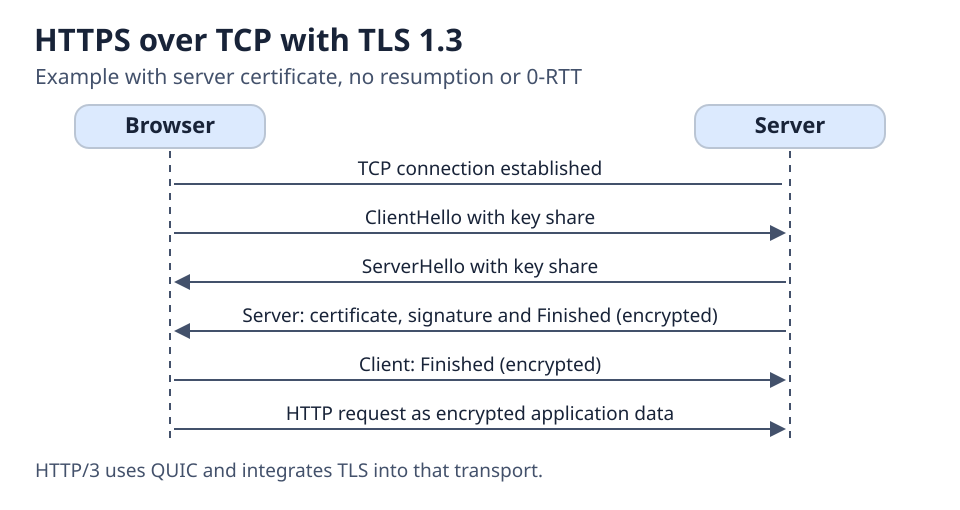

# M1-L6 – Networks and security {#L6}

**Course area:** M1 – Bachelor’s: Foundations of computer science

**Level:** Bachelor’s

**Prior knowledge:** No fixed prerequisites specified.

## Overview: How individual computers become a shared system {#S1}

So far, we have considered programs, computers and databases. As soon as two programs on different computers work together, another layer is added: the **network**. Data must find their destination, be transmitted correctly along the way and be processed by the appropriate application at the destination. Decisions must also be made about who may communicate with whom and which information needs protection.

A browser loading a webpage and a server application querying a database represent two sides of the same problem: **reliable communication** and **controlled access**. A technically functioning connection is not enough. A public application must also account for unwanted requests, other users' accounts, stolen credentials, software errors and data loss.

In this lesson we consider networks as layers, the path of a request through the internet, the foundations of encryption and security decisions for small applications of your own. The actual operation of a publicly accessible server is covered in detail later in M2-L1.

## The internet is a network of networks {#S2}

A **local network** connects devices in a limited area, for example a desktop computer, a notebook and a router in a flat. The **internet** consists of very many interconnected networks operated by access providers, companies, data centres and other organisations. Nobody operates the internet as a single central machine.

Connections between such networks are organised by **routers**. A router looks at the destination address of a data packet and uses its routing information to decide which next station should receive the packet. This is not the same as a single fixed path: routes can change, and data packets can be lost or arrive late.

``` text
PC ── Home network ── Router ── Internet access
                                    │
                               Other networks
                                    │
                                 Data centre
                                    │
                                 Web server
```

**What problem does this solve?** An application does not need to know which cables, wireless links and routers lie between it and its destination. It uses standardised networking functions. **When is it unnecessary?** If a tool operates entirely locally, neither internet access nor a public address is required.

A **packet** is a bounded unit of data containing control information and payload. Larger transmissions are divided into multiple units at suitable layers; not every packet is the same size. A video can therefore be carried over the internet even though individual network packets are relatively small.

## Addresses, names and ports: three different questions {#S3}

A network connection must resolve at least three things: *Which computer or network connection? Which application at that destination? And under which name can a person find the service?*

### IP addresses – where should the packet go? {#21-ip-adressen-wohin-soll-das-paket}

**IP** means *Internet Protocol*. Among other things, it describes the addressing and forwarding of packets across multiple networks. Two address families are commonly encountered:

- **IPv4** (*Internet Protocol Version 4*): 32-bit addresses; a typical notation is `192.0.2.10`.
- **IPv6** (*Internet Protocol Version 6*): 128-bit addresses; an example representation is `2001:db8::10`.

These two addresses are **documentation examples**, not actual destination servers. The key distinction is between **public** addresses, which can in principle be routed on the internet, and **private or local** address ranges used within networks. A local address does not automatically mean complete protection; actual access paths depend on the network configuration.

Many home routers use **NAT** (*Network Address Translation*). They translate addresses and often ports at the boundary between local and public networks. This allows several devices, for example, to share an IPv4 internet connection. NAT is, however, **not a security strategy in its own right** and is not the same as a firewall.

``` text
Notebook: private address ──┐
                            ├── Home router / NAT ── Public connection
Desktop: private address ───┘
```

### DNS – which name corresponds to which address? {#22-dns-welcher-name-gehört-zu-welcher-adresse}

**DNS** stands for *Domain Name System*. It helps resolve a human-readable name such as `example.org` into suitable technical address information. A browser does not necessarily know a domain's destination address in advance. It may first use a local cache or query a DNS resolver.

A typical, simplified sequence is:

``` text
Browser: "example.org"
           │
           ▼
Local DNS cache / DNS resolver
           │
           ▼
IP address of the destination
           │
           ▼
Establish connection to a server
```

An **A record** points to an IPv4 address, an **AAAA record** to an IPv6 address; other DNS record types serve other purposes. DNS itself **does not carry the webpage**. It is an auxiliary service for name resolution. A domain can also return different addresses depending on the query, for example for regional distribution or load balancing.

**When is it unnecessary?** For a purely local service, a direct local address may suffice. For public services, a domain name facilitates access and can hide changed server addresses from users. A domain name does not, however, establish that the service behind it is trustworthy.

### Ports – which program should receive the data? {#23-ports-welches-programm-soll-die-daten-erhalten}

A computer can run a web server, a database service and other applications at the same time. **Ports** are logical numbers used to associate network connections with a particular service or communication endpoint. A port is not a physical socket.

Common assignments are **80** for unencrypted HTTP and **443** for HTTPS. These are conventions, not immutable laws of nature. Not every application on a given port is automatically a particular service; ports must be considered together with the transport technology used.

``` text
Same server address
   ├── Port 443  → HTTPS web service
   ├── Port 22   → SSH administration if required (authorised access only)
   └── Internal database port → preferably not exposed publicly
```

**SSH** means *Secure Shell*, a protocol for secure remote access. The fact that a service could technically be accessible does not mean that it *should* be publicly accessible. A small web service usually provides only the public entry point it actually needs.

## The layers of network communication {#S4}

Why are there so many abbreviations? Because different problems are solved separately. Physical transmission, packet forwarding, transport between programs and the actual application protocol are different tasks.

The classical **OSI model** (*Open Systems Interconnection*) distinguishes seven conceptual layers. For our purposes, a coarser, practical division is sufficient for now:

  Layer                Guiding question                      Examples
  -------------------  ------------------------------------  ----------------------------------
  Application          What should be exchanged?             HTTP, DNS, application API
  Transport            How do programs communicate?          TCP, UDP, QUIC
  Internet/network     How do packets find other networks?   IPv4, IPv6
  Local transmission   How do data reach the next device?    Ethernet, Wi-Fi, fibre-optic link

The limits of this simplified representation matter: **QUIC** is a modern transport protocol based on UDP that also integrates functions for securing connections; **TLS** does not simply belong to one fixed OSI layer in every case. Models aid understanding; they are not an exact blueprint for every modern technology.

The principle of layering makes it possible, for example, to access the same web application over a local Wi-Fi network, a mobile connection or a fibre-optic connection without reinventing the application for each connection.

## TCP, UDP and QUIC: transport with different objectives {#S5}

### TCP – ordered and reliable transmission {#41-tcp-geordnete-und-zuverlässige-übertragung}

**TCP** means *Transmission Control Protocol*. It provides applications with an **ordered byte stream**. In normal operation, TCP ensures that lost segments are retransmitted and that the application receives bytes in the correct order. Connections can of course still fail; TCP does not guarantee that a remote server will never fail.

``` text
Application A ── Data stream over TCP ── Application B
    │                                         │
    └──── Transmission errors are remedied ────┘
          as far as possible
```

TCP is useful when an application requires an ordered data stream. Even with a well-functioning TCP connection, delays can occur, and the application must still handle broken connections.

### UDP – few requirements, no built-in delivery guarantee {#42-udp-wenig-vorgaben-keine-eingebaute-zustellgarantie}

**UDP** stands for *User Datagram Protocol*. It transmits separate datagrams, but itself provides neither reliable delivery nor ordering nor retransmission of lost packets. Applications and protocols built on it can add such functions as needed.

It is useful when low protocol overhead or custom control is particularly important, for example in certain real-time transmissions. **UDP does not automatically mean faster or less secure:** what matters is the complete application and transport design.

### QUIC and HTTP/3 {#43-quic-und-http3}

**QUIC** is a modern transport protocol built on UDP that combines reliable data streams, connection management and cryptographic protection. **HTTP/3** uses QUIC. The statement “HTTP always runs over TCP” would therefore be incorrect today. HTTP/1.1 and HTTP/2 generally use TCP; HTTP/3 uses QUIC over UDP.

The course objectives do not require you to implement the protocol yourself. The important idea is that **the web protocol and the technology underneath it are distinguishable layers**, and new protocols can change the transport technology without requiring all webpages to be redeveloped.

**Security limitation of accelerated connections:** When reconnecting, under certain conditions QUIC can transmit data using **0-RTT** (*Zero Round Trip Time*, early application data before the new handshake is complete). Such early data can under certain conditions be **replayed** (*replay*). Consequently, without additional safeguards, 0-RTT requests are unsuitable for actions with real effects, such as “debit money” or “start a paid job”. A protected transport channel does not automatically make an unsafe domain operation resistant to replay. **The feature is optional:** applications can restrict or disable 0-RTT; it is not a feature of every HTTPS connection. Basis: IETF [RFC 9001](https://www.rfc-editor.org/rfc/rfc9001.html), particularly concerning replay risk. The core TLS 1.3 standard is [RFC 9846](https://www.rfc-editor.org/rfc/rfc9846.html).

## HTTP and HTTPS: the language of the web {#S6}

**HTTP** means *Hypertext Transfer Protocol*. It describes how a client makes a request and a server responds. A browser is a typical client; a program of your own or an AI agent can also send HTTP requests.

``` text
Browser                          Web server
   │                                │
   ├── Request: GET /artikel ──────►│
   │                                │
   ◄──────── Status + content ──────┤
   │                                │
```

`GET` denotes a method for retrieving information. `POST` is typically used to submit or process data. Response codes indicate the result, for example `200` (successful), `404` (resource not found) or `500` (internal server error). The code alone does not explain every cause.

An **API** (*Application Programming Interface*) specifies which functions an application offers to other programs. A **web API** often uses HTTP. An API is not automatically public, however; it can be internal, protected, chargeable or accessible only to particular clients.

In practice, **HTTPS** means *HTTP over TLS*, that is, HTTP over a connection protected by **TLS**. TLS means *Transport Layer Security*. HTTPS is intended to protect communications in transit against eavesdropping and undetected modification and helps verify the identity of the server being contacted.

``` text
Browser ── HTTP requests within a protected TLS connection ── Server
```

**Limitation:** HTTPS does not automatically make a website trustworthy, a database secure or an application free of programming errors. It primarily protects the connection between the respective TLS endpoints. If TLS terminates at an upstream proxy, for example, further internal transmission paths must be considered separately.

## Cryptography: hashes, encryption, keys and certificates {#S7}

The term **cryptography** describes mathematical methods that can, for example, keep information confidential, check it for changes or associate it with a sender. Different methods serve different purposes. Four terms are particularly often confused.

### Hash functions: a kind of verification fingerprint {#61-hashfunktionen-eine-art-prüffingerabdruck}

A **cryptographic hash function** transforms data of arbitrary length into a fixed-length value. If the input data change, the hash value also changes with very high probability. Such methods are used, among other things, to check the integrity of a file.

``` text
File "lektion.md" ── Hash function ──► Checksum A
Modified file     ── Hash function ──► Checksum B
                                             A ≠ B
```

Importantly, a hash value is **not encryption** that could simply be decrypted afterwards. Nor is it evidence of *who* created the file. If an attacker can replace the file and published checksum at the same time, checking the hash is insufficient to establish authenticity.

Passwords should not be stored in plain text. Special, deliberately computationally expensive **password-suitable hashing/key derivation methods** are used for this purpose, for example Argon2id, each with an individual **salt** (an additional random value). A fast standard hash such as SHA-256 alone is unsuitable because automated trial of password candidates would be too fast. The OWASP security guidance discusses these differences in detail.

### Symmetric encryption: the same secret key {#62-symmetrische-verschlüsselung-derselbe-geheime-schlüssel}

In **symmetric encryption**, both parties use the same secret key to encrypt and decrypt. This is efficient for large amounts of data. In this model, anyone who obtains the key can in principle also decrypt data protected by it.

``` text
Plaintext + secret key ──► Ciphertext
Ciphertext + same key  ──► Plaintext
```

One practical problem is that the two communication partners must first securely obtain a shared secret key. Another risk is storage: if the only key is lost, one's own encrypted data may become unreadable; if it is stolen, protection may be lost.

### Asymmetric cryptography: public and private key pair {#63-asymmetrische-kryptografie-öffentliches-und-privates-schlüsselpaar}

In **asymmetric cryptography** there is a **public key** and a corresponding **private key**. Depending on the method, these can be used to encrypt data, agree on key material or create and verify digital signatures. Not every asymmetric method supports all of these functions.

A **digital signature** helps verify whether data were signed using the corresponding private key and remained unchanged after signing. However, the signature alone does not establish a person's real identity: for that, the public key must be reliably associated with an identity.

### Certificates and TLS {#64-zertifikate-und-tls}

A digital **certificate** associates a public key with certain identity information, for example a domain name, and is typically attested by a trusted **certificate authority** (CA). With HTTPS, the client checks, among other things, whether the certificate applies to the name being contacted and whether the chain of trust and validity conditions are appropriate.

TLS combines several cryptographic mechanisms: in the **handshake** (initial negotiation), parameters are agreed, the peer is authenticated and shared session keys are derived. Symmetric methods then protect the transmitted payload efficiently. It is therefore an oversimplification to claim that with HTTPS the entire transmission is permanently encrypted “with the public key”.

``` text
1. Browser connects to server
2. TLS handshake: parameters, key agreement, identity verification
3. Protected communication channel is established
4. HTTP messages are transmitted over it
```

**Note on current standards (check date 03.11.2026):** The authoritative published text for TLS version 1.3 is **RFC 9846 (2026)**. It supersedes the earlier specification RFC 8446 (2018) without changing the basic idea of TLS 1.3 explained here. RFC stands for *Request for Comments*, a document series for technical internet specifications.

## Authentication and authorisation – two different decisions {#S8}

An application with user accounts must distinguish between two questions:

- **Authentication:** *Who do you claim to be, and how do we verify it?*
- **Authorisation:** *What is this identified account permitted to do?*

A user may be correctly signed in and still have no access to a particular record. This second check is frequently overlooked, for example when an application checks only whether there is a login at all, but not who owns the requested document.

``` text
Request to /api/dokument/4711
             │
             ▼
Authentication: valid account?
             │
             ▼
Authorisation: does document 4711 belong to this account?
             │
       ┌─────┴─────┐
       │           │
      Yes          No
       │           │
     Result    Deny access
```

A **session** associates multiple requests with a signed-in user. A session cookie or access token is often used for this. Such values are security-sensitive: anyone who obtains them improperly may in some circumstances impersonate the user. Secure storage, limited validity and suitable logout or revocation options are therefore part of the design.

**MFA** (*Multi-Factor Authentication*) combines at least two *different* factors, for example a password and a hardware security key. A second password is not automatically a second factor. MFA makes certain kinds of account takeover more difficult, but does not prevent every attack.

**What problem do accounts and permissions solve?** They allow data and features to be associated with particular people. **When are they unnecessary?** An entirely local offline tool without separate users usually does not need a web-based user account. Accounts create additional responsibilities: password protection, recovery, blocking, data protection and support.

## Threat modelling: security begins with the right question {#S9}

A **threat model** is a structured consideration of *what needs protection, who might attack it, through which means and with what consequences*. This is usually more helpful than indiscriminately incorporating as many security products as possible.

Consider an online analysis tool to which users upload files. What would be critical there?

  Asset          Possible threat                           Appropriate basic measure
  -------------  ----------------------------------------  --------------------------------------------------------
  User files     Another user reads them                   Per-file authorisation, separate storage
  User account   Takeover through stolen credentials       Secure session, MFA where appropriate, abuse prevention
  Server         Attacker exploits unpatched software      Updates, as few exposed services as possible
  Application    Malicious input causes errors             Input validation, secure libraries, tests
  Availability   Excessive requests overload the service   Rate limiting, capacity planning, monitoring
  Data store     Errors or deletion destroy data           Separate backups and recovery testing

It does not follow from this model that a single measure provides complete protection. A firewall, for example, does not automatically prevent a flaw in a publicly accessible web application. HTTPS helps against eavesdropping in transit, not against faulty authorisation checks in the backend.

### Least privilege – only as many permissions as necessary {#81-least-privilege-so-wenig-rechte-wie-nötig}

**Least privilege** means the principle of granting minimal permissions. Every person and every technical service should possess only the permissions necessary for their task.

For example, a public web process normally needs neither full administrative access to the operating system nor access to all backups. An analysis worker may need access to a single job, but not to the complete account details of all users.

Closely related is **deny by default**: if a permission has not been explicitly granted, access is denied. This is safer than initially permitting all access and prohibiting only some of it.

``` text
Internet
   │
   ▼
Public HTTPS entry point
   │
   ▼
Application with limited permissions
   │
   ├── Access only to assigned jobs
   └── Database account without administrative privileges
```

**When is it overengineered?** Complex role management with multiple tenants is unnecessary for a small offline utility. The underlying principle of avoiding unnecessary permissions remains useful even there.

### Firewalls, updates and security limitations {#82-firewall-updates-und-sicherheitsgrenzen}

A **firewall** allows or blocks network traffic according to rules. For a public service it is generally sensible to expose only necessary entry points. This does not, however, replace program checks or a secure configuration.

**Security updates** close known vulnerabilities. Not only the operating system but also web servers, database systems, program libraries and one's own application may be affected. Updates entail work and can cause compatibility problems. They must therefore be planned and, for critical systems, rolled out in a verifiable manner.

**Backups** protect against data loss, for example through hardware failure, operator error or certain kinds of malware. They are reliable only if copies are kept separately, protected against unauthorised changes and recovery is occasionally tested. A continuously synchronised copy is not automatically a suitable backup: deletions and corrupted data can also be synchronised.

A straightforward principle follows: the more services and users a system has, the more ongoing maintenance and security responsibility it creates — even if the original program code is small.

## A complete visit to a secure website {#S10}



*Illustration: Simplified TLS 1.3 handshake with server certificate over TCP. The diagram combines server authentication and several handshake messages. HTTP/3 uses QUIC.*

We combine the concepts into a simplified sequence. It is deliberately not a mandatory sequence for all browser protocols but a typical architectural model.

``` text
User enters: https://example.org/werkzeug
                       │
                       ▼
                  DNS resolution
                       │
                       ▼
              Destination IP address
                       │
                       ▼
         Establish connection (e.g. TCP)
                       │
                       ▼
         TLS handshake / certificate check
                       │
                       ▼
                 HTTPS request
                       │
                       ▼
                 Web server / API
                       │
                       ▼
          Application logic / permissions
                       │
                       ▼
                   Database
                       │
                       ▼
            HTTPS response to the user
```

With **HTTP/3**, transport would run over QUIC rather than a classical TCP connection; the architectural idea remains comparable. Upstream components such as a reverse proxy, caches or a content delivery network may also be involved. We discuss these later in module M2.

At each point a different technology answers a different question: DNS finds technical addresses; IP transports packets between networks; the transport layer organises communication; TLS protects the channel; HTTP describes requests and responses; the application decides on permissions and content; the database manages its data.

**Why this separation matters:** When troubleshooting, “the website does not work” can have very different causes — from an incorrect DNS record or an expired certificate to a faulty database query. Someone who understands the layers does not look for the cause indiscriminately.

## Three reference points for your own software ideas {#S11}

### Local program with SQLite {#101-lokales-programm-mit-sqlite}

A PureBasic tool that reads local files and uses an SQLite database needs **no public network architecture** for its core function. If no data leave the device, many problems associated with public endpoints disappear. Local security, file access protection and backups remain relevant nonetheless.

### Small public web application {#102-kleine-öffentliche-webanwendung}

A simple PHP or JavaScript backend could already run on a single rented server. It typically needs a DNS record, an HTTPS entry point, application logic and possibly a database. User accounts additionally require secure authentication and permission checks.

The one-off development steps are not enough: ongoing costs and tasks include hosting, a domain and additional services depending on the provider, security updates, certificate management, monitoring, backups and assistance with user problems. Managed services exist for some of these tasks; they reduce work but do not completely remove the operator's responsibility for the application.

### AI processing service with background jobs {#103-ki-verarbeitungsdienst-mit-hintergrundaufträgen}

A service that processes uploaded images using an AI model has additional sensitive interfaces: files are uploaded, jobs passed on, intermediate results stored and later delivered again. Permissions must be correct **throughout the entire process**, not only at the first web form.

``` text
Customer
  │ HTTPS
  ▼
API / account and access check
  │
  ▼
Job queue ──────────► AI worker
                         │
                         ▼
                    Result store
                         │
                         ▼
                  Protected delivery
```

This also illustrates why a larger system is not automatically better: for a few occasional jobs, a single computer with a queue can be simpler. Many workers running in parallel make sense only when load, resilience or particular technical requirements justify the effort.

## Typical misconceptions and brief answers {#S12}

  Common statement                                        More precise explanation
  ------------------------------------------------------  ------------------------------------------------------------------------------------------------------------------
  “A domain is an IP address.”                            A domain is a name whose DNS records can point to addresses, among other things.
  “HTTPS protects the entire application.”                HTTPS protects the transport channel; application errors and incorrectly assigned permissions are still possible.
  “Anyone signed in can see everything.”                  Authentication and access permission must be checked separately.
  “A hash is encrypted text.”                             Hashing is fundamentally not reversible encryption.
  “NAT replaces a firewall.”                              NAT is address translation, not a complete security concept.
  “TCP guarantees every operation will succeed.”          TCP protects the data stream during a functioning connection; applications must handle failures themselves.
  “Replication is a backup.”                              Copies can inherit the same deletions or errors; recoverability must be planned separately.
  “Every small application needs a cloud architecture.”   A local program or a single server may be the more appropriate solution.

## Summary and transition to M1-L7 {#S13}

The path through a network consists of several separate tasks: **resolving names, finding addresses, forwarding packets, transporting data, interpreting messages and protecting access**. The internet is an interconnection of many networks; IP, DNS, TCP or UDP, HTTP and TLS each perform different tasks. Security does not arise from encryption alone, but also from reliable identity verification, correctly assigned access permissions, up-to-date software, limited attack surfaces and recoverable data.

For a small local computer, much of this is unnecessary. Once other people access an application online, however, these questions become part of ongoing operation. **M2-L1** later shows how to turn a local program into a publicly accessible service; **M4-L3** explores organisational and data protection responsibilities in greater depth.

The **next lesson M1-L7** completes the overview of computer science foundations: concurrency, formal languages, distributed systems, human–computer interaction and an introduction to AI before modules M5 and M6.


## Sources {#S14}

**Last source check:** 03.11.2026

**Research/check date: 03.11.2026; clarification of 0-RTT on 05.11.2026.** The links help trace individual technical foundations and security principles. No current provider prices or binding legal advice are asserted.

1.  **MDN Web Docs – Overview of HTTP** (request–response principle, client–server): [https://developer.mozilla.org/de/docs/Web/HTTP/Guides/Overview](https://developer.mozilla.org/de/docs/Web/HTTP/Guides/Overview)
2.  **MDN Web Docs – What is a Domain Name?** (DNS, domains and address resolution): [https://developer.mozilla.org/en-US/docs/Learn_web_development/Howto/Web_mechanics/What_is_a_domain_name](https://developer.mozilla.org/en-US/docs/Learn_web_development/Howto/Web_mechanics/What_is_a_domain_name)
3.  **IETF / RFC Editor – RFC 9846: TLS 1.3** (valid successor specification to RFC 8446): [https://www.rfc-editor.org/info/rfc9846/](https://www.rfc-editor.org/info/rfc9846/)
4.  **IETF / RFC Editor – RFC 9001: Using TLS to Secure QUIC** (0-RTT application data and replay risk): [https://www.rfc-editor.org/info/rfc9001/](https://www.rfc-editor.org/info/rfc9001/)
5.  **OWASP Cheat Sheet Series – Authorization** (least privilege, deny by default): [https://cheatsheetseries.owasp.org/cheatsheets/Authorization_Cheat_Sheet.html](https://cheatsheetseries.owasp.org/cheatsheets/Authorization_Cheat_Sheet.html)
6.  **OWASP Cheat Sheet Series – Password Storage** (password-suitable hashing methods and salt): [https://cheatsheetseries.owasp.org/cheatsheets/Password_Storage_Cheat_Sheet.html](https://cheatsheetseries.owasp.org/cheatsheets/Password_Storage_Cheat_Sheet.html)
7.  **OWASP Cheat Sheet Series – Multifactor Authentication** (independent authentication factors): [https://cheatsheetseries.owasp.org/cheatsheets/Multifactor_Authentication_Cheat_Sheet.html](https://cheatsheetseries.owasp.org/cheatsheets/Multifactor_Authentication_Cheat_Sheet.html)
8.  **Cloudflare Learning Center – OSI model** (layers as conceptual abstraction): [https://www.cloudflare.com/de-de/learning/ddos/glossary/open-systems-interconnection-model-osi/](https://www.cloudflare.com/de-de/learning/ddos/glossary/open-systems-interconnection-model-osi/)

**Context:** Network standards and security guidelines can evolve. This lesson explains enduring concepts; specific implementation decisions should be checked again against current documentation when operating a real system.
