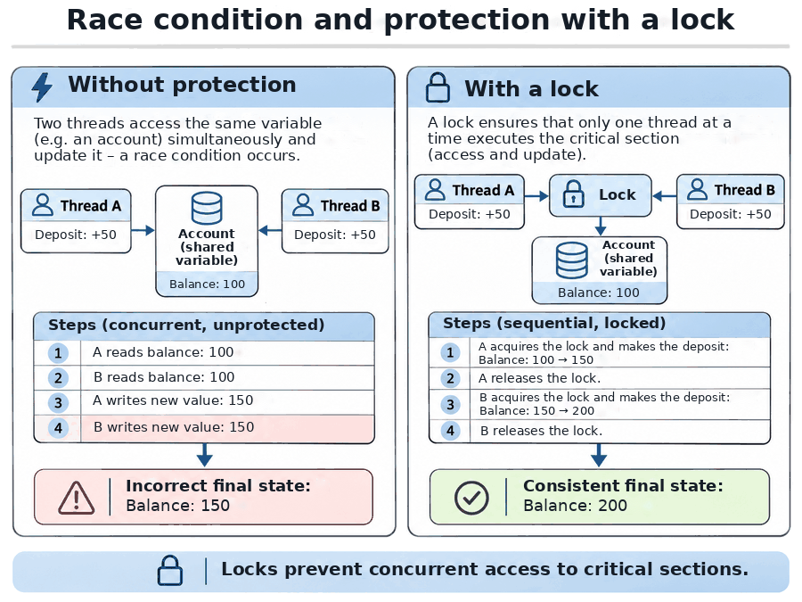

# M1-L7 – Overview of further typical Bachelor’s subject areas {#L7}

**Course area:** M1 – Bachelor’s: Foundations of computer science

**Level:** Bachelor’s

**Prior knowledge:** No fixed prerequisites specified.

## Overview: What else belongs to a computer science degree? {#S1}

In M1-L1 to M1-L6, we have already learnt the foundations of programming, computers, algorithms, software architecture, databases and networks. A computer science degree also considers several questions that may initially seem quite unrelated: How do we prevent errors when two tasks manipulate the same data simultaneously? How can a computer understand a programming language? How do programs running on several computers work? Why is designing a user interface just as much a part of computer science as an algorithm? And how does machine learning differ from ordinary programming?

This lesson connects five such areas. It is not intended to replace later specialist courses, but to provide a **map**. The overview follows the knowledge areas of the *CS2023 Computer Science Curricula* by ACM, IEEE Computer Society and AAAI: Parallel and Distributed Computing, Foundations of Programming Languages, Human-Computer Interaction, Artificial Intelligence, and Society, Ethics, and the Profession are explicitly included in the discipline. Individual universities may organise the content differently.

One recurring idea is more important than all the technical terms: **As soon as data, time, several actors or people are involved, it is often no longer sufficient to consider only the 'normal' program flow.**

## Concurrency: When several things happen at once {#S2}

### Definition and initial problem

**Concurrency** means that several tasks can make progress during overlapping periods. **Parallelism** refers to actual simultaneous execution on several computational units. A single processor core can alternate between concurrent tasks; multiple cores can execute them simultaneously. Concurrency therefore does not automatically mean faster computation.

Why is it needed? A desktop program, for example, should continue to respond to mouse movements while loading a file. A web server must be able to serve multiple incoming requests. An AI service may want to prepare the next job while a graphics card is already computing. If each activity blocked all others, the application would appear unusable or its resources would be poorly utilised.

### Processes, threads and asynchronous execution

A **process** is a running instance of a program with a generally separate virtual address space. A **thread** is a flow of execution within a process; threads belonging to the same process can use shared memory areas. With an **asynchronous** approach, a program does not necessarily have to wait idly for a lengthy operation: it can carry out other work and process the result later. Asynchronicity does not automatically mean that a separate thread is started or that CPU computation takes place in parallel.

``` text
Application
   │
   ├─ Accept user interaction ───────────────┐
   ├─ Load file ───────── [Waiting time] ────┤
   └─ Prepare data ──────────────────────────┤
                                            ▼
                                      Display result
```

The sketch shows logical activities; their actual allocation to threads or processor cores depends on the runtime environment used.

### The race condition: Two correct operations produce an incorrect result

A **race condition** occurs when the result depends on the accidental order in which accesses take place. Suppose a counter stands at 10. Two tasks are each meant to add 1:

``` text
Initial value: 10

Task A: reads 10 ─────────────────┐
Task B:          reads 10 ────────┤
Task A: writes 11 ────────────────┤
Task B:                  writes 11┘

Expected: 12       Actually possible: 11
```

Viewed separately, both tasks appear to have calculated correctly. The problem is the shared state. The example is also relevant because a single programming expression such as 'increment the counter by one' is not guaranteed to be an indivisible operation in every context.

### Synchronisation, locks and atomic steps



*Illustration: Example of a lost update: both threads read 100 and write 150 without synchronisation. A correctly shared lock serialises the changes to 200; here it protects only the processes concerned within the respective shared locking scope.*

**Synchronisation** coordinates access by multiple tasks to shared data. A **mutex** (*mutual exclusion*) allows only one flow of execution at a time to enter a protected section. An **atomic operation** takes effect as an indivisible step with respect to competing accesses. Database transactions can address similar protection requirements at database level, but are not a blanket solution to all concurrency in a program.

``` text
Task A ──► Acquire lock ──► Change counter ──► Release lock
                                ▲
Task B ───────── waits ─────────┘ ──────────► Change counter
```

Locks can prevent errors, but also cost time. Excessively large locking scopes reduce parallelism; poorly chosen locking rules can create new errors. Sometimes it is even simpler to **avoid shared mutable state**: each task works on its own copy of the data and hands over a result only at the end.

**Distinction from a distributed system:** A lock in the memory of a process initially protects only the participating flows of execution in that specific coordination scope. Two separate servers with their own locks can nevertheless start the same external action. The shared data store or the external service being called must then ensure the uniqueness of the business effect; a local mutex alone is insufficient. The later lesson [M4-L1](M4-L1.md) explores failure models for queues and workers in more detail.

### Deadlock, starvation and livelock

A **deadlock** occurs when several tasks wait for one another and can therefore no longer make progress. Example: task A holds resource 1 and waits for resource 2; task B holds resource 2 and waits for resource 1.

``` text
Task A ── holds file X ── waits for database Y
   ▲                                  │
   │                                  ▼
Task B ◄─ waits for file X ◄─ holds database Y
```

The labels illustrate the classic circular wait; the file and database are merely resources chosen to make it concrete. Countermeasures include a consistent order for requesting locks, short critical sections and targeted timeouts. **Starvation** means that a task has no fair opportunity to obtain a required resource for a prolonged period. In a **livelock**, tasks still actively respond to one another but make no useful progress.

**When useful?** Concurrency helps with large numbers of users, background processing and responsive interaction. **When unnecessary?** For a small utility processing a few files in sequence, additional threads often only create more opportunities for errors. More threads are not a free performance improvement.

## Formal languages, automata and compilers {#S3}

### Why computers need rules for language

People often recognise from context what is meant. A computer needs precise rules for program code and structured data: Which character sequences are permitted? What does an expression mean? Which sequence of instructions is possible?

A **formal language** is a set of strings that may be formed according to specified rules. A **grammar** describes such rules. For example, it can specify that an expression consists of a number, a plus sign and another number. Initially this describes only the **syntax** (form), not the entire **semantics** (meaning).

An **automaton** is a mathematical model that processes symbols or events and changes state in the process. A **finite automaton** has only finitely many possible states. It is suitable, for example, for recognising simple text patterns or modelling a login procedure. A compiler typically uses several successive processing steps; simple character patterns and nested language structures require different methods.

### Example: User login as a state machine

``` text
[Logged out] ── valid login ──► [Logged in]
      ▲                              │
      └────────── log out ────────────┘

[Logged out] ── invalid details ──► [Logged out]
```

This simple model forces us to ask which transitions are permitted. A real login system obviously needs further rules, for example for expired sessions, multi-factor authentication, locked accounts and error cases. A state machine replaces neither password verification nor security architecture; it makes particular processes easier to verify.

### From source code to a program

A typical compiler can conceptually be divided into the following steps:

``` text
Source code
   │
   ▼
Lexical analysis (characters → tokens)
   │
   ▼
Syntax analysis / parsing (tokens → structure)
   │
   ▼
Semantic checks (meaning, types, names)
   │
   ▼
Intermediate representation and optimisation (optional)
   │
   ▼
Code generation (e.g. machine code)
```

A **token** here is a recognised linguistic unit, such as a numeric literal, an identifier or an operator. **Parsing** is the checking and structuring of input according to grammar rules. A semantic check might establish, for example, that an undefined identifier is being used. Not every programming language and runtime environment uses exactly the same pipeline: interpretation, bytecode and just-in-time compilation may take different routes.

### Regular expressions are not universal parsers

**Regular expressions** (often abbreviated to **regex**) are especially suitable for recognising and breaking down many clearly defined character patterns. They are not a suitable replacement for a parser for all arbitrarily nested syntactic structures. Common regex implementations also provide extensions that go beyond classical regular languages; the precise expressive scope depends on the system used.

For a simple filename validator or log search, a few patterns are often sufficient. For a complete programming language, a complex document grammar or strictly nested data formats, proper syntax analysis is more appropriate.

**When useful?** Parsers, data formats, programming languages and verifiable business processes benefit from formal rules. **When excessive?** Simple, clearly documented conditions often suffice for a very small tool. Developing a compiler specifically for that would not be an improvement.

## Distributed systems: A program no longer runs in just one place {#S4}

### Definition and initial problem {#begriff-und-ausgangsproblem-2}

A **distributed system** consists of several independent computers or processes that interact via messages to offer a common service. They normally do not share directly accessible main memory. Each participant sees only its own state and messages it has received.

Why distribute software? Possible reasons include geographical distance, greater fault tolerance, different specialised hardware or more computing capacity. The difficulty is that each additional computer introduces network latency, transmission errors, independent failures and contradictory observations.

``` text
User ──► Web server ──► Job queue
                           │
                           ├─► Worker A ──► Result store
                           └─► Worker B ──► Result store
                                   │
                              Status database
```

**Workers** are background processes that execute tasks. A **queue** collects jobs that are not processed immediately. This pattern handles lengthy work, such as image computation or document analysis, while the web server can respond promptly to user requests.

### A message does not yet guarantee an effect

Suppose worker A receives a job to process an image and stores the result, but the acknowledgement to the job service is lost. From the outside, it initially looks as if the job failed. A retry could start the same processing a second time.

Distributed applications must therefore distinguish between **message delivered**, **job started**, **result stored** and **effect completed**. A common design technique is **idempotence**: repeated delivery of the same uniquely identified job must not cause an unwanted additional effect. This does not make the retry mechanism itself fault-free; the business rules make it more manageable.

### Why time and ordering become difficult

On one computer, a central clock can be helpful. In a network, computers have their own clocks; messages can take different amounts of time to travel. Two events on different computers cannot therefore always be reliably ordered as 'first' and 'afterwards' based simply on clock time. Computer science uses, among other things, **logical clocks** and explicit ordering relations for this purpose. Leslie Lamport's classic 1978 paper describes such an approach.

For an order, for example, the ordering is crucial: a payment must not be regarded as recorded if the necessary operation was never completed correctly. For a public image gallery, by contrast, a newly added image becoming visible on a second server only a little later may often be acceptable.

### Consistency, availability and failure

**Consistency** describes, depending on the model used, which observations are permitted for multiple participants. **Strong consistency** may require that certain acknowledged modifications become visible to subsequent accesses in a well-defined order. In simplified terms, **eventual consistency** means that, in the absence of new changes and under the assumptions of the particular system, copies can eventually agree again. Eventual consistency is not a blanket promise of a fixed delay.

**Availability** means that a service can respond to requests under certain assumptions. An additional server does not automatically improve availability: shared databases, networks, configurations or faulty updates can still affect all instances. Moreover, in the event of a network failure, it is necessary to distinguish whether another computer has actually failed or is merely temporarily unreachable.

A **consensus algorithm** helps several nodes agree on a common decision or ordering despite certain failures. Such algorithms require clear assumptions about the types of failure and available participants. We consider the precise interpretation of consistency, the **CAP theorem** and its limited claim, as well as replication and sharding, in detail only in the database-focused section C.

**When useful?** When a single computer demonstrably no longer suffices or a requirement of the application demands several locations. **When unnecessary?** For a small service with few users, a single server with reliable backups, monitoring and clear recovery rules can be more robust and less expensive overall than a poorly understood cluster.

## Human-computer interaction: Good software is also usable software {#S5}

### What does this field investigate?

**Human-computer interaction (HCI)** investigates how people perceive and operate digital systems and how the design of those systems can be assessed and improved. It is not just about the visual design of a window. Comprehensibility, error prevention, speed of use, accessibility and the expectations of the particular target group also matter.

Software may perform calculations perfectly and still fail in everyday use if users cannot find a function, recognise important differences or notice an incorrect input.

### Three simple design rules

**Feedback:** After an action, it must be clear what has happened. An upload needs a comprehensible status rather than several minutes of waiting without any indication.

**Consistency:** Identical terms and controls should work in the same way. Someone seeing 'Save' on one page and 'Apply' on another should not have to guess whether the two mean the same thing.

**Error tolerance:** A system should prevent errors where possible and enable recovery where appropriate. An accidentally deleted draft could, for example, initially be moved to the recycle bin, provided that data protection and retention obligations do not preclude it.

``` text
User intention
    │
    ▼
Interface with comprehensible action
    │
    ▼
Application validates input
    │
    ├─ plausible ──► Action ──► Visible confirmation
    └─ incorrect ──► Clear message + opportunity to correct
```

### Accessibility concerns more than a small group of users

**Accessibility** means designing digital content and functions so that they are, as far as possible, accessible to people with different physical, sensory or cognitive abilities. For web offerings, the **Web Content Accessibility Guidelines (WCAG)** of the **World Wide Web Consortium (W3C)** provide important technical guidance. The four fundamental principles are: perceivable, operable, understandable and robust.

Examples include keyboard operability, sufficient contrast, clear headings, alternative text for meaningful images, comprehensible error messages and an interface that still works when enlarged. Not every visual detail must be designed identically; what matters is whether the function remains accessible.

Such measures often help other people too: someone with only one hand free while travelling benefits from easily accessible controls; someone with little experience of an application benefits from clear language.

### When does a user interface become a cost factor?

A custom-developed interface requires time for design, error handling, testing on several devices, accessibility and subsequent changes. For a personal utility, a simple table view may be perfectly sufficient. For a public offering with many unfamiliar users, documentation, understandable error texts and ease of support are part of product quality and ongoing operating costs.

## Data protection, security and computer science ethics {#S6}

### Protection by design rather than as an afterthought

In M1-L6 we discussed technical security. **Data protection** poses a different question: *May the data be processed for this purpose at all, and how much of it is necessary?* An encrypted database can technically protect personal data and nevertheless contain more information than the application needs.

The **General Data Protection Regulation (GDPR)** includes principles such as purpose limitation, data minimisation, storage limitation, transparency, and integrity/confidentiality for processing to which it applies. The **European Data Protection Board (EDPB)** also explains **privacy by design** and **privacy by default**. The obligations that apply in individual cases depend on the specific service, the parties and the data. This lesson is not legal advice.

``` text
Plan new function
       │
       ▼
Which data are genuinely necessary?
       │
       ├─ unnecessary ─► Do not collect them in the first place
       │
       └─ necessary ───► Define purpose + access rights + deletion rule
                                │
                                ▼
                         Implement technically
```

### Ethics is not simply the same as compliance with the law

Computer science ethics also deals with questions such as: Does a system create avoidable disadvantages? Can users understand its decisions? Are people treated unfairly by automated assessments? Who bears responsibility if an AI system makes a mistake?

An automated decision can be programmed correctly in formal terms and still be based on biased data. For a model that evaluates people, measuring average accuracy alone is therefore insufficient. Possible consequences of errors, their distribution, opportunities to contest decisions and the appropriateness of automation must also be considered.

**When essential?** Particularly with health data, employment decisions, personal profiles and applications that have tangible consequences for third parties in general. **When simpler?** A purely local, personal filename converter without other people's personal data requires considerably less organisational effort, but not zero technical care.

## Data processing and machine learning {#S7}

### Classical data analysis: Making patterns visible

Data science combines computer science with statistics and domain knowledge. A simple analysis program can calculate averages, frequencies or trends over time from sales figures. These values are initially **descriptive**: they say what was observed in the recorded data. They do not establish whether a relationship represents a cause.

Important problems arise before computation even begins: missing data, inconsistent measurement methods, duplicate entries, changed categories or biased selection can render results unusable. More data do not automatically solve these problems.

### What is machine learning?

**Machine learning (ML)** refers to methods in which a model adjusts parameters based on example data or feedback, rather than specifying every decision entirely as a fixed rule. With **supervised learning**, examples have target values, such as images and their classes. With **unsupervised learning**, structures are investigated in data without such target assignments. **Reinforcement learning** works with feedback on actions and consequences in an environment.

The learning method must suit the problem. A clearly defined tax rate or an exactly computable checksum does not need a trained model. For varied images, spoken language or patterns that are difficult to formalise, machine learning may be helpful.

``` text
Training data ──► Learning algorithm ──► Model parameters
                                              │
                                    later: inference
                                              │
New input ────────────────────────────────────┤
                                              ▼
                                        Prediction/output
```

**Training** is the model adjustment phase. **Inference** is the application of a trained model to new inputs. A **large language model (LLM)** can generate text during inference based on learnt patterns and the current context. This does not mean that every response represents verified knowledge or a genuine database query. Details follow in M6-L1 to M6-L4.

### What are neural networks and deep learning?

An **artificial neural network** is a mathematical model with adjustable weights that processes inputs through several computational steps. **Deep learning** uses multilayer networks. Many present-day systems for language, image and audio processing belong to this family. The name is historically inspired by the brain; that does not imply equivalence to biological neurons.

When evaluating a model, it is necessary to distinguish performance on training data from performance on **new, independent examples**. A model may memorise training examples and still perform poorly on new data. This is known, among other things, as **overfitting**. A fair evaluation requires suitable assessment data separate from the training phase.

### Limits and operating costs

A model can make mistakes, respond less effectively to changed data or inherit bias from the training data. Large models also involve computing costs, electricity consumption, memory requirements, model versions, possible data leaks and legal questions about training data and data supplied by users. For a simple statistic over a few rows of a table, a large neural network would be both more expensive and harder to verify than an ordinary algorithm.

## Three connected application scenarios {#S8}

### Scenario A: Local media archive

A local media catalogue might need a filename parser, a database for metadata and a clear search interface. Concurrency may be useful if a lengthy file analysis runs in the background. A server cluster, a neural network or several synchronised databases would be excessive without a specific need.

``` text
Files ─► Parser ─► Local database ─► Search interface
               └─ Background analysis (optional)
```

**Operational implication:** Manageable effort, but backups and careful handling of faulty files remain necessary.

### Scenario B: Paid online tool

Usability, input validation, access protection and traceable states become important here. Several concurrent users can modify the same data store. If money, quotas or orders are involved, the rules for competing modifications must be particularly clear. A single host may still be sufficient.

``` text
User ─► Web interface ─► Application ─► Database
             │                  │
       Error feedback     Authorisation check
```

**Operational implication:** Support, security updates, backups, data protection objectives and available resources must be planned. Not every problem is solved by more servers.

### Scenario C: AI job service with several workers

A queue separates the rapid receipt of a job from its lengthy processing. Several workers can process different jobs. An identifiable job status and idempotent result delivery help manage retries after failures. If the service later controls devices, safety-critical reactions must be designed locally and independently of a permanent cloud connection.

``` text
Customer ─► API ─► Job queue ─► AI worker
                       │             │
                       ▼             ▼
                 Status management ◄── Result store
```

**Operational implication:** Possible duplicate jobs, storage requirements, data protection for uploaded content, GPU costs and failure handling. A distributed design is useful only if its benefits justify the additional complexity.

## Overview: Which field solves which problem? {#S9}

  Field                           Typical problem                                                 Often unnecessary when …                                                                                 Later study
  ------------------------------- --------------------------------------------------------------- -------------------------------------------------------------------------------------------------------- ---------------------------------
  Concurrency                     A program must coordinate several activities                    There is only a short linear workflow                                                                    M2-L2, M3-L5, M4-L1
  Formal languages and automata   Inputs and processes must be handled according to clear rules   Simple fixed checks suffice                                                                              M2-L2, M6-L1
  Distributed systems             Several computers must work together correctly                  One computer meets the requirements                                                                      M2-L5, M3-L1–M3-L6, M4-L1–M4-L2
  Human-computer interaction      Users cannot reliably understand and operate functions          The application is only a small internal tool; basic comprehensibility remains necessary                 M2-L2, M4-L5
  Data protection and ethics      Data processing or automation may adversely affect people       There are genuinely no relevant third-party data or consequences; careful assessment remains necessary   M4-L3, M6-L3–M6-L7
  Machine learning                Patterns are difficult to express completely as fixed rules     A simple deterministic calculation suffices                                                              M5-L1–M6-L6

## Summary: Completing the foundations block {#S10}

Computer science investigates not only individual programs, but also **correct collaboration, precise descriptions, distributed state, good usability and learning methods**. Concurrency creates responsiveness but also race conditions and deadlocks. Formal languages and automata make inputs and states verifiable. Distributed systems enable larger or geographically separated services, but introduce message failures and consistency issues. Human-computer interaction and data protection help determine whether a technical solution is practical and responsible. Machine learning extends the possibilities when classical rules are insufficient; it by no means replaces these rules everywhere.


## Sources {#S11}


**Research/review date: 03.11.2026.** The foundations of formal languages, synchronisation and collaboration between computers are long-established concepts. Links provide technical orientation and do not substantiate statements about current provider prices. For data protection and specific legal consequences, additional case-by-case assessment is necessary.

1.  [ACM / IEEE Computer Society / AAAI – CS2023 Knowledge Areas](https://csed.acm.org/knowledge-areas/) · Overview of typical computer science knowledge areas (Parallel/Distributed Computing, HCI, AI, Programming Languages, Ethics) · Last accessed: 2026-11-22
2.  [Oracle Java Tutorials – Synchronization](https://docs.oracle.com/javase/tutorial/essential/concurrency/sync.html) · Shared state, thread interference and synchronisation. The tutorials explicitly refer to Java 8 and serve here only as a conceptual explanation · Last accessed: 2026-11-22
3.  [Oracle Java Tutorials – Deadlock](https://docs.oracle.com/javase/tutorial/essential/concurrency/deadlock.html) · Teaching example of mutual waiting, also an older Java 8 teaching text · Last accessed: 2026-11-22
4.  [Leslie Lamport (1978) – Time, Clocks, and the Ordering of Events in a Distributed System](https://lamport.azurewebsites.net/pubs/time-clocks.pdf) · Foundations of logical event ordering · Last accessed: 2026-11-22
5.  [W3C Web Accessibility Initiative – WCAG 2 at a Glance](https://www.w3.org/WAI/standards-guidelines/wcag/glance/) · The principles of perceivability, operability, understandability and robustness · Last accessed: 2026-11-22
6.  [European Data Protection Board – Principles of processing](https://www.edpb.europa.eu/topics/key-gdpr-concepts/basic-principles_de) · Transparency, purpose limitation, data minimisation and other fundamental GDPR principles · Last accessed: 2026-11-22
7.  [European Data Protection Board – Data protection by design and by default](https://www.edpb.europa.eu/topics/ai-and-technology/privacy-by-design-and-by-default_de) · Principle and ongoing consideration · Last accessed: 2026-11-22
8.  [Google for Developers – Machine Learning Crash Course](https://developers.google.com/machine-learning/crash-course) · Introduction to learning methods, data, model training and modern AI; the website offers optional exercises that are not required for this reading course · Last accessed: 2026-11-22

**Outlook:** The precise guarantees of distributed database systems follow in module M3; the technical development of neural networks and language models and the path towards robotics follow in modules M5 and M6. This lesson provides orientation, not a replacement for these more advanced studies.
