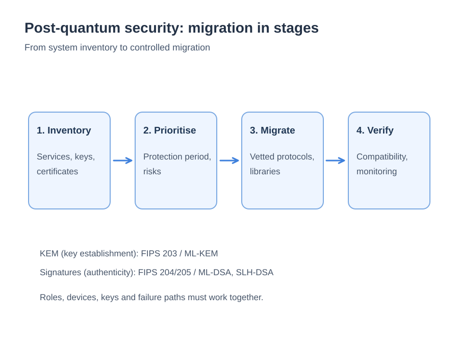

# M11-L1 – Post-quantum cryptography and cryptographic migration {#L1}

**Course area:** M11 – Elective topics: cryptography and software agents

**Level:** Not specified

**Prior knowledge:** No fixed prerequisites specified.

**Context:** An elective and emerging topic between Bachelor-level IT security and advanced cryptography. It is neither an assignment to a compulsory module nor a guide to implementing production cryptography independently without specialist review.

**Guiding question:** If certain mathematical problems can be solved differently using powerful quantum computers, how can information protected today remain secure in the long term?

## Cryptography protects different things {#S1}

An encrypted message packet and a digitally signed software update do not serve the same purpose. Encryption is intended to protect content against unauthorised reading. A digital signature is intended to associate a message or software with a key and make changes detectable. A **key exchange** mechanism, by contrast, enables both parties to obtain the shared secret required for encryption.

This distinction is important because replacing a single cryptographic library does not automatically modernise every protective function of a large system.

| Security objective | Typical mechanism | Example |
| --- | --- | --- |
| Confidentiality | Symmetric encryption with a suitable key | Encrypted stored file |
| Secure key acquisition | KEM or key exchange | Establishing a protected connection |
| Authenticity and integrity | Digital signature | Signed software package |
| Binding keys to identities | Certificates, key management, trust model | Verification of a server certificate |

**KEM** stands for *Key Encapsulation Mechanism*. It is a mechanism through which two parties can establish a shared secret without having shared it beforehand. The KEM itself is not equivalent to the entire subsequent data encryption process.

## Why “post-quantum”? {#S2}

Many widely used public-key schemes rely on mathematical problems that are practically difficult for classical computers to solve. A sufficiently powerful, fault-tolerant quantum computer could tackle certain such problems much more easily using different algorithms. The threat particularly affects established schemes in classical public-key cryptography; it does **not** mean that all encryption in use today would suddenly become ineffective.

The exact capabilities, availability and timeline of large quantum computers are uncertain. Security planning, however, considers not only the most likely year of an attack but also the required period of confidentiality. An encrypted connection recorded today may remain of interest to an attacker if it could be decrypted later. This risk is often discussed under the term **“harvest now, decrypt later”**.

## Three standardised building blocks {#S3}

The US **National Institute of Standards and Technology (NIST)** published three important post-quantum standards in 2024:

| Standard | Scheme | Main purpose |
| --- | --- | --- |
| **FIPS 203** | **ML-KEM** | Shared secret for secure key establishment |
| **FIPS 204** | **ML-DSA** | Digital signatures |
| **FIPS 205** | **SLH-DSA** | Digital signatures based on hash functions |

Names and areas of application are frequently confused. Someone who needs to replace an existing digital signature cannot do so merely by enabling a KEM. Conversely, a signature alone does not generate a secret session key.

For new systems, existing, reviewed implementations and current security guidelines are decisive. An example program called “quantum crypto” is not proof of correctly implemented cryptography.

## Security migration starts with an inventory {#S4}

Imagine an organisation with a website, internal APIs, an update service and a long-term archive. Before replacing technologies, those responsible must know **where each cryptographic function is used in the first place**.

The inventory could begin with a table such as this:

| System | Cryptographic function | Why critical? | Question to investigate |
| --- | --- | --- | --- |
| Web server | Connection establishment | Data in transit | Which protocol versions and algorithms do the endpoints negotiate? |
| Software updates | Signature verification | Preventing tampered updates | Who manages the signing keys? |
| Document archive | Encryption of data at rest | Long protection period | Which data must still be confidential in 15 years? |
| Device fleet | Certificate verification | Device identity | Can all devices verify new algorithms? |

The table is an original **fictional teaching example**. It illustrates an organisational point: some risks lie in protocols, others in devices, key management processes or the entire chain of trust.

*Original schematic teaching illustration; not a complete implementation guide.*

## What is “crypto-agility”? {#S5}

**Crypto-agility** means that a system can replace algorithms and key mechanisms under controlled conditions without rebuilding the entire product. It is not an invitation to keep changing algorithms at will. Rather, it requires defined interfaces, versioned settings, compatibility tests, security guidelines and a documented way to roll back changes if problems occur.

An overly tightly coupled system might have the same algorithm hard-coded in many places. Replacing it would then require simultaneous changes to data formats, services, certificate verification and devices. A modular system can isolate these changes more effectively.

## Hybrid schemes – transition rather than sudden replacement {#S6}

A migration strategy can combine a classical component with a quantum-resistant component. This is often called **hybrid key exchange**. Such constructions must not, however, be devised arbitrarily: the way secrets are combined, the way they are authenticated and the way errors are handled are critical to security.

The central learning objective is therefore **architectural thinking**, not programming one's own hybrid cryptography. It is necessary to understand the protocols involved, reviewed libraries and current specifications before deploying them in production.

## Migration metrics {#S7}

A new algorithm may have different storage, timing and transmission requirements. During a migration, at least the following metrics should be measured:

- Execution time for establishing connections and verifying signatures.
- Size of public keys, certificates and signatures.
- Behaviour during packet loss or over slow connections.
- Support in clients, servers, devices and security modules.
- Error rates, protocol compatibility and rollback options.

A system is not secure simply because its benchmark is particularly fast. Quality also includes correct implementation, key management, the ability to update the system and understandable operational processes.

## Practical case: a sensor used over the long term {#S8}

A fictional measuring device is intended to be used for twelve years. It sends data to a central system and regularly verifies signed updates. We ask three questions:

1.  **Which capability must be preserved?** The device must continue to recognise trustworthy updates and protect connections.
2.  **Where is the technical risk?** Limited flash memory, a low-powered CPU, old protocol libraries and a maintenance channel that is only rarely accessible.
3.  **What would be tested first?** Actual support for the chosen standard, memory requirements, rollback, a secure update procedure and key rotation.

An additional consideration is important: sometimes it is necessary to plan not only for an algorithm, but also for the **root of trust** and device identity over many years. An important cryptographic standard is of little use if the device never receives it because it cannot be updated.

## Self-check {#S9}

1.  What is the difference between a **KEM** and a **digital signature**? A KEM helps to obtain a shared secret; a signature establishes the association and integrity of a signed message under the respective assumptions.
2.  Why is an archive with a long confidentiality period important? Because data encrypted today must remain confidential in the future.
3.  Why does evidence that a “FIPS algorithm is implemented” not replace a security assessment of the system as a whole? Because errors in protocols, key management or operations can undermine security independently of the algorithm.

## Limitations and further learning {#S10}

This chapter does not cover mathematical security proofs of the individual schemes or independent implementation of cryptographic primitives. Mathematically, further study leads to lattices, algebraic structures, probability and computational complexity. In the existing courses, **Computer Science M10-L1** and **University Mathematics M4-L5** provide suitable connections.

## Sources {#S11}

**Documented source status:** 10 November 2026

- [NIST – Approval of the three post-quantum standards FIPS 203/204/205](https://www.nist.gov/news-events/news/2024/08/announcing-approval-three-federal-information-processing-standards-fips): standard names and their respective purposes.
- [NIST NCCoE – Migration to Post-Quantum Cryptography](https://pages.nist.gov/nccoe-migration-post-quantum-cryptography/): migration issues and practical context.
- [NIST – Post-Quantum Cryptography Standardization](https://csrc.nist.gov/projects/post-quantum-cryptography): broader project and standards information.

*Original teaching structure and fictional system examples. No reproduction of standards texts, implementations or third-party tables.*
