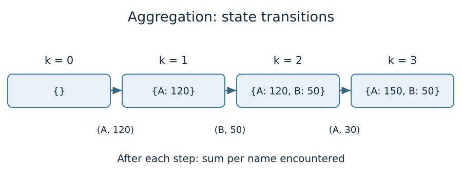

# M12-L1 – Imperative programming and structured data {#L1}

**Course area:** M12 – Programming and software quality

**Level:** Bachelor’s · Core/foundations

**Prerequisites:** [M1-L1](M1-L1.md)

## Learning objectives {#S1}

Design imperative data processing from a contract, formulate a loop invariant, distinguish references from copies, and test ordinary and exceptional cases.

## State, control flow and data contracts {#S2}

An imperative program specifies changes to state through statements. In Python an assignment binds a name to an object; it is not a mathematical assertion of equality. Sequence, branching and repetition combine steps. A function contract describes accepted inputs and the required outcome. Separate this from the implementation: different algorithms can satisfy the same contract.

Model bookings as pairs `(name, cents)`, with a nonempty string `name` and a nonnegative integer `cents` (excluding Boolean values). The input is a finite sequence of such pairs. Return the sum of amounts in cents for every name encountered, even if its sum is zero. An invalid name or amount raises `ValueError`. Malformed pair structure is outside the contract; unpacking may raise a different exception. Integer cents are exact in this model; floating-point values would be unnecessary.

## Loop invariant and algorithm {#S3}

After processing the first $k$ pairs, `result` contains precisely the names encountered so far and the sum of the amounts associated with each name among those $k$ pairs. Initialization: at $k=0$ the empty dictionary satisfies the statement. Maintenance: the next valid entry $(a,c)$ changes only the sum for $a$ by $c$; for a new name the previous sum is zero. The statement therefore holds for $k+1$. Termination: at $k=n$ the dictionary satisfies the contract. The finite input sequence ensures termination. An invalid entry aborts without returning a partial result.

```python
def totals(rows):
    result = {}
    for name, cents in rows:
        if not isinstance(name, str) or not name:
            raise ValueError("name")
        if type(cents) is not int or cents < 0:
            raise ValueError("cents")
        result[name] = result.get(name, 0) + cents
    return result

rows = [("A", 120), ("B", 50), ("A", 30)]
assert totals(rows) == {"A": 150, "B": 50}
assert totals([]) == {}
assert rows == [("A", 120), ("B", 50), ("A", 30)]
```

The diagram shows three state transitions. Assuming the usual average constant-time dictionary operations, processing requires $O(n)$ such operations and $O(u)$ entries for $u$ distinct names. This is not a worst-case guarantee for arbitrary hash collisions, string lengths or arbitrarily large integers.

{alt="Aggregation state sequence"}

## Structured data and aliasing {#S4}

A list stores an ordered sequence; tuple positions cannot be reassigned after construction; a dictionary maps hashable keys to values. Tuples can still contain mutable objects. Choose a structure by the required operations rather than its syntax. `totals` leaves the input intact because it mutates only a new dictionary. With aliasing, however, multiple names can refer to the same mutable list.

```python
original = [[1], [2]]
alias = original
shallow = original.copy()
shallow[0].append(9)
assert alias is original
assert original == [[1, 9], [2]]
assert shallow is not original
```

A shallow copy separates only the outer container. Deep copies can be useful, but may also change intended object identities. Prefer an explicit contract about ownership and permitted changes. A mutable default argument (`def f(xs=[]): ...`) can inadvertently share state between calls; a `None` default and a fresh list created on each call avoid this.

## Error cases and independent checking {#S5}

A repeated name tests accumulation; empty input tests initialization; zero tests that an existing key is not incorrectly omitted. Negative amounts, Boolean amounts and empty names violate the contract. Also test the output against an independent specification, for example summing all matching bookings separately for each name. This slower reference algorithm is appropriate for small test inputs. Tests do not prove the invariant in general, and the invariant does not automatically verify the actual Python implementation.

```python
for bad in [("", 1), ("A", -1), ("A", True)]:
    try:
        totals([bad])
    except ValueError:
        pass
    else:
        raise AssertionError(bad)
```

This block assumes the function from S3. Real bookkeeping would have additional requirements such as currencies, refunds and transaction boundaries; this example performs aggregation only.

## Self-assessment {#S6}

### Exercises

1. Trace `totals([("B", 0), ("A", 5), ("B", 2)])` step by step.
2. Formulate the invariant for a loop counting even elements.
3. Why is `dict.fromkeys(["A", "B"], [])` unsuitable for independent lists?
4. Give an invalid booking with correctly formed pair structure.
5. How does space usage change if all $n$ names are distinct?

::: {.lc-solutions data-lc-section="S6"}
1. `{}`, `{"B": 0}`, `{"B": 0, "A": 5}`, `{"B": 2, "A": 5}`.
2. After $k$ iterations the counter equals the number of even values among the first $k$ elements; initially zero, maintained by conditional increment.
3. Both keys receive the same list; a mutation is visible through both. Use a comprehension creating a fresh list for each key.
4. For example `("A", -3)`; `ValueError`.
5. $u=n$, so $O(n)$ entries rather than a potentially much smaller dictionary.
:::

## Sources {#S7}

- [Python 3.12 Tutorial, Control Flow](https://docs.python.org/3.12/tutorial/controlflow.html) · §4.1–4.3, 4.8–4.9: control flow, functions, default arguments · Last accessed: 2026-11-24 · Content verified: 2026-11-24
- [Python 3.12 Tutorial, Data Structures](https://docs.python.org/3.12/tutorial/datastructures.html) · §5.1, 5.3, 5.5–5.6: mutable lists, tuples, dictionaries · Last accessed: 2026-11-24 · Content verified: 2026-11-24
