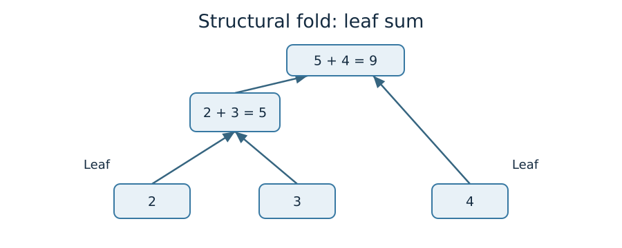

# M12-L2 – Functional programming and recursion {#L2}

**Course area:** M12 – Programming and software quality

**Level:** Bachelor’s · Core/foundations

**Prerequisites:** [M12-L1](M12-L1.md); [M8-L1](M8-L1.md)

## Learning objectives {#S1}

Distinguish pure and effectful functions, combine map and fold, define recursive data, and justify termination and correctness by structural induction.

## Pure functions and functional abstraction {#S2}

A pure function returns the same result for the same input values and has no observable side effects. Writing a file, modifying an externally visible list, or querying the current time are not pure operations. Absence of assignment is neither necessary nor sufficient for purity: a locally mutated accumulator that does not escape can implement an externally pure function. Conversely, a short expression may read hidden state. Here we consider terminating functions on immutable data with deterministic, pure function arguments.

Higher-order functions take functions as arguments or return functions. `map(f, xs)` describes an elementwise transformation and `filter(p, xs)` selects elements. Python returns iterators for both; `list(...)` materializes the result. A fold reduces a sequence to a single value using a binary function and an initial value. Evaluation order is part of its definition.

## Folds and evaluation order {#S3}

For a left fold, $a_0=z$ and $a_{i+1}=f(a_i,x_i)$. The empty sequence returns $z$. A right fold instead corresponds to $f(x_1,f(x_2,\ldots,f(x_n,z)))$. For subtraction with seed zero and 1,2,3 the left fold returns -6, the right fold 2. A different grouping is not equivalent without suitable algebraic properties. For an associative operation with a two-sided identity as seed, regrouping is valid; changing order additionally requires commutativity (or a specific justification). Floating-point addition is not generally exactly associative.

```python
def fold_left(fn, seed, xs):
    acc = seed
    for x in xs:
        acc = fn(acc, x)
    return acc

def tree_fold(leaf, branch, tree):
    if type(tree) is int:
        return leaf(tree)
    if type(tree) is not tuple or len(tree) != 2:
        raise ValueError("expected int or pair")
    left, right = tree
    return branch(tree_fold(leaf, branch, left),
                  tree_fold(leaf, branch, right))

tree = ((2, 3), 4)
assert tree_fold(lambda x: x, lambda a, b: a+b, tree) == 9
assert tree_fold(lambda x: 1, lambda a, b: a+b, tree) == 3
assert fold_left(lambda a, x: a-x, 0, [1, 2, 3]) == -6
assert list(map(lambda x: x*x, [2, 3, 4])) == [4, 9, 16]
```

The iterative left fold traverses the finite sequence with an accumulator; it is linear in the number of elements if the function argument takes constant time. A Python iterator can be single-use. The diagram illustrates folding a binary tree.

{alt="Tree fold from leaves to root"}

## Recursive data types and induction proof {#S4}

A finite full binary tree in this model is either an integer leaf or a pair of such trees. Cycles are excluded. `tree_fold` handles leaves with `leaf` and internal nodes with `branch`. Termination follows from the number of nodes as a natural-number measure: both recursive arguments are proper subtrees with fewer nodes. Correctness of leaf summation follows by structural induction. Leaf: `leaf(x)=x` gives the sum. Pair: if both recursive results are the respective leaf sums, adding them gives the sum of all leaves. Similarly `leaf(x)=1` counts leaves. The function arguments can be chosen independently of the traversal scheme.

For `((2,3),4)` the partial sums are 5 and 4, then 9. A full binary tree with $m$ leaves has $m-1$ internal nodes (induction on the same structure); assuming constant node costs the traversal takes $O(m)$ time and $O(h+1)$ call stack for height $h$ in edges. A highly skewed tree may hit Python's recursion limit even though the mathematical recursion terminates. Iterative postorder traversal using an explicit stack is an alternative.

## Practice: separating computation from effects {#S5}

A functional core can derive a new result value from an immutable input model. An outer imperative layer reads input, invokes the core and writes results. This simplifies repeatable tests but does not guarantee correctness. For example, a function argument can have a hidden effect. The contract of `tree_fold` requires a valid finite tree and terminating leaf and branch functions; for the mathematical interpretation as a pure fold these must also be pure. Invalid non-pairs are rejected, and excessively deep trees may raise `RecursionError`.

A test generator can enumerate all small tree shapes and collect their leaves with an explicit stack traversal. Compare leaf sum and count against the fold. Use different node operations to detect accidental argument reversal, such as concatenating tuples in left-to-right order.

## Self-assessment {#S6}

### Exercises

1. Calculate the left fold with multiplication and seed 1 for 2,3,4.
2. Calculate the right fold with subtraction and seed 0 for 1,2,3.
3. Give leaf sum and count for `(1,(2,(3,4)))`.
4. Why is reading the current time inside a function not pure?
5. Formulate a tree fold for maximum leaf depth in edges.

::: {.lc-solutions data-lc-section="S6"}
1. 24.
2. $1-(2-(3-0))=2$.
3. Sum 10, count 4.
4. The same explicit input can yield different results; the clock is an external source of state.
5. `tree_fold(lambda x: 0, lambda a,b: 1+max(a,b), tree)`.
:::

## Sources {#S7}

- [Composing Programs, Higher-Order Functions](https://www.composingprograms.com/pages/16-higher-order-functions.html) · §1.6.1, 1.6.8: functional abstraction · Last accessed: 2026-11-24 · Content verified: 2026-11-24
- [Composing Programs, Recursive Functions](https://www.composingprograms.com/pages/17-recursive-functions.html) · §1.7.1, 1.7.4: base cases, recursive decomposition · Last accessed: 2026-11-24 · Content verified: 2026-11-24
