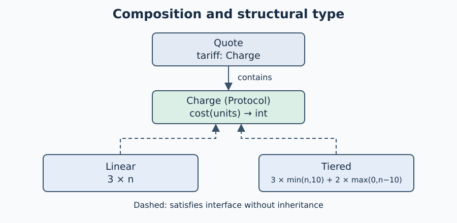

# M12-L3 – Object orientation, types and polymorphism {#L3}

**Course area:** M12 – Programming and software quality

**Level:** Bachelor’s · Core/foundations

**Prerequisites:** [M12-L1](M12-L1.md)

## Learning objectives {#S1}

Explain identity, state and interfaces; implement structural polymorphism and assess whether a subtype satisfies a behavioral contract. Choose between inheritance and composition with reasons.

## Objects and type contracts {#S2}

A class defines a type and supplies methods; an object is a particular instance with identity and potentially mutable state. Two names can refer to the same object: modifying a mutable list through one alias is visible through the other. Value equality differs from identity (`==` versus `is`). Encapsulation directs permitted state changes through a defined interface. In Python a leading underscore is a convention, not a security boundary. A frozen dataclass prevents ordinary attribute assignment but does not guarantee deep immutability of nested objects.

A type contract describes accepted inputs, results and observable effects. Nominal subtyping relies on declared type relationships; structural subtyping relies on the required interface. Python supports dynamic method calls; `Protocol` expresses structural typing requirements for static analysis. Type annotations generally do not enforce input validation at runtime.

## Composition and polymorphism {#S3}

We model pricing in integer accounting units without rounding. The `Charge.cost` contract accepts a nonnegative integer quantity, returns a nonnegative integer price, and does not change the tariff object. The linear tariff charges 3 per unit; the tiered tariff charges 3 for each of the first ten units and 2 for each additional unit. Both implementations raise `ValueError` for invalid quantities. We deliberately reject `bool`, although Python derives it from `int`. The `Quote` class delegates to a tariff without inspecting its concrete type.

The implementation demonstrates composition and dynamic method selection. Both tariffs satisfy the structural interface without explicitly inheriting from `Charge`.

```python
from dataclasses import dataclass
from typing import Protocol

class Charge(Protocol):
    def cost(self, units: int) -> int: ...

def check_units(units: int) -> None:
    if type(units) is not int or units < 0:
        raise ValueError("nonnegative integer required")

@dataclass(frozen=True)
class Linear:
    def cost(self, units: int) -> int:
        check_units(units)
        return 3 * units

@dataclass(frozen=True)
class Tiered:
    def cost(self, units: int) -> int:
        check_units(units)
        return 3 * min(units, 10) + 2 * max(0, units - 10)

@dataclass(frozen=True)
class Quote:
    tariff: Charge
    def total(self, units: int) -> int:
        return self.tariff.cost(units)

assert Quote(Linear()).total(12) == 36
assert Quote(Tiered()).total(12) == 34
```

{alt="Quote delegates through the interface to two implementations"}

## Substitution and invariants {#S4}

The substitution principle requires a concrete type to work wherever its contract is expected. A subtype must not strengthen required preconditions, weaken promised postconditions or violate promised invariants. A class accepting at most ten units does not satisfy this contract despite an identical method signature. Returning -1 for a valid input also violates the contract. A static type checker can detect signature errors but cannot generally prove all semantic promises.

For `Tiered`, the price is $3n$ when $0\leq n\leq10$, and $30+2(n-10)$ when $n>10$. The expressions agree at the boundary and every extra unit increases the price. The contract does not require a particular rate, however. The price formula is a stronger property of the individual tariff, not the shared protocol.

## Design decisions {#S5}

Inheritance is suitable for a stable is-a relationship with a matching contract, but it may couple subclasses to base-class internals. Composition expresses a has-a relationship: `Quote` contains a tariff, and a new `Quote` can be constructed with a different tariff. This example uses immutable, stateless tariffs, not shared mutable prices. A discount decorator could contain another tariff provided it preserves the contract, including rounding rules. Real financial calculations would require separate currency, rounding and validity-period specifications.

Check every tariff with the same contract tests (0, 1, 10, 11, negative input). Also check the particular price independently. Signatures, contract tests and domain specifications complement one another.

## Self-check {#S6}

### Exercises

1. Distinguish identity and value equality.
2. Calculate both tariffs for 10 and 13 units.
3. Why does a tariff limited to ten units violate the common contract?
4. Why does `Protocol` not enforce runtime validation here?
5. Design a constant surcharge of 5 using composition. What property is preserved?

::: {.lc-solutions data-lc-section="S6"}
1. Identity concerns the same object; equality concerns the defined value-equality relation.
2. 10: both 30; 13: linear 39, tiered 36.
3. It strengthens the precondition; the interface accepts every nonnegative integer quantity.
4. Annotations support static analysis; `check_units` performs explicit runtime validation.
5. A wrapper holds a `Charge` and returns `cost(units)+5` after calling it. Nonnegative integer results and error behavior remain intact if the wrapped tariff meets the contract.
:::

## Sources {#S7}

- [Python 3.12, Classes](https://docs.python.org/3.12/tutorial/classes.html) · 9.1, 9.3, 9.5: objects, methods, inheritance · Last accessed: 2026-11-24 · Content verified: 2026-11-24
- [Python 3.12, typing](https://docs.python.org/3.12/library/typing.html) · type annotations; Protocol and structural subtyping · Last accessed: 2026-11-24 · Content verified: 2026-11-24
