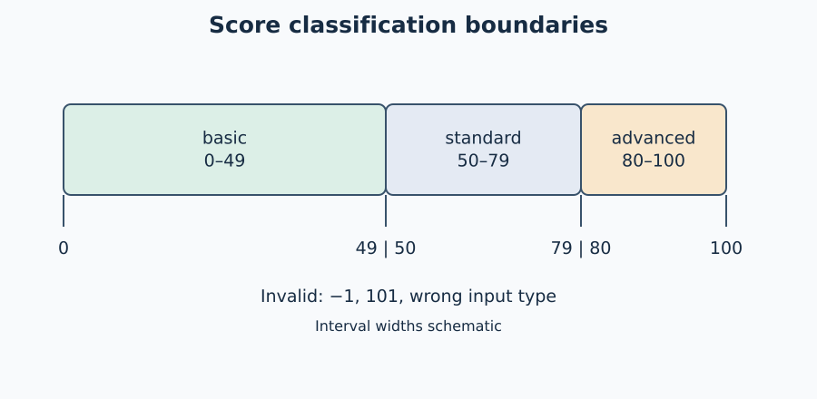

# M12-L4 – Test design and systematic software quality {#L4}

**Course area:** M12 – Programming and software quality

**Level:** Bachelor’s · Core/foundations

**Prerequisites:** [M12-L1](M12-L1.md); [M1-L4](M1-L4.md)

## Learning objectives {#S1}

Derive tests from a specification, select equivalence classes and boundaries, formulate properties, and evaluate coverage and mutation testing.

## Specification and test oracle {#S2}

A test needs an observable expected result or another test oracle. A unit test examines a small unit in isolation; an integration test examines cooperation among units. System tests assess the complete system against requirements. Regression tests protect against recurrence of known defects. These categories may overlap. Test inputs and expected results should not merely duplicate the implementation logic, since shared mistakes may remain undetected.

Our specification classifies integer scores from 0 to 100: 0–49 yield `basic`, 50–79 yield `standard`, and 80–100 yield `advanced`. Other inputs, including Boolean and floating-point values, are invalid. The three valid intervals and invalid input classes guide test selection.

## Equivalence classes and boundaries {#S3}

Equivalence classes group inputs expected to behave similarly under the specification. One representative cannot prove the entire class. For discrete intervals, boundaries and their immediate neighbors are useful: -1, 0, 1, 48, 49, 50, 51, 78, 79, 80, 81, 99, 100, 101. Add type errors such as `True` and `50.0`. The diagram marks the central transitions.

The implementation and small test suite are deliberately separate. Tests expect fixed specified results and explicitly handle expected exceptions.

```python
def band(x: int) -> str:
    if type(x) is not int or not 0 <= x <= 100:
        raise ValueError("integer in 0..100 required")
    if x < 50:
        return "basic"
    if x < 80:
        return "standard"
    return "advanced"

def check_cases(fn):
    cases = [(0, "basic"), (49, "basic"), (50, "standard"),
             (79, "standard"), (80, "advanced"), (100, "advanced")]
    for x, expected in cases:
        assert fn(x) == expected
    for x in (-1, 101, True, 50.0):
        try:
            fn(x)
        except ValueError:
            continue
        raise AssertionError("invalid input accepted")

check_cases(band)
rank = {"basic": 0, "standard": 1, "advanced": 2}
assert all(rank[band(x)] <= rank[band(x+1)] for x in range(100))
```

{alt="Three score intervals with boundary values 49, 50, 79 and 80"}

## Properties and coverage {#S4}

Property-based tests check statements over many inputs. For valid scores, category rank must not decrease as the score rises. The code checks all 100 adjacent valid pairs, establishing monotonicity for this finite range. Monotonicity alone is insufficient: a function returning `basic` for every valid score also satisfies it. Boundary tests refute that incorrect function. Since the valid domain is small, all 101 values can be checked against an independently constructed table. Unbounded inputs or complex state spaces still require selective testing.

Statement coverage indicates which statements executed. Branch coverage checks both outcomes of a decision. Neither alone says whether an oracle verifies the correct result. A test that merely calls a function may miss defects.

## Mutation testing and release {#S5}

Mutation testing deliberately changes a program, for example replacing `x < 50` with `x <= 50`. A mutant is killed when at least one test distinguishes it from the specification. Here, 50 is the counterexample. Changing `x < 80` to `x < 79` is detected at 79. Raising the upper accepted input boundary to 101 is detected by the test at 101. An equivalent mutant such as replacing `x < 50` with `x <= 49` for already validated integers cannot be distinguished behaviorally.

A mutation score of $k/m$ refers to the selected set of non-equivalent mutants; unknown equivalence complicates interpretation. A high score does not prove absence of defects. Supplement testing with review, static analysis and integration tests. A CI pipeline runs small tests on changes; failures block release until the cause is resolved or the specification is corrected with justification.

## Self-check {#S6}

### Exercises

1. Name the three valid equivalence classes.
2. Which values matter at the transition to `advanced`?
3. Which test kills the mutation `x < 50` to `x <= 50`?
4. Why is monotonicity insufficient as the sole property?
5. Of five mutants, four are non-equivalent and three of those are killed. Calculate the mutation score.

::: {.lc-solutions data-lc-section="S6"}
1. 0–49, 50–79, 80–100.
2. 79 and 80; additionally 78 and 81.
3. `band(50)` must yield `standard`.
4. The constant output `basic` is also monotonic but incorrect.
5. 3/4 = 75%. The equivalent mutant is excluded from the denominator.
:::

## Sources {#S7}

- [The Fuzzing Book, Introduction to Software Testing](https://www.fuzzingbook.org/html/Intro_Testing.html) · Simple Testing; Generating Tests; Limits of Testing · Last accessed: 2026-11-24 · Content verified: 2026-11-24
- [The Fuzzing Book, Mutation Analysis](https://www.fuzzingbook.org/html/MutationAnalysis.html) · Why Structural Coverage is Not Enough; Evaluating Mutations; Equivalent Mutants · Last accessed: 2026-11-24 · Content verified: 2026-11-24
