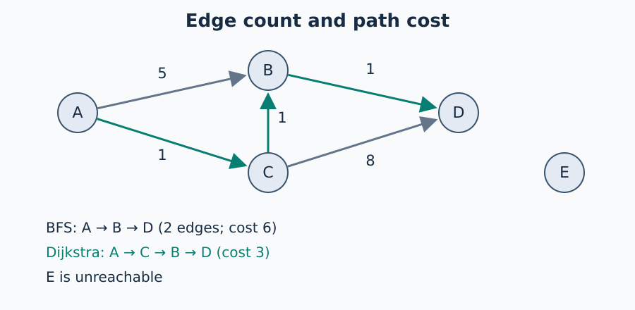

# M13-L1 – Graph traversal and shortest paths {#L1}

**Course area:** M13 – Algorithm design methods

**Level:** Bachelor’s · Core/foundations

**Prerequisites:** [M8-L1](M8-L1.md); [M12-L1](M12-L1.md)

## Learning objectives {#S1}

Distinguish reachability, minimum edge count and minimum total edge weight. Justify the invariants of breadth-first search and Dijkstra’s algorithm, reconstruct paths and analyse the running times.

## Graph model and search goals {#S2}

A finite directed graph $G=(V,E)$ consists of vertices and directed edges. An adjacency list stores each vertex’s outgoing neighbours and weights. In this lesson all vertices are labelled by comparable strings, every edge destination belongs to the graph, and the source exists. Dijkstra’s weights are nonnegative integers. An unreachable vertex has distance $\infty$, not zero. A path with few edges may still have high cost.

Consider A→B (5), A→C (1), C→B (1), C→D (8), B→D (1), and isolated vertex E. Breadth-first search finds a two-edge path to D; A→B→D costs 6. The minimum-cost path A→C→B→D has three edges but costs only 3. The diagram contrasts the two objectives.

{alt="Directed graph: two edges via B, minimum cost via C and B; E isolated"}

## Breadth-first and depth-first search {#S3}

Breadth-first search (BFS) uses a FIFO queue. Mark vertices when inserting them so each enters the queue at most once. The mark records the distance in edges and a predecessor. The queue contains pending vertices in nondecreasing distance order. Induct on the distance layers: the source has distance 0. If layer $k$ is correct, expanding it reaches every as-yet undiscovered vertex at minimum distance $k+1$. Any shorter path would have discovered it in an earlier layer. Thus the first recorded distances are optimal.

Depth-first search (DFS) uses a stack. For reachability alone, marking on insertion suffices: every discovered vertex has a path from the source, and every reachable vertex is eventually discovered; otherwise some path would contain an edge from the discovered to the undiscovered set. This iterative variant produces a visited set, not necessarily the order or DFS tree of a recursive implementation. With adjacency lists both methods take $O(|V|+|E|)$ time and $O(|V|)$ extra space.

## Dijkstra: relaxation and proof {#S4}

Initialize $d(s)=0$ and every other distance to $\infty$. Relaxing edge $(u,v)$ with weight $w$ replaces $d(v)$ by $d(u)+w$ if the candidate is smaller. Extract the vertex with the smallest current key from a priority queue. Skip stale entries.

**Correctness argument:** Every finite tentative distance is the length of a path actually found and hence an upper bound on the optimum. Suppose the next valid extracted vertex $u$ had a path shorter than its key. On such a shortest path let $y$ be the first vertex not yet finalized, with finalized predecessor $x$ (the source case is trivial). Relaxing from $x$ makes $d(y)$ at most the length of the prefix ending at $y$. Nonnegative weights make this no larger than the length of the entire shorter path to $u$. Thus $d(y)<d(u)$, contradicting minimum extraction. Inductively each valid extraction finalizes its distance. Strict improvements prevent reinsertion on ties.

In the example, valid extractions are A:0, C:1, B:2, D:3; old keys B:5 and D:9 are skipped. Negative weights violate the proof assumption: S→U (2), S→V (5), V→U (-4) initially gives U distance 2 but the true optimum is 1. Finalizing U would be incorrect. Bellman–Ford is an alternative for negative edges; reachable negative cycles may preclude finite optimal distances.

## Executable implementation and limitations {#S5}

The `path` function follows predecessors backwards. It returns `None` for an unreachable destination. The example deliberately uses integer weights to avoid rounding issues.

```python
from collections import deque
from heapq import heappop, heappush
from math import inf

def bfs(g, s):
    d, parent = {s: 0}, {s: None}
    q = deque([s])
    while q:
        u = q.popleft()
        for v, w in g[u]:
            if v not in d:
                d[v], parent[v] = d[u] + 1, u
                q.append(v)
    return d, parent

def dfs(g, s):
    seen, stack = {s}, [s]
    while stack:
        u = stack.pop()
        for v, w in g[u]:
            if v not in seen:
                seen.add(v)
                stack.append(v)
    return seen

def dijkstra(g, s):
    if any(type(w) is not int or w < 0
           for edges in g.values() for v, w in edges):
        raise ValueError("nonnegative integer weights required")
    d = dict.fromkeys(g, inf)
    parent = {s: None}
    d[s], heap = 0, [(0, s)]
    while heap:
        du, u = heappop(heap)
        if du != d[u]:
            continue
        for v, w in g[u]:
            candidate = du + w
            if candidate < d[v]:
                d[v], parent[v] = candidate, u
                heappush(heap, (candidate, v))
    return d, parent

def path(parent, t):
    if t not in parent:
        return None
    result = []
    while t is not None:
        result.append(t)
        t = parent[t]
    return result[::-1]

g = {"A": [("B", 5), ("C", 1)], "B": [("D", 1)],
     "C": [("B", 1), ("D", 8)], "D": [], "E": []}
assert bfs(g, "A")[0]["D"] == 2
assert dfs(g, "A") == {"A", "B", "C", "D"}
d, pred = dijkstra(g, "A")
assert d["D"] == 3 and path(pred, "D") == ["A", "C", "B", "D"]
assert d["E"] == inf and path(pred, "E") is None
```

The heap variant inserts a new entry on each successful relaxation. For $V=|V|$ and $E=|E|$, running time is $O(V+E+(E+1)\log(E+2))$ and extra space is $O(V+E)$ including heap entries. For simple graphs this gives the familiar bound $O(V+E\log(V+1))$. An indexed priority queue with decrease-key can limit the heap to $O(V)$ entries. Input validation here covers weights, not every model assumption.

## Self-check {#S6}

### Exercises

1. What is the minimum number of edges on a path from A to D?
2. What is the weighted distance from A to B?
3. Why does BFS mark vertices on queue insertion?
4. Why is the example with V→U (-4) not a valid Dijkstra input?
5. Add D→E with weight 0. What distance and reconstructed path does E receive?

::: {.lc-solutions data-lc-section="S6"}
1. Two, for example A→B→D.
2. 2 via A→C→B.
3. To avoid enqueuing discovered vertices repeatedly; the first BFS distance is optimal.
4. The negative edge can lower the cost of an already finalized vertex. The implementation rejects it.
5. Distance 3; A→C→B→D→E.
:::

## Sources {#S7}

- [Sedgewick & Wayne, Directed Graphs](https://algs4.cs.princeton.edu/42digraph/index.php) · Reachability in digraphs; graph representation · Last accessed: 2026-11-24 · Content verified: 2026-11-24
- [Sedgewick & Wayne, Shortest Paths](https://algs4.cs.princeton.edu/44sp/) · Dijkstra’s algorithm; negative weights; lazy implementation · Last accessed: 2026-11-24 · Content verified: 2026-11-24
