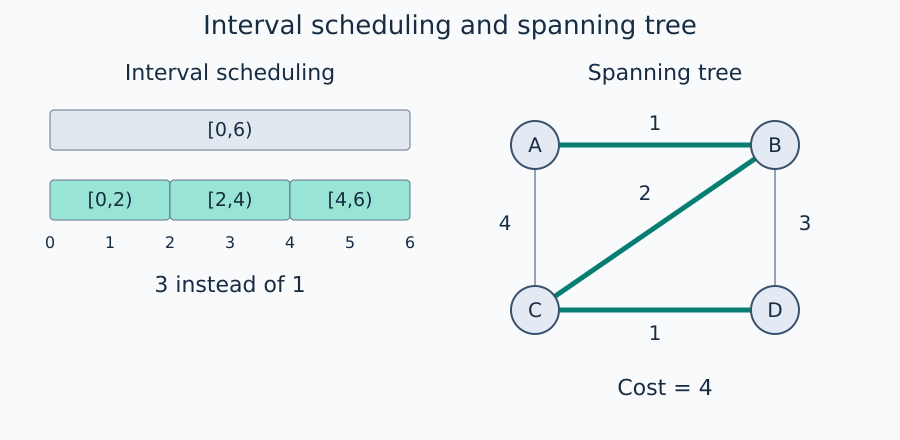

# M13-L2 – Greedy algorithms and exchange arguments {#L2}

**Course area:** M13 – Algorithm design methods

**Level:** Bachelor’s · Core/foundations

**Prerequisites:** [M13-L1](M13-L1.md)

## Learning objectives {#S1}

Justify a safe local choice by exchange, compute a minimum spanning tree and identify cases in which a greedy rule fails.

## Interval scheduling {#S2}

Given finitely many half-open intervals $[a,b)$ with $a<b$, maximize the number of pairwise disjoint intervals; touching endpoints are allowed. Sort by finishing time, select the first interval and repeat on compatible intervals. In the example [0,6) competes with [0,2), [2,4), [4,6). The three short intervals together are optimal. The choice is governed by finish time, not duration or start time.

## Exchange argument {#S3}

Let $g$ finish earliest and let $o$ be the first interval in an optimal solution. Since $b_g\le b_o$, every later interval starts no earlier than the end of $g$. Replace $o$ by $g$: the cardinality and feasibility are preserved. Thus an optimum containing $g$ exists. Apply the same argument to the remaining problem; induction on the number of intervals proves optimality. Empty input returns the empty schedule. With weights the exchange is invalid: [0,2) and [2,4) with value 1 each lose to [0,4) with value 5. Specify the objective before choosing the rule.

## Minimum spanning trees {#S4}

A connected undirected graph with $n$ vertices has a spanning tree with $n-1$ edges. Minimize total edge weight, not distances from a root. Kruskal processes edges in increasing weight order and accepts exactly those joining distinct current components. The diagram has AB=1, BC=2, CD=1, AC=4, BD=3; AB, CD, BC cost 4. Ties may be broken arbitrarily; negative weights are permitted.

Proof: the current forest $F$ is contained in a minimum spanning tree $T$. For a new edge $e$ between components, either $e\in T$ or $T+e$ contains a unique cycle. Another edge $f$ on the cycle crosses the cut around one component of $F$. It is not in $F$. Kruskal could not have skipped an earlier crossing edge (it would also have joined distinct components at that time), so $w(e)\le w(f)$. Remove $f$: the resulting tree contains $F+e$ and costs no more. The invariant is preserved; with $n-1$ edges the tree is optimal. On disconnected graphs the same argument applies separately to each component, giving a minimum spanning forest.

{alt="Interval schedule and minimum spanning tree"}

## Implementation and complexity {#S5}

Union-find represents components with parent pointers. Path halving and union by size accelerate repeated queries. Scheduling takes $O(k\log(k+1))$ time for $k$ intervals. Kruskal takes $O(n+m\log(m+1)+m\alpha(n))$ for $m$ edges, where $\alpha$ is the inverse Ackermann function (amortized union-find bound). Space is $O(n+m)$ including sorted edges. Inputs must have valid vertex indices, positive interval lengths and finite comparable weights. The examples do not revalidate these contracts.

```python
def schedule(intervals):
    chosen = []
    for a, b in sorted(intervals, key=lambda t: (t[1], t[0])):
        if not chosen or a >= chosen[-1][1]:
            chosen.append((a, b))
    return chosen

def kruskal(n, edges):
    parent = list(range(n))
    size = [1] * n
    def find(x):
        while x != parent[x]:
            parent[x] = parent[parent[x]]
            x = parent[x]
        return x
    result = []
    for u, v, w in sorted(edges, key=lambda e: e[2]):
        a, b = find(u), find(v)
        if a == b:
            continue
        if size[a] < size[b]:
            a, b = b, a
        parent[b] = a
        size[a] += size[b]
        result.append((u, v, w))
    return result

assert schedule([(0, 6), (0, 2), (2, 4), (4, 6)]) == [(0, 2), (2, 4), (4, 6)]
edges = [(0, 1, 1), (1, 2, 2), (2, 3, 1), (0, 2, 4), (1, 3, 3)]
assert sum(w for u, v, w in kruskal(4, edges)) == 4
```

## Self-assessment {#S6}

### Exercises

1. Which intervals are selected in the example?
2. Why is the exchange feasible?
3. Give a counterexample to earliest start first.
4. What edges and cost does the tree in the diagram have?
5. What does Kruskal return for two disconnected components?

::: {.lc-solutions data-lc-section="S6"}
1. [0,2), [2,4), [4,6).
2. The replacement finishes no later; subsequent intervals remain compatible.
3. [0,9), [1,3), [3,5), [5,7): earliest start yields one instead of three.
4. AB, CD, BC; total cost 4.
5. A minimum spanning forest with a minimum tree for each component.
:::

## Sources {#S7}

- [Kleinberg & Tardos, Greedy Algorithms I](https://www.cs.princeton.edu/courses/archive/spring18/cos423/lectures/04GreedyAlgorithmsI-2x2.pdf) · Interval scheduling, exchange argument; PDF text (Review scope: text only) · Last accessed: 2026-11-24 · Content verified: 2026-11-24
- [Sedgewick & Wayne, Minimum Spanning Trees](https://algs4.cs.princeton.edu/43mst/index.php) · Cut property, Kruskal, spanning forest · Last accessed: 2026-11-24 · Content verified: 2026-11-24
