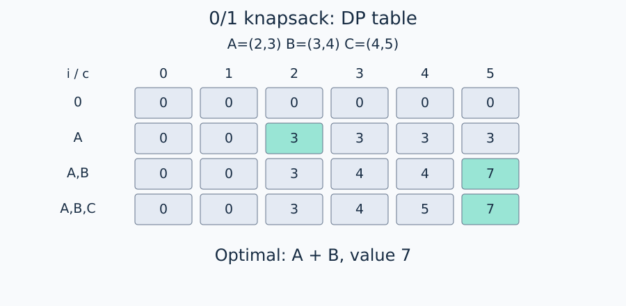

# M13-L3 – Dynamic programming and recurrences {#L3}

**Course area:** M13 – Algorithm design methods

**Level:** Bachelor’s · Core/foundations

**Prerequisites:** [M12-L1](M12-L1.md); [M7-L2](M7-L2.md)

## Learning objectives {#S1}

Define states, base cases and recurrences, compute a DP table, reconstruct an optimal selection and distinguish polynomial from pseudopolynomial running time.

## From search tree to state table {#S2}

Dynamic programming stores results of recurring subproblems. A useful state contains all information needed for future decisions. Memoization evaluates states on demand; tabulation follows a dependency order. Both require acyclic state dependencies in the problems considered here. Storing results alone does not make an exponentially large state space efficient.

## 0/1 knapsack: recurrence and proof {#S3}

For $n$ items with positive integer weights $w_i$, nonnegative integer values $v_i$ and capacity $W\ge 0$, each item may be chosen at most once. Define $D(i,c)$ as the optimal value from the first $i$ items under capacity $c$. We have $D(0,c)=0$ and $D(i,0)=0$. For $c<w_i$, $D(i,c)=D(i-1,c)$; otherwise

$$D(i,c)=\max\{D(i-1,c),v_i+D(i-1,c-w_i)\}.$$

Proof by induction on $i$: every feasible selection either contains item $i$ or does not. In the first case the remaining capacity is $c-w_i$ and the other items come from the smaller subproblem; in the second it is $c$. Both candidates are attainable, and every solution is bounded above by one candidate. Their maximum is optimal. The base case is the empty selection.

## Example and reconstruction {#S4}

Items A=(2,3), B=(3,4), C=(4,5) specify weight and value; $W=5$. The diagram shows the complete table. Cell $D(3,5)=7$ inherits $D(2,5)$, so C is unnecessary. $D(2,5)=7>D(1,5)=3$: take B, leaving capacity 2. A supplies value 3 there. On ties the later item may be omitted.

Greedy selection by value/weight is not generally optimal for 0/1: with capacity 5 and items (3,5), (5,8), it selects the first (ratio 5/3 > 8/5) but achieves 5 instead of 8. Allowing fractional items would define a different problem.

{alt="Knapsack DP table with optimal selection"}

## Implementation and complexity {#S5}

The table contains $(n+1)(W+1)$ cells; time and space are $O((n+1)(W+1))$ under unit-cost value arithmetic. Because binary $W$ requires about $\log_2(W+1)$ bits, the bound is pseudopolynomial. For the optimal value alone a single row suffices if capacities are processed in descending order for each item; ascending order would allow repeated use of the same item. The full table permits simple reconstruction. This model deliberately excludes zero weights and validates its inputs.

```python
def knapsack(items, capacity):
    if type(capacity) is not int or capacity < 0:
        raise ValueError("nonnegative integer capacity required")
    if any(type(w) is not int or w <= 0 or type(v) is not int
           or v < 0 for w, v in items):
        raise ValueError("positive integer weights, nonnegative integer values")
    n = len(items)
    table = [[0] * (capacity + 1) for _ in range(n + 1)]
    for i, (w, v) in enumerate(items, 1):
        for c in range(capacity + 1):
            best = table[i - 1][c]
            if w <= c:
                best = max(best, v + table[i - 1][c - w])
            table[i][c] = best
    selected = []
    c = capacity
    for i in range(n, 0, -1):
        if table[i][c] > table[i - 1][c]:
            selected.append(i - 1)
            c -= items[i - 1][0]
    return table[n][capacity], selected[::-1], table

assert knapsack([(2, 3), (3, 4), (4, 5)], 5)[:2] == (7, [0, 1])
assert knapsack([], 0)[:2] == (0, [])
```

## Self-assessment {#S6}

### Exercises

1. Compute $D(2,4)$ in the example.
2. Why read from row $i-1$?
3. What selection results at capacity 4?
4. Why is $O(nW)$ not automatically polynomial in input length?
5. What goes wrong with ascending capacity iteration in a single row?

::: {.lc-solutions data-lc-section="S6"}
1. 4, B alone.
2. So each item is used at most once.
3. C alone, value 5.
4. The binary representation of W is logarithmic in W; W can be exponential in bit length.
5. A value already increased in the same row may include the same item again.
:::

## Sources {#S7}

- [Sedgewick & Wayne, Knapsack.java](https://introcs.cs.princeton.edu/java/23recursion/Knapsack.java.html) · 0/1 recurrence, reconstruction; independent Python implementation · Last accessed: 2026-11-24 · Content verified: 2026-11-24
- [MIT OCW, Recitation 21](https://ocw.mit.edu/courses/6-006-introduction-to-algorithms-fall-2011/resources/recitation-21-dynamic-programming-knapsack-problem/) · Resource description: knapsack, pseudopolynomial time; video not reviewed (resource description only; video not reviewed) · Last accessed: 2026-11-24
