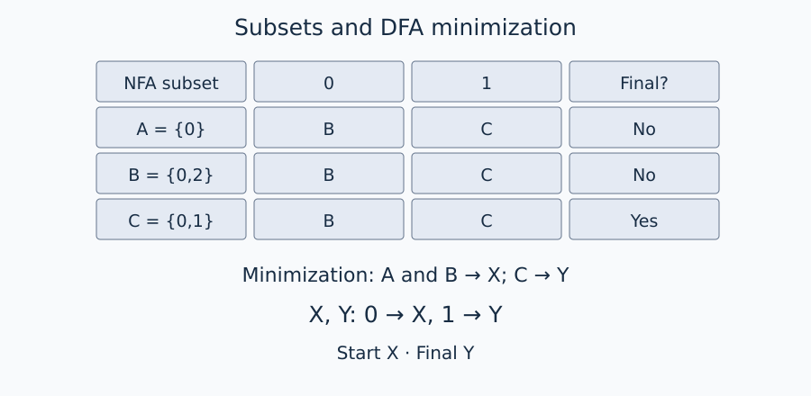

# M14-L1 – Finite automata, subset construction and minimization {#L1}

**Course area:** M14 – Formal languages and complexity

**Level:** Bachelor’s · Core/foundations

**Prerequisites:** [M8-L2](M8-L2.md)

## Learning objectives {#S1}

Construct a deterministic finite automaton from a nondeterministic one, prove preservation of the language, and find the smallest complete DFA over a fixed alphabet.

## Finite automata {#S2}

A DFA $(Q,\Sigma,\delta,q_0,F)$ has a total transition function $\delta:Q\times\Sigma\to Q$. In an NFA the result is a set of states; a word is accepted if at least one complete run ends in a final state. The empty state set represents the absence of a possible run. When $\varepsilon$ edges are allowed, the closure $E(S)$ comprises the states reachable from $S$ through zero or more such edges.

## Subset construction and proof {#S3}

The DFA starts in $E(\{q_0\})$. On each symbol $a$, a set $S$ leads to $E(\bigcup_{q\in S}\delta(q,a))$. A set is final precisely when it intersects $F$. Induction on word length: the initial set contains exactly the states reachable without consuming input. Given the induction hypothesis, one symbol transition followed by closure gives exactly the possible states after the next symbol. Both automata therefore accept the same words. An NFA with $n$ states yields at most $2^n$ DFA states; only reachable subsets need be constructed.

## Minimization and example {#S4}

Two reachable DFA states are equivalent if every continuation is either accepted from both or rejected from both. Start with separate final and nonfinal blocks, omitting empty blocks. Split each block by the destination blocks of its transitions until no further split occurs. After $k$ refinements states in the same block agree on all continuations of length at most $k$: the base case is the empty continuation; the induction step examines one symbol followed by a shorter continuation. The stable partition is preserved by every transition and thus represents language equivalence. Every block requires a separate state in any equivalent DFA: prefixes reaching different blocks have a distinguishing continuation. The quotient automaton is therefore minimal and unique up to renaming.

Example: state 0 loops on both symbols, with an additional edge on 0 to state 2 and on 1 to state 1. Only 1 is final, and 1 and 2 have no outgoing edges. The reachable sets A={0}, B={0,2}, C={0,1} are shown in the figure. A and B merge; C remains separate. The language consists of binary words whose last digit is 1.

{alt="Subsets and DFA minimization"}

## Implementation and limitations {#S5}

The implementation assumes an epsilon-free NFA, a fixed reusable alphabet and valid transition targets. An absent transition means the empty set. The queue enumerates reachable subsets; each nonstable iteration strictly refines the partition. With $m$ reachable DFA states there are at most $m-1$ strict refinements; the cost per round depends on alphabet size and data structures. Epsilon edges require an additional closure computation. This is a teaching model, not an optimized lexer.

```python
from collections import deque

def determinize(start, finals, edges, alphabet):
    # epsilon-free NFA; missing transitions are empty sets
    start = frozenset({start})
    todo = deque([start])
    trans = {start: {}}
    while todo:
        s = todo.popleft()
        for a in alphabet:
            t = frozenset(r for q in s for r in edges.get((q, a), ()))
            trans[s][a] = t
            if t not in trans:
                trans[t] = {}
                todo.append(t)
    return start, {s for s in trans if s & finals}, trans

def minimize(start, finals, trans, alphabet):
    # trans contains only reachable states and is complete
    blocks = [b for b in (set(trans) & finals, set(trans) - finals) if b]
    while True:
        owner = {q: i for i, b in enumerate(blocks) for q in b}
        refined = []
        for b in blocks:
            buckets = {}
            for q in b:
                key = tuple(owner[trans[q][a]] for a in alphabet)
                buckets.setdefault(key, set()).add(q)
            refined.extend(buckets.values())
        if len(refined) == len(blocks):
            break
        blocks = refined
    out = {i: {a: owner[trans[next(iter(b))][a]] for a in alphabet}
           for i, b in enumerate(blocks)}
    return owner[start], {owner[q] for q in finals}, out

def accepts(start, finals, trans, word):
    for a in word:
        start = trans[start][a]
    return start in finals

edges = {(0, '0'): {0, 2}, (0, '1'): {0, 1}}
s, f, t = determinize(0, {1}, edges, '01')
assert len(t) == 3
s, f, t = minimize(s, f, t, '01')
assert len(t) == 2
assert accepts(s, f, t, '101') and not accepts(s, f, t, '10')
```

## Self-assessment {#S6}

### Exercises

1. Is the empty subset always reachable?
2. Which subset follows 010 in the example?
3. Which continuation distinguishes B and C?
4. How many subsets are possible with five NFA states?
5. Why may an unreachable state be discarded before minimization?

::: {.lc-solutions data-lc-section="S6"}
1. No; state 0 is always reachable in the example.
2. B={0,2}.
3. The empty word, because only C is final.
4. 32.
5. No input word can reach it, so it does not affect the language.
:::

## Sources {#S7}

- [Cornell CS 4120 – Lexical implementation](https://www.cs.cornell.edu/courses/cs4120/2023sp/notes/leximpl/) · Subset construction, epsilon closure, minimality (Review scope: text only) · Last accessed: 2026-11-24 · Content verified: 2026-11-24
- [Virginia Tech OpenDSA – DFA minimization](https://opendsa.cs.vt.edu/ODSA/Books/PIFLA/html/DFAMinimization.html) · Partition refinement; text only, interactive examples not checked (Review scope: text only) · Last accessed: 2026-11-24 · Content verified: 2026-11-24
