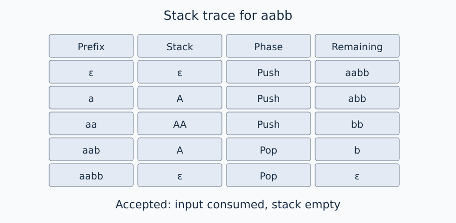

# M14-L2 – Regular and context-free languages: proofs and pushdown automata {#L2}

**Course area:** M14 – Formal languages and complexity

**Level:** Bachelor’s · Core/foundations

**Prerequisites:** [M14-L1](M14-L1.md)

## Learning objectives {#S1}

Distinguish regular and context-free languages, state both pumping lemmas with correct quantifier order, and construct a grammar and a pushdown automaton.

## Grammar and derivation {#S2}

A context-free grammar consists of nonterminals, terminals, a start symbol, and productions with exactly one nonterminal on the left. The grammar $S\to aSb\mid\varepsilon$ generates $L=\{a^nb^n:n\ge0\}$. Each application of the first rule adds an a on the left and a b on the right; the second rule terminates the derivation. Induction on the number of applications shows that exactly the words of L are generated. Example: $S\Rightarrow aSb\Rightarrow aaSbb\Rightarrow aabb$. The parse tree records the structure; the derivation is a sequence of substitutions.

## Pumping lemmas and limitations {#S3}

For every regular language there exists $p\ge1$ such that each word $w$ in the language with $|w|\ge p$ has a decomposition $w=xyz$ with $|xy|\le p$, $|y|>0$, and $xy^iz$ in the language for all $i\ge0$. Proof: Among the first $p+1$ visited states of a DFA with $p$ states, one repeats; its nonempty loop can be skipped or traversed arbitrarily many times.

If L were regular, choose $w=a^pb^p$. Every permitted decomposition has y consisting solely of a symbols. With $i=0$, some a symbols disappear while the number of b symbols stays unchanged. Contradiction.

For context-free languages the necessary condition is: there exists $p\ge1$ such that every word $w$ in the language of length $|w|\ge p$ has a decomposition $w=uvxyz$ with $|vxy|\le p$, $|vy|>0$, and $uv^ixy^iz$ in the language for every $i\ge0$. Proof idea: in a sufficiently tall parse tree in Chomsky normal form, a nonterminal repeats along a path; the intervening subtree can be removed or repeated. Choosing the repetition close to the leaves bounds the length of vxy.

For $K=\{a^nb^nc^n:n\ge0\}$ choose $a^pb^pc^p$. The segment vxy of length at most p cannot contain all three symbol types. Pumping with $i=0$ decreases at least one symbol count while another remains p. Thus K is not context-free. Both lemmas give necessary, not sufficient conditions; a nonmembership proof must cover all allowed decompositions.

## Pushdown automaton and invariant {#S4}

A pushdown automaton adds a stack, accessible at its top, to a finite control state. For L, a push phase stores one A per a, followed by a pop phase removing one A per b. An a after the first b or a b with an empty stack is rejected. Acceptance requires the end of input and an empty stack. The empty word is accepted. Formally, a dedicated bottom marker can represent the stack base and an end-of-input marker can model the final check.

Invariant: as long as no error is detected, the consumed prefix has form $a^rb^s$ with $0\le s\le r$, and the stack contains $r-s$ symbols. This holds initially and is preserved by both permitted transitions. An empty stack at the end implies $r=s$; conversely every word in L is processed without error. Nondeterministic pushdown automata recognize exactly the context-free languages; deterministic pushdown automata are generally less powerful.

{alt="Stack trace for aabb"}

## Implementation and limitations {#S5}

The code simulates only the described deterministic pushdown automaton, not a general PDA. It uses linear time in the word length and linear space in the worst case. The stack holds just one symbol type, so a counter would suffice here; other grammars such as multiple bracket types depend on the stack contents.

```python
def balanced_blocks(word):
    stack = []
    closing = False
    for a in word:
        if a == 'a' and not closing:
            stack.append('A')
        elif a == 'b':
            closing = True
            if not stack:
                return False
            stack.pop()
        else:
            return False
    return not stack

assert balanced_blocks('') and balanced_blocks('aaabbb')
assert not balanced_blocks('abab') and not balanced_blocks('abb')
```

## Self-assessment {#S6}

### Exercises

1. Derive aaabbb from S.
2. Why is abba not in L?
3. Why must every permitted decomposition be considered in the regular pumping lemma?
4. What remains on the stack after aaab?
5. Which example language is not context-free?

::: {.lc-solutions data-lc-section="S6"}
1. S ⇒ aSb ⇒ aaSbb ⇒ aaaSbbb ⇒ aaabbb.
2. An a appears after popping starts, violating the block form.
3. The lemma guarantees existence of a suitable decomposition; one unsuitable choice does not refute that.
4. Two A symbols.
5. K={a^n b^n c^n : n≥0}.
:::

## Sources {#S7}

- [Cornell CS 2800 – Pumping lemma](https://www.cs.cornell.edu/courses/cs2800/2017sp/lectures/lec24-pumping.html) · Regular pumping lemma and proof (Review scope: text only) · Last accessed: 2026-11-24 · Content verified: 2026-11-24
- [Old Dominion University – Context-free grammar](https://www.cs.odu.edu/~toida/nerzic/390teched/cfl/cfg.html) · CFG, PDA, language equivalence (Review scope: text only) · Last accessed: 2026-11-24 · Content verified: 2026-11-24
- [San José State University – CS154](https://www.cs.sjsu.edu/faculty/pollett/154.1.11s/Lec14032011.html) · CFL pumping lemma and proof idea (Review scope: text only) · Last accessed: 2026-11-24 · Content verified: 2026-11-24
