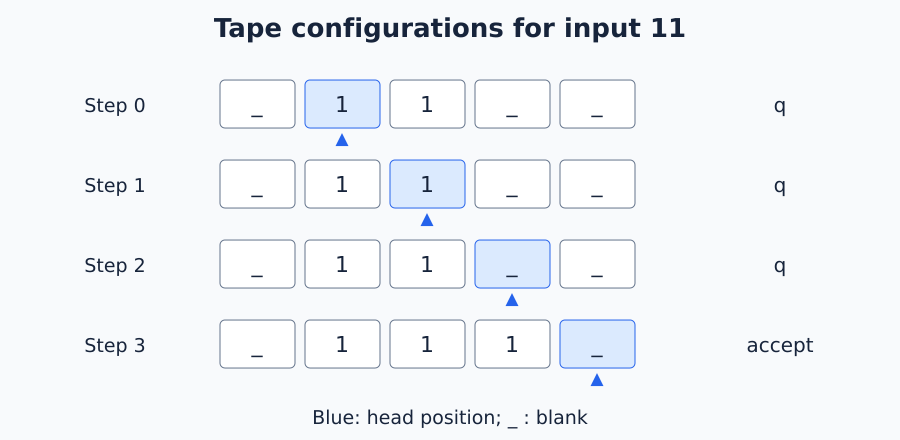

# M14-L3 – Turing machines and decidability proofs {#L3}

**Course area:** M14 – Formal languages and complexity

**Level:** Bachelor’s · Core/foundations

**Prerequisites:** [M14-L2](M14-L2.md)

## Learning objectives {#S1}

Trace machine configurations, distinguish recognizability from decidability, prove undecidability by diagonalization, and construct a reduction to a second problem.

## Machine model and configuration {#S2}

A deterministic single-tape Turing machine has a finite state set $Q$, input alphabet $\Sigma$, tape alphabet $\Gamma\supseteq\Sigma$ including a blank, an initial state and two halting states. We use a tape unbounded in both directions, indexed by integers. For each nonhalting state and scanned symbol, the transition function specifies a successor state, a written symbol and a head displacement $d\in\{-1,1\}$. A configuration records the state, head position and tape contents (only finitely many nonblank cells at each finite time). Initially the head is at index 0.

Example: machine A appends one mark to unary input $1^n$. In state q it moves right over each one. At the first blank it writes a one, moves right and accepts. After $j\le n$ transitions the head is at j, the input is unchanged, and the state is q. The next transition after j=n terminates. A therefore halts after exactly n+1 steps, including on empty input.

## Decision, recognition and diagonalization {#S3}

A decider for a language halts on every input and accepts exactly the members. A recognizer eventually accepts every member; on nonmembers it may reject or run forever. Every decidable language is recognizable. If both L and its complement are recognizable, alternate single simulation steps of their recognizers. One must eventually accept, determining membership in L.

Machines have finite descriptions and can be simulated by a universal machine. Suppose a total algorithm H decides whether M halts on w. Construct D(x): for a valid machine description x, ask H(x,x). If H answers yes, D loops forever; otherwise D halts. Reject invalid descriptions. Set $x=\langle D\rangle$. If H predicts that D halts on its own description, D instead loops. If H answers no, D halts. Either answer contradicts the assumption, so HALT is undecidable. Nevertheless HALT is recognizable: simulate M and accept whenever M halts, including if M itself rejects.

## Reduction and limits of simulation {#S4}

Consider EMPTY-ACCEPT: does the given machine accept empty input? Given a HALT pair (M,w), effectively construct N that ignores its input, simulates M on w, and accepts if the simulation halts. Thus $\langle M,w\rangle\in HALT\iff\langle N\rangle\in EMPTY\text{-}ACCEPT$. A decider for EMPTY-ACCEPT would decide HALT. The reduction direction matters: from the known undecidable problem to the target problem.

A step bound B only makes the question of whether a halt occurs within B steps decidable. It does not solve HALT. An unknown result is neither rejection nor proof of nontermination. The diagram traces the first configurations of the unary machine.

{alt="Tape configurations for input 11"}

## Tape simulation in Python {#S5}

The implementation assumes a well-defined transition table complete on reachable nonhalting configurations. It simulates the selected tape model, stores only nonblank cells, and checks for a halt even exactly at the budget boundary. It is not a universal halting decider. The number of nonblank cells increases by at most one per step.

```python
def simulate(delta, word, limit):
    if limit < 0 or any(c != '1' for c in word):
        raise ValueError('invalid input')
    tape = dict(enumerate(word))
    state, head = 'q', 0
    for steps in range(limit + 1):
        if state in ('accept', 'reject'):
            return state, steps, tape, head
        if steps == limit:
            return 'unknown', steps, tape, head
        state, symbol, move = delta[state, tape.get(head, '_')]
        if symbol == '_':
            tape.pop(head, None)
        else:
            tape[head] = symbol
        head += move

append_one = {('q', '1'): ('q', '1', 1),
              ('q', '_'): ('accept', '1', 1)}
assert simulate(append_one, '111', 4)[0] == 'accept'
assert simulate(append_one, '111', 3)[0] == 'unknown' 
```

## Self-assessment {#S6}

### Exercises

1. What configuration does A reach on input 11 after two steps?
2. How many transitions does A need on empty input?
3. Why is HALT recognizable but undecidable?
4. Which answer from H contradicts D running on its own description?
5. Why must a simulator not report “loops forever” after ten steps without a halt?

::: {.lc-solutions data-lc-section="S6"}
1. State q, head at 2, tape 11 with blank at 2.
2. One transition.
3. Simulation recognizes actual halts; diagonalization rules out a total decider.
4. Both: yes forces looping, no forces halting.
5. An actual halt may occur after the limit.
:::

## Sources {#S7}

- [Old Dominion University – Turing machines](https://www.cs.odu.edu/~zeil/cs390/s24/Public/turing/index.html) · Machine model and transition function (Review scope: Text) · Last accessed: 2026-11-24 · Content verified: 2026-11-24
- [Cornell CS 4820 – Notes on Turing Machines](https://www.cs.cornell.edu/courses/cs4820/2024sp/notes/turingm.pdf) · Universal simulation, diagonalization and reduction, sections 4–5 (Review scope: PDF text; page image unavailable) · Last accessed: 2026-11-24 · Content verified: 2026-11-24
