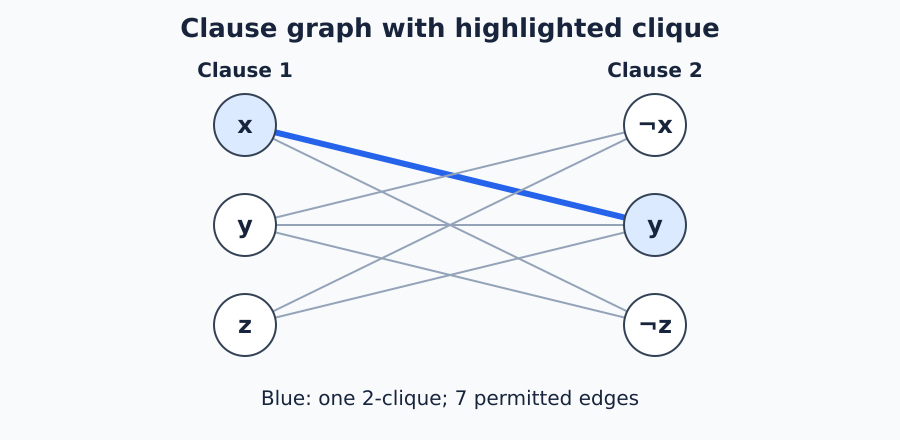

# M14-L4 – NP-completeness and polynomial reductions {#L4}

**Course area:** M14 – Formal languages and complexity

**Level:** Bachelor’s · Core/advanced study

**Prerequisites:** [M14-L3](M14-L3.md); [M13-L1](M13-L1.md)

## Learning objectives {#S1}

Distinguish P, NP and NP-hardness, define a polynomial many-one reduction, reduce 3-SAT to CLIQUE, and verify certificates.

## Decision problems and certificates {#S2}

P contains decision problems solvable deterministically in time polynomial in the input bit length. NP contains problems whose yes-instances have polynomial-length certificates verifiable in polynomial time; no certificate may be accepted for a no-instance. We have $P\subseteq NP$ (a decider can ignore an empty certificate). NP does not mean “not polynomial”. Whether $P=NP$ remains open.

A polynomial many-one reduction $A\le_p B$ is a polynomial-time computable mapping f satisfying $x\in A\iff f(x)\in B$. It is transitive. B is NP-hard if every A in NP reduces to B; additionally requiring $B\in NP$ makes it NP-complete. We use the NP-completeness of 3-SAT as an established result (Cook–Levin and the reduction from SAT to 3-SAT).

## Construction from 3-SAT to CLIQUE {#S3}

A 3-CNF formula is a conjunction of m clauses with three literals each (repetitions allowed). Create a vertex (i,j) for each literal occurrence in clause i, with j its position. Two vertices share an undirected edge exactly when they belong to different clauses and their literals are not complementary. Set k=m. The graph has 3m vertices and at most $\binom{3m}{2}$ edges. Under a standard explicit encoding the construction takes polynomially many bit operations; pairwise comparison of literal names is also polynomial.

Example: $(x\lor y\lor z)\land(\neg x\lor y\lor\neg z)$. Assigning x=y=true satisfies both clauses, regardless of z. The occurrence x in clause 1 and y in clause 2 form a 2-clique. There are no edges within a clause. The diagram highlights one possible certificate edge.

## Proof in both directions {#S4}

**Forward:** A satisfying assignment makes at least one literal true in every clause. Select one per clause. Any two chosen occurrences belong to different clauses and cannot be complementary, since both are true. Hence they are adjacent. The m chosen vertices form a clique.

**Reverse:** A clique of m vertices contains at most one vertex per clause because intraclause edges are absent. Thus it contains exactly one from each clause. No two chosen literals are complementary. Assign every selected variable its indicated truth value and assign arbitrary values to the remaining variables. Each clause contains a true literal, so the formula is satisfiable. For m=0 we allow the empty conjunction and the empty clique.

CLIQUE is in NP: verify a certificate of k distinct vertices for graph membership and all $\binom{k}{2}$ edges; reject k larger than the vertex count immediately. The reduction and known NP-completeness of 3-SAT imply NP-completeness of CLIQUE. This proves neither an exponential lower bound nor equality or inequality of P and NP.

{alt="Clause graph with highlighted clique"}

## Construction and certificate checking in Python {#S5}

Signed integers i and -i encode a variable and its negation. Vertices also retain clause and position indices to distinguish repeated occurrences. The code constructs the graph and checks a supplied clique; it does not search for a maximum clique. Pairwise construction and checking take quadratically many pair comparisons in the respective vertex counts; bit costs of literal comparison are additional.

```python
from itertools import combinations

def clause_graph(clauses):
    if any(len(c) != 3 or any(x == 0 for x in c) for c in clauses):
        raise ValueError('expected triples of nonzero literals')
    vertices = [(i, j, x) for i, c in enumerate(clauses)
                for j, x in enumerate(c)]
    edges = {frozenset((u, v)) for u, v in combinations(vertices, 2)
             if u[0] != v[0] and u[2] != -v[2]}
    return vertices, edges, len(clauses)

def clique_certificate(vertices, edges, k, chosen):
    return (len(chosen) == k and len(set(chosen)) == k
            and set(chosen) <= set(vertices)
            and all(frozenset(pair) in edges
                    for pair in combinations(chosen, 2)))

G = clause_graph([(1, 2, 3), (-1, 2, -3)])
assert clique_certificate(*G, [(0, 0, 1), (1, 1, 2)])
```

## Self-assessment {#S6}

### Exercises

1. What distinguishes NP-hard from NP-complete?
2. Why must occurrences within one clause not share an edge?
3. How many vertices are created for four clauses?
4. Is (x or x or x) AND (not x or not x or not x) satisfiable? What clique is absent?
5. Which direction must a reduction take to establish NP-hardness of a new problem B?

::: {.lc-solutions data-lc-section="S6"}
1. NP-completeness additionally requires membership in NP.
2. Otherwise an m-clique could choose several literals from one clause and omit another.
3. Twelve.
4. No; all interclause edges are absent, so no 2-clique exists.
5. From a known NP-hard problem to B.
:::

## Sources {#S7}

- [Princeton – Intractability](https://algs4.cs.princeton.edu/66intractability/) · P, NP, NP-completeness (Review scope: Text) · Last accessed: 2026-11-24 · Content verified: 2026-11-24
- [Stanford CS 154 – NP reductions](https://theory.stanford.edu/~trevisan/cs154-12/np-reductions.pdf) · 3-SAT to CLIQUE, page 2 (Review scope: PDF text and page 2) · Last accessed: 2026-11-24 · Content verified: 2026-11-24
