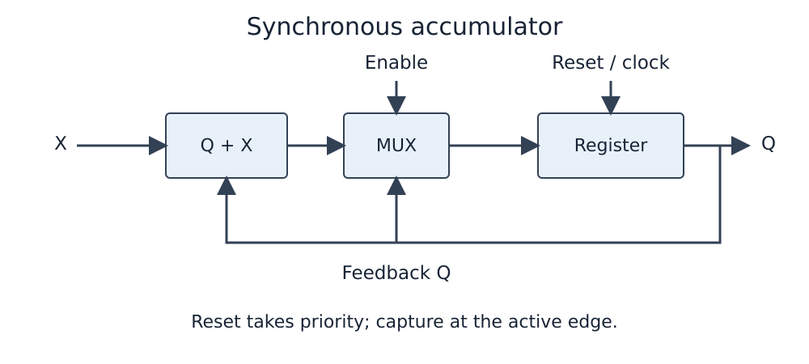

# M15-L1 – Digital circuits and register transfer {#L1}

**Course area:** M15 – Computer architecture and operating systems

**Level:** Bachelor’s · Core

**Prerequisites:** [M1-L2](M1-L2.md)

## Learning objectives {#S1}

Distinguish combinational and sequential logic, derive a full adder, model n-bit addition, and analyze synchronous state transitions and timing constraints.

## Combinational logic and the full adder {#S2}

A combinational circuit maps current inputs to outputs without stored state. For three input bits a, b and c (carry in), a full adder defines $p=a\oplus b$, $s=p\oplus c$ and $c_{out}=(a\land b)\lor(p\land c)$. XOR is one exactly when its two inputs differ. The second expression is one whenever at least two of the three bits are one.

| a | b | c | s | Carry |
|---|---|---|---|---|
|0|0|0|0|0|
|0|0|1|1|0|
|0|1|0|1|0|
|0|1|1|0|1|
|1|0|0|1|0|
|1|0|1|0|1|
|1|1|0|0|1|
|1|1|1|1|1|

Consequently, $a+b+c=s+2c_{out}$ in every row, with ordinary integer addition on the left.

## Ripple carry and overflow {#S3}

With n full adders, carry propagates from bit i to bit i+1, starting at the least significant bit. Multiplying each bit equation by $2^i$ and summing cancels all internal carries, leaving $A+B+c_0=S+2^n c_n$. Thus S is the sum modulo $2^n$. Example: $1101_2+0110_2=10011_2$; four bits store 0011 and carry out is 1. Carry out is not the same as signed overflow. The longest carry chain grows linearly with n in the simple ripple model; faster adders compute carries using additional logic.

## Registers and synchronous state transitions {#S4}

An edge-triggered register captures its input word at the active clock edge. A multiplexer selects either the old value fed back or the new sum. In the model, synchronous reset gives $Q_{t+1}=0$; without reset, enable gives $Q_{t+1}=(Q_t+X_t)\bmod 2^n$; otherwise $Q_{t+1}=Q_t$. All right-hand sides use the old state. Parallel transfers A←B and B←A swap the words; sequential software assignments without temporary storage do not.

Four-bit example: Q=13, X=6, enable=1, reset=0 gives Q'=3; enable=0 leaves Q=13. Reset takes priority.

With an ideal common clock and no skew, the longest register-to-register path must satisfy $T\ge t_{CQ,max}+t_{logic,max}+t_{setup}$, and the shortest $t_{CQ,min}+t_{logic,min}\ge t_{hold}$. With 0.8 ns, 3 ns and 0.2 ns, T≥4 ns, or at most 250 MHz. A longer period does not fix a hold violation. Actual designs also account for skew, jitter, process variation and metastability.

{alt="Synchronous accumulator with register and feedback"}

## Bit-accurate simulation {#S5}

The program models stable logic values and a state transition, not electrical waveforms. The addition invariant can be checked independently using integer division.

```python
def full_adder(a, b, c):
    p = a ^ b
    return p ^ c, (a & b) | (p & c)

def ripple(a, b, n, c=0):
    assert n > 0 and 0 <= a < 2**n and 0 <= b < 2**n
    assert c in (0, 1)
    result = 0
    for i in range(n):
        s, c = full_adder((a >> i) & 1, (b >> i) & 1, c)
        result |= s << i
    return result, c

def tick(q, x, enable, reset, n):
    if reset:
        return 0
    return ripple(q, x, n)[0] if enable else q

assert ripple(13, 6, 4) == (3, 1)
assert tick(13, 6, True, False, 4) == 3
```

## Self-assessment {#S6}

### Exercises

1. What is (s, carry) for a=1, b=0, c=1?
2. Compute 15+2 with four bits and carry out.
3. How many states does an n-bit register have?
4. What happens when reset=1 and enable=1?
5. What is the maximum clock frequency with 1 ns, 5 ns and 0.25 ns for the three maximum timing terms?

::: {.lc-solutions data-lc-section="S6"}
1. (0,1).
2. S=1, carry=1.
3. 2^n.
4. Reset wins; the new value is zero.
5. T≥6.25 ns; at most 160 MHz.
:::

## Sources {#S7}

- [MIT Computation Structures – Combinational Logic](https://computationstructures.org/notes/combinational_logic/notes.html) · §7.8.2–7.8.3; full adder (Review scope: Text) · Last accessed: 2026-11-24 · Content verified: 2026-11-24
- [MIT Computation Structures – Sequential Logic](https://computationstructures.org/notes/sequential_logic/notes.html) · §8.3.1–8.3.3; register timing (Review scope: Text) · Last accessed: 2026-11-24 · Content verified: 2026-11-24
