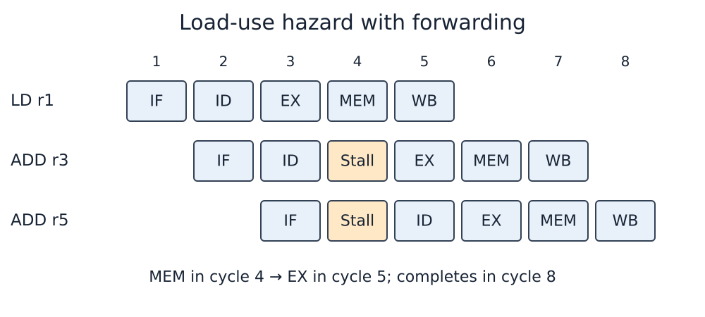

# M15-L2 – Instruction sets, addressing and pipelining {#L2}

**Course area:** M15 – Computer architecture and operating systems

**Level:** Bachelor’s · Core

**Prerequisites:** [M15-L1](M15-L1.md)

## Learning objectives {#S1}

Distinguish an instruction set from its microarchitecture, calculate effective addresses and register states, identify data hazards, and determine the execution time of a simple pipeline.

## Instruction sets and addressing modes {#S2}

The instruction set architecture (ISA) specifies the programmable interface: registers, instruction semantics, memory addressing and visible state changes. Microarchitecture describes its implementation. Two processors can implement the same ISA with different pipelines.

We use a fictional load/store ISA with 32-bit registers, byte-addressed memory and aligned four-byte instructions. ADD rd,ra,rb adds two registers modulo $2^{32}$; ADDI rd,ra,k adds a signed immediate constant. LD rd,k(ra) reads a 32-bit word at effective address $R[ra]+k$ (modulo $2^{32}$); ST rs,k(ra) writes it. The effective address must be divisible by four. Without a branch, the program counter increases by four per instruction. Byte order, exceptions and branch encoding are not specified here.

Example: R[r2]=100, the memory word at address 108 is 21. LD r1,8(r2) sets r1=21; ADDI r3,r1,-4 sets r3=17; ST r3,12(r2) stores 17 at address 112. Register, immediate and base-plus-offset addressing are different operand forms.

## Five stages and performance model {#S3}

The pipeline divides processing into IF (instruction fetch), ID (decode/register read), EX (ALU/address), MEM (data memory) and WB (register writeback). One instruction requires five stages in the ideal model; several instructions occupy different stages simultaneously. For n>0 instructions without hazards, the sequence takes n+4 cycles. With s lost cycles, it takes n+4+s cycles. Average cycles per instruction are $(n+4+s)/n$. Execution time is the cycle count multiplied by the clock period, not just the count.

With stage delays 120, 100, 180, 150 and 80 ps and 20 ps register overhead, the period is 200 ps. Ten hazard-free instructions require 14 cycles = 2.8 ns, with first-instruction latency of 1 ns. An idealized single-cycle machine without additional register overhead requires 630 ps per instruction, or 6.3 ns for ten. Pipelining primarily increases throughput.

## Hazards and forwarding {#S4}

Structural hazards arise when resources are contested, data hazards when operands are not yet available, and control hazards when the next PC is unknown. In the following model: in order, single issue, separate instruction/data memories, one cycle per stage, no cache misses. ALU results become available after EX; load results only after MEM. Full forwarding to EX avoids stalls for most immediate ALU RAW dependencies. A consumer directly following a load requires one additional cycle, since it can use the value in EX only two cycles after the load's EX.

| Instruction | 1 | 2 | 3 | 4 | 5 | 6 | 7 | 8 |
|---|---|---|---|---|---|---|---|---|
| LD r1,0(r2) | IF | ID | EX | MEM | WB | | | |
| ADD r3,r1,r4 | | IF | ID | Stall | EX | MEM | WB | |
| ADD r5,r3,r6 | | | IF | Stall | ID | EX | MEM | WB |

A stall holds younger stages and inserts a bubble into EX. Branches may require discarding incorrectly fetched instructions; the penalty depends on resolution timing and prediction. Without forwarding, different waiting conditions apply.

{alt="Five-stage pipeline with load-use stall"}

## Scheduling EX cycles {#S5}

The following simulator considers only ADD, ADDI and LD with EX source operands. For each register it tracks the earliest usable cycle of the latest writer. Every instruction has a destination; stores and branches are excluded. This is a timing model, not a complete CPU emulator.

```python
def schedule(program):
    # (operation, destination, tuple of EX source registers)
    # Only ADD, ADDI, LD; all destinations are writable.
    ready = {}
    previous = 0
    rows = []
    for op, dst, src in program:
        if op not in ('ADD', 'ADDI', 'LD'):
            raise ValueError('unsupported instruction')
        ex = max([previous + 1, 3] + [ready.get(r, 0) for r in src])
        rows.append(ex)
        ready[dst] = ex + (2 if op == 'LD' else 1)
        previous = ex
    return rows, rows[-1] + 2 if rows else 0

p = [('LD', 'r1', ('r2',)),
     ('ADD', 'r3', ('r1', 'r4')),
     ('ADD', 'r5', ('r3', 'r6'))]
assert schedule(p) == ([3, 5, 6], 8)
```

## Self-assessment {#S6}

### Exercises

1. What distinguishes ISA from microarchitecture?
2. Which address does LD r4,-8(r2) use when R[r2]=100?
3. How many cycles do 20 hazard-free instructions need?
4. How many cycles does the three-instruction sequence shown take?
5. Why does ALU forwarding alone not remove the load-use delay?

::: {.lc-solutions data-lc-section="S6"}
1. The ISA is the visible interface; microarchitecture is its implementation.
2. 92.
3. 24.
4. 8.
5. The loaded value appears only at the end of MEM, too late for the following instruction’s EX.
:::

## Sources {#S7}

- [MIT Computation Structures – Instruction Set Architectures](https://computationstructures.org/notes/isas/notes.html) · ISA; load/store (Review scope: Text) · Last accessed: 2026-11-24 · Content verified: 2026-11-24
- [Cornell CS 3410 – Pipelining & Performance](https://courses.cs.cornell.edu/cs3410/2026sp/notes/pipelining.html) · Performance; hazards (Review scope: Text) · Last accessed: 2026-11-24 · Content verified: 2026-11-24
- [Cornell CS 6120 – Efficient Instruction Scheduling](https://www.cs.cornell.edu/courses/cs6120/2019fa/blog/instruction-scheduling/) · Pipeline hazards; load-use (Review scope: Text) · Last accessed: 2026-11-24 · Content verified: 2026-11-24
