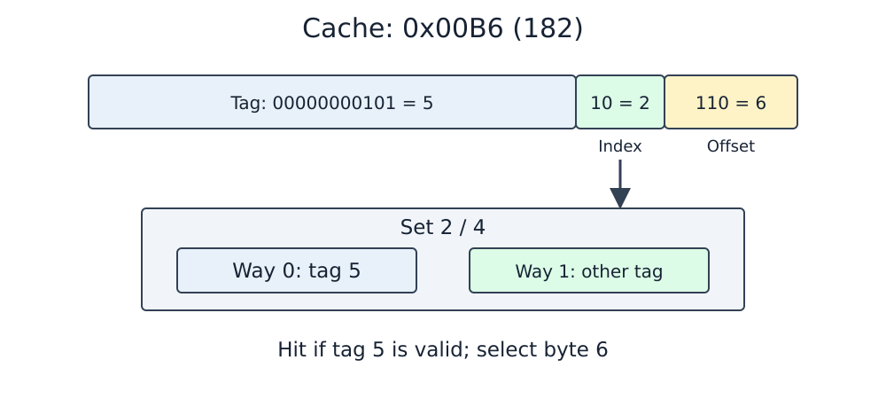

# M15-L3 – Cache organization and memory locality {#L3}

**Course area:** M15 – Computer architecture and operating systems

**Level:** Bachelor’s · Core

**Prerequisites:** [M15-L2](M15-L2.md)

## Learning objectives {#S1}

Compute tag, index and offset; distinguish spatial and temporal locality; classify misses and compare cache geometries using an access trace.

## Address decomposition and locality {#S2}

A memory hierarchy combines small fast storage with larger slower storage. A cache copies entire blocks from the next lower level. Temporal locality means repeated access to the same data; spatial locality means access to nearby addresses. Both describe a trace, not a guarantee of hits. Sequential traversal of a densely stored array generally exploits spatial locality better than a large stride.

For data capacity $C$, block size $B$ and associativity $W$, there are $S=C/(BW)$ sets. With powers of two and $m$ address bits, there are $b=\log_2 B$ offset bits, $s=\log_2 S$ index bits and $m-b-s$ tag bits. For byte address $a$, block $q=\lfloor a/B\rfloor$, set $q\bmod S$ and tag $\lfloor q/S\rfloor$. A hit requires a valid entry with matching tag; the offset selects a byte. Metadata is not included in the stated data capacity.

Example: 16-bit addresses, 64 bytes of data, 8-byte blocks, two ways: four sets, 3 offset, 2 index and 11 tag bits. For 0x00B6, $q=22$, set 2, tag 5, offset 6. Reconstruct the address as $(5\cdot4+2)\cdot8+6=182$.

{alt="Address fields and cache set"}

## Mapping, miss classes and latency {#S3}

In a direct-mapped cache ($W=1$), blocks mapping to the same set compete for one slot. A fully associative cache ($S=1$) allows any block in any slot. Multiple ways require a replacement rule. Least recently used (LRU) evicts the entry whose last access is oldest; hardware may approximate LRU.

Compare the trace 0, 4, 16, 0 for 16 data bytes and 8-byte blocks. Direct mapped: miss, hit, miss, miss. Fully associative with two ways: miss, hit, miss, hit. First references to a block are compulsory misses. In the usual 3C model starting empty with a same-capacity fully associative LRU reference cache, subsequent misses are classified as conflict misses if the reference cache hits, and capacity misses otherwise. This classification depends on the reference model and excludes additional coherence misses.

A simple latency model is $AMAT=t_h+p_m t_p$, with $t_p$ the additional miss penalty. A 2 ns hit time, 5% miss rate and 60 ns additional penalty yield 5 ns. Overlapping requests or multiple cache levels require a richer model.

## Write policies and access experiment {#S4}

Write-through updates the lower level immediately (possibly through a buffer); write-back retains modified blocks until writeback, marking them dirty. Independently, write-allocate versus no-write-allocate specifies whether a write miss loads a block. More capacity or larger blocks do not automatically improve speed: transfer cost, hit latency, conflicts and access patterns matter.

The simulator handles only single-byte read addresses and exact per-set LRU. Each set stores tags from oldest to newest access. Compare `range(0, 64, 1)` with `range(0, 64, 8)` at the same geometry: the first trace uses every fetched byte; the second only one per block. Both first reference eight blocks. Miss rates differ (8/64 versus 8/8).

## Executable model {#S5}

```python
def cache_trace(addresses, block_size, sets, ways):
    if min(block_size, sets, ways) < 1:
        raise ValueError("invalid geometry")
    state = [[] for _ in range(sets)]
    hits = []
    for a in addresses:
        if a < 0:
            raise ValueError("negative address")
        block = a // block_size
        tag, index = divmod(block, sets)
        line = state[index]
        hit = tag in line
        if hit:
            line.remove(tag)
        elif len(line) == ways:
            line.pop(0)
        line.append(tag)
        hits.append(hit)
    return hits

assert cache_trace([0, 4, 16, 0], 8, 2, 1) == [False, True, False, False]
assert cache_trace([0, 4, 16, 0], 8, 1, 2) == [False, True, False, True]
```

## Self-assessment {#S6}

### Exercises

1. Find set count and address fields for 32 bits, 4 KiB data, 64-byte blocks, four ways.
2. Decompose 0x00B6 in the 16-bit model above.
3. Classify the last miss in 0, 4, 16, 0 for the direct-mapped 16-byte cache.
4. Calculate AMAT for 1 ns hit time, 2% miss rate and 100 ns additional penalty.
5. What does a set dirty bit mean? Why is it not a valid bit?

::: {.lc-solutions data-lc-section="S6"}
1. 16 sets, 6 offset, 4 index and 22 tag bits.
2. Tag 5, set 2, offset 6.
3. Conflict miss; the same-capacity fully associative LRU cache hits.
4. 3 ns.
5. The valid block has been modified and may need writeback before eviction; valid indicates whether an entry can be used.
:::

## Sources {#S7}

- [MIT Computation Structures – The Memory Hierarchy](https://computationstructures.org/lectures/caches/caches.html) · locality, direct mapping, associativity, AMAT, write policy (Review scope: Text) · Last accessed: 2026-11-24 · Content verified: 2026-11-24
