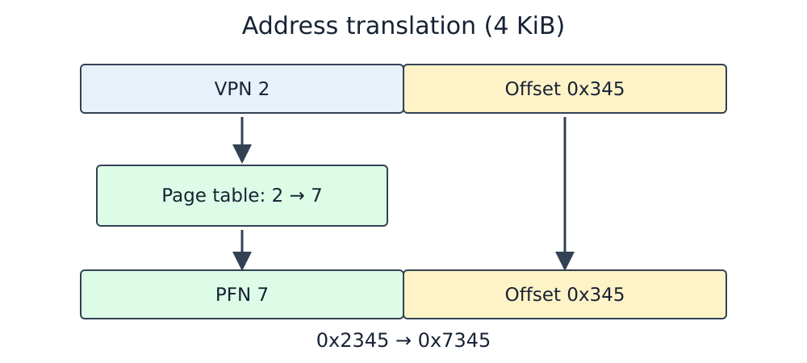

# M15-L4 – Virtual memory and page replacement {#L4}

**Course area:** M15 – Computer architecture and operating systems

**Level:** Bachelor’s · Core/Elective

**Prerequisites:** [M15-L3](M15-L3.md); [M8-L3](M8-L3.md)

## Learning objectives {#S1}

Translate virtual addresses; distinguish page tables from TLBs; simulate FIFO and LRU and explain their limitations.

## Virtual addresses and page tables {#S2}

Each process has a virtual address space. Paging divides it into equal-sized pages and physical memory into equal-sized frames. For page size $P=2^p$, $VPN=\lfloor a/P\rfloor$ and $o=a\bmod P$. A page table maps a valid virtual page to a physical frame PFN; the physical address is $PFN\cdot P+o$. The low $p$ bits remain unchanged. Page table entries also carry state and protection information. Two processes can map identical virtual addresses to different frames or intentionally share frames.

Example: $P=4096$ bytes, virtual address 0x2345, VPN 2 and offset 0x345. If frame 7 is assigned and access is permitted, the result is 0x7345. With 32-bit addresses and 4 KiB pages there are 20 VPN bits. A flat table with four bytes per entry would occupy 4 MiB; multilevel tables can omit unused regions. The last allocated page may be partly unused (internal fragmentation).

{alt="Virtual and physical address"}

## TLB and page faults {#S3}

A TLB caches recent translations, not application data. A TLB miss for a resident page can be resolved by a page table lookup. If a permitted page is not resident, the operating system may make it available on a page fault (e.g. from a file or by zero filling). An invalid address or prohibited access must not be legitimized merely by loading data. Exact exception classification depends on the architecture. Page table changes require stale translations to be invalidated.

A simplified serial timing model without page faults: 1 ns TLB lookup, 50 ns memory access, 98% TLB hit rate. A hit costs 51 ns; a miss with one extra table access costs 101 ns. Expected time is 52 ns. Multilevel tables, concurrency and page-walk caches change this model.

## Page replacement and Belady’s anomaly {#S4}

Demand paging makes pages resident when needed. If no frame is free, a victim must be chosen. FIFO evicts the earliest loaded page; hits do not change its order. LRU evicts the least recently referenced page; hits update the order. Modified pages may need writeback. OPT evicts a page whose next reference is farthest away (or absent); this requires future knowledge.

For trace 1,2,3,4,1,2,5,1,2,3,4,5, FIFO with three frames yields 9 faults and with four frames 10 (Belady's anomaly). LRU yields 10 and 8 respectively. Under LRU the set of the $k$ most recently referenced distinct pages is always contained in the set for $k+1$. Thus for an identical trace and empty initial state, extra frames cannot increase LRU faults. This does not generally hold for FIFO.

The simulator separates address translation (static table, explicit errors) from replacement (page numbers only, empty start, all references permitted). It models neither real I/O costs nor TLB coherence. An undersized resident working set can cause many faults; thrashing means excessive paging at the expense of productive work.

## Executable models {#S5}

```python
def translate(address, page_size, table, write=False):
    if address < 0 or page_size < 1:
        raise ValueError("invalid address or size")
    vpn, offset = divmod(address, page_size)
    if vpn not in table:
        raise KeyError("unmapped page")
    frame, writable = table[vpn]
    if write and not writable:
        raise PermissionError("read only")
    if frame is None:
        raise LookupError("not resident")
    return frame * page_size + offset


def faults(pages, frames, policy):
    if frames < 1 or policy not in ("FIFO", "LRU"):
        raise ValueError("invalid policy or capacity")
    resident = []
    misses = 0
    for page in pages:
        if page in resident:
            if policy == "LRU":
                resident.remove(page)
                resident.append(page)
        else:
            misses += 1
            if len(resident) == frames:
                resident.pop(0)
            resident.append(page)
    return misses

assert translate(0x2345, 4096, {2: (7, True)}) == 0x7345
trace = [1,2,3,4,1,2,5,1,2,3,4,5]
assert faults(trace, 3, "FIFO") == 9
assert faults(trace, 4, "FIFO") == 10
assert faults(trace, 3, "LRU") == 10
assert faults(trace, 4, "LRU") == 8
```

## Self-assessment {#S6}

### Exercises

1. How many VPN and offset bits are in a 48-bit address with 4 KiB pages?
2. Translate 0x2345 to frame 7 with 4096-byte pages.
3. Does a TLB miss necessarily mean a page fault?
4. Compare FIFO and LRU for the given twelve-reference trace with three and four frames.
5. Why cannot more frames increase LRU faults for the same trace?

::: {.lc-solutions data-lc-section="S6"}
1. 36 VPN bits, 12 offset bits.
2. 0x7345.
3. No; the page may be resident and its translation simply absent from the TLB.
4. FIFO 9/10; LRU 10/8.
5. The $k$ most recently referenced distinct pages are contained in the corresponding set for $k+1$; a hit with $k$ remains a hit with $k+1$.
:::

## Sources {#S7}

- [UW–Madison CS 537 – Paging](https://pages.cs.wisc.edu/~bart/537/lecturenotes/s16.html) · page table, protection, fragmentation (Review scope: Text) · Last accessed: 2026-11-24 · Content verified: 2026-11-24
- [UW–Madison CS 537 – Translation Buffers](https://pages.cs.wisc.edu/~bart/537/lecturenotes/s17.html) · TLB, translation overhead (Review scope: Text) · Last accessed: 2026-11-24 · Content verified: 2026-11-24
- [UW–Madison CS 537 – Page Selection and Replacement](https://pages.cs.wisc.edu/~bart/537/lecturenotes/s19.html) · demand paging, FIFO, LRU (Review scope: Text) · Last accessed: 2026-11-24 · Content verified: 2026-11-24
