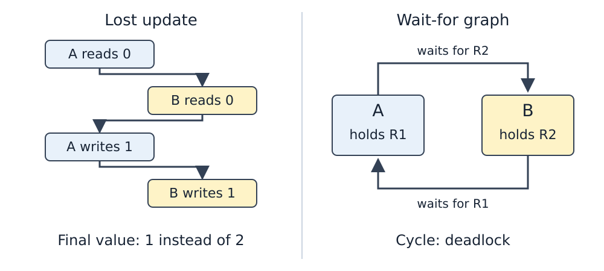

# M15-L5 – Concurrent programs: synchronization and deadlock analysis {#L5}

**Course area:** M15 – Computer architecture and operating systems

**Level:** Bachelor · Core

**Prerequisites:** [M12-L1](M12-L1.md); [M8-L3](M8-L3.md)

## Learning objectives {#S1}

Enumerate interleavings; explain lost updates; distinguish semaphores from mutexes; analyse a bounded buffer; detect and prevent lock deadlocks using wait-for graphs and resource ordering.

## Interleavings and critical sections {#S2}

Concurrency allows tasks to make progress over overlapping periods; parallelism requires actual simultaneous execution. Our model interleaves atomic steps of two threads in one common order while preserving each thread's program order (sequential consistency). An expression such as `x = x + 1` is decomposed into read, add and write. Starting at x = 0, both A and B can read 0, compute 1 locally and write 1. One update is lost. Serial execution produces 2. There are exactly $\binom{6}{3}=20$ permitted schedules; only the two fully serial schedules produce 2. A race condition means correctness depends on timing or ordering. A data race is narrower: unordered conflicting memory accesses, at least one a write (the precise definition depends on the language memory model).

A mutex protects a critical section when all participating accesses use the same mutex. It serializes the two increments without requiring unrelated work to stop. A mutex normally has ownership semantics; a counting semaphore manages available permits. `wait` atomically acquires a permit or blocks; `signal` returns one. Neither using locks nor passing tests guarantees general thread safety.

## Semaphores and bounded buffer {#S3}

A buffer of capacity C starts with `empty=C`, `full=0`, `mutex=1`. The producer reserves a free slot (`wait(empty)`), acquires the mutex, inserts an item, releases the mutex and announces an available item (`signal(full)`). The consumer reserves an available item (`wait(full)`), acquires the mutex, removes the item, releases the mutex and announces a free slot (`signal(empty)`). The counters do not necessarily equal physical occupancy at every instant: reservations and not-yet-announced changes must be accounted for. Physical occupancy q always satisfies $0\le q\le C$. Each slot follows a cycle: free → reserved → occupied → reserved for removal → free (announcements may lag). The mutex prevents simultaneous changes to buffer metadata.

With capacity 1 a consumer may wait on an empty buffer. If it already holds the mutex, the producer cannot insert anything: both block. Hence the reservation precedes mutex acquisition. The model below uses one producer and one consumer, n operations each, atomic semaphore operations and no exceptions. It explores every reachable state, not merely a randomly scheduled run. Real implementations also require error handling, cancellation and release using `finally` or RAII. With condition variables, the predicate must be rechecked under the mutex after waking (a loop rather than just `if`).

## Wait-for graph, deadlock and prevention {#S4}

Deadlock occurs when a set of tasks waits indefinitely for releases by one another. For exclusive, non-preemptible resources the classical necessary conditions are mutual exclusion, hold and wait, no preemption and circular waiting. In a concrete wait-for graph for single-instance locks, an edge A→B means A is blocked waiting for a lock held by B. A directed cycle implies deadlock in this model (blocked threads cannot release their held locks). For resources with multiple instances, a cycle in a general resource-allocation graph is not sufficient to prove deadlock.

Example: A holds R1 and waits for R2; B holds R2 and waits for R1. If every resource is acquired in strictly increasing global order, a wait cycle would require a strictly increasing sequence of lock ranks returning to its starting rank, a contradiction. This prevention applies to these lock dependencies provided all participating threads obey the ordering. It does not prevent every possible blockage (for example, message or condition waits). Starvation means a task never gets its turn despite others making progress. Livelock means continued activity without useful progress. Deadlock freedom does not imply fairness.

{alt="Lost update and circular waiting"}

## Executable state models {#S5}

```python
from itertools import combinations


def increment_results(start, locked=False):
    # Each thread has read, add, write; preserve its local order.
    results = []
    for positions in combinations(range(6), 3):
        if locked and positions not in ((0, 1, 2), (3, 4, 5)):
            continue
        x = start
        pc, local = [0, 0], [0, 0]
        for k in range(6):
            t = 0 if k in positions else 1
            if pc[t] == 0:
                local[t] = x
            elif pc[t] == 1:
                local[t] += 1
            else:
                x = local[t]
            pc[t] += 1
        results.append(x)
    return results


def has_cycle(edges):
    nodes = set(edges) | {v for vs in edges.values() for v in vs}
    visiting, done = set(), set()
    def visit(u):
        if u in visiting:
            return True
        if u in done:
            return False
        visiting.add(u)
        for v in edges.get(u, ()):
            if visit(v):
                return True
        visiting.remove(u)
        done.add(u)
        return False
    return any(visit(u) for u in nodes)

assert sorted(set(increment_results(0))) == [1, 2]
assert increment_results(0, locked=True) == [2, 2]
assert has_cycle({"A": ["B"], "B": ["A"]})
assert not has_cycle({"A": ["B"], "B": ["C"]})
```

```python
def buffer_states(capacity, count, bad_order=False):
    if capacity < 1 or count < 0:
        raise ValueError("invalid bounds")
    # (producer PC, consumer PC, empty, full, mutex, occupancy)
    initial = (0, 0, capacity, 0, 1, 0)
    seen, todo, blocked = {initial}, [initial], []
    producer = ["empty-", "mutex-", "put", "mutex+", "full+"]
    consumer = ["full-", "mutex-", "get", "mutex+", "empty+"]
    if bad_order:
        producer[:2] = reversed(producer[:2])
        consumer[:2] = reversed(consumer[:2])
    while todo:
        state = todo.pop()
        assert 0 <= state[5] <= capacity
        assert all(x >= 0 for x in state[2:5])
        assert state[4] <= 1
        moves = []
        for t, program in enumerate((producer, consumer)):
            if state[t] == 5 * count:
                continue
            op = program[state[t] % 5]
            nxt = list(state)
            if op in ("put", "get"):
                assert state[4] == 0
                nxt[5] += 1 if op == "put" else -1
            else:
                i = {"empty": 2, "full": 3, "mutex": 4}[op[:-1]]
                if op[-1] == "-" and state[i] == 0:
                    continue
                nxt[i] += 1 if op[-1] == "+" else -1
            nxt[t] += 1
            moves.append(tuple(nxt))
        if not moves and state[:2] != (5 * count, 5 * count):
            blocked.append(state)
        for nxt in moves:
            if nxt not in seen:
                seen.add(nxt)
                todo.append(nxt)
    return seen, blocked

assert not buffer_states(2, 3)[1]
assert buffer_states(1, 1, bad_order=True)[1]
```

The graph search uses recursion; an iterative version is preferable for large graphs. The finite buffer model checks safety conditions and blocked terminal states, not unbounded fairness or weaker hardware memory models.

## Self-assessment {#S6}

### Exercises

1. How many interleavings exist for two increments of three atomic steps each? Which final values are possible?
2. Explain why a mutex protects the shared counter only if all participating accesses use the same synchronization.
3. Give the initial values of the three semaphores for capacity 4. Why reserve `empty` or `full` first?
4. The wait-for graph contains A→B, B→C and C→A. What follows in the single-instance lock model? What changes after removing C→A?
5. Explain why strict global lock ordering excludes circular waiting. Does it guarantee fairness?

::: {.lc-solutions data-lc-section="S6"}
1. 20; final values 1 and 2. Only the two serial schedules produce 2.
2. An unprotected access can intervene between read and write; a lock excludes only cooperating participants.
3. `empty=4`, `full=0`, `mutex=1`; a blocked reservation must not hold the mutex needed by the other side to create the resource.
4. The cycle indicates deadlock. Without C→A this graph is acyclic; other unmodelled dependencies are not ruled out.
5. A cycle would require strictly increasing ranks returning to the initial rank. No, waiting time and scheduling fairness are not guaranteed.
:::

## Sources {#S7}

- [UW–Madison CS 537 – Semaphores and Producer/Consumer Problem](https://pages.cs.wisc.edu/~bart/537/lecturenotes/s6.html) · atomic semaphore operations, bounded buffer, acquisition order (Review scope: Text) · Last accessed: 2026-11-24 · Content verified: 2026-11-24
- [UW–Madison CS 537 – Deadlock](https://pages.cs.wisc.edu/~bart/537/lecturenotes/s12.html) · resource dependencies, deadlock prevention, resource ordering (Review scope: Text) · Last accessed: 2026-11-24 · Content verified: 2026-11-24
- [Cornell – Harmony book](https://harmony.cs.cornell.edu/book/) · condition variables, Chapter 15 deadlock, glossary (Review scope: Text) · Last accessed: 2026-11-24 · Content verified: 2026-11-24
