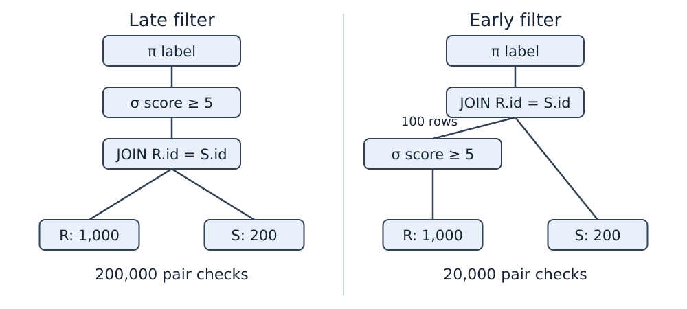

# M16-L1 – Relational algebra and query optimization {#L1}

**Course area:** M16 – Databases and mathematical computing

**Level:** Bachelor · Core/elective

**Prerequisites:** [M10-L2](M10-L2.md)

## Learning objectives {#S1}

Model relations as sets; combine selection, projection and join; distinguish SQL bags and NULL from classical algebra; prove selection pushdown; estimate plan costs and identify invalid rewrites.

## Relations, operators and SQL {#S2}

In classical relational algebra a relation over a schema is a finite set of tuples. Selection $\sigma_p(R)$ retains exactly the tuples satisfying predicate p. Projection $\pi_A(R)$ restricts each tuple to the attributes in A and eliminates duplicates. Cartesian product combines every pair of tuples; a theta join $R\bowtie_q S=\sigma_q(R\times S)$ filters those pairs. Disambiguate shared attribute names using relation names or renaming. Union and difference require compatible schemas.

SQL uses bags by default: `SELECT label` can return the same value multiple times, while `SELECT DISTINCT label` removes those repetitions. SQL NULL is not an ordinary value of classical algebra. `NULL = NULL` evaluates to UNKNOWN; WHERE and inner JOIN ON retain only TRUE results. Use `IS NULL` to check for missing values. Without ORDER BY, row order is not guaranteed.

Example: R(id,score) contains (1,8), (2,3), (3,7); S(id,label) contains (1,A), (3,B). Retrieve the labels for scores ≥ 5. The algebra is $\pi_{label}(\sigma_{score\geq5}(R\bowtie_{R.id=S.id}S))$. The result is {A,B}. In the later simulation, R also contains a duplicate of (3,7) and a row with a NULL key. SQL returns A once and B twice; DISTINCT again returns A and B.

## Equivalent query plans {#S3}

For an inner join and a deterministic, side-effect-free predicate p referring only to attributes of R:

$$\sigma_p(R\bowtie_q S)=\sigma_p(R)\bowtie_q S.$$

Proof: a pair (r,s) satisfies the left-hand side precisely when r belongs to R, s belongs to S, q(r,s) is true, and p(r) is true. The same conditions define the right-hand side. Under SQL bag semantics the multiplicity of each qualifying pair also remains unchanged, provided duplicates are not removed. For an inner join the TRUE condition is preserved for side-effect-free nullable predicates as well. Early projection must retain all attributes subsequently needed for joins, filters and output; do not silently introduce SQL DISTINCT.

This rule does not apply in general to outer joins. Let R contain id=1 and S contain (id=1, score=3). `R LEFT JOIN S ON R.id=S.id WHERE S.score>=5` returns no rows. If S is filtered before the LEFT JOIN and the outer WHERE is removed, the result is (1,NULL,NULL), because R is preserved. That is a different query. Not every syntactically possible rewrite preserves semantics.

## Cost model and limitations {#S4}

Consider 1,000 R rows and 200 S rows. A filter retains 100 R rows (selectivity 0.1). A simple nested-loop join without an index checks 200,000 pairs in the first plan and only 20,000 after early filtering. Both alternatives also incur scanning and predicate-evaluation costs; a tenfold reduction in pair checks is not a measured runtime speedup. Under suitable hashing and memory assumptions, an equality hash join may have expected work approximately linear in input sizes plus output. Large output, memory constraints or skew may increase costs substantially.

A rough cardinality estimate for an equality join is $|R||S|/\max(V_R,V_S)$, where V is the number of distinct key values (positive counts). Here it assumes in particular uniform distributions, suitable key-domain overlap, and no NULLs. Disjoint keys actually produce an empty result; frequent keys can cause large deviations. Real optimizers combine statistics, physical access paths, join orders and cost models. EXPLAIN shows a chosen plan, not necessarily an optimal one.

{alt="Two equivalent query trees with early and late filtering"}

## Executable model {#S5}

The following Python simulation compares explicit bag evaluation with SQLite. Both alternatives use identical inputs; Counter compares row multiplicities independently of output order. The model only covers deterministic equality joins and a numeric filter. SQLite is an executable reference, not evidence of PostgreSQL execution plans.

```python
from collections import Counter
import sqlite3


def evaluate(r, s, push=False):
    # r: (id, score), s: (id, label); None models SQL NULL.
    selected = [a for a in r if a[1] is not None and a[1] >= 5]
    left = selected if push else r
    result = Counter()
    for key, score in left:
        for other, label in s:
            if key is not None and other is not None and key == other:
                if score is not None and score >= 5:
                    result[label] += 1
    return result


def sql_result(r, s, push=False, distinct=False):
    with sqlite3.connect(":memory:") as db:
        db.execute("CREATE TABLE r (id INTEGER, score INTEGER)")
        db.execute("CREATE TABLE s (id INTEGER, label TEXT)")
        db.executemany("INSERT INTO r VALUES (?, ?)", r)
        db.executemany("INSERT INTO s VALUES (?, ?)", s)
        q = ("SELECT " + ("DISTINCT " if distinct else "") + "s.label ")
        if push:
            q += "FROM (SELECT * FROM r WHERE score >= 5) AS r "
            q += "JOIN s ON r.id = s.id"
        else:
            q += "FROM r JOIN s ON r.id = s.id WHERE r.score >= 5"
        return Counter(row[0] for row in db.execute(q))

r = [(1, 8), (2, 3), (3, 7), (3, 7), (None, 9)]
s = [(1, "A"), (3, "B"), (None, "C")]
assert evaluate(r, s) == evaluate(r, s, True) == Counter(A=1, B=2)
assert sql_result(r, s) == evaluate(r, s)
assert sql_result(r, s, True, True) == Counter(A=1, B=1)
```

## Self-assessment {#S6}

### Exercises

1. R contains (1,8), (2,3), (3,7). Give the selection for score ≥ 5. S contains (1,A), (3,B). Which labels does the join return?
2. R also contains (3,7) a second time. How do `SELECT label` and `SELECT DISTINCT label` differ?
3. Prove selection pushdown for a predicate referencing only R attributes. Why is early projection onto score alone problematic?
4. A nested-loop join has 2,400 and 500 rows. A filter reduces R to one quarter. How many pair checks are needed before and after?
5. Explain the LEFT JOIN counterexample and why an equality join between two NULL keys yields no matching pair in an inner SQL join.

::: {.lc-solutions data-lc-section="S6"}
1. {(1,8),(3,7)}; labels {A,B}.
2. Without DISTINCT, A once and B twice; with DISTINCT, once each. No guaranteed order.
3. Both sides require q(r,s) and p(r) for the same tuple pair. Projection must retain id because the join needs id.
4. 1,200,000 before; 600 × 500 = 300,000 after. Other costs are excluded.
5. With prefiltered S the R row survives via NULL extension. In the original plan WHERE rejects the value 3. NULL = NULL is UNKNOWN, not TRUE.
:::

## Sources {#S7}

- [UC Berkeley CS 186 – Query Optimization](https://cs186berkeley.net/notes/note10/) · operator trees; selectivity estimation; pushdown heuristics (Review scope: Text) · Last accessed: 2026-11-24 · Content verified: 2026-11-24
- [PostgreSQL 17 – SELECT](https://www.postgresql.org/docs/17/sql-select.html) · SELECT ALL/DISTINCT; ordering; logical processing (Review scope: Text) · Last accessed: 2026-11-24 · Content verified: 2026-11-24
- [PostgreSQL 17 – Table Expressions](https://www.postgresql.org/docs/17/queries-table-expressions.html) · inner and outer joins; WHERE and ON (Review scope: Text) · Last accessed: 2026-11-24 · Content verified: 2026-11-24
