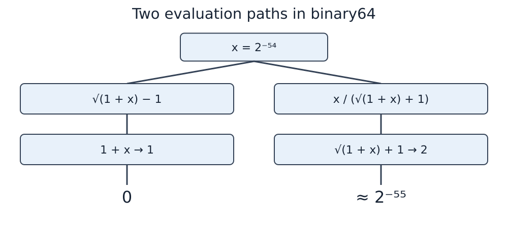

# M16-L2 – Numerical computing: floating point, error and conditioning {#L2}

**Course area:** M16 – Databases and mathematical computing

**Level:** Bachelor · Core/bridge

**Prerequisites:** [M12-L1](M12-L1.md)

## Learning objectives {#S1}

Interpret binary floating-point numbers, calculate absolute and relative errors, recognize cancellation, distinguish problem conditioning from algorithm stability, and check a numerically preferable expression against an independent reference.

## Representation and rounding {#S2}

IEEE 754 binary64 uses one sign bit, eleven exponent bits and 52 stored fraction bits. Normal numbers have an additional implicit leading one, giving 53 significant binary digits. The number $0.625=5/8$ is exactly representable in binary, whereas $1/10$ is not. A rational number in lowest terms has a terminating binary expansion precisely when its denominator is a power of two. Proof: every finite binary fraction is an integer divided by a power of two; conversely, any such fraction can be written in base two. The finite exponent range and precision impose further representability restrictions.

With round-to-nearest, ties-to-even, the gap from 1 to the next larger binary64 number is $2^{-52}$. The unit roundoff is $u=2^{-53}$. For a correctly rounded elementary operation with a finite normal result, the usual model is $\operatorname{fl}(z)=z(1+\delta)$, with $|\delta|\le u$. This relative bound does not generally hold for underflow into the subnormal range; overflow, infinity and NaN require separate treatment. Rounding is not decimal formatting. Python uses binary64 on typical platforms; the following experiment assumes that format.

## Error and conditioning {#S3}

For an exact value y and approximation $\hat y$, the absolute and relative forward errors are $|\hat y-y|$ and, for $y\ne0$, $|\hat y-y|/|y|$. Backward error instead asks for a small change to the input for which the computed result would be exact. With $f(x)=x^2$, $x=3$ and $\hat y=9.06$, the relative forward error is $0.06/9=1/150$. A suitable perturbed input is $\sqrt{9.06}$, whose relative distance from 3 is approximately 0.00333.

For a differentiable scalar function with $x\ne0$ and $f(x)\ne0$, the local relative condition number is $\kappa_f(x)=|xf'(x)/f(x)|$. Divide $f(x+\Delta x)-f(x)=f'(x)\Delta x+o(\Delta x)$ by $f(x)$ and by $\Delta x/x$, then take the absolute limit. For $f(x)=x-1$ and $x=1.001$, $\kappa=1001$: small relative input errors can be amplified substantially. This is a property of the problem, not the programming language. Backward stability means that the algorithm returns an exact answer for sufficiently nearby data; it does not guarantee small forward error for ill-conditioned problems.

## Cancellation and a more stable expression {#S4}

For $x>0$, consider $f(x)=\sqrt{1+x}-1$. Multiplication by the conjugate gives the exact identity $f(x)=x/(\sqrt{1+x}+1)$. The local condition number is $(\sqrt{1+x}+1)/(2\sqrt{1+x})$, between 1/2 and 1. Derivation: $f'(x)=1/(2\sqrt{1+x})$; substituting the rationalized expression yields the claim. The problem is well-conditioned in this domain, although direct evaluation loses accuracy for small x.

For $x=2^{-54}$, the sum $1+x$ rounds to 1, and direct evaluation returns zero. The alternative expression returns approximately $2^{-55}$; the actual value is positive and slightly smaller. The subtraction itself may be exact while the small difference exposes previous rounding errors. The alternative avoids that cancellation here, but is not a universal stability proof for all input ranges.

{alt="Two calculation paths for x equal to two to the power minus 54; direct zero, rationalized approximately two to the power minus 55"}

## Executable comparison {#S5}

The decimal reference starts from the actual stored float input, not its rounded display. It uses 100 decimal digits and the rationalized identity. For the tested domain this is much more accurate than binary64, but it is not a symbolically exact square root.

```python
import math
from decimal import Decimal, localcontext


def direct(x):
    return math.sqrt(1.0 + x) - 1.0


def rationalized(x):
    return x / (math.sqrt(1.0 + x) + 1.0)


def reference(x):
    with localcontext() as ctx:
        ctx.prec = 100
        d = Decimal.from_float(x)
        return d / ((1 + d).sqrt() + 1)


def relative_error(y, ref):
    return abs((Decimal.from_float(y) - ref) / ref)

x = 2.0 ** -54
assert direct(x) == 0.0
assert rationalized(x) == 2.0 ** -55
assert relative_error(rationalized(x), reference(x)) < Decimal('1e-15')
for k in (10, 30, 54, 70):
    x = 2.0 ** -k
    ref = reference(x)
    print(k, relative_error(direct(x), ref),
          relative_error(rationalized(x), ref))
```

Check the input domain, reference precision, error metric and boundary cases separately in numerical programs. An exactly zero reference value calls for an absolute rather than relative error metric. Domain-appropriate absolute and relative tolerances are preferable to a blanket equality check for general comparisons.

## Self-assessment {#S6}

### Exercises

1. Which of 3/16 and 3/20 has a terminating binary expansion? Explain.
2. An exact result is 200 and its approximation is 199.8. Find the absolute and relative errors.
3. Calculate the relative condition number of $f(x)=x^3$ for $x\ne0$.
4. Derive the rationalized expression for $\sqrt{1+x}-1$ and explain the zero output for $x=2^{-54}$.
5. Can a backward-stable algorithm produce large forward errors on an ill-conditioned problem? Explain and name a limitation of the rounding bound.

::: {.lc-solutions data-lc-section="S6"}
1. 3/16 yes; 3/20 no, since the reduced denominator contains a factor of 5.
2. 0.2 and 0.001 = 0.1%, respectively.
3. $|x\cdot3x^2/x^3|=3$.
4. Multiply numerator and denominator by $\sqrt{1+x}+1$; the numerator becomes x. In binary64, $2^{-54}$ is less than half the gap from 1 to the next larger number, so $1+x$ rounds to 1.
5. Yes: a large condition number allows small input perturbations to cause large output changes. For example, the relative rounding bound does not generally apply to subnormal results.
:::

## Sources {#S7}

- [Python 3.12 – Floating-Point Arithmetic](https://docs.python.org/3.12/tutorial/floatingpoint.html) · binary representation; rounding; representation error (Review scope: Text) · Last accessed: 2026-11-24 · Content verified: 2026-11-24
- [Driscoll & Braun – Fundamentals of Numerical Computation: Problems and conditioning](https://tobydriscoll.net/fnc-julia/intro/conditioning.html) · relative condition number; error amplification (Review scope: Text) · Last accessed: 2026-11-24 · Content verified: 2026-11-24
- [Driscoll & Braun – Fundamentals of Numerical Computation: Stability](https://tobydriscoll.net/fnc-julia/intro/stability.html) · cancellation; forward and backward error (Review scope: Text) · Last accessed: 2026-11-24 · Content verified: 2026-11-24
