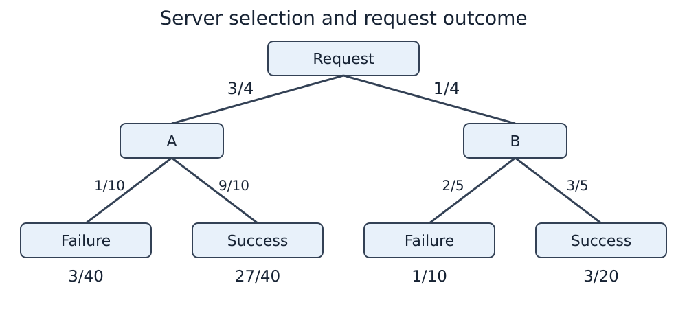

# M16-L3 – Discrete probability for algorithms and systems {#L3}

**Course area:** M16 – Databases and mathematical computing

**Level:** Bachelor · Core/bridge

**Prerequisites:** [M8-L1](M8-L1.md), [M9-L2](M9-L2.md)

## Learning objectives {#S1}

Model finite probability spaces, calculate conditional probability and expectation, distinguish pairwise from mutual independence, and derive expected costs of randomized algorithms using indicator variables.

## Events and conditional probability {#S2}

A finite probability space consists of an outcome set $\Omega$ with weights $p(\omega)\ge0$ summing to 1. An event A is a subset; $P(A)=\sum_{\omega\in A}p(\omega)$. Equal probabilities are an additional assumption, not a general property. For $P(B)>0$, $P(A\mid B)=P(A\cap B)/P(B)$. Independence means $P(A\cap B)=P(A)P(B)$; hence two mutually exclusive events of positive probability are not independent.

A service chooses server A with probability 3/4, otherwise B. A request fails with probability 1/10 on A and 2/5 on B. By total probability, the failure probability is $3/4\cdot1/10+1/4\cdot2/5=7/40$. Given an observed failure, Bayes' rule gives $P(B\mid failure)=(1/10)/(7/40)=4/7$. This is not a claim about a real service; the parameters are model assumptions.

{alt="Server A with 3/4, B with 1/4; failure paths with weights 3/40 and 1/10"}

## Expectation and indicators {#S3}

For a random variable X on a finite space, $E[X]=\sum_\omega X(\omega)p(\omega)$. Linearity $E[X+Y]=E[X]+E[Y]$ follows from distributivity within this sum; independence is not required. The indicator variable $I_A$ is 1 on A and 0 elsewhere, so $E[I_A]=P(A)$. Variance instead satisfies $\operatorname{Var}(X+Y)=\operatorname{Var}(X)+\operatorname{Var}(Y)+2\operatorname{Cov}(X,Y)$, where $\operatorname{Cov}(X,Y)=E[XY]-E[X]E[Y]$. Independence is sufficient for zero covariance.

Pairwise independence does not imply mutual independence: for independent fair bits U and V let $W=U\mathbin{\mathrm{XOR}}V$. Each pair is uniform over four bit pairs. Nevertheless, $P(U=0,V=0,W=0)=1/4$ rather than $1/8$.

## Random assignment and costs {#S4}

A simplified hashing model assigns n distinct keys independently and uniformly to m buckets ($m\ge1$). For each unordered key pair i,j, let $I_{ij}=1$ if both are assigned to the same bucket. Then $P(I_{ij}=1)=1/m$: of the $m^2$ possible assignments of the two keys, m match. The total number of colliding pairs is $C=\sum_{i<j}I_{ij}$. Thus, without requiring mutual independence of the indicators:

$$E[C]=\frac{n(n-1)}{2m}.$$

For n=4 and m=3 the expectation is 2, although individual assignments may have between 1 and 6 colliding pairs. Occupancies (3,1,0) produce three colliding pairs. An algorithm comparing each colliding pair once therefore has expected comparison costs $E[C]$; total runtime includes other work. For real hash functions the random model must be justified. Expected costs are not a worst-case guarantee: all n keys can land in one bucket.

## Executable exact check {#S5}

The simulation enumerates all $m^n$ assignments and uses rational arithmetic. It is deliberately suitable only for small cases. The formula, in contrast, takes a constant number of arithmetic operations (not necessarily constant bit complexity).

```python
from itertools import product
from collections import Counter
from fractions import Fraction


def expected_pairs(n, m):
    if n < 0 or m < 1:
        raise ValueError('invalid dimensions')
    return Fraction(n * (n - 1), 2 * m)


def exact_pairs(n, m):
    if n < 0 or m < 1:
        raise ValueError('invalid dimensions')
    total = 0
    for assignment in product(range(m), repeat=n):
        counts = Counter(assignment)
        total += sum(k * (k - 1) // 2 for k in counts.values())
    return Fraction(total, m ** n)

assert exact_pairs(4, 3) == expected_pairs(4, 3) == 2
assert exact_pairs(0, 3) == 0
assert exact_pairs(4, 1) == 6
```

Another cost model: independent repetitions of a trial with constant success probability $0<p\le1$ require a geometrically distributed number of trials T until the first success. Since $P(T>k)=(1-p)^k$, summing the survival probabilities gives $E[T]=\sum_{k\ge0}P(T>k)=1/p$. The sum identity follows from $t=\sum_{k=0}^{t-1}1$ and interchange of nonnegative sums. With p=1/4, four trials are needed on average, but the probability of still having no success after four trials is $(3/4)^4=81/256$. Dependent repetitions or varying p require a different model.

## Self-assessment {#S6}

### Exercises

1. In the server model, calculate the probability of a successful request and the probability of server A given failure.
2. Prove linearity of expectation for two random variables on a finite space.
3. Why are U,V,W from the XOR example not mutually independent?
4. Calculate the expected number of colliding pairs for 10 keys and 5 buckets. What is the maximum possible C?
5. A trial independently succeeds with p=1/5. Find the expected trial count and the probability of no success after three trials.

::: {.lc-solutions data-lc-section="S6"}
1. $33/40$ and $(3/40)/(7/40)=3/7$.
2. Apply distributivity to $(X(\omega)+Y(\omega))p(\omega)$ in the finite weighted sum.
3. The triple (0,0,0) has probability 1/4, not the product 1/8 of the marginal probabilities.
4. $45/5=9$; maximum 45 when all keys land in one bucket.
5. 5 trials; $(4/5)^3=64/125$.
:::

## Sources {#S7}

- [Introduction to Probability – Conditioning and Independence](https://www.probabilitycourse.com/chapter5/5_1_3_conditioning_independence.php) · conditional distributions; independence; total probability and expectation (Review scope: Text) · Last accessed: 2026-11-24 · Content verified: 2026-11-24
- [Cornell CS 2800 – Probabilistic counting](https://www.cs.cornell.edu/courses/cs2800/2017sp/lectures/lec19-counting.html) · indicator variables and linearity of expectation (Review scope: Text) · Last accessed: 2026-11-24 · Content verified: 2026-11-24
