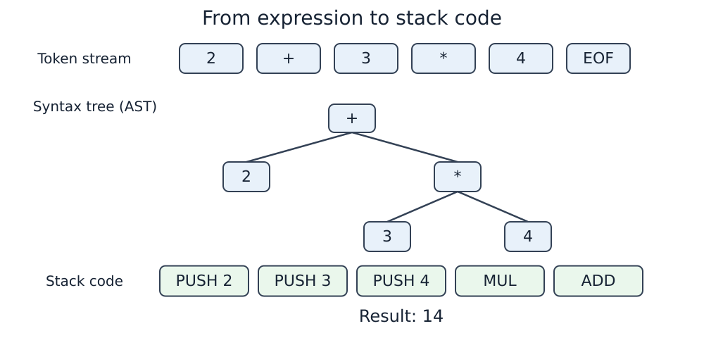

# M17-L1 – Lexing and recursive descent: a small compiler {#L1}

**Course area:** M17 – Compilers and formal methods

**Level:** Bachelor’s · Elective

**Prerequisites:** [M12-L1](M12-L1.md), [M14-L2](M14-L2.md)

## Learning objectives {#S1}

Convert a character stream completely into positioned tokens, translate an unambiguous expression grammar into a recursive parser, construct an abstract syntax tree (AST), and generate a small stack instruction program. Distinguish lexical, syntactic and subsequent semantic errors.

## From source text to lexical analysis {#S2}

A compiler translates a program into a different representation. Its front end analyses input; a back end may generate machine code. Our teaching compiler instead generates stack instructions for a small virtual machine. It accepts only nonnegative decimal integer literals, binary operators +, −, * and parentheses; intermediate results may be negative. There are no variables, division or unary operators. Whitespace is ignored but separates lexemes. The sequence `123` is a single lexeme. Each token contains its kind, original text and zero-based character offset. An EOF token marks the end. Unknown characters must not be silently skipped: `2@3` must fail at offset 1. In contrast, `2 3` is lexically valid but syntactically invalid.

The lexer specification uses regular expressions. Parenthesis structure additionally requires a parser. In a full language a later semantic phase checks, for example, declared names and type compatibility; syntactic validity does not guarantee either.

## Grammar, precedence and associativity {#S3}

The extended BNF (EBNF) of this language is:

```text
expr = term { ("+" | "-") term } ;
term = atom { "*" atom } ;
atom = NUM | "(" expr ")" ;
start = expr EOF ;
```

Braces denote zero or more repetitions here, not source characters. NUM is a terminal kind; expr, term and atom are nonterminals. `term` binds multiplication before addition. The loops construct equal-precedence operators from left to right: `9-4-2` means `(9-4)-2=3`, not `9-(4-2)=7`. A directly left-recursive `expr = expr "+" term | term` would, if naively implemented, call expr repeatedly without consuming a token. The loop form avoids this recursion. Parentheses invoke expr only after consuming `(`.

Prediction requires just the next token here: NUM and `(` distinguish atom alternatives; the loops begin only on their respective operators. EOF must follow a complete expression so an invalid remainder cannot be accepted. The teaching program stops at the first error; professional parsers can additionally implement error recovery.

## Abstract syntax tree and stack code {#S4}

For `2+3*4`, the AST is `('+', ('num', 2), ('*', ('num', 3), ('num', 4)))`. It retains the meaningful structure but no parenthesis or whitespace tokens. The code generator visits the left subtree, then the right subtree, and finally emits the operator. `PUSH 2; PUSH 3; PUSH 4; MUL; ADD` leaves 14. SUB pops the right operand b first, then the left a, and pushes a−b. Reversing them would be a translation error.

{alt="2+3*4 becomes five tokens, an addition node with multiplication as its right child, and five stack instructions"}

Correctness argument by structural induction: for a numeric leaf, PUSH places its value on any initial stack. Assume each subtree pushes exactly its value and preserves the stack below. After both translations, a and b are on top; the operator replaces them with a op b. The claim therefore holds for the entire AST. This proof covers valid trees and the specified integer semantics only. With constant token costs, lexer and parser run linearly in characters and tokens respectively; code generation visits each AST node once. Integer arithmetic additionally depends on bit length. Recursion depth and memory are finite; deeply nested input can hit Python's recursion limit.

## Executable teaching model {#S5}

The following Python code separates lexing, parsing, translation and execution. The stack interpreter expects only code produced by the generator; it is not a verifier for arbitrary bytecode. Diagnostic offsets count characters, not UTF-8 bytes. No Python eval is used.

```python
import re


def lex(text):
    tokens = []
    pos = 0
    pattern = re.compile(r"[0-9]+|[()+*\-]|\s+")
    while pos < len(text):
        match = pattern.match(text, pos)
        if match is None:
            raise SyntaxError(f"unexpected character at {pos}")
        word = match.group()
        if not word.isspace():
            tokens.append(("NUM" if word[0].isdigit() else word,
                           word, pos))
        pos = match.end()
    return tokens + [("EOF", "", pos)]


def parse(text):
    tokens = lex(text)
    i = 0

    def take(kind):
        nonlocal i
        actual, word, pos = tokens[i]
        if actual != kind:
            raise SyntaxError(f"expected {kind} at {pos}, got {actual}")
        i += 1
        return word

    def atom():
        if tokens[i][0] == "NUM":
            return ("num", int(take("NUM")))
        take("(")
        node = expr()
        take(")")
        return node

    def term():
        node = atom()
        while tokens[i][0] == "*":
            take("*")
            node = ("*", node, atom())
        return node

    def expr():
        node = term()
        while tokens[i][0] in ("+", "-"):
            op = tokens[i][0]
            take(op)
            node = (op, node, term())
        return node

    result = expr()
    take("EOF")
    return result


def emit(node):
    out = []

    def visit(n):
        if n[0] == "num":
            out.append(("PUSH", n[1]))
        else:
            visit(n[1])
            visit(n[2])
            out.append(({"+": "ADD", "-": "SUB", "*": "MUL"}[n[0]],))
    visit(node)
    return out


def run(program):
    stack = []
    for instruction in program:
        op = instruction[0]
        if op == "PUSH":
            stack.append(instruction[1])
        else:
            b = stack.pop()
            a = stack.pop()
            if op == "ADD":
                stack.append(a + b)
            elif op == "SUB":
                stack.append(a - b)
            elif op == "MUL":
                stack.append(a * b)
            else:
                raise ValueError(op)
    if len(stack) != 1:
        raise ValueError("invalid stack")
    return stack[0]


assert run(emit(parse("2+3*4"))) == 14
assert run(emit(parse("(2+3)*4"))) == 20
assert run(emit(parse("9-4-2"))) == 3
```

## Self-check {#S6}

### Exercises

1. Give the tokens and offsets for `12 + 3`, including EOF.
2. Draw the AST for `8-2*3-1` and calculate its value.
3. Generate stack code for `(5-2)*4` and list the stack after each instruction.
4. Classify `2@3`, `2 3`, `(2+3` and `2+` by error phase. Why is accepting only the first expression insufficient?
5. Prove stack preservation for a SUB node and explain why the right operand is popped first.

::: {.lc-solutions data-lc-section="S6"}
1. NUM(12,0), +(+,3), NUM(3,5), EOF('',6).
2. `('-', ('-', ('num',8), ('*', ('num',2), ('num',3))), ('num',1))`; result 1.
3. PUSH 5, PUSH 2, SUB, PUSH 4, MUL; stacks [5], [5,2], [3], [3,4], [12].
4. `2@3` is lexically invalid. The other three are syntactically invalid (extra number, missing parenthesis, missing operand). EOF prevents accepting a valid prefix with an invalid remainder.
5. After translating the children, the stack is S·a·b. SUB pops b and a and replaces them by a−b; original stack S remains unchanged. Reversed popping would produce the wrong sign for unequal operands.
:::

## Sources {#S7}

- [Crafting Interpreters – Scanning (mirror)](https://cndoit18.github.io/craftinginterpreters/scanning.html) · 4.2–4.5: token attributes, lexical grammar, scanning and error positions (Review scope: Text) · Last accessed: 2026-11-24 · Content verified: 2026-11-24
- [Cornell CS 211 – Grammars and Parsing](https://www.cs.cornell.edu/courses/cs211/2006fa/Sections/S3/grammars.html) · Recursive descent parsing and exceptions; left recursion and ambiguity (Review scope: Text) · Last accessed: 2026-11-24 · Content verified: 2026-11-24
