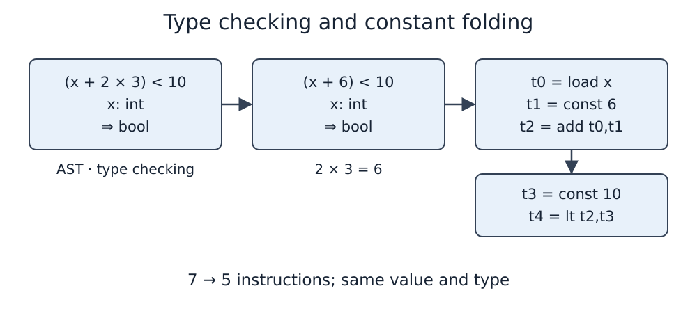

# M17-L2 – Type checking, intermediate representation and compiler optimization {#L2}

**Course area:** M17 – Compilers and formal methods

**Level:** Master’s · Specialization

**Prerequisites:** [M17-L1](M17-L1.md); [M12-L3](M12-L3.md)

## Learning objectives {#S1}

Derive typing judgments from syntax and typing environments, reject ill-typed expressions before execution, lower an AST to linear intermediate instructions, and justify value preservation under constant folding. Explain the semantic limits of an optimization.

## Static type checking {#S2}

The parser in M17-L1 determines structure rather than admissible types. We extend the model to preconstructed finite expression trees containing integers, Boolean values and variables. The typing environment $\Gamma$ maps every permitted name to one type. The judgment $\Gamma\vdash e:t$ states that expression $e$ has type $t$. The runtime value environment must be complete and conform to $\Gamma$.

| Expression | Requirement | Result type |
|---|---|---|
| Integer literal | none | int |
| Boolean literal | none | bool |
| Variable x | x in $\Gamma$ | $\Gamma(x)$ |
| a+b, a*b | both int | int |
| `a<b` | both int | bool |
| a and b | both bool | bool |

There are no implicit conversions. Python's bool is a subclass of int, but this model distinguishes the types using `type(v) is int` and `is bool`. With x:int, `(x+2*3)<10` is well typed, whereas `x+true` is not. An unknown variable is also a type error. The checker recursively follows the rules without needing the values of variables.

## Intermediate representation {#S3}

An intermediate representation (IR) decouples source language from later translation stages. A linear model uses temporary values: `t0 = load x; t1 = const 2; t2 = const 3; t3 = mul t1,t2; t4 = add t0,t3; t5 = const 10; t6 = lt t4,t5`. The numbers in temporary names correspond to instruction indices. Every binary instruction operand refers to an already defined value. This is a simple straight-line single-assignment representation, not a full SSA IR with control flow and phi nodes.

{alt="The expression x plus two times three less than ten is type checked, folded to x plus six less than ten and executed as five temporary instructions."}

Translation visits both children before their parent. By induction, a leaf's const or load instruction yields its correct value. If both children yield their correct values, the parent instruction uses exactly those two temporaries with the original operation. Thus the final instruction yields the expression's value. Each AST edge is traversed once; with constant cost per node, translation takes time and space linear in tree size.

## Constant folding and semantic preservation {#S4}

After type checking, pure constant subtrees may be evaluated. In the example, `2*3` is replaced by `6`. The optimized code needs five rather than seven instructions, not necessarily a proportionately shorter actual runtime. The fold function operates bottom up. A literal or variable leaf is unchanged. If the transformed children have equal values and types by the induction hypothesis, applying the same operator is equivalent. When both children are literals, the operator can be evaluated in advance with exactly the same semantics; the replacement is a literal of the result type. Hence the type and value of the entire expression are preserved.

The teaching model uses unbounded integers and eager (not short-circuiting) Boolean and, with no side effects or division. In another language, `0*f()` may suppress an exception or output from f, and floating-point rearrangements can change rounding. Overflow rules for bounded integer types must also agree. Type checking must precede fold: an invalid subtree must not be hidden by optimization. Constant propagation across variable definitions and global data-flow analysis are beyond this model.

## Executable teaching model {#S5}

The code expects well-formed AST tuples and matching typing and value environments; it does not validate arbitrary input data or IR. Type checking is part of the compile function. Python operator functions implement the specified semantics; the actual cost of large integers depends on their bit length.

```python
import operator

OPS = {'+': (int, int, operator.add),
       '*': (int, int, operator.mul),
       '<': (int, bool, operator.lt),
       'and': (bool, bool, operator.and_)}


def infer(e, gamma):
    tag = e[0]
    if tag == 'lit':
        if type(e[1]) not in (int, bool):
            raise TypeError('literal')
        return type(e[1])
    if tag == 'var':
        if e[1] not in gamma:
            raise TypeError('unknown variable')
        return gamma[e[1]]
    arg, result, _ = OPS[tag]
    if infer(e[1], gamma) is not arg or infer(e[2], gamma) is not arg:
        raise TypeError('operand type')
    return result


def fold(e):
    if e[0] in ('lit', 'var'):
        return e
    op, a, b = e[0], fold(e[1]), fold(e[2])
    if a[0] == b[0] == 'lit':
        return ('lit', OPS[op][2](a[1], b[1]))
    return (op, a, b)


def lower(e):
    ir = []
    def visit(n):
        tag = n[0]
        if tag in ('lit', 'var'):
            instruction = n
        else:
            a, b = visit(n[1]), visit(n[2])
            instruction = (tag, a, b)
        index = len(ir)
        ir.append(instruction)
        return index
    result = visit(e)
    return ir, result


def run(ir, result, env):
    values = []
    for n in ir:
        if n[0] == 'lit':
            value = n[1]
        elif n[0] == 'var':
            value = env[n[1]]
        else:
            value = OPS[n[0]][2](values[n[1]], values[n[2]])
        values.append(value)
    return values[result]


def compile_expr(e, gamma):
    infer(e, gamma)
    return lower(fold(e))


expr = ('<', ('+', ('var', 'x'), ('*', ('lit', 2), ('lit', 3))), ('lit', 10))
assert infer(expr, {'x': int}) is bool
assert run(*compile_expr(expr, {'x': int}), {'x': 3}) is True
```

## Self-assessment {#S6}

### Exercises

1. Under x:int and b:bool, determine the type of `((x+2)<7) and b` and justify each step.
2. Explain why `true*2` must be rejected even though Python can perform the operation.
3. Give the temporary instructions before and after folding `(2+3)*x`.
4. Prove for a constant multiplication node that folding preserves value and type.
5. Why is `0*f()` → `0` not generally valid in a language with side effects? Give a counterexample.

::: {.lc-solutions data-lc-section="S6"}
1. x+2:int; comparison with 7 yields bool; b:bool; and accepts both bool values and returns bool.
2. The typing rule requires two int operands; true has type bool in the model, regardless of Python inheritance and implicit arithmetic.
3. Before: t0=const 2, t1=const 3, t2=add t0,t1, t3=load x, t4=mul t2,t3. After: t0=const 5, t1=load x, t2=mul t0,t1.
4. Both literals have type int after type checking. The induction hypothesis guarantees their values. The product is an integer; the new literal contains exactly this product, so its type and value equal those of the old node.
5. If f prints a message and returns 7, the original expression yields 0 with output, the replacement yields 0 without output. Observable behavior differs.
:::

## Sources {#S7}

- [Cornell – Eta Type System Specification](https://www.cs.cornell.edu/courses/cs4120/2026sp/project/types.pdf) · §2: expression typing judgments (Review scope: Text; Seitenbild nicht abrufbar) · Last accessed: 2026-11-24 · Content verified: 2026-11-24
- [CMU – Intermediate Representation](https://www.cs.cmu.edu/~411/lectures/06-irtrees.pdf) · §1–2: IR levels and pure/effectful operations (Review scope: Text; Seitenbild nicht abrufbar) · Last accessed: 2026-11-24 · Content verified: 2026-11-24
- [Cornell CS 212 – Compiler](https://www.cs.cornell.edu/courses/cs212/1998sp/lectures/lec_4_14-16.html) · Linearization and constant folding (Review scope: Text) · Last accessed: 2026-11-24 · Content verified: 2026-11-24
