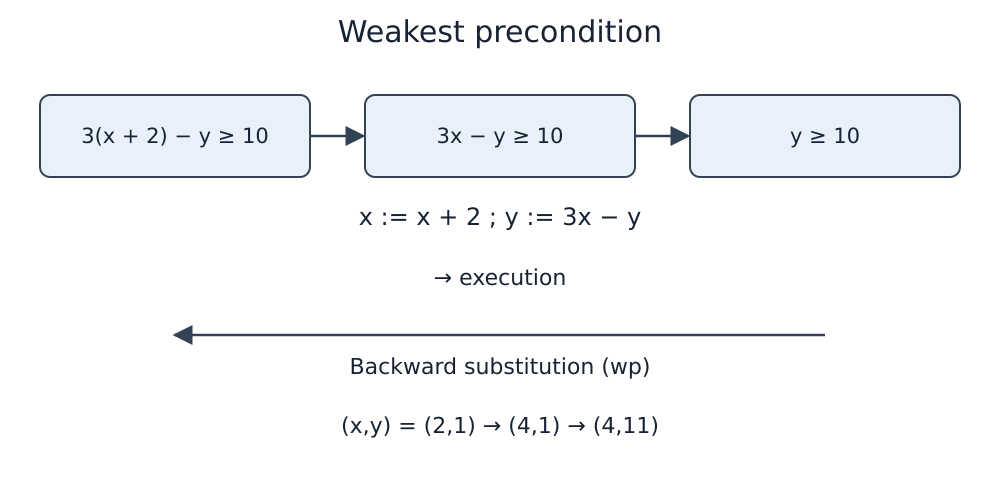

# M17-L3 – Hoare logic and weakest preconditions {#L3}

**Course area:** M17 – Compilers and formal methods

**Level:** Master’s · Specialization

**Prerequisites:** [M12-L1](M12-L1.md); [M7-L2](M7-L2.md)

## Learning objectives {#S1}

Interpret Hoare triples, calculate weakest preconditions for assignments and sequential composition, prove a loop invariant, and establish total correctness using a natural-valued variant.

## Specification and notions of correctness {#S2}

A state $\sigma$ maps variables to mathematical integers. An assertion is a predicate over states. The triple $\{P\}\ C\ \{Q\}$ is partially correct if every normally terminating execution of program C from a state satisfying P ends in a state satisfying Q. This assumes the error-free, deterministic semantics used here. Total correctness additionally requires termination for every initial state satisfying P. `while true: skip` satisfies every partial triple but no total triple with a satisfiable precondition.

The consequence rule permits strengthening a precondition or weakening a postcondition: From $P'\Rightarrow P$, a valid triple with P and Q, and $Q\Rightarrow Q'$, the triple with P' and Q' follows. A specification must actually express the intended property; Q=true is usually too weak.

## Weakest preconditions {#S3}

For always-terminating assignments, $wp(x:=E,Q)=Q[x\leftarrow E]$. Substitution replaces free occurrences of x with E; E is evaluated in the old state (rename bound variables if necessary). Sequential composition is processed backward: $wp(C_1;C_2,Q)=wp(C_1,wp(C_2,Q))$. For a deterministic conditional with total guard B, the formula is $(B\land wp(C_1,Q))\lor(\neg B\land wp(C_2,Q))$. The weakest precondition is the largest set of states from which the program terminates and establishes Q. The weakest liberal precondition (wlp) permits nontermination; for our loop-free total commands the two coincide.

Example: `x:=x+2; y:=3*x-y` with Q: $y\ge10$. Backward substitution first gives $3x-y\ge10$, then $3(x+2)-y\ge10$. For x=2,y=1, the precondition holds and final state (4,11) satisfies Q. For x=0,y=0, it fails and final value 6 violates Q. The calculation is not an estimate but an equivalence to the postcondition in the final state.

{alt="Three assertions are shown above two assignment steps; execution proceeds forward and weakest-precondition calculation backward."}

## Loops: invariant and termination measure {#S4}

Let $n\in\mathbb N_0$. The program sets i=0,s=0 and executes i:=i+1; s:=s+i while `i<n`. The desired result is $s=n(n+1)/2$. The invariant is $I:0\le i\le n\land 2s=i(i+1)$; n remains unchanged.

Initialization: i=s=0 satisfies I. Preservation: For old values i,s satisfying I and `i<n`, the new i'=i+1 is at most n and the new s'=s+i+1. Therefore $2s'=i(i+1)+2(i+1)=(i+1)(i+2)=i'(i'+1)$. Exit: I and the negated guard i≥n imply i=n and hence Q. This proves partial correctness.

Termination: The integer variant $V=n-i$ is nonnegative under I, positive under the guard and decreases by exactly one after every iteration. The loop body terminates and there is no infinite descending sequence of natural numbers. Thus the program terminates after n iterations; together with the invariant this establishes total correctness. With real fixed-width integer types, absence of overflow would also need to be proved. A loop invariant alone does not prove termination.

## Executable model and testing limits {#S5}

Python integers match mathematical integer semantics within available resources. Assertions illustrate the invariant and variant; they are not an automated proof and may be disabled by the interpreter. The wp function directly implements the analytically calculated precondition, not a general WP generator.

```python
def sum_to(n):
    if type(n) is not int or n < 0:
        raise ValueError('nonnegative integer required')
    i, s = 0, 0
    while i < n:
        assert 0 <= i <= n and 2*s == i*(i+1)
        old_variant = n-i
        i = i+1
        s = s+i
        assert 0 <= n-i < old_variant
    assert i == n and 2*s == n*(n+1)
    return s


def program(x, y):
    x = x+2
    y = 3*x-y
    return x, y


def wp(x, y):
    return 3*(x+2)-y >= 10


assert sum_to(5) == 15
assert wp(2, 1) == (program(2, 1)[1] >= 10)
```

## Self-assessment {#S6}

### Exercises

1. Calculate wp for `x:=2*x+1` and Q: x≥9 over integer states.
2. Calculate wp for `x:=x+1; y:=x+y` and Q: y=8.
3. What three proof obligations establish partial correctness of a while loop with invariant I?
4. For n≥0, prove total correctness of `i:=n; while i>0: i:=i-1` with respect to Q: i=0.
5. Is the triple with P=true, `while true: skip` and Q=false partially or totally correct? Justify.

::: {.lc-solutions data-lc-section="S6"}
1. 2x+1≥9, hence x≥4.
2. First x+y=8, then x+1+y=8, equivalently x+y=7.
3. P must imply I before the loop, I and the guard must guarantee I again after the body, and I with the negated guard must imply Q.
4. Initially I: 0≤i≤n holds. If i>0, i-1 remains in this interval. On exit i≤0, so i=0. The natural-valued variant i decreases by one each iteration; the body terminates. Thus termination and Q both hold.
5. Partially correct because no normally terminating execution exists that could violate Q. Not totally correct because the program diverges from every state.
:::

## Sources {#S7}

- [Software Foundations – Hoare Logic I (Princeton)](https://www.cs.princeton.edu/courses/archive/spring23/cos510/sf/plf/Hoare.html) · Assignment, sequencing, while rule and partial correctness (Review scope: Text) · Last accessed: 2026-11-24 · Content verified: 2026-11-24
