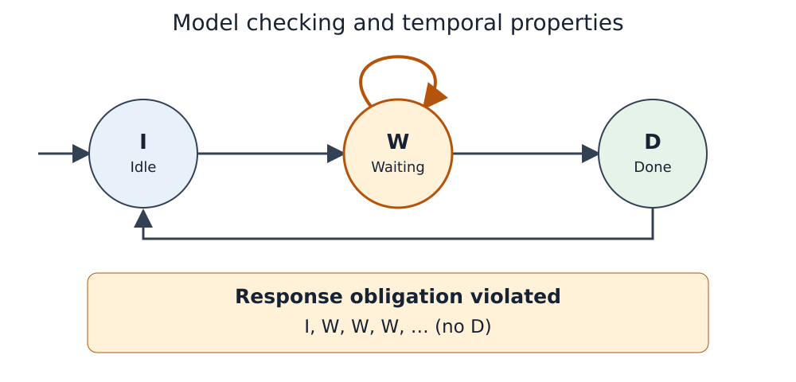

# M17-L4 – Model checking and temporal properties {#L4}

**Course area:** M17 – Compilers and formal methods

**Level:** Master’s · Specialization

**Prerequisites:** [M15-L5](M15-L5.md); [M17-L3](M17-L3.md)

## Learning objectives {#S1}

Model finite transition systems, interpret the temporal operators X, F, G and U, distinguish safety from liveness, check invariants by reachability and construct an infinite counterexample as a finite prefix-cycle representation.

## State model and temporal logic {#S2}

A finite model consists of a state set S, an initial state s0, a relation R ⊆ S × S and a labelling L assigning the true atomic propositions to each state. We require at least one successor per state; an intended standstill may be represented by a self-loop. This is a modelling choice, not proof that the real system progresses. A run is an infinite sequence $s_0,s_1,\ldots$ with $(s_i,s_{i+1})\in R$.

Linear temporal logic (LTL) interprets propositions at positions of a run. X p requires p at the next state, F p at some position from now on (including now), G p at every position from now on. $p\ U\ q$ requires a current or future position with q and p at every strictly preceding position from now on. If q never occurs, this strong until is false. The model satisfies an LTL formula exactly when every run from the initial state satisfies it. One successful run is insufficient.

Safety: a violation can be witnessed by a finite bad prefix that no extension can repair. An example is $G\neg bad$. Liveness: every finite word has an infinite extension satisfying the property (over the chosen alphabet of propositions). For example, $G(request\Rightarrow F\ done)$ requires eventual completion after each request. Finite waiting alone does not refute it. Not every temporal formula belongs exclusively to one of these classes; mixtures are possible.

## Example and counterexample {#S3}

A service has I (idle), W (waiting, request) and D (done). Edges are I→W, W→W, W→D and D→I. No state is labelled bad. The safety invariant holds, but the response obligation is false: the run I,W,W,… avoids D forever after the request. The alternative W→D is possible, not compulsory. Removing the self-loop establishes the response obligation in this model. Alternatively an explicit fairness assumption could exclude the infinite waiting path; without such an assumption it must not be ignored. Weak fairness of a continuously enabled service transition is an additional semantics not implemented by the following algorithm.

{alt="I leads to W, W leads to D or back to W, and D leads to I. The W self-loop permits an infinite run without completion."}

If a reachable error state B with a self-loop and label bad were added, a finite path to B would be a safety counterexample. The search must consider all possible edges, not just a simulated execution.

## Algorithm and correctness argument {#S4}

Breadth-first search from s0 computes reachable states and stores a predecessor for each. Every reachable state has a finite path; induction on its length shows it is discovered. Every discovered state is reachable because it is the start or a successor of an already discovered state. Hence $G\neg bad$ holds exactly when no reachable state carries bad; a predecessor chain gives a shortest error path in edge count. Cost O(|S|+|R|).

For universal eventual reachability of done (CTL: AF done), start with $A_0=\{s:done\in L(s)\}$ and iterate $A_{k+1}=A_k\cup\{s:\forall t\ ((s,t)\in R\Rightarrow t\in A_k)\}$. By induction A_k contains exactly the states from which every run reaches done within at most k steps. The sequence increases monotonically and stabilizes after at most |S| strict expansions. The complement of the fixed point contains no done state and every state has at least one successor in the complement. Repeatedly selecting such a successor yields a cycle by finiteness, hence an infinite run without done. Thus the fixed point is exactly the set of states from which every run eventually reaches done. The response obligation holds exactly when every reachable request state belongs to the fixed point. Otherwise connect a path to the violating request to a prefix and cycle in the complement. Naive iteration takes O(|S|(|S|+|R|)); n Boolean variables can yield up to 2^n states. General LTL model checking uses, among other techniques, Büchi automata and product graphs; the algorithm proved here checks only these two formula patterns.

## Executable model {#S5}

State names are strings (not None). Labels are supplied as sets. The result contains an error path or None and a lasso (prefix, nonempty repeating cycle) or None. The prefix ends immediately before the cycle; it may be empty if the start lies on the cycle. All allowed infinite paths are considered without a fairness filter. This is not a general LTL parser or distributed runtime model.

```python
from collections import deque


def reachable(graph, start):
    if start not in graph or any(not ns or any(t not in graph for t in ns)
                                 for ns in graph.values()):
        raise ValueError('finite total graph required')
    parent = {start: None}
    queue = deque([start])
    while queue:
        s = queue.popleft()
        for t in graph[s]:
            if t not in parent:
                parent[t] = s
                queue.append(t)
    return parent


def trace(parent, end):
    path = []
    while end is not None:
        path.append(end)
        end = parent[end]
    return path[::-1]


def check(graph, start, bad, request, done):
    parent = reachable(graph, start)
    if not (bad | request | done) <= graph.keys():
        raise ValueError('unknown labelled state')
    unsafe = next((s for s in parent if s in bad), None)
    # Least fixed point for AF done.
    good = set(done)
    while True:
        nxt = good | {s for s, ns in graph.items() if set(ns) <= good}
        if nxt == good:
            break
        good = nxt
    failing = next((s for s in parent if s in request and s not in good), None)
    lasso = None
    if failing is not None:
        path, seen = [], {}
        s = failing
        while s not in seen:
            seen[s] = len(path)
            path.append(s)
            s = next(t for t in graph[s] if t not in good)
        k = seen[s]
        lasso = (trace(parent, failing)[:-1] + path[:k], path[k:])
    return (None if unsafe is None else trace(parent, unsafe), lasso)


g = {'I': ('W',), 'W': ('W', 'D'), 'D': ('I',)}
assert check(g, 'I', set(), {'W'}, {'D'}) == (None, (['I'], ['W']))
g['W'] = ('D',)
assert check(g, 'I', set(), {'W'}, {'D'}) == (None, None)
```

## Self-assessment {#S6}

### Exercises

1. Does the run I,W,D,I,W,D,… satisfy the response obligation? Does it therefore hold in the original model?
2. Add W→B and B→B with bad at B. Give a shortest safety counterexample path.
3. Calculate A0 and the fixed point for the original graph; repeat without W→W.
4. Explain why F done holds immediately at D. Does X done hold there?
5. Why is the presence of a reachable cycle insufficient to refute the response obligation? State the additional condition.

::: {.lc-solutions data-lc-section="S6"}
1. Yes, each W position has a later D position. No, the run I,W,W,… refutes the universal property.
2. I,W,B; two edges. The bad label at B violates G ¬bad.
3. With the loop A0={D}, already a fixed point: W has itself as successor, I has W. Without the loop A1={D,W}, A2={D,W,I}; the response obligation holds.
4. F includes the current position. X done is false because the next state is I.
5. The cycle must be reachable from a reachable request position along a done-free path, and contain no done state. Otherwise it does not witness a permanently unanswered request.
:::

## Sources {#S7}

- [University of Edinburgh – Modelling Concurrent Systems](https://homepages.inf.ed.ac.uk/rvangla/MCS/notes.html) · Lecture 14: safety, liveness, fairness (Review scope: Text) · Last accessed: 2026-11-24 · Content verified: 2026-11-24
- [UNSW – Modelling Concurrent Systems](https://cgi.cse.unsw.edu.au/~rvg/MCS/notes.html) · Lecture 10A/B: CTL and LTL semantics (parallel version of Edinburgh notes) (Review scope: Text) · Last accessed: 2026-11-24 · Content verified: 2026-11-24
- [Carnegie Mellon – LTL Model Checking & Büchi Automata](https://www.cs.cmu.edu/~15414/s20/f17/lectures/17-buchi.pdf) · Sections 1–3: finite total transition systems and LTL model checking (Review scope: Text; PDF-Seitenbild nicht abrufbar) · Last accessed: 2026-11-24 · Content verified: 2026-11-24
