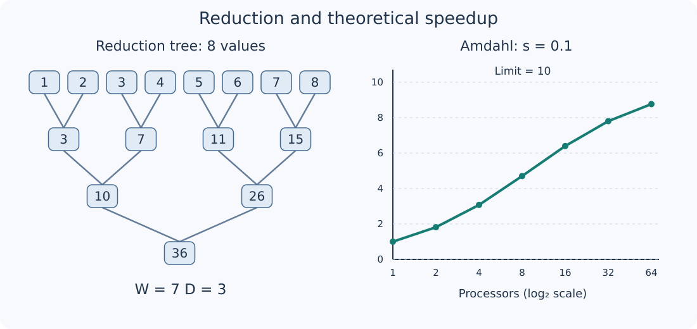

# M18-L1 – Parallel algorithms and scientific computing {#L1}

**Course area:** M18 – Parallel and scientific computing

**Level:** Master’s · Specialization

**Prerequisites:** [M13-L3](M13-L3.md); [M15-L5](M15-L5.md)

## Learning objectives {#S1}

Determine work and span of a dependency graph, derive theoretical speedup bounds, design a tree reduction for odd input sizes, explain order-dependent rounding, and plan a reproducible scaling experiment.

## Work, critical path and processor model {#S2}

Model a computation as a directed acyclic graph (DAG). Every vertex represents a unit-duration operation; an edge means that its target must wait for the source result. Inputs are already available. Work W counts operation vertices; span D counts the operation vertices on the longest dependency path. On one ideal processor T₁=W, and with unlimited ideal processors T∞=D. For p processors,

$$T_p\geq\max(\lceil W/p\rceil,D).$$

The first bound follows from the capacity of at most p operations per time unit, the second from sequential execution along the critical path. A greedy scheduler runs as many ready operations as possible each round. Full rounds consume p operations and can occur at most W/p times. In a non-full round all ready operations run; every longest remaining path starts with a ready operation, so the remaining span drops by at least one. There are at most D such rounds. Thus this scheduler satisfies Tₚ ≤ W/p + D. This model excludes communication, memory and task management costs; it is not a measured runtime guarantee.

## Reduction and scaling {#S3}

A reduction combines elements using an associative operation. Mathematical integer addition is suitable. Each round adds adjacent pairs and carries any unpaired element forward unchanged. The invariant is that each intermediate value sums a disjoint contiguous segment of the input, and the segments cover the input exactly. It holds initially for singletons and is preserved when adjoining segments are combined. Finally a single segment remains, giving the total. For n≥1 there are exactly n−1 additions because every addition reduces the segment count by one. After k rounds the segment count is ⌈n/2ᵏ⌉, so D=⌈log₂ n⌉. For n=0 define the identity 0 and W=D=0. Eight values require seven additions in three levels; with two processors the levels take 2+1+1=4 time units. The implementation simulates level barriers and does not launch parallel threads.

{alt="Eight inputs are reduced to a sum in three levels; alongside, theoretical speedup approaches ten with a ten percent serial fraction."}

Let s be the non-parallelizable fraction of the original runtime for a fixed task. With perfect parallelization of the remainder and no overhead, Tₚ/T₁=s+(1−s)/p and Sₚ=1/(s+(1−s)/p). With s=0.1 and p=8, speedup is 80/17≈4.706 and efficiency Sₚ/p=10/17≈0.588. As p→∞ the limit is 10. For s=0 this particular bound disappears; DAG span can still limit scaling. Amdahl's model assumes a fixed workload. Strong scaling fixes n; weak scaling keeps work per processor approximately constant. Increasing the total workload is not evidence of solving the same task faster.

## Scientific computing and measurement design {#S4}

Floating-point addition is not generally associative. In binary64 with round-to-nearest, (10¹⁶−10¹⁶)+1 and 10¹⁶+(−10¹⁶+1) yield 1 and 0 respectively. The exact mathematical sum is 1. A fixed reduction tree can be deterministic with fixed arithmetic and inputs, but guarantees neither exact answers nor agreement across other tree shapes or hardware. Higher-accuracy or reproducible accumulation (such as ReproBLAS under its assumptions) may be necessary. Accuracy validation and bitwise reproducibility are distinct requirements.

Plan an experiment with identical inputs for p=1,2,4,8 and a well-optimized serial reference. Record CPU, memory, software versions, thread count, compiler flags, input size and random seed. Specify beforehand whether initialization, transfer and synchronization are included in runtime. Perform warm-up runs and at least five independent repetitions; record individual times, median and dispersion. Check each configuration against an exact integer reference or a justified numerical tolerance defined in advance. With a different summation order, do not silently assume exact equality. Compare both time and accuracy; report memory bandwidth and communication costs as possible causes rather than diagnoses proven without measurement. The following simulation tests algorithmic structure only.

## Executable model {#S5}

The functions count additions and levels; data movement, input reads and Python list operations do not count as work in this simplified model. The correctness proof assumes mathematical integers. The scheduler returns the ideal time with a barrier per level, not the Python function's runtime.

```python
def reduce_tree(values):
    row = list(values)
    work = span = 0
    if not row:
        return 0, work, span
    while len(row) > 1:
        nxt = [row[i] + row[i+1] for i in range(0, len(row)-1, 2)]
        work += len(nxt)
        if len(row) % 2:
            nxt.append(row[-1])
        row = nxt
        span += 1
    return row[0], work, span


def level_schedule(n, p):
    if n < 0 or p < 1:
        raise ValueError('n >= 0 and p >= 1 required')
    time = 0
    while n > 1:
        jobs = n // 2
        time += (jobs + p - 1) // p
        n -= jobs
    return time


assert reduce_tree([2, 5, -1, 4, 3]) == (13, 4, 3)
assert level_schedule(8, 2) == 4
assert (1e16 + -1e16) + 1.0 == 1.0
assert 1e16 + (-1e16 + 1.0) == 0.0
```

## Self-assessment {#S6}

### Exercises

1. Determine work and span for 17 inputs; list the segment counts after each round.
2. Calculate the level schedule time for 17 inputs on three processors and compare it with the lower bounds.
3. What are speedup and efficiency with a 20 percent serial fraction and four processors? What is the asymptotic limit?
4. Use 10¹⁶, −10¹⁶ and 1 to explain why a correct integer reduction does not justify arbitrary floating-point reductions.
5. Design a strong-scaling experiment with one million values and explain when an apparent speedup is meaningless because of unequal measurement boundaries.

::: {.lc-solutions data-lc-section="S6"}
1. W=16, D=5; 17→9→5→3→2→1.
2. Additions per level: 8,4,2,1,1. Time=3+2+1+1+1=8. Lower bound max(⌈16/3⌉,5)=6. Level barriers may cost time; the bound does not claim attainability.
3. S=1/(0.2+0.8/4)=2.5; efficiency=0.625; limit 5.
4. Both parenthesizations give 1 in exact arithmetic. In binary64 the 1 in −10¹⁶+1 is rounded away, making the second result 0. Order, accuracy and reproducibility must be checked separately.
5. Same values and task at p=1,2,4,8; optimized serial reference, fixed measurement boundaries, warm-up, repetitions, median/dispersion, result validation. If serial timing includes data transfer but parallel timing excludes it, the ratio compares different workloads.
:::

## Sources {#S7}

- [University of Utrecht – Work & Span](https://ics-websites.science.uu.nl/docs/vakken/b3cc/resources/tutorials/08-work_span.pdf) · Introduction; questions 1, 5 (PDF text; page image unavailable) (Review scope: Text) · Last accessed: 2026-11-24 · Content verified: 2026-11-24
- [Cornell University – Performance basics](https://www.cs.cornell.edu/courses/cs5220/2020fa/lec/2020-09-08-perf-basics.html) · Quantifying Parallel Performance; Amdahl’s Law; Strong and weak scaling (Review scope: Text) · Last accessed: 2026-11-24 · Content verified: 2026-11-24
- [UC Berkeley – ReproBLAS](https://bebop.cs.berkeley.edu/reproblas/) · What are ReproBLAS; Main Goals; Usage (Review scope: Text) · Last accessed: 2026-11-24 · Content verified: 2026-11-24
