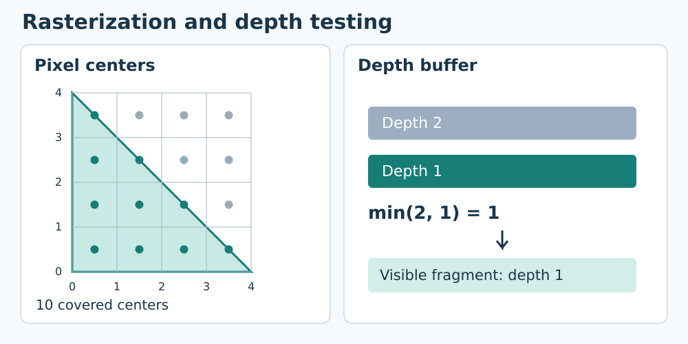

# M19-L1 – Computer graphics: transformation and rasterization {#L1}

**Course area:** M19 – Computer graphics and computer vision

**Level:** Bachelor’s · Elective specialization

**Prerequisites:** [M15-L2](M15-L2.md); Linear algebra (vectors and matrices).

## Learning objectives {#S1}

Apply homogeneous coordinates and transformation order, derive barycentric coordinates, rasterize triangles by point sampling, and justify depth testing with a loop invariant.

## Homogeneous coordinates and pipeline {#S2}

A model point is represented as a column vector $p=(x,y,z,1)^T$. A direction instead has final coordinate zero; an affine translation leaves it unchanged. Translation by $(3,-2,0)$ is

$$T=\begin{pmatrix}1&0&0&3\\0&1&0&-2\\0&0&1&0\\0&0&0&1\end{pmatrix}.$$

It maps $(2,4,1,1)^T$ to $(5,2,1,1)^T$. Order matters: scaling by two followed by translation by three along x gives $2x+3$, while reversing the order gives $2x+6$. A 3D pipeline separates model, view and projection matrices: $p_c=PVMp$. Primitives are clipped against the viewing volume before perspective division. For $w_c\ne0$, normalized coordinates are obtained by dividing by $w_c$; the viewport then maps them to raster coordinates. Division is undefined at $w_c=0$. The program does not implement clipping or perspective projection; it expects already transformed orthographic screen coordinates.

## Barycentric coordinates and coverage {#S3}

For triangle vertices $a,b,c$ in the plane, let $E(a,b,p)=(b_x-a_x)(p_y-a_y)-(b_y-a_y)(p_x-a_x)$ and $D=E(a,b,c)$. When $D=0$ the triangle is degenerate. Otherwise,

$$\lambda_a=E(b,c,p)/D,\quad\lambda_b=E(c,a,p)/D,\quad\lambda_c=E(a,b,p)/D.$$

Expansion gives a sum of one. The three expressions are affine functions of $p$ and take the corresponding unit-vector values at the vertices. Thus $p=\lambda_a a+\lambda_b b+\lambda_c c$ for the planar coordinates: both sides are affine functions agreeing at three noncollinear points. The point is in the closed triangle exactly when all weights are nonnegative (a convex combination). Dividing by signed $D$ makes the test independent of winding order.

Example: $a=(0,0),b=(4,0),c=(0,4)$ and $p=(1,1)$ give $(1/2,1/4,1/4)$. Pixel $(i,j)$ is sampled at its center $(i+1/2,j+1/2)$. A mesh requires a consistent shared-edge rule such as top-left; our closed triangles can cover boundary samples twice. Subpixel sampling reduces jagged edges but does not eliminate aliasing in general.

{alt="Triangle on a pixel grid with covered centers marked; right, comparison of depths 1 and 2."}

## Depth testing and perspective {#S4}

In the orthographic teaching model, depth $z$ is affine over the projected nondegenerate triangle: $z_p=\sum_i\lambda_i z_i$. Smaller values are closer to the camera. The depth buffer stores the minimum depth among all fragments covering each pixel so far; the color buffer stores its label. Inductive proof: initially there is no fragment. Each new fragment replaces the stored one exactly when its depth is smaller. The minimum is therefore preserved. In a tie, the first fragment wins here. For opaque fragments with a unique minimum depth, the result is independent of processing order. Transparency requires other methods.

Perspective-projected attributes generally require a correction. For screen weights $\lambda_i$, clip coordinates $w_i$ and an attribute $u_i$ affine on the object, $u=(\sum_i\lambda_i u_i/w_i)/(\sum_i\lambda_i/w_i)$ when denominators are defined. This follows by normalizing the object-side weights proportional to $\lambda_i/w_i$. For equal screen weights of two endpoints with $w_0=1,w_1=2$ and $u_0=0,u_1=1$, this gives $u=1/3$ rather than $1/2$. Already divided normalized depth $z_c/w_c$, in contrast, is interpolated linearly in screen space. Do not confuse it with camera-space depth.

## Executable model {#S5}

The implementation uses exact rational arithmetic, checks every pixel and ignores degenerate triangles. For $N$ triangles and a $W\times H$ raster, time is $O(NWH)$ in a unit-cost model; buffers require $O(WH)$ entries. Real rasterizers restrict candidates to bounding boxes and use finite precision. The function expects integer or rational inputs, not arbitrary floats.

```python
from fractions import Fraction as F

def transform(matrix, point):
    q = [sum(a*b for a,b in zip(row, point)) for row in matrix]
    if q[3] == 0:
        raise ValueError('point at infinity')
    return tuple(F(v, q[3]) for v in q[:3])

def edge(a,b,p):
    return (b[0]-a[0])*(p[1]-a[1])-(b[1]-a[1])*(p[0]-a[0])

def weights(a,b,c,p):
    d = edge(a,b,c)
    if d == 0:
        return None
    return tuple(F(v,d) for v in (edge(b,c,p),edge(c,a,p),edge(a,b,p)))

def raster(triangles,width,height):
    depth, color = {}, {}
    for vertices, label in triangles:
        a,b,c = vertices
        for y in range(height):
            for x in range(width):
                p = (F(2*x+1,2), F(2*y+1,2))
                w = weights(a,b,c,p)
                if w is None or min(w) < 0:
                    continue
                d = sum(t*v[2] for t,v in zip(w,vertices))
                if (x,y) not in depth or d < depth[x,y]:
                    depth[x,y], color[x,y] = d,label
    return depth,color

T = ((1,0,0,3),(0,1,0,-2),(0,0,1,0),(0,0,0,1))
assert transform(T,(2,4,1,1)) == (5,2,1)
a,b,c=(0,0,2),(4,0,2),(0,4,2)
assert weights(a,b,c,(1,1)) == (F(1,2),F(1,4),F(1,4))
near = [(0,0,1),(4,0,1),(0,4,1)]
assert raster([((a,b,c),'far'),(near,'near')],4,4)[1][0,0] == 'near'
```

## Self-assessment {#S6}

### Exercises

1. Compute $T(2,4,1,1)^T$ and $T(2,4,1,0)^T$; explain the difference.
2. Compare translation by three after scaling by two with the reverse order at $x=4$.
3. Find the barycentric weights of $(2,1)$ in the example triangle and decide coverage.
4. Two covering fragments have depths 3 and 1. Which survives in either order? What changes with equal depth?
5. Compute the perspective-correct attribute for two equal screen weights, $w=(1,3)$ and $u=(0,4)$.

::: {.lc-solutions data-lc-section="S6"}
1. Point: $(5,2,1,1)^T$; direction: $(2,4,1,0)^T$. Translation acts only on the point.
2. Scale first: 11; translate first: 14.
3. $(1/4,1/2,1/4)$; all nonnegative, so covered.
4. Depth 1 wins regardless of order. At equal depth the first fragment remains.
5. $(0+4/6)/(1/2+1/6)=1.
:::

## Sources {#S7}

- [Stanford CS248A – Winter 2026](https://gfxcourses.stanford.edu/cs248a/winter26/lecture/) · Lecture 1, 3, 7 (course overview only) (Review scope: Übersicht) · Last accessed: 2026-11-24 · Content verified: 2026-11-24
- [Athens University of Economics and Business – Computer Graphics Primer](https://graphics.cs.aueb.gr/cgcourse/cgh-u4.html) · Rasterization Pipeline; Sampling and Interpolation; Hidden Surface Elimination (Review scope: Text) · Last accessed: 2026-11-24 · Content verified: 2026-11-24
- [Scratchapixel – Rasterization: a Practical Implementation](https://www.scratchapixel.com/lessons/3d-basic-rendering/rasterization-practical-implementation/rasterization-practical-implementation.html) · Implementation notes; perspective-correct interpolation; depth test (Review scope: Text) · Last accessed: 2026-11-24 · Content verified: 2026-11-24
