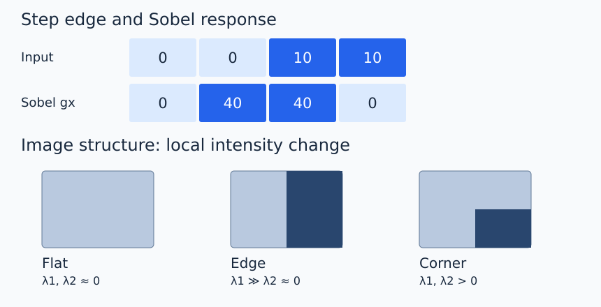

# M19-L2 – Computer vision: image filters and geometric features {#L2}

**Course area:** M19 – Computer graphics and computer vision

**Level:** Master’s · Elective specialization

**Prerequisites:** [M19-L1](M19-L1.md), [M16-L2](M16-L2.md); linear algebra.

## Learning objectives {#S1}

Distinguish discrete convolution from cross-correlation, compute boundary effects and filter responses, interpret Sobel gradients, and derive the Harris corner score from a local quadratic approximation. Explain limitations caused by noise, illumination and scale.

## Discrete image filters {#S2}

A grayscale image $I[y,x]$ contains finitely many samples; $x$ increases to the right and $y$ downwards. For a real kernel $K[j,i]$ with odd height and width centered at the origin, define cross-correlation by

$$C[y,x]=\sum_{j,i}K[j,i]I[y+j,x+i].$$

Convolution reverses both displacement signs: $F[y,x]=\sum_{j,i}K[j,i]I[y-j,x-i]$. Equivalently, rotate the kernel by 180 degrees and correlate. Only centrally symmetric kernels make these operations identical for every image. Both are linear (with linear boundary extension), because the sum distributes over addition and scalar multiplication. At finite image boundaries the formula requires an extension rule: zero padding supplies zero for missing values, whereas replication repeats the nearest pixel. A constant image of value 9 produces 9 in the interior under a normalized 3×3 mean filter, but only 4 at a corner with zero padding. Replication produces 9 there. Boundaries can therefore introduce artificial edges.

The smoothing kernel $G=\frac1{16}(1,2,1)^T(1,2,1)$ is separable. Expanding the outer product shows that horizontal and vertical one-dimensional filtering gives the same value as two-dimensional filtering with consistent boundary handling. A separable $k\times k$ kernel reduces per-pixel work from $O(k^2)$ to $O(k)$. Smoothing reduces high-frequency noise but may blur fine details and edges. A median filter, by contrast, is nonlinear.

## Gradients and edges {#S3}

Using cross-correlation with the unnormalized Sobel kernel $K_x=\begin{pmatrix}-1&0&1\\-2&0&2\\-1&0&1\end{pmatrix}$ and $K_y=K_x^T$ gives $g_x,g_y$. Gradient magnitude is $m=\sqrt{g_x^2+g_y^2}$ and direction is $\theta=\operatorname{atan2}(g_y,g_x)$ for nonzero gradients. The gradient is perpendicular to a locally straight intensity edge. On a linear ramp $I[y,x]=ax+b$, interior values are $g_x=8a$, $g_y=0$; dividing by eight gives the corresponding derivative per pixel. Convolution using the same kernel would reverse the sign.

An image with repeated row $(0,0,10,10)$ yields $g_x=(0,40,40,0)$ and $g_y=0$ with replication. Two neighboring pixels respond to the same step edge. Thresholding $m$ alone need not yield a thin edge line. Nonmaximum suppression along the gradient direction and hysteresis are additional components of a Canny detector; neither is implemented here. Noise can produce large gradients. Keep the signed filter response rather than clipping it to an 8-bit range before calculating magnitude.

{alt="Step edge with two Sobel responses and three local structure types."}

## Geometric features: structure matrix and Harris {#S4}

For a small displacement $d=(u,v)^T$, a Taylor expansion approximates the intensity difference in a local window by $g_xu+g_yv$. With nonnegative weights $w_p$, the weighted squared discrepancy is approximately

$$E(d)\approx d^TMd,\qquad M=\sum_p w_p\begin{pmatrix}g_x^2&g_xg_y\\g_xg_y&g_y^2\end{pmatrix}.$$

The matrix is positive semidefinite: for any $d$, $d^TMd=\sum_p w_p(g_xu+g_yv)^2\ge0$. Its eigenvalues $\lambda_1,\lambda_2$ are nonnegative. Two small eigenvalues suggest a flat region; one large and one small suggest an edge; two large ones suggest a point that can be localized in two directions. These are heuristics about local image structure, not guarantees of a physical object corner.

The Harris response $R=\det M-k(\operatorname{tr}M)^2$ uses $k=0.04$ here. With unit weights, gradients $(2,0),(0,2)$ yield $M=\operatorname{diag}(4,4)$ and $R=13.44$. Gradients $(2,0),(2,0)$ yield $M=\operatorname{diag}(8,0)$ and $R=-2.56$. A complete detector then applies a threshold and a local maximum search. Under $I'=aI+b$, constant offsets vanish in the Sobel filter with replication; $M'=a^2M$ and $R'=a^4R$. A fixed threshold is therefore not contrast invariant. Changes in lighting direction, shadows, scale and perspective can move or remove features. Feature detection also differs from feature matching across images.

## Executable model {#S5}

The example assumes nonempty rectangular images and kernels, uses exact integers or rational values, and explicitly implements both border modes. `harris` scores a supplied list of local gradients with unit weights; it is not a complete image detector. An $H\times W$ image with an $r\times s$ kernel requires $O(HWrs)$ arithmetic operations under a unit-cost model and $O(HW)$ output storage.

```python
from fractions import Fraction as F

KX = ((-1,0,1),(-2,0,2),(-1,0,1))
KY = tuple(zip(*KX))

def filter2d(image, kernel, *, convolution=False, border='zero'):
    h,w = len(image),len(image[0])
    kh,kw = len(kernel),len(kernel[0])
    if kh%2==0 or kw%2==0 or border not in ('zero','replicate'):
        raise ValueError('odd kernel and known border required')
    if convolution:
        kernel = [row[::-1] for row in kernel[::-1]]
    def pixel(y,x):
        if border=='replicate':
            return image[min(h-1,max(0,y))][min(w-1,max(0,x))]
        return image[y][x] if 0<=y<h and 0<=x<w else 0
    return [[sum(kernel[j][i]*pixel(y+j-kh//2,x+i-kw//2)
                 for j in range(kh) for i in range(kw))
             for x in range(w)] for y in range(h)]

def sobel(image):
    return (filter2d(image,KX,border='replicate'),
            filter2d(image,KY,border='replicate'))

def harris(gradients,k=F(1,25)):
    a=sum(x*x for x,y in gradients)
    b=sum(x*y for x,y in gradients)
    c=sum(y*y for x,y in gradients)
    return a*c-b*b-k*(a+c)**2

image=[[0,0,10,10] for _ in range(3)]
gx,gy=sobel(image)
assert gx[1]==[0,40,40,0] and gy[1]==[0,0,0,0]
assert harris([(2,0),(0,2)])==F(336,25)
assert harris([(2,0),(2,0)])==-F(64,25)
```

## Self-assessment {#S6}

### Exercises

1. Compute correlation and convolution at the center of the 1D row $(1,3,7)$ using kernel $(-1,0,1)$.
2. Compute a corner of a constant 3×3 image of value 18 after a 3×3 mean filter under both boundary modes.
3. Determine the interior Sobel responses of the ramp $I[y,x]=3x+2y$.
4. Determine $M$ and $R$ with $k=0.04$ for gradients $(3,0),(0,1)$ with unit weights.
5. What happens to $R$ when contrast doubles? Why is a fixed threshold insufficient for robust feature detection?

::: {.lc-solutions data-lc-section="S6"}
1. Correlation $-1+7=6$; convolution $1-7=-6$.
2. Zero padding $4\cdot18/9=8$; replication 18.
3. $g_x=24$, $g_y=16$, $m=8\sqrt{13}$.
4. $M=\operatorname{diag}(9,1)$, $R=9-0.04\cdot100=5$.
5. $R'=16R$. Even with unchanged image structure, a point may cross a fixed threshold; relative or adaptive criteria can help but do not guarantee invariance to all image changes.
:::

## Sources {#S7}

- [Foundations of Computer Vision – Linear Image Filtering](https://visionbook.mit.edu/linear_image_filtering.html) · §15.4–15.5.1 (Review scope: Text) · Last accessed: 2026-11-24 · Content verified: 2026-11-24
- [Foundations of Computer Vision – Stereo Vision](https://visionbook.mit.edu/3d_scene_understanding_stereo.html) · §40.3.2.1 (Review scope: Text) · Last accessed: 2026-11-24 · Content verified: 2026-11-24
- [Foundations of Computer Vision – Optical Flow Estimation](https://visionbook.mit.edu/optical_flow.html) · Harris response and conditioning (Review scope: Text) · Last accessed: 2026-11-24 · Content verified: 2026-11-24
- [John Lambert – Image Derivatives and the Harris Corner Detector](https://johnwlambert.github.io/image-derivatives-harris/) · Image Derivatives; Sobel vs. Gaussian (Review scope: Text) · Last accessed: 2026-11-24 · Content verified: 2026-11-24
