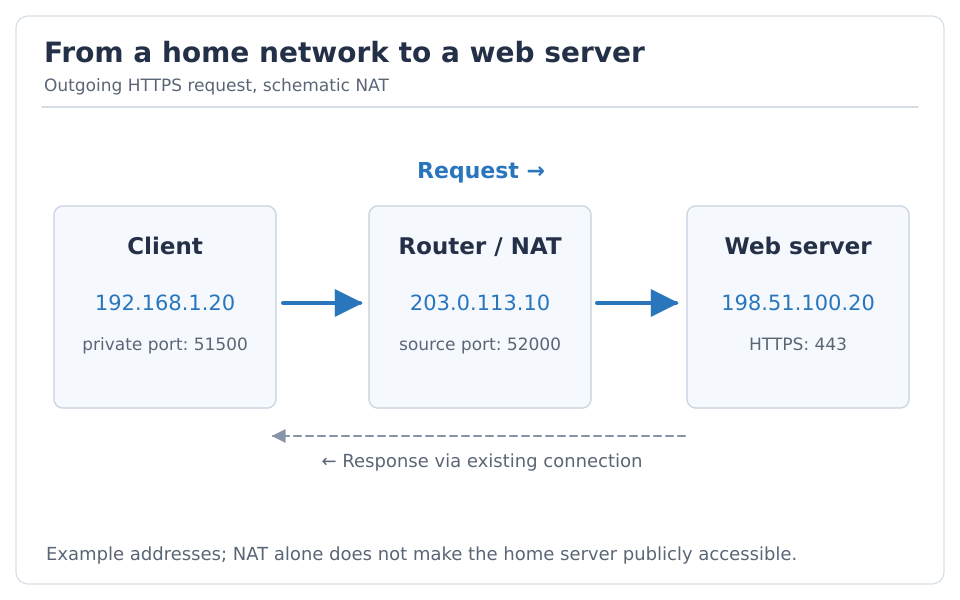

# M2-L1 – From your own PC to a publicly accessible server {#L1}

**Course area:** M2 – Bachelor’s: Web, servers and hosting

**Level:** Bachelor’s

**Prior knowledge:** No fixed prerequisites specified.

**Learning objective:** Understand the technical and organisational steps that turn a locally running program into a continuously accessible internet service – without having to set up a server yourself.

## Overview: A server is not a mysterious computer to begin with {#S1}

Anyone who has already developed a program on their own computer knows most of the fundamental technical principle of a server. A server also has a processor, main memory, storage media, an operating system and running programs. The essential difference is its **role**: a server program makes a function available to other programs or people over a network. The other party is called the **client**, meaning the requesting program.

The word *server* can therefore refer to two things:

1.  **Server as a software role:** A program waits for requests and responds to them. This could be a local web server on the development computer.
2.  **Server as a computer:** A device provided primarily for such services. It does not have to be particularly large or expensive.

A database can also run as a server service without having to be directly accessible from the internet. Conversely, a powerful desktop PC is not automatically an internet server simply because it has substantial computing power.

**What problem does a server solve?** Other devices should be able to use a common function or the same data store without installing all the software and data themselves. **When is it unnecessary?** If a tool works exclusively locally and does not need shared data, a standalone desktop application may be the better solution.

``` text
Local application:
  User → Desktop program → Local file / SQLite

Client-server application:
  User → Browser (client) → Network → Server program → Data
```

The second line illustrates only the principle. Whether the server is located at home, with a web hosting provider or in a data centre is a separate decision.

## From a local program to a network application {#S2}

### Local is not the same as public {#21-lokal-ist-nicht-dasselbe-wie-öffentlich}

A locally started program can display a webpage in the browser even though no other computer is involved. A web server might, for example, be accessible exclusively at the address `127.0.0.1`. This so-called **loopback address** refers to the computer itself. The name `localhost` is often used for this purpose.

This must be distinguished from an address in the local network, for example `192.168.1.20`. Other devices on the home network may be able to access a service using such an address – provided the program listens for connections there and the firewall permits access. An address in the local network is therefore by no means an internet address that is publicly accessible.

``` text
Own PC only:
Browser ──► 127.0.0.1 ──► Local service

Within the home:
Laptop ──► Home network / router ──► PC running service

From the internet:
External browser ──► Internet ──► Accessible network gateway
                                      │
                                      ▼
                                   Server service
```

The three situations use some of the same application software, but differ in reachability, network configuration and responsibility for security.

### A service must remain active {#22-ein-dienst-muss-aktiv-bleiben}

With a local tool, the user decides when to start it. An online service, by contrast, should respond even when nobody is sitting at the server. The operating system therefore often starts **background services**: programs that run without a visible desktop window, wait for requests and, where necessary, start automatically again after a reboot.

Under Linux, such services are often managed by a *service manager* such as `systemd`; Windows has a corresponding concept of services. A service can fail, restart, write logs and consume resources. It therefore needs not only executable program code but also an operational framework: startup behaviour, configuration, permissions and error handling.

**When excessive?** An analysis used once a week need not operate continuously as an internet service. It can be executed locally or according to a schedule. Continuous operation is a requirement, not an end in itself.

## Where can a server be located? Five practical operating models {#S3}

To begin with, five options are more important than a long list of cloud brand names.

  Model                                What do you receive?                                             Typical advantage                                Who bears which burden?
  ------------------------------------ ---------------------------------------------------------------- ------------------------------------------------ ----------------------------------------------------------------------------------------------
  **Development PC**                   Own computer with a locally started application                  No additional platform, easy experiments         You yourself; normally not public
  **Home server**                      Own hardware on your own local connection network                Control over device and data                     Electricity, network, hardware failure, updates, access protection
  **Shared hosting**                   Web space and predefined server functions on a shared platform   Usually little system administration             Provider operates platform; customer maintains application and data
  **VPS** (*Virtual Private Server*)   Virtual computer with its own operating system environment       Flexible, clearly separated server environment   Provider operates host; customer usually manages guest OS, applications, updates and backups
  **Dedicated server**                 Physical computer allocated to one customer                      High control and predictable resources           Substantial operational responsibility; hardware work may be the provider's responsibility

With a **VPS**, virtualisation software divides the resources of a physical machine into several virtual computers. This is not the same concept as conventional shared hosting: with a VPS, the customer often manages their own operating system; with shared hosting, they generally receive a preconfigured runtime environment and file space. Nor does 'dedicated' automatically mean that the application is maintained by the provider. Whether updates, monitoring and backups are included depends on the specific contract.

With **managed hosting** or a **managed service**, the provider takes over additional operational tasks. This is a property of the contract or service, not necessarily a sixth type of hardware. A rented virtual server can also be managed or self-administered. We consider the larger cloud service models in M2-L3.

### A small PHP tool as an example

**PHP** (*PHP: Hypertext Preprocessor*) is a server-side programming language for web applications. Suppose an application consists of a few PHP pages, a small database and an administration area. Several users should be able to open it using a browser.

- With **conventional web hosting**, this may already be entirely possible, provided suitable PHP and database functions are offered.
- On a **VPS**, the same application would also run, but someone would additionally have to maintain the operating system and server services.
- With a **home server**, electricity supply, internet connection, router and your own hardware would add to the requirements.
- A **dedicated server** would often be unnecessary for such a small scope.

The simplest functioning operating model is not inferior. It often has the fewest sources of error and ongoing obligations.

## The software layers of a simple web server {#S4}

A server is not 'one piece of software', but an interaction between several roles.

**Operating system:** It manages processes, memory, files, users, network interfaces and permissions. **Web server:** It accepts web requests via **HTTP** (*Hypertext Transfer Protocol*, the transfer protocol of the web) and returns static files, for example, or forwards dynamic requests. Common products include Apache HTTP Server and NGINX. **Application:** It contains the actual domain logic, such as user login, data analysis or calculations. **Database:** It stores information that needs to persist. A database may be on the same machine or on a separate computer.

``` text
                  One server computer
┌─────────────────────────────────────────────┐
│ Operating system                            │
│  ├─ Web server                              │
│  │    └─ Application (e.g. PHP or Node.js)   │
│  │         └─ Database                      │
│  ├─ Logging / monitoring                    │
│  └─ Background services                     │
└─────────────────────────────────────────────┘
             ▲
             │ Network requests
             │
         Browser / client
```

This representation does **not** mean that the web server, application and database always run in the same process. They may be different processes even though they use the same hardware. Later distribution across several computers changes the communication paths, not the functional task.

A **static website** may consist largely of unchanging HTML (*HyperText Markup Language*) and CSS (*Cascading Style Sheets*) files, as well as images. A **dynamic web application** additionally requires program logic that responds to requests. We distinguish these in detail in M2-L2.

## From a domain name to the correct server {#S5}

When someone opens `https://example.org/angebot` in a browser, several independent things happen. The notation contains a protocol (`https`), a name (`example.org`) and a path (`/angebot`). The address `example.org` is a deliberately reserved example domain name, not a service offered by this course.

**Domain:** A human-readable name that can be registered and managed. **Registrar:** The company through which a domain is registered. **DNS** (*Domain Name System*): Among other things, maps names to internet addresses. **IP** (*Internet Protocol*): Used for addressing and forwarding data packets between networks.

It is important to distinguish the tasks: a domain registrar need not be the same company as the DNS provider or the hosting provider. Nor does the name alone contain complete information about which computer serves the webpage.

``` text
Domain owner → Registrar: Registration of name
                         │
                         ▼
                Authoritative DNS configuration
                         │
                         ▼
Browser → DNS resolution → Target address → Connection to server
```

An **A record** in DNS can point to an IPv4 address, an **AAAA record** to an IPv6 address (*Internet Protocol Version 6*). A domain can have several such records. A **CNAME record**, by contrast, points to another DNS name. The required option depends on the hosting architecture. DNS supplies information for finding the destination; it does not normally transmit the HTML content of the webpage itself.

**Practical consequence:** An existing domain may be able to point to a new server without users having to type a different web address. During a changeover, however, DNS caches and transition periods must be considered. Technical and legal management of the domain name remains a separate area of responsibility.

## Ports – which service receives the request? {#S6}

An IP address does not uniquely identify which of the many programs on a computer is to be contacted. **Ports** serve this purpose: numbered communication endpoints for a particular transport protocol, such as TCP (*Transmission Control Protocol*, a connection-oriented transport protocol) or UDP (*User Datagram Protocol*, a datagram-based transport protocol).

Typical conventions on the web:

  Port   Common use                                          Note
  ------ --------------------------------------------------- --------------------------------------------------------------------
  80     HTTP (*Hypertext Transfer Protocol*)                Unencrypted web requests, often redirected to HTTPS
  443    HTTPS (*HTTP over TLS, Transport Layer Security*)   Encrypted web access; HTTP/3 can use UDP instead of TCP
  22     SSH (*Secure Shell*)                                Remote administration; need not generally be public
  5432   PostgreSQL (typical default port)                   Database access; should not normally be open to all internet users

These numbers are conventions, not physical laws. A program can use other ports under suitable conditions. The important points are that a service *listens* on an appropriate network interface, the network permits the connection to the destination and a **firewall** blocks unnecessary connections.

``` text
Public destination address
        │
        ├─ Port 443 → Web server / HTTPS
        ├─ Port 22  → Restricted admin access only if required
        └─ Port 5432 → NOT open to public users
```

**What problem do ports solve?** A computer can operate several network services in parallel. **When irrelevant?** Anyone simply reading a local webpage does not normally have to administer particular port openings.

## HTTP, HTTPS, TLS and certificates – clearly distinguishing four layers {#S7}

**HTTP** is the request-response protocol of the web. A browser requests a resource; the server returns a status, additional information and, where appropriate, content. **HTTPS** protects this web communication through **TLS** (*Transport Layer Security*). TLS enables encrypted connections protected against certain forms of manipulation.

To allow the browser to recognise the server, the server normally presents a **digital certificate**. Among other things, it binds a name to a public key; the browser checks its validity and chain of trust. The issuing organisation is called a **CA** (*Certificate Authority*).

``` text
Browser
   │ 1. Resolve name
   ▼
Destination address
   │ 2. Establish connection
   ▼
Web server with TLS certificate
   │ 3. Verification / key negotiation
   ▼
Protected channel for HTTP requests and responses
```

A well-known example of automated certificate issuance is **Let’s Encrypt**. The operator must demonstrate control over the domain name concerned. In the **HTTP-01** method, verification information is made available through a web path; **DNS-01** uses a DNS text record and is suitable, among other things, for wildcard certificates. These are only conceptual examples – an actual set-up is not needed for our course.

Certificates expire and must therefore be renewed in good time. The associated keys also need protection. Automatic renewal reduces maintenance effort, but does not remove the obligation to notice failed attempts.

**Important:** An HTTPS certificate does not prove that a website is reputable or that its database has been programmed securely. HTTPS mainly protects the connection to the endpoint reached. Incorrect access rights, compromised accounts and faulty applications remain real risks.

## What does a reverse proxy do? {#S8}

A **proxy** is an intermediary network service. A *reverse proxy* sits on the server side in front of one or more application services. It accepts requests and forwards them as appropriate. An internal application therefore does not need to be accessible directly at the public interface.

Imagine an office building: visitors first go to reception. There it is established which room or employee is responsible. Reception does not carry out the actual specialist task, but organises access.

``` text
                         Internet
                             │
                             ▼
                 Reverse proxy (HTTPS)
                        │          │
              /bilder   │          │ /api
                        ▼          ▼
                  Image service  Application service
                                   │
                                   ▼
                                 Database
```

NGINX, for example, can act as a reverse proxy that forwards requests to internal HTTP application servers. Depending on the configuration, a reverse proxy may also handle TLS termination, routing based on the domain name or path, load balancing, request limiting and logging.

A **web server** and a **reverse proxy** are not strictly separate types of hardware: the same program can serve static content and forward other requests. An application can also speak HTTP itself. An additional proxy is therefore not always necessary.

**When useful?** When several applications should be accessible under one domain, a unified HTTPS entry layer is needed or internal services should be shielded. **When excessive?** For a very simple website that the web hosting provider already serves entirely through its platform. A reverse proxy is not an automatic guarantee of security; misconfigurations can create new risks.

## Home routers, NAT and the question of public reachability {#S9}

A home router connects the local network to the internet provider's connection. Devices within the home network often have private IPv4 addresses. For outgoing connections, the router translates addresses and often ports. This process is called **NAT** (*Network Address Translation*).

{alt="Schematic outgoing HTTPS request from a home network client through a NAT router to a web server, using example documentation IP addresses."}

Outgoing connection through NAT; private addresses and ports are not automatically publicly accessible.

For ordinary browsing this works straightforwardly: the private computer starts the outgoing connection and the associated response can be routed back. However, if an external computer should reach a home server *from outside*, the path must explicitly be possible.

``` text
Internet user
     │
     ▼
Connection at provider
     │
     ▼
Home router / network boundary
     │ Only with an appropriate inbound access path
     ▼
Home server on local network
     │
     ▼
Application
```

With your own public IPv4 address, suitable forwarding on the router may in principle be possible. However, not every connection has a directly assigned public IPv4 address. With **CGNAT** (*Carrier-Grade Network Address Translation*), connections share an upstream address translation facility at the provider. Simple port forwarding on your own router does not then automatically provide public IPv4 reachability.

**IPv6** (*Internet Protocol Version 6*) is a different addressing model: a device can in principle receive a globally routable IPv6 address. Nevertheless, the internet connection must permit the relevant connections and the firewall must prevent unwanted access. Public addressability is not equivalent to secure or actually permitted reachability.

Alternatives exist, such as tunnels established via an external server or intermediary services. However, these create dependencies and in some cases new security and data protection questions. For a small paid online application, a suitable hosting provider is often simpler than opening up the home network.

**Crucial distinction:** *Having a domain*, *having a public address* and *operating a secured service that is actually accessible from outside* are three different matters.

## A complete web request step by step {#S10}

We now combine all the components. A visitor wants to access an analysis in a small online tool. We assume a conventional web service with an application and a database.

1.  The user opens a web address with `https://` in the browser.
2.  The browser determines the destination address; to do this it can use DNS information already stored or query DNS.
3.  A suitable connection path to the destination is established over the internet.
4.  The server or the proxy in front of it presents a TLS certificate matching the domain name; a protected connection is established.
5.  The browser sends an HTTP request, for example for an analysis page.
6.  The web server checks whether a static file suffices or an application is required.
7.  A dynamic request is, where appropriate, passed to the application process.
8.  The application checks inputs, authentication and the required permissions.
9.  As necessary, the application reads or modifies data in its database. The database does not need to be publicly accessible for this.
10. The application generates a response; the web server or proxy sends it back to the browser.
11. The browser displays the page or a result.
12. Logs and metrics may be generated in the background to assist with troubleshooting, operations and detection of abuse, designed to minimise data collection.

``` text
User
  │
  ▼
Browser ──► DNS (name → address)
  │
  ▼
Internet / public network boundary
  │
  ▼
HTTPS entry point: Web server / reverse proxy
  │
  ▼
Application: inputs + permissions + domain logic
  │
  ▼
Database (internal, not directly public)
  │
  ▼
Response returned via application and web server
  │
  ▼
Browser displays result
```

**The most important insight:** This is *one* possible logical path, not a prescription for a particular software stack. For a static website, the application process and database may be omitted entirely. On a larger platform, several computers may be involved. A web hosting provider can also conceal many individual layers behind a user-friendly interface.

## Public accessibility means ongoing responsibility {#S11}

A local tool only needs to work when its owner uses it. An online service used by others takes on additional obligations.

### Security updates and permissions {#111-sicherheitsupdates-und-rechte}

Publicly accessible software is regularly exposed to automated requests and attack attempts. The operating system, web server, libraries and application need appropriate security updates. Services should have only the necessary permissions. A database, for example, should not be publicly accessible simply because the website is public.

Administrative access, passwords and keys must be protected. A network port that is not needed should remain closed. An operator must also decide how to detect and respond to security notifications.

### Backups and recovery {#112-backups-und-wiederherstellung}

A backup is an independently usable copy for recovery. For a small service, this involves at least application data, necessary configuration and, where appropriate, uploaded files. A snapshot or a copy of a running database is not necessarily equivalent to a consistent, tested backup.

A publicly accessible application can also lose data through user errors, faulty updates or defective hardware. What matters is therefore not only *whether* a backup exists, but whether a recovery procedure actually works. We explore this further in M3-L6.

### Monitoring and failures {#113-überwachung-und-ausfälle}

**Monitoring** means observing operational states. This includes accessibility, response times, error frequency, disk space, process states and, where appropriate, unusual access. **Logs** are recorded events. They help with troubleshooting and security analyses, but can contain personal data. The scope and retention of these data must therefore be justified.

A small service does not necessarily need a person monitoring it around the clock. But it needs a realistic arrangement for what happens in the event of failures and what availability is promised to users.

### Data protection and user management {#114-datenschutz-und-nutzerverwaltung}

Anyone storing other people's user accounts, uploads or personal information takes on additional organisational and legal responsibility. The location of the hosting provider is not the only relevant question: data processing arrangements, access control, deletion and external services can also play a role. Specific legal requirements belong in a separate, currently verified assessment (M4-L3), not a blanket hosting rule.

### Costs – more than a monthly fee {#115-kosten-mehr-als-eine-monatsgebühr}

A hosting offering may already include storage space, processor time or data traffic, or charge separately for them. In addition, the domain, extra backups, higher availability, support, monitoring, data transfer and especially your own working time may be relevant.

  Operating model    Visible cost categories                                   Often underestimated effort
  ------------------ --------------------------------------------------------- ----------------------------------------------------------------------------
  Home server        Hardware, electricity, internet connection, spare parts   Failures, reachability, backups, intrusion protection for the home network
  Shared hosting     Plan, domain, additional options                          Maintenance of own application, data and credentials
  VPS                Rental, storage, backups, data traffic as per contract    Operating system updates, web server, firewall, security monitoring
  Dedicated server   Hardware rental, extra services, possibly traffic         Administration and troubleshooting despite paying for hardware

This is a **cost model**, not a current price list. A home server is not automatically cheaper; it can, for example, be uneconomical due to electricity consumption and lack of redundancy. A cloud solution is not automatically more expensive, but it is not free to maintain either.

## Three illustrative scenarios from software practice {#S12}

### Public documentation and download offering {#121-öffentliches-dokumentations--und-downloadangebot}

A technical website publishes guides, screenshots and freely available tools. Initially, it contains no elaborate user functions.

**Possible simple architecture:** Existing conventional web hosting or statically served files. Downloads and documentation do not automatically require a separate virtual machine. Nevertheless, the operator must consider keeping files up to date, permissions and the security of the publication process.

``` text
Visitor → Domain → Web hosting → HTML / files / downloads
```

### Small paid online tool {#122-kleines-kostenpflichtiges-online-werkzeug}

A customer logs in, uploads a file, has an analysis performed and downloads a result. The software requires user management, an application and usually persistent storage.

**Possible simple architecture:** A web server and a single application on a suitable hosting plan or VPS, with the database initially on the same platform or provided as a separate service. Distribution across several servers is not necessary as long as the requirements do not justify it.

``` text
Customer → HTTPS → Web application → Database
                       │
                       └────────────► Protected file storage
```

The technical effort here arises less from the word 'cloud' than from access rights, data deletion, secure uploads, billing and support.

### Online interface with local AI processing {#123-online-schnittstelle-mit-lokaler-ki-verarbeitung}

An application offers image or text processing. A powerful computer with a graphics processor could perform calculations while the publicly accessible entry point is with an external provider.

**Possible architecture:** The public component accepts jobs and places them in a queue. A protected processing service retrieves work and returns results. An AI computer on the home network does not therefore automatically have to act as an open web server.

``` text
Customer → Public HTTPS application → Job list
                                         │
                                         ▼
                                  Protected AI worker
                                         │
                                         ▼
                                     Result store
                                         │
                                         ▼
                                       Customer
```

Such a solution obviously requires clear rules for authentication, data transmission, errors, retention periods and worker availability. The precise organisation follows later in M4-L1 and M6-L6.

## Common misconceptions {#S13}

  Statement                                                      Correction
  -------------------------------------------------------------- ------------------------------------------------------------------------------------------------------------------------------------
  'A server is a special expensive machine.'                     Server primarily denotes a role; the hardware depends on the requirements.
  'A VPS is the same as shared hosting.'                         With a VPS, you typically operate your own virtual system environment; shared hosting generally provides a preconfigured platform.
  'Anyone who owns a domain already has a server.'               Domain registration, DNS operation and hosting are separate tasks.
  'Port 443 automatically means security.'                       An open port 443 alone says nothing about secure TLS configuration and application permissions.
  'HTTPS makes a website trustworthy.'                           HTTPS protects transport, not all business and security processes.
  'With a reverse proxy, no firewall is needed.'                 Reverse proxies, firewalls and application permissions solve different problems.
  'The database must be reachable from outside.'                 Normally only the application or an authorised internal service communicates with it.
  'A public IPv6 address automatically opens the application.'   Service binding, routing, firewall and provider conditions must also be appropriate.
  'A home server is always the cheapest option.'                 Electricity, hardware, failures, maintenance and security belong in the comparison.
  'A small web application needs Kubernetes.'                    A single suitable hosting provider or server is very often sufficient.

## Summary and transition to M2-L2 {#S14}

A publicly accessible internet service consists of **several clearly distinguishable components**: a computer or hosting service, an operating system, a running program, an accessible network path, a registered domain name where applicable, DNS information and secured web access. A web server or reverse proxy, an internal database and operational measures often supplement this architecture.

The question 'Which server do I need?' is therefore premature until it is clear *which function* is to be operated, *for which users*, *with what volume of data*, *with what availability* and *under what responsibility*. For a small PHP tool, conventional hosting may be more suitable than a self-managed VPS. An exclusively local application may not need an internet server at all.

**Next lesson [M2-L2 – Website, web application, API and backend](M2-L2.md):** We will look at what distinguishes a web server from a backend, how the frontend and database work together and how individual web requests become a usable online service.


## Sources {#S15}

**Last source review:** 03.11.2026

**Technical review date: 03.11.2026.** The following official or standards-related sources provide technical orientation. Provider prices, specific contractual conditions and legal questions are not the subject of a current market or legal review.

1.  **MDN Web Docs – How the web works:** Client-server, domain resolution, HTTP, webpages and the basic request flow. [https://developer.mozilla.org/de/docs/Learn_web_development/Getting_started/Web_standards/How_the_web_works](https://developer.mozilla.org/de/docs/Learn_web_development/Getting_started/Web_standards/How_the_web_works)
2.  **NGINX – Reverse Proxy (official documentation):** Forwarding and processing requests to internal application servers. [https://docs.nginx.com/nginx/admin-guide/web-server/reverse-proxy/](https://docs.nginx.com/nginx/admin-guide/web-server/reverse-proxy/)
3.  **Let's Encrypt – Challenge Types (as of 12.02.2026):** Domain control, HTTP-01 and DNS-01 as routes to certificate issuance. [https://letsencrypt.org/docs/challenge-types/](https://letsencrypt.org/docs/challenge-types/)
4.  **ICANN – Domain Name Industry:** Distinction between domain registration, DNS hosting and web hosting. [https://www.icann.org/resources/pages/domain-name-industry-2017-06-20-en](https://www.icann.org/resources/pages/domain-name-industry-2017-06-20-en)
5.  **IETF – RFC 6598:** Shared IPv4 address space and carrier-grade NAT; limitations of public IPv4 reachability. [https://datatracker.ietf.org/doc/html/rfc6598](https://datatracker.ietf.org/doc/html/rfc6598)
6.  **NGINX – ngx_http_proxy_module:** Technical operation of request forwarding. [https://nginx.org/en/docs/http/ngx_http_proxy_module.html](https://nginx.org/en/docs/http/ngx_http_proxy_module.html)

For a public server that is actually being planned, specific hosting, network and security conditions must be checked again using current information. This lesson describes the architecture, not a complete administration guide.
