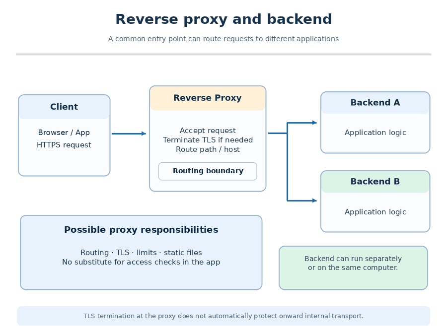

# M2-L2 – Website, web application, API and backend {#L2}

**Course area:** M2 – Bachelor’s: Web, servers and hosting

**Level:** Bachelor’s

**Prior knowledge:** No fixed prerequisites specified.

**Learning objective:** Understand how a publicly accessible website becomes an interactive online service, the role of interfaces and background jobs, and why user management, state management and access protection are architectural tasks in their own right.

## Overview: A website is not automatically a web application {#S1}

In [M2-L1 – From your own PC to a publicly accessible server](M2-L1.md), we established how a server becomes accessible. We now look at **what actually happens on that server** once a request arrives. A browser might simply retrieve a prepared information page. However, it can also operate a comprehensive application that processes inputs, stores data, initiates computations or communicates with other computers. Both approaches use web technologies, but they have very different requirements.

The fundamental problem is that people want to use a function over the internet without installing the corresponding software locally. The browser displays the user interface; the actual logic can run in the browser, on a server or across both. On the server side, data may need to be stored persistently and access by different users kept separate.

``` text
Information page:
  Browser → Web server → Ready-made HTML file

Interactive application:
  Browser → User interface → Application logic → Database / service
```

A **website**, in the broadest sense, is a coherent web presence. A **web application** provides functions with which someone works: for example, editing a media catalogue, creating invoices or analysing data. The boundaries are fluid; a website can contain dynamic sections without the entire site being designed as a comprehensive application.

**When is it unnecessary?** A simple project introduction, documentation site or published collection of articles does not automatically need complex user management, its own API or a database. Static files can suffice. **When is it useful?** When user inputs need to be processed, personal data managed or results saved for later access.

## Three approaches: static page, dynamic website and web application {#S2}

### Static pages {#21-statische-seiten}

With a **static web page**, the files to be served already exist. Typical examples are **HTML** (*HyperText Markup Language*, a markup language for structuring content), **CSS** (*Cascading Style Sheets*, styling rules for presentation) and **JavaScript** (a programming language used in the browser). A web server sends the files, and the browser constructs the display from them. JavaScript can also open menus, filter images or sort data locally on a static page: *static* does not mean *without interactivity*; primarily, it means that the delivered content need not be generated individually on the server for each request.

``` text
Browser ── GET /handbuch.html ──► Web server
Browser ◄──── HTML, CSS, images ── Web server
                  │
                  ▼
        JavaScript responds locally
```

**Advantage:** Few moving parts, often inexpensive hosting, a small attack surface and effective delivery through caches. **Disadvantage:** An additional solution is required for shared, persisted user modifications. A comments section, for example, needs an external service or its own backend.

### Dynamic websites {#22-dynamische-websites}

A **dynamic website** generates content based on data and requests. A content management system (CMS, a system for managing and publishing content) can, for example, load an article from a database and convert it into HTML for the visitor. The output does not have to be recomputed completely every time; frequently used results can be cached.

``` text
Browser → Web server → PHP application → Database
                            │
                            └──── Ready-made HTML response → Browser
```

A blog using PHP and a database is therefore already dynamic. However, it does not automatically need a separate JavaScript frontend server, microservices or real-time connections. A conventional web hosting provider is often perfectly adequate for this purpose.

### Web applications {#23-webanwendungen}

A web application places greater emphasis on **an action**: searching, editing, comparing, buying, uploading or generating results. The user initiates operations; the application validates inputs, modifies data and provides feedback. Much of the interface logic can run directly in the browser using JavaScript, while sensitive operations and persistent data storage remain on the server.

A **Single-Page Application (SPA)** often loads a basic interface first and then updates parts of it without requesting an entire HTML document for each step. This is one possible implementation, not a prerequisite for a web application. A traditional server-rendered application can be equally convenient and functional.

**Trade-off:** More logic in the browser can enable responsive interfaces but may increase the effort required for JavaScript, data synchronisation, error handling and accessibility. For many applications, pages assembled on the server are easier to develop, test and maintain. The two approaches are often combined.

## Frontend and backend: Where does each responsibility lie? {#S3}

The **frontend** is the part of an application directly visible to and usable by its users. It includes text, forms, buttons, tables, error messages and graphical elements. The **backend** processes requests behind the scenes, checks permissions, executes business rules, uses a database and communicates with other services when necessary.

A useful conceptual distinction is:

- **Frontend:** *What does the user see, and what action do they want to perform?*
- **Backend:** *Are they permitted to do it, how is it executed correctly and what data changes as a result?*
- **Database:** *What must be retained beyond individual requests and restarts?*

``` text
      Browser / frontend
       HTML · CSS · JavaScript
              │
         HTTPS request
              ▼
         Backend / API
   Validation · rules · workflow
       ┌──────┴────────┐
       ▼               ▼
    Database       External service
```

The distinction does **not have to mean a separation into different computers or projects**. A PHP application can generate HTML, process user inputs and execute database queries – all within the same application. Components only need to be operated separately when technical requirements or responsibilities suggest doing so.



*Illustration: A reverse proxy can sit in front of several web applications and forward requests according to host or path. TLS can terminate at the proxy; the onward connection requires its own protection where security requirements demand it. The diagram shows one possible operational architecture, not a prerequisite for a web application.*

### Example: A spreadsheet tool in the browser

The user uploads a **CSV file** (*Comma-Separated Values*, a tabular text format), selects a column and wants to see statistics. For a small file, JavaScript can perform all calculations locally in the browser. No server ever needs to receive the data. This minimises data transfer, costs little and is fast, provided memory and processing power suffice.

If, on the other hand, several users want to save the same analyses, process very large data sets or work in sync across several devices, a backend can be useful. It accepts jobs, stores results and manages access permissions.

**The crucial question:** Where *must* an operation take place? Not everything that can be operated through a website needs to be computed in a cloud.

## What is an API? {#S4}

An **API** (*Application Programming Interface*) specifies how one program can use a function of another program. This includes permitted requests, required information, returned data and error conditions. APIs also exist within a computer, for example between software libraries. This lesson focuses mainly on **web APIs** that are accessible over a network.

Imagine a library: you do not need to know how books are stored or catalogued internally. You need reliable information about how to search for a title. An API performs exactly this role for software.

``` text
Browser or desktop tool
         │
         │  Request: "Data for job 42"
         ▼
       Web API
         │  Authorisation and validation
         ▼
       Database
         │
         └──► Structured response
```

An API is not automatically public. It may be intended only for your own browser, internal services or paying customers. **The actual business function** can remain the same even when different clients use it: a browser interface, desktop program, mobile app or automated AI agent.

### Endpoints and data formats {#41-endpunkte-und-datenformate}

An API provided over the web usually has **endpoints**: addressable locations at which defined functions or resources are accessible. Example addresses such as `https://example.org/api/auftraege/42` are schematic; this is not an actual service.

Structured data is very often transmitted as **JSON** (*JavaScript Object Notation*). JSON is a data format, not an independent network connection or database. For example, the response could contain the following values: job number 42, status “completed” and the result address. Another service could use XML (*Extensible Markup Language*) or a binary format instead.

A **contract for the interface** is crucial: Which fields are present? Are values mandatory or optional? How is an error represented? What does a later change to the format mean for existing clients? Without such agreements, a supposedly simple connection quickly becomes a maintenance problem.

### HTTP methods and status codes {#42-http-methoden-und-statuscodes}

The web frequently uses **HTTP** (*Hypertext Transfer Protocol*, the web transfer protocol). It distinguishes the purpose of a request by means of methods, among other things:

| Method | Main idea | Schematic example |
| --- | --- | --- |
| `GET` | Read a resource | Retrieve job status |
| `POST` | Submit input, often to create something or initiate an operation | Request a new job |
| `PUT` | Replace the target resource completely | Replace all settings |
| `PATCH` | Make a partial change | Change only a display name |
| `DELETE` | Remove a resource | Delete your own draft |

In HTTP, **idempotent** means that the *intended server-side effect* of repeatedly executing the same request is equivalent to the effect of executing it once. `GET`, `PUT` and `DELETE` have the corresponding semantics; `POST` does not guarantee this property. An accidentally duplicated `POST` to create a paid computation job could therefore create two jobs – if the application does not specifically protect against duplicates.

The server responds with a **status code**. Common examples include `200` (successful), `201` (created), `202` (accepted, processing possibly still pending), `400` (bad request), `401` (authentication missing or invalid), `403` (access forbidden), `404` (not found) and `500` (internal server error). The response may also contain a comprehensible error message.

**Risk:** A good-looking API name does not protect against incorrect business logic. If `GET` secretly triggers paid actions or permissions are checked only in the frontend, the result is an insecure and unpredictable interface.

## REST: A widespread architectural approach {#S5}

**REST** (*Representational State Transfer*) refers to an architectural style for distributed hypermedia systems described by Roy Fielding. Among other things, it includes a uniform interface, separate client and server roles, stateless communication between requests, cacheability information and a layered structure. The idea is to connect components using interfaces that are as comprehensible and independently developable as possible.

A simplified REST-like example:

``` text
GET  /api/auftraege/42  → Returns representation of job 42
POST /api/auftraege     → May create a new job
```

A resource can be represented technically in JSON. **However:** Not every API that exchanges JSON over HTTP automatically satisfies all REST constraints. In particular, the concept of resources and uniform semantics should not be confused with arbitrary function calls.

REST is not the only option. A **Remote Procedure Call (RPC)** conceptually invokes a named function in another system; **GraphQL** provides its own query language for selecting the requested data. These alternatives solve different problems but also entail interface and operational overhead.

**When is it useful?** For clearly describable resources that several clients retrieve or modify. **When is it excessive?** When a small PHP application exclusively renders its own pages and does not require independent clients. A clean internal module boundary may then be more important than an additional publicly exposed API.

## From request to response: synchronous execution {#S6}

A traditional web request is **synchronous** in terms of the interaction pattern: the client sends a request and waits for a response. Although the server may use asynchronous operations internally, a response time is initially required from the user’s perspective.

``` text
User clicks "Calculate"
        │
        ▼
Frontend validates the input form
        │ HTTPS
        ▼
Backend checks identity, permissions and inputs
        │
        ▼
Calculation / database access
        │
        ▼
HTTP response with result or error
        │
        ▼
Frontend displays result
```

For short queries this is simple and effective. Problems arise if a task takes several minutes, the network connection fails or many users simultaneously request extensive calculations. In that case, it is usually preferable to **accept, store and process the job later** – without requiring an open request throughout the entire waiting period.

## Background jobs, queues and workers {#S7}

A **background job** is a task executed independently of a currently open browser request. A **worker** (work process) retrieves such jobs from a **queue**, processes them and stores a result. A **scheduler** can start jobs at a designated time, for example a daily backup or sending a report.

``` text
Browser → API: "Start analysis"
              │
              ▼
      Record job persistently
              │
              ▼
             Queue
              │
              ▼
         Worker process
              │
              ▼
       Store data / result
              │
              ▼
 Browser queries status later
```

The API can therefore quickly confirm: *Job accepted* – for example with HTTP `202`. The actual work continues afterwards. A local application can already implement a similar pattern with a database table and a separate worker process. A specialised message broker is **not automatically** required.

### What happens when errors occur?

This highlights the difference between a small script and a reliably operated service. A worker can crash partway through processing. The job can be delivered again after a restart. The system must consequently define the available states, for example `new`, `in progress`, `completed`, `failed`, and how it handles retries.

**Idempotency** is particularly useful for such retries: if the same job is received twice, it must not simply be computed, delivered or billed twice. Common countermeasures include stable job identifiers, duplicate checks, database transactions and a limited number of attempts. We examine the details in M3-L5 – Transactions and distributed correctness, and distributed processing in M4-L1.

**Operational consequences:** Queues require storage, monitoring, error logs and rules for overloaded workers. Computationally intensive AI jobs can also incur high CPU (*Central Processing Unit*, main processor) or GPU costs (*Graphics Processing Unit*, graphics processor). A queue does not limit costs by itself; this requires job limits, quotas and controlled concurrency.

## Webhooks: One system reports an event to another {#S8}

A **webhook** is an agreed automatic notification over a network: when a particular event occurs in system A, it sends an HTTP request to a previously configured address in system B. This differs from an ordinary API query, where system B would actively have to check whether something has changed.

Example: a payment platform notifies the application that a payment has been confirmed. The application can then update the status of an order. The actual event does **not** become trustworthy simply because some message contains the words “payment successful”.

``` text
Event in system A
      │
      ▼
HTTP webhook to system B
      │
      ▼
Verify signature / authenticity / event ID
      │
      ▼
Store event → Optional queue → Processing
```

Important protective measures include HTTPS (*HTTP Secure*, HTTP over an encrypted connection), verifying a cryptographic signature or equivalent authentication mechanism, checking the plausibility of the event type and protecting against repeated deliveries. Since senders may retry if no acknowledgement arrives, the same notification can sometimes be expected several times. A unique event ID helps prevent duplicate processing. Some providers expect acknowledgement within a few seconds; time-consuming work should then be assigned to a background job.

**When is it unnecessary?** When no second system needs to be notified automatically. An occasionally used local utility can simply query an API when needed.

## WebSockets and other kinds of updates {#S9}

Ordinary HTTP works well when the client makes a request and receives a response. In a chat, collaborative interface or live display, however, new events often need to appear without another click.

**WebSocket** is a protocol for longer-lived, bidirectional communication between client and server. Both sides can send messages during the connection. The standardised underlying mechanism is described in **RFC 6455** (*Request for Comments*, a series of documents for internet standards); the browser interface is provided as the WebSocket API.

``` text
Ordinary HTTP:
  Browser → Request → Server → Response → Browser

WebSocket:
  Browser ◄════ Existing connection ════► Server
             Messages in both directions
```

Simpler alternatives suffice for some use cases:

| Pattern | Main idea | Typical use |
| --- | --- | --- |
| **Polling** | Browser checks regularly for updates | Job status every few seconds |
| **SSE** (*Server-Sent Events*) | Server sends events in one direction over a longer-lived HTTP connection | Progress indicators, stream of messages |
| **WebSocket** | Both sides can send messages at any time | Chat, collaborative editing, interactive control |

The type of connection does not remove the need for user permissions, data consistency and error handling. Longer-lived connections must be re-established after server restarts and network interruptions. Many simultaneous connections consume resources; at high message volumes, the application needs a way of handling slow receivers (*backpressure*). The traditional browser WebSocket interface does not automatically provide this backpressure control.

**When is it unnecessary?** If a user only wants to check the progress of a computation occasionally, simple polling may be more robust and economical.

## User accounts, roles and sessions {#S10}

As soon as a service manages personal data, it must distinguish **who** is making a request and **what** that person is allowed to do. These are two different tasks:

- **Authentication:** Establishing which identity a request can be associated with, for instance after signing in.
- **Authorisation:** Deciding whether that identity may access the specific record or perform the specific action.

A user with permission to “read own jobs” does not automatically have permission to retrieve other people’s jobs. Even a technically correctly authenticated user may not be authorised to access a particular data set.

### Sessions and cookies {#101-sitzungen-und-cookies}

HTTP requests are initially independent messages. After sign-in, however, a web application still wants to know that subsequent requests originate from the same authenticated browser. A **session** is often maintained for this purpose.

``` text
User signs in
       │
       ▼
Backend checks credentials
       │
       ▼
Session is created
       │
       ▼
Browser receives protected session cookie
       │
       ▼
Subsequent request includes cookie
       │
       ▼
Backend checks session AND access permissions
```

A **cookie** is a small value that the browser can store for a website and send with appropriate requests. In a common arrangement, the cookie only contains a random session identifier; its associated identity and permissions are stored on the server. Another approach uses signed tokens that may contain information themselves. **Token** generally means a value used to prove or convey authorisation; not every token is automatically a session cookie.

The Open Worldwide Application Security Project (**OWASP**, a non-profit initiative for application security) recommends, among other measures, appropriate session-cookie attributes such as `Secure`, `HttpOnly` and `SameSite`, server-side expiry and logout logic, and avoidance of sensitive content in session identifiers. `HttpOnly` makes it harder for certain scripts to read the cookie; it does not automatically protect an application against all attacks.

**Important:** A session is an additional operational concern: it can expire, be stolen, be lost after a restart or need to be invalidated when permissions change. Such rules belong to the application – not the web server alone.

### Roles, permissions and resources {#102-rollen-rechte-und-ressourcen}

A common model is **RBAC** (*Role-Based Access Control*). Instead of assigning every individual permission to each user, roles such as `guest`, `customer` and `administrator` are associated with permissions. Roles are only a tool; many systems need additional checks at the level of individual data objects.

| Role | Typical permitted action | Not automatically permitted |
| --- | --- | --- |
| Guest | Read public description | View private customer data |
| Customer | Retrieve own analysis | Retrieve another customer’s job |
| Administrator | Manage system settings | Unrestricted access without a business or legal basis |

Suppose an API has the endpoint `/api/auftraege/42`. A signed-in user changes `42` to `43` in the address. **The server must check whether that specific user is permitted to access job 43.** Simply hiding other users’ jobs in the frontend is not sufficient. OWASP refers to missing checks on individual objects as *Broken Object Level Authorization* (BOLA).

### Multi-tenancy: several customers, one service {#103-mandantenfähigkeit-mehrere-kunden-ein-dienst}

**Multi-tenancy** means that a service serves several distinct customer organisations or customer groups. A **tenant** is not necessarily a user: an organisation can have multiple employee accounts. The fundamental question is: how do tenants share technical resources without mixing data and responsibilities?

Three simplified models are:

1.  **Shared application and database:** Records carry a tenant ID. Access checks are particularly important.
2.  **Shared application, separate databases:** Greater separation of data storage, but additional administration.
3.  **Separate instances per tenant:** Stronger separation and individual customisation are possible, but operational and update costs are higher.

``` text
Tenant Company A ─┐
                  ├─► Shared web application ─► Protected data storage
Tenant Company B ─┘                             (logically or physically separated)
```

Shared infrastructure does **not automatically mean a lack of security**; separate databases do **not automatically mean complete isolation**. The actual access paths and operational processes are crucial. If a service is intended for just one person, multi-tenancy would often be unnecessary complexity.

## Stateless and stateful: Two terms that must be distinguished {#S11}

A **stateless service** normally does not need context from previous requests that is stored exclusively in its local main memory in order to process an individual request. Necessary information arrives with the request or is loaded from shared storage. A **stateful component**, in contrast, manages state needed for subsequent steps, such as an ongoing transaction, a WebSocket connection or a database containing persistently stored changes.

**Important: A stateless backend does not mean an “application without stored data”.** User data can certainly reside in a database; the individual backend instance simply does not have to remember the user exclusively through irreplaceable local variables.

``` text
                 Request
                   │
          ┌────────┴────────┐
          ▼                 ▼
     Backend 1          Backend 2
          │                 │
          └────────┬────────┘
                   ▼
            Shared database /
            shared session store
```

This pattern later helps with **horizontal scaling**: several backend instances can handle similar requests. However, shared data storage can become a bottleneck, and not every application can be designed to be completely stateless.

The **REST constraint of stateless requests** refers precisely to the interaction between client and server: each request should contain the information needed to interpret it. A server-side session in traditional web design is therefore not identical to this strict REST model. At the same time, a REST system can of course store long-lived resources in a database. *Communication state* and *business data* are different things.

**When is statelessness unnecessary?** A small application with a single instance can manage its session tables locally without issue. The advantage of independent instances becomes more apparent with load balancing, failures and multiple servers.

## Security and operations: An API is a public attack surface {#S12}

A web application entails new obligations as soon as other people can access it. The most important rule is: **The browser is not a trusted place for enforcing security rules.** It may conveniently prevalidate inputs; however, the server must check values, identity and permissions itself.

### Typical risks

- **Unauthorised access:** A correctly authenticated user may try other object IDs. Remedy: checks at the level of every affected resource.
- **Malicious inputs:** Unvalidated data can influence database queries, HTML output or file paths. Remedy: appropriate parameter binding, context-dependent output encoding and safe file handling.
- **Overload and cost attacks:** An open computation endpoint may receive large numbers of calls deliberately or accidentally. Remedy: quotas, size limits, rate limiting, job budgets and monitoring.
- **Stolen credentials or sessions:** Remedy: secure password handling, multi-factor authentication (MFA) where appropriate, TLS, suitable session rules and traceable mechanisms for revoking access.
- **Data loss:** Incorrect changes, broken deployments and accidental deletion are not prevented by access protection alone. Remedy: backups and tested restoration.
- **Data leakage through logs:** Access tokens, uploaded files and personal information should not end up in logs without control.

For published services, legal and organisational issues also arise: the purpose of processing, retention, deletion, contractual relationships with service providers and support processes. Specific requirements depend on use and jurisdiction; this lesson does not replace an up-to-date legal review.

### Ongoing costs, even for small software projects

Often only the monthly server bill is considered. In reality, the domain, data storage, backup copies, outbound data transfer, email delivery, monitoring, updates and customer support all contribute to the total effort. Background calculations in particular can incur usage-based costs. A small tool with few users can often operate on a conventional hosting plan or small server, provided the required functions are supported.

**Complex architecture is not a quality criterion in itself.** A modern service can also be a well-maintained monolith with a database. Microservices, persistent WebSocket connections or several separate queues only make sense if they solve an actual problem.

## Three end-to-end practical scenarios {#S13}

### Documentation and project website {#131-dokumentations--und-projektwebsite}

**Objective:** Make texts, images, manuals and software descriptions publicly readable.

``` text
Visitor → Browser → Web host → HTML / CMS page
```

If few personalised functions are needed, static output or a simple CMS page is often sufficient. A public API, user accounts and WebSockets would create extra maintenance and security work without a corresponding benefit. Operations focus on updates, availability, backups and comment functions where appropriate.

### Small online analysis tool {#132-kleines-online-analysewerkzeug}

**Objective:** A user uploads data, receives an analysis and can retrieve it again later.

``` text
Browser → Form / display → API / backend
                                │
                                ├─► Database: users, jobs, results
                                └─► Optional worker for longer computations
```

A first version can consist of a single backend with a database. If computations only take seconds, no queue is needed yet. Separating the web application and workers only becomes interesting with longer, concurrent jobs. User accounts require a secure session or comparable authentication; each analysis must be checked against its owner.

### AI processing service {#133-ki-verarbeitungsdienst}

**Objective:** Users submit text or media and have results generated from them. The AI computation runs in a local or rented computing environment.

``` text
Browser or API customer
        │
        ▼
      Backend ──► Check user / plan / cost limit
        │
        ▼
     Create job ──► Queue ──► AI worker (CPU/GPU)
        │                         │
        └─ Retrieve status ◄─ Store result
```

Decoupling can offer major benefits here: short web requests do not block AI computations that take minutes, and worker processes can be operated independently. Job IDs, retry logic, storage limits, permissions for results and cost control become central tasks. A WebSocket is **optional** for simply displaying progress; polling or SSE can suffice.

The essential business question is not whether such an architecture is technically possible, but whether demand, price, hardware costs, data protection and ongoing support fit together. We return to this trade-off in M4-L4 and M4-L5.

## Decision aid: start small, expand deliberately {#S14}

| Requirement | Obvious simple solution | Expand only when genuinely needed |
| --- | --- | --- |
| Display texts and handouts | Static website | CMS for frequent editorial updates |
| Forms and database | Server-side web application | Separate frontend/API for multiple clients |
| Fast data computation | Directly within request or locally in browser | Background job for long runtime or high load |
| Show job progress | Regular status query | SSE or WebSocket for more timely updates |
| User sign-in | Proven session management | Central identity service for several applications |
| Multiple customers | Clean user and data model | Tenant architecture where organisational separation is needed |
| Few online users | One server, one application | More instances, queues and load balancing if bottlenecks arise |

The table is not a dogma. It shows a sensible order in which to solve problems: **Function → data → permissions → reliability → only then scaling**. The specific technology should suit the actual usage patterns.

## Summary and transition to M2-L3 {#S15}

A **website** provides content; a **web application** additionally provides functions for carrying out work. The **frontend** enables interaction; the **backend** validates and processes operations. An **API** defines a contract between programs. **REST** is an architectural style, not simply another term for JSON over HTTP. **Webhooks** report events between systems, **background jobs** decouple long-running tasks from browser requests, and **WebSockets** enable bidirectional communication over an existing connection. **Sessions**, **roles**, **tenants** and **stateless services** solve distinct problems of identity, permissions, data separation and scalability.

The central insight is: **A small website does not become a professional service by incorporating as many technologies as possible. What matters is comprehensible interfaces, correct states, secure permissions and reliably manageable operations.**

In **M2-L3 – Hosting and cloud deployment models** we next ask who operates these components and which responsibilities lie with the provider or software developer: traditional hosting, rented servers, managed platforms, serverless and cloud service models.

## Sources {#S16}

**Last source review:** 03.11.2026

**Review date:** 03.11.2026. The sources explain architectural principles and current recommendations; they are not price lists or a substitute for a security or legal review of a specific product.

- **MDN Web Docs – HTTP request methods:** Meaning of GET, POST, PUT, PATCH and DELETE, and idempotency. [https://developer.mozilla.org/de/docs/Web/HTTP/Reference/Methods](https://developer.mozilla.org/de/docs/Web/HTTP/Reference/Methods)
- **Roy T. Fielding – Dissertation, Chapter 5 “Representational State Transfer (REST)” (2000):** REST constraints and architectural trade-offs. [https://ics.uci.edu/\~fielding/pubs/dissertation/rest_arch_style.htm](https://ics.uci.edu/~fielding/pubs/dissertation/rest_arch_style.htm)
- **IETF – RFC 6455, The WebSocket Protocol (2011):** Standardised bidirectional connection. [https://datatracker.ietf.org/doc/rfc6455/](https://datatracker.ietf.org/doc/rfc6455/)
- **MDN Web Docs – WebSocket API and EventSource:** Bidirectional WebSockets, one-way Server-Sent Events and information on backpressure control. [https://developer.mozilla.org/en-US/docs/Web/API/WebSockets_API](https://developer.mozilla.org/en-US/docs/Web/API/WebSockets_API) and [https://developer.mozilla.org/en-US/docs/Web/API/EventSource](https://developer.mozilla.org/en-US/docs/Web/API/EventSource)
- **GitHub Docs – Best practices for using webhooks:** Authenticity verification, prompt acknowledgement, queues and retries. [https://docs.github.com/en/webhooks/using-webhooks/best-practices-for-using-webhooks](https://docs.github.com/en/webhooks/using-webhooks/best-practices-for-using-webhooks)
- **OWASP – Session Management Cheat Sheet:** Session identifiers, cookie attributes, expiry and protection against abuse. [https://cheatsheetseries.owasp.org/cheatsheets/Session_Management_Cheat_Sheet](https://cheatsheetseries.owasp.org/cheatsheets/Session_Management_Cheat_Sheet)
- **OWASP API Security Top 10 (2023 edition):** Broken object-level authorisation and other API risks. [https://api-security.owasp.org/editions/2023/en/0x11-t10/](https://api-security.owasp.org/editions/2023/en/0x11-t10/)
- **Microsoft Learn – Architectural Approaches for a Multitenant Solution:** Trade-offs between shared and separate infrastructure. [https://learn.microsoft.com/en-us/azure/architecture/guide/multitenant/approaches/overview](https://learn.microsoft.com/en-us/azure/architecture/guide/multitenant/approaches/overview)
