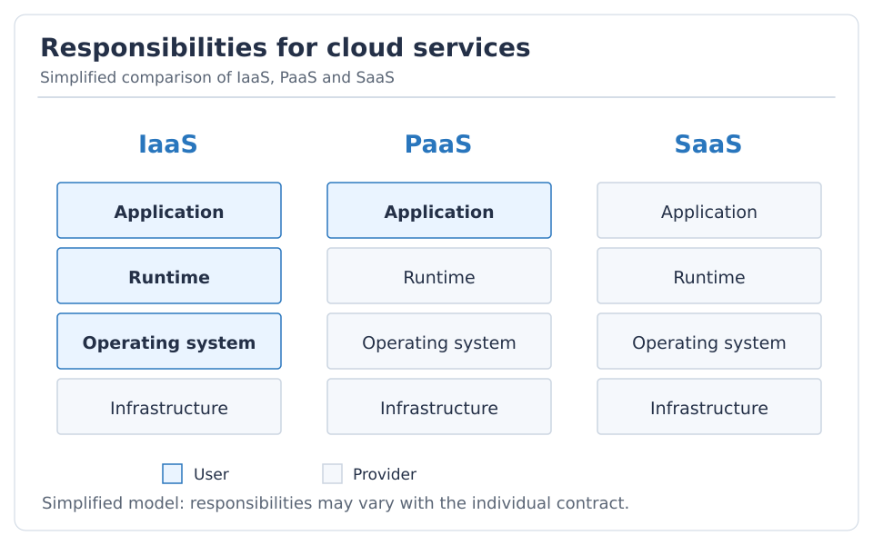

# M2-L3 – Hosting and cloud deployment models {#L3}

**Course area:** M2 – Bachelor’s: Web, servers and hosting

**Level:** Bachelor’s

**Prior knowledge:** No fixed prerequisites specified.

## Overview: Not where the software runs, but who takes care of what {#S1}

In M2-L1, an ordinary computer became a publicly accessible server. In M2-L2, we divided a web application into a user interface, backend, programming interfaces and data storage. The next question now arises: **Where can such an application be operated without you having to take on every hardware and maintenance task yourself?**

The answer is not simply “in the cloud”. There are substantial differences between your own home computer, a conventional web hosting package, a rented virtual server and a fully managed online service. They concern primarily **control, operational responsibility, flexibility to make changes, costs and dependencies**. The same small PHP application can be deployed in different ways according to the circumstances; the best choice depends on its requirements.

This lesson distinguishes three levels that are frequently conflated in advertising:

1.  **Operating location and ownership:** At home, in your own data centre, in somebody else’s data centre or on shared infrastructure.
2.  **Service model:** Am I renting resources, a managed platform or a ready-made application?
3.  **Business model:** Am I using a service myself or selling my own software to customers through it?

The most important conclusion in advance: **Offering an application online does not mean having to operate as a cloud provider yourself.** You can use a very simple third-party hosting service and still offer your own commercial software.

## Self-hosting: Your own computer as a server {#S2}

**Self-hosting** means that you provide and operate the essential technical resources yourself. The term **on-premises**, meaning “at your own premises”, is often used. This may be a home PC, a small office computer or an entire server installation in your own data centre. The distinction matters: self-hosting initially says nothing about the size of the system.

Your own computer can make sense if data is deliberately kept locally, if an internet connection is not reliably available or if you need specialised hardware. A local AI computer with a graphics card is a clear example. An internal development environment, a private media archive or a local test server also fits this model well.

``` text
Local user → Home network → Own computer → Application → Local data
                                  │
                                  └── Maintenance, power and hardware yourself
```

**What does this solve?** Maximum control over the operating system, hardware and local data. **When is it unnecessary?** When only a small public website needs to be accessible. The disadvantages often outweigh the benefits: electricity consumption, outages, internet connectivity, lack of a public address, noise, access protection and your own responsibility for maintenance and backups.

Incidentally, a home server and a *private cloud* are not automatically the same thing. The term “cloud” typically presupposes additional characteristics such as on-demand provisioning and shared resource management. Renaming an individual computer does not turn it into a cloud.

## Colocation: Your own hardware in another data centre {#S3}

With **colocation**, sometimes also called “housing”, you generally place your own hardware in a professional data centre. Depending on the contract, the operator provides facilities such as rack space, power, cooling, physical access control and network connectivity. Responsibility for the actual server, its components, operating system and applications can largely remain with you.

``` text
Own server (your property)
          │
          ▼
Third-party data centre
   ├── Power / cooling / space
   ├── Network connectivity
   └── Physical access control
          │
          ▼
Your software and data
```

This solves the location-related problems of a home server, not automatically its administration problems. If a drive fails, it must be clear who replaces it; a data centre does not repair your application of its own accord. Colocation can be useful for special hardware requirements or servers you already own. For an initial small online tool, this would usually be an excessive starting point.

**Distinction:** With a *dedicated rented server*, the provider supplies the hardware; with colocation, the customer normally owns the hardware. Contracts may include additional maintenance services, so the specific responsibilities are crucial.

## Traditional web hosting: A ready-made home for the website {#S4}

**Shared hosting** means that several customers are hosted in a server environment managed by the provider. For example, you receive web storage, domain integration, PHP execution, a database and an administration interface. The host typically takes care of the physical infrastructure and substantial parts of system administration.

``` text
Browser → Hosting provider’s web server
             ├── Website A
             ├── Website B (your PHP application)
             └── Website C
                    │
                    ▼
              Database supplied by host
```

You can often operate a content management system, documentation site or small PHP application there without administering Linux yourself. The limitation is that you cannot install arbitrary background programs or change arbitrary server settings. Process runtimes, memory, database connections and background jobs may also be limited.

**What does this solve?** Inexpensive operation of typical websites with little maintenance. **When is it insufficient?** When you need your own persistent processes, special runtime environments, GPU-accelerated computations, individual network configurations or complex services.

**Important:** “Shared hosting” is neither a security guarantee nor a statement about which processing capacity is exclusively available to you. The provider must correctly implement separation between customers. You typically remain responsible for your own web code, passwords, extensions and correct application configuration.

## VPS and dedicated rented servers: More freedom, more responsibility {#S5}

A **VPS** (*Virtual Private Server*) is a rented server provided through virtualisation. You usually administer your own guest operating system, have substantially more configuration options than with shared hosting and can operate several services of your own. The host normally maintains the physical hardware and underlying virtualisation, not automatically your software within the virtual server.

``` text
Provider’s physical host
   ├── VPS customer A
   ├── VPS customer B → Linux → Web server → Own app
   └── VPS customer C
```

A **dedicated server**, by contrast, is usually a rented physical computer that is not provided as a conventional shared VPS. It offers greater control over the entire machine and potentially more predictable allocation of resources; the specific characteristics depend on the offering. It is not necessary for ordinary websites, but may be attractive for special workloads or particular isolation requirements.

With a VPS, you typically have to plan operating system and security updates, firewall settings, user permissions, runtime environments, database operations, monitoring, backups and recovery yourself. How much is actually taken care of depends on whether the service is *unmanaged* or *managed*. **“Rented” does not mean “administered”.**

A small VPS is a reasonable starting point for many independently developed services, provided operational experience or reliable support is available. For a developer who wants to spend as little time as possible on system administration, a managed alternative may be more economical – even if its fixed monthly fee is higher.

## What distinguishes cloud computing from ordinary server rental? {#S6}

**Cloud computing** refers to a delivery model in which computing, storage and network resources are accessible over a network on demand and can typically be provisioned and released rapidly. The US **NIST** (*National Institute of Standards and Technology*) published a definition in 2011 that remains foundational today. It identifies five essential characteristics:

- **On-demand self-service:** Resources can be provisioned without an individual manual ordering process.
- **Broad network access:** Services are accessible through standardised network interfaces.
- **Resource pooling:** Infrastructure is shared among several users or organisations.
- **Rapid elasticity:** Capacity can be expanded or reduced as required.
- **Measured service:** Resource consumption can be recorded and used as a basis for billing.

``` text
Customer → Cloud management → Shared resource pool
                             ├── Compute
                             ├── Storage
                             └── Networks
                 Allocate capacity on demand
```

Not every advertised “cloud server” meets all these characteristics to the same extent. A fixed VPS with a flat monthly fee can function in a technically very similar way to a cloud VM, but may be less flexible to provision or scale. Conversely, providers use cloud technology for seemingly simple hosting services.

**What does cloud computing solve?** Infrastructure and platform functions become available without having to procure your own hardware. **When is it unnecessary?** When a small system with consistently low demand runs reliably on a simple hosting package. “Cloud” is not a judgement of quality or an automatic guarantee of resilience.

## Public, private and hybrid clouds: Who can use the infrastructure? {#S7}

These terms describe **deployment models**. They differ from the service models IaaS, PaaS and SaaS discussed later.

### Public cloud – publicly offered cloud infrastructure

A **public cloud** is offered as a service by an operator to a broad group of customers. You use its resources without having to own the data centre. “Public” does **not** mean that the data stored there must be publicly accessible. Private networks, access controls and isolated user accounts are particularly important in such environments.

### Private cloud – a cloud intended for one organisation

A **private cloud** is exclusively available to one organisation. It can be operated internally or by a service provider, on the organisation’s own premises or at external locations. What matters is that it is provided as cloud infrastructure for that organisation, not merely who owns the hardware. An ordinary internal file store is therefore not automatically a private cloud.

### Hybrid cloud – combining different cloud environments

A **hybrid cloud** connects distinct cloud environments, for example a private cloud with a public cloud. Applications or data can work together across them according to defined rules. A local computer plus any external web service is sometimes called “hybrid” in everyday language, but does not necessarily satisfy a formal hybrid cloud definition.

### Community cloud and multicloud

The NIST classification also includes a **community cloud**, which serves a group of organisations with shared requirements. **Multicloud** in current usage means using offerings from several cloud providers. It is not one of the four original NIST deployment models and presents its own integration problems.

**Practical rule:** For most small projects of your own, one hosting environment suffices. Private, hybrid and multicloud structures introduce additional connections, identity rules, cost controls and sources of failure; they only become worthwhile when there are specific requirements.

## IaaS, PaaS and SaaS: Three levels of responsibility {#S8}

The three classic **cloud service models** describe **which part of the technical solution you receive as a service**. The same organisation can use several models simultaneously.



IaaS, PaaS and SaaS shift operational responsibilities; contractual details may differ.

### IaaS – Infrastructure as a Service {#81-iaas-infrastructure-as-a-service}

**IaaS** means *Infrastructure as a Service*. You rent fundamental resources: virtual machines, storage devices, networks or similar infrastructure components. The provider operates the physical environment and virtualisation. You typically install or manage the operating system, web server, database and application.

``` text
IaaS provider: Data centre → Hardware → Virtualisation
                                              │
Customer:                             Guest operating system
                                              │
                                      Web server + application
                                              │
                                            Database
```

**Problem solved:** You do not have to procure hardware, but retain considerable technical freedom. **Unnecessary** if your program can run without problems on traditional hosting or a managed platform. The often underestimated disadvantage is responsibility for updates, secure configuration and recovery of your own environment.

A VPS can be functionally very similar to IaaS. Whether the specific service conforms to the cloud model in a stricter sense depends on provisioning, elasticity and usage model; the name “VPS” alone does not decide that.

### PaaS – Platform as a Service {#82-paas-platform-as-a-service}

**PaaS** means *Platform as a Service*. Instead of administering an entire server yourself, you primarily deploy your application. The provider typically operates the underlying runtime and operating system environment, takes on some of the scaling work and provides tools for deployment and monitoring.

``` text
You:      Application code + configuration + data logic
                            │
                            ▼
PaaS:          Runtime + operating system + scaling
                            │
                            ▼
                    Physical infrastructure
```

**Problem solved:** Less administrative work; greater focus on your own software. **Unnecessary** for a static website or an application for which a conventional web hosting plan already provides everything. Disadvantages may include limited runtime environments, restrictions on background processes, additional platform costs and technical dependence on the provider.

A managed platform does not remove the obligation to write secure application code. It is still necessary to check whether the database needs a separate backup, which process limits apply and how scaling is billed.

### SaaS – Software as a Service {#83-saas-software-as-a-service}

**SaaS** means *Software as a Service*. The customer uses a largely ready-made application through a browser or programming interface instead of installing servers, runtime environments and application software themselves. The SaaS operator typically bears much of the technical maintenance responsibility, while the customer remains responsible for the proper handling of their data, accounts and sharing permissions.

``` text
End customer → Browser → Ready-made online service
                         │
                  SaaS provider operates
             Application + platform + infrastructure
```

**Problem solved:** A standardised function is immediately usable. **Unnecessary** if you require entirely custom software logic that the ready-made service does not offer. Disadvantages include ongoing usage fees, limited customisability and dependence on export functions and contractual terms.

An important misconception arises here: **If you develop and sell an online service to customers yourself, you may be offering SaaS – even if you have rented only a small VPS for that purpose.** The business model of your offering is distinct from the infrastructure model you purchase yourself.

## Additional models: CaaS, FaaS and managed databases {#S9}

### CaaS – Containers as a Service {#91-caas-containers-as-a-service}

**CaaS** means *Containers as a Service*. Containers package programs together with important runtime dependencies into a defined execution unit. A CaaS offering takes over part of the deployment and management of these containers, frequently through a managed orchestration environment. An **orchestrator**, for example, coordinates which container instance runs on which machine and when new instances are started.

``` text
Your container image → Managed container platform
                                    │
                               Start / manage
                                    │
                              Running containers
```

**Useful** when several services or special runtime environments need to be deployed reproducibly. **Excessive** for a single small PHP website. Specific responsibilities vary considerably: a platform may manage the cluster, while responsibility for container images, dependencies, permissions and data remains partly with you. The technology itself is explained in detail in M2-L4.

### FaaS – Function as a Service {#92-faas-function-as-a-service}

**FaaS** means *Function as a Service*. You deploy a small function triggered by an event rather than operating your own server process continuously. An event can be an incoming web request, a message or a new file. The platform starts the required execution, monitors resources and, depending on the service, can add capacity.

``` text
File uploaded → Event → Execute function
                                  │
                           Generate thumbnail
                                  │
                               Save file
```

**Useful** for irregular, clearly bounded tasks. **Unnecessary or unsuitable** when an application runs continuously, requires tightly coupled processes or depends heavily on provider-specific limits. Factors to consider include startup delays (“cold starts”), execution limits, concurrent invocations, database connections and usage-based charges.

### Serverless – an operating model, not a magic word {#93-serverless-eine-betriebsform-kein-zauberwort}

**Serverless** essentially means “without server administration”, not “without servers”. The provider still operates computers, but the platform largely hides their provisioning and operation. FaaS is one form of serverless computing. Serverless container and database services also exist. Some services can scale down to zero active instances; others have continually billed components or minimum capacities.

A typical serverless application looks like this:

``` text
User → API entry point → Serverless function → Managed database
                            │
                       Logs / monitoring
```

**What does this solve?** Irregular load without permanent administration. **When is it unnecessary?** For a small, steadily used application, a simple hosting package or VPS can be more economical and easier to understand. Serverless does not remove responsibility for inputs, permissions, data deletion, incorrect retries or cost overruns.

### Managed database {#94-managed-database-verwaltete-datenbank}

With a **managed database**, the operator takes on substantial parts of database operations, depending on the product: infrastructure, provisioning, updates, backup functions or monitoring. You configure the database, model tables and manage queries, access, data quality and usually the recovery strategy.

A managed database service is neither automatically infinitely scalable nor inherently protected from every operational error. In particular, **replication is distinct from backup**. An accidentally deleted record may also be lost in a highly available database; recovery and retention periods therefore have to be assessed separately. We cover distributed database systems in module M3.

## Who bears which responsibility? {#S10}

The term **shared responsibility model** refers to a model in which responsibility is divided between parties. It is documented in detail by AWS and Microsoft, among others. In simplified terms, the more infrastructure the provider manages, the less you must administer yourself – but responsibility for your data and proper operation of the application remains.

| Layer / task | Own server | IaaS / typical VPS | PaaS / managed platform | SaaS as a user |
| --- | --- | --- | --- | --- |
| Physical hardware / building | Yourself | Provider | Provider | Provider |
| Virtualisation / infrastructure | Yourself, if used | Provider | Provider | Provider |
| Application operating system | Yourself | Usually yourself | Usually provider | Provider |
| Operating application code | Yourself | Yourself | Develop it yourself; platform operates runtime | Provider operates finished app |
| Users and permissions | Yourself | Yourself | Yourself, partly shared | Own accounts/sharing permissions still relevant |
| Handling own data properly | Yourself | Yourself | Yourself | Own organisational obligations remain |
| Backups and restoration | Entirely yourself | Plan yourself | Divided depending on contract | Check export/retention terms |

This table is **an orientation model, not universal contractual terms**. A managed VPS may take on more tasks than an ordinary IaaS server; a PaaS service may leave certain system configurations to the customer. For each specific offering, ask: *Who patches what, who detects faults, who restores data, and who is responsible if an automated backup fails?*

A useful contrast is **security of the cloud** versus **security in the cloud**. For example, the provider secures the data centre and hypervisor; at your level, you secure user accounts, permissions, secrets, configuration and content. The boundary shifts according to the service model.

## Three different architectures for the same software idea {#S11}

Suppose you develop an online tool that analyses an uploaded CSV file and displays an overview of the results. The functional task remains the same; operationally, different solutions emerge.

### Option A: Traditional hosting with PHP

``` text
Browser → PHP application at web host → Small database
```

The host supplies the standard environment. You take care of the PHP code, validation, updates to your own application and handling of user data. This is particularly suitable when analysis and storage remain small and no long-running specialised processes are required. Memory and processing time limits may become problematic with large files.

### Option B: A managed VPS

``` text
Browser → Rented VPS → Own backend → Own database
```

You have greater freedom regarding programming languages, background processing and libraries. In return, you need maintenance, firewall rules, monitoring and a reliable backup process – unless these tasks are explicitly covered by the managed service contract. A more powerful individual machine could later be supplemented by additional instances.

### Option C: PaaS plus a managed database

``` text
Browser → PaaS application → Managed database
                    │
                    └── Optional worker / job service
```

The platform takes care of launching the application and part of its operational management. Your code processes requests; the database can be managed as a separate service. This simplifies certain processes but potentially increases both the number of subscribed services and usage-based costs. Interfaces between several services must be properly secured.

**None of the options is automatically superior.** If the first option reliably meets actual demand, additional infrastructure is not an improvement. A change should be justified by a specific bottleneck or new requirement.

## A second example: From local AI to an online AI service {#S12}

A locally available computer with a powerful graphics card can generate images or videos. As long as you are the only user, there is no obligation to turn it into a public cloud service. For a later offering to customers, however, accessibility, job queues, security and costs become relevant.

``` text
Customer → Online order / API → Job database
                                      │
                                      ▼
                                    Queue
                                      │
                           ┌──────────┴───────────┐
                           ▼                      ▼
                     Local AI computer      Rented GPU instance
                           │                      │
                           └──────────┬───────────┘
                                      ▼
                                  Result store
```

The diagram shows a **hybrid processing approach in the general sense**, not necessarily a formally defined hybrid cloud. The frontend and job management could run on a small rented service. The actual AI computation could take place locally or, when additional capacity is needed, on another provider’s computer. Such a system does not need to exist from day one: initially, even a single worker could process tasks from a simple queue.

Important operational consequences include local connection outages, limited GPU resources, data protection when processing other people’s files, secure transfer of jobs, deletion periods, model licensing terms, support and electricity or usage charges. If the local computer is switched off at night, the product would either have to defer jobs or provide alternative computing capacity. Distributed AI processing is examined in greater depth in M4-L1 and M6-L6.

## Costs: What is actually billed? {#S13}

The **billing model** is not identical to the technical service model. A VPS may cost a flat monthly amount; a platform may charge by reserved capacity, invocations or processing time. A serverless service can be inexpensive at low usage but become more expensive than a fixed server with high or incorrectly configured usage.

Typical cost items include:

| Cost type | Typical cause | Often overlooked |
| --- | --- | --- |
| Base capacity | Running server, platform instance, database | Possible even during hours of low usage |
| Computing time | CPU or GPU execution, function invocations | Long jobs, repeated unsuccessful attempts |
| Storage | Databases, object storage, snapshots | Old versions, backup retention |
| Network traffic | Outbound data, cross-region transfer | Downloads and inter-service communication |
| Additional services | Logging, monitoring, message brokers | Many small separately billed services |
| Operations | Maintenance, troubleshooting, customer support | Your own working time is not free |

**Thought experiment, not current market prices:** If a fixed server costs 12 euros per month and usage-based processing for the same demand costs 4 euros, the second option appears more attractive. However, if daily job volumes increase until the usage-based amount reaches 60 euros, a fixed server may be more economical – provided it can handle the load. In practice, additional costs such as databases, storage, data transfer, availability and support must be included.

“Free allowances” also have usage limits and conditions; they must not be planned as permanently free production capacity. A sensible operating model requires budgets, warning thresholds, hard limits where available and a clear statement of what happens in cases of misuse or unexpected growth. An API without access limits can cause technical and financial damage even though the cloud provider is functioning correctly.

## Security, data protection, resilience and dependencies {#S14}

### Security and data protection

A rented platform does not automatically make the processing of personal data compliant with data protection requirements. Relevant factors include storage location, data processing agreements, subprocessors, access permissions, deletion, logging and, where applicable, international data transfers. Choosing a European data centre region can be helpful but does not replace assessing the entire processing chain. These are technical points to check, not binding legal advice.

### Resilience

A service running in a professional data centre can still fail. Typical causes include unsuccessful updates, software bugs, configuration changes, exhausted database connections, faulty dependencies or disruptions at a service provider. A provider’s promise of high availability does not mean that your entire application has the same availability. Where several dependent services are involved, the entire chain must be considered.

### Vendor dependency

**Vendor lock-in** means that switching to another platform becomes technically or economically costly. The risk increases, for example, through proprietary interfaces, special data formats or tightly interconnected platform services. Open standards, exportable data, documented interfaces and a simple software architecture can reduce the risk. However, complete vendor independence is not free: additional layers of abstraction also create work.

### Recovery

Regardless of the hosting model, there must be an answer to this question: *What do we do if data disappears or the infrastructure can no longer be used?* Backups, separate retention and occasional recovery tests are distinct from the actual rental of servers. This is discussed in detail in M3-L6.

## Decision aid: Which model is suitable for which purpose? {#S15}

| Starting situation | Usually consider first | Why | What is often unnecessary |
| --- | --- | --- | --- |
| Static information site | Static hosting / traditional web host | Few moving parts | Own VPS or cluster |
| Small PHP web application | Shared or managed hosting | Existing runtime and database | Complex cloud orchestration |
| Custom specialised software / background services | Managed VPS, VPS or PaaS | Greater freedom for processes | Own data centre hardware |
| Irregular individual processing tasks | FaaS or job platform | Flexible for suitable workload patterns | Large permanent server |
| Many independent container services | CaaS / managed container platform | Consistent deployment and coordination | Often excessive for one small service |
| Larger database with little time for administration | Managed database | Reduces operational and maintenance work | Own high-availability solution without need |
| Sensitive data to be processed locally | Self-hosting or suitable isolated solution | Control over data flows | Public upload without a functional reason |
| Custom AI job service | Small backend plus suitable workers | Separate computation from user access | Immediate distributed GPU cluster |

This table provides **questions for orientation**, not blanket recommendations. Specific requirements determine the choice, such as data volume, concurrent users, programming environment, legal requirements and available operational expertise.

A proven sequence for making decisions is:

1.  **What function should be offered?** Website, application, API or computationally intensive job?
2.  **What does it actually need technically?** Specific runtime, background process, GPU, file storage, database?
3.  **What must work securely and reliably?** User accounts, backups, accessibility, deletion?
4.  **What can and do I want to operate myself?** Updates and administration or a managed service instead?
5.  **What ongoing costs arise from low, normal and unexpectedly high usage?**
6.  **How can I get out again?** Data export, switching providers, fallback and recovery plan?

## The most important distinction: Hosting model versus your own offering {#S16}

You can **sell a SaaS application** even if, as the operator, you use only a VPS. You can **offer an API as a service** even if it consists of a single PHP file on shared hosting. You can **run an internal AI workflow** on your own GPU without using any cloud product. And you can **purchase SaaS yourself** to organise your business without operating any internet application of your own.

``` text
Your customer
   │
   │ Purchases your software functionality (business model: e.g. SaaS)
   ▼
Your application
   │
   │ Needs an execution environment (hosting decision)
   ▼
Shared hosting / VPS / PaaS / Serverless / Own computer
   │
   └── Provider takes on different operational tasks depending on the contract
```

This distinction is particularly valuable if you are thinking about future sources of income. **Technical feasibility is not the same as customer demand, and scalable infrastructure is not yet a viable business model.** Only a concrete problem and paying users justify additional operational effort.

## Summary and transition {#S17}

- **Self-hosting** provides considerable control, but entails responsibility for hardware, maintenance and outages.
- **Colocation** moves your own hardware into a data centre, but does not automatically relieve you of administration.
- **Shared hosting** simplifies typical websites; **VPS and dedicated servers** provide greater freedom and usually more operational tasks.
- **Cloud computing** describes on-demand resource provisioning, not simply “computers somewhere else”.
- **Public, private and hybrid clouds** are deployment models; **IaaS, PaaS and SaaS** are different levels of service.
- **CaaS, FaaS, serverless and managed databases** are additional deployment options, not mandatory building blocks of every application.
- **Shared responsibility** means that infrastructure tasks can be outsourced; responsibility for your own code, data and use of the services remains.
- **The hosting model and business model are independent of one another.** A simply operated online service can be a fully fledged product of your own.

**Next lesson [M2-L4 – Virtualisation and containers](M2-L4.md):** What technically is a virtual machine, what does a container do differently, and when is an orchestration platform such as Kubernetes needed?

## Sources {#S18}

**Last source review:** 03.11.2026

**Review date: 03.11.2026.** This selection includes foundational standards and official vendor and project documentation. Product examples illustrate a service model; specific prices, contractual terms and legal assessments must be checked again for a later real-world decision.

1.  **NIST SP 800-145**, *The NIST Definition of Cloud Computing* (September 2011): essential cloud characteristics, classic service and deployment models. [https://csrc.nist.gov/pubs/sp/800/145/final](https://csrc.nist.gov/pubs/sp/800/145/final)
2.  **Google Cloud**, *PaaS versus IaaS versus SaaS versus CaaS* (updated 15.10.2026 according to the page): modern distinctions and example services. [https://cloud.google.com/learn/paas-vs-iaas-vs-saas](https://cloud.google.com/learn/paas-vs-iaas-vs-saas)
3.  **Microsoft Learn**, *Shared responsibility in the cloud*: areas of responsibility across self-hosting, IaaS, PaaS and SaaS. [https://learn.microsoft.com/en-us/azure/security/fundamentals/shared-responsibility](https://learn.microsoft.com/en-us/azure/security/fundamentals/shared-responsibility)
4.  **Amazon Web Services**, *Shared Responsibility Model*: protection of cloud infrastructure and security of one’s own use of the cloud. [https://aws.amazon.com/compliance/shared-responsibility-model/](https://aws.amazon.com/compliance/shared-responsibility-model/)
5.  **Google Cloud**, *Cloud Run overview*: example of a fully managed application and container platform. [https://docs.cloud.google.com/run/docs/overview/what-is-cloud-run](https://docs.cloud.google.com/run/docs/overview/what-is-cloud-run)
6.  **Amazon Web Services**, *Understanding the Lambda execution environment lifecycle*: initialisation and possible cold starts during event-driven execution. [https://docs.aws.amazon.com/lambda/latest/dg/lambda-runtime-environment.html](https://docs.aws.amazon.com/lambda/latest/dg/lambda-runtime-environment.html)
7.  **Google Cloud**, *Cloud SQL for PostgreSQL – Shared Responsibility*: operator and customer obligations for a managed database. [https://docs.cloud.google.com/sql/docs/postgres/shared-responsibility](https://docs.cloud.google.com/sql/docs/postgres/shared-responsibility)

**Context:** The 2011 NIST definition is a deliberately stable conceptual foundation; time-dependent statements concerning services were checked against current official provider information. Provider prices were not specified.
