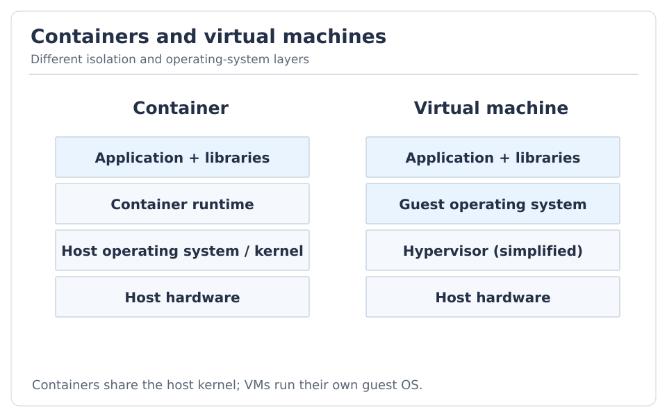
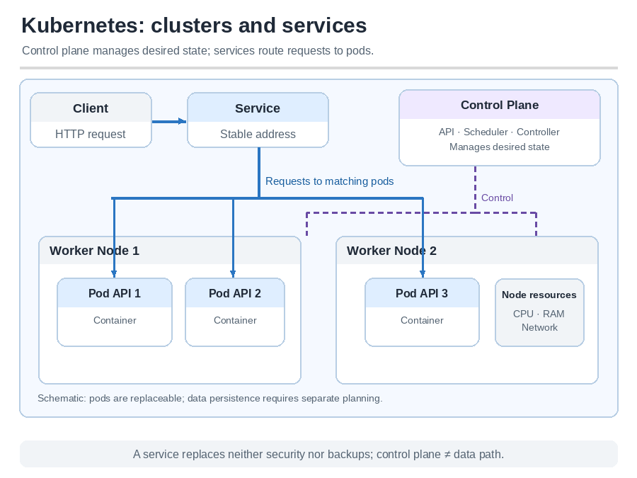

# M2-L4 – Virtualisation and containers {#L4}

**Course area:** M2 – Bachelor’s: Web, servers and hosting

**Level:** Bachelor’s

**Prior knowledge:** No fixed prerequisites specified.

## Overview: How one computer can become several apparently independent computers {#S1}

M2-L1 examined how an ordinary computer offers services over the internet. In M2-L2, we divided an application into frontend, backend and data storage. M2-L3 showed who can operate the infrastructure required for these components. We now answer the question: **How can a data centre provide many separate customer environments on a single physical server?**

The first answer is **virtualisation**. It creates several logically separate computing environments from real hardware. The second answer is **containerisation**: instead of starting a complete virtual computer for every application, processes are executed in isolation together with the program components they need. Both approaches solve related but not identical problems. In real cloud systems they are even frequently combined.

In what follows, we deliberately distinguish four levels:

1.  **Physical computer:** Processors, main memory, storage devices and network interfaces.
2.  **Virtual machine:** A complete computing environment with its own operating system kernel.
3.  **Container:** An isolated running process or process group that, on Linux, typically shares an operating system kernel with other containers.
4.  **Orchestration platform:** Software that manages many such application instances, distributes them across computers and replaces them when failures occur.

An application does not have to manage all four levels itself. A rented virtual server can be entirely sufficient; a managed platform service can even hide nearly all underlying layers.

## The initial problem: One large server, many small tasks {#S2}

Suppose a data centre has a powerful computer with many processor cores and plenty of main memory. A small customer needs only a fraction of these resources. If every customer received a separate physical server, many resources would remain unused. Furthermore, hundreds of customers would require hundreds of physical devices to be purchased, cabled, monitored and replaced.

Different customers’ programs could be installed directly on the same operating system. This would be technically possible to some extent, but would lead to conflicts: one program needs a particular runtime library, while another needs a different one. Different administrators should not see the same files. A crashed service should affect other customers as little as possible. Nor should changes to one customer’s operating system affect everyone else.

**Virtualisation solves the problem of division and separation here.** The customer receives an environment that behaves like its own computer, even though it shares physical hardware with other environments.

### Mini-architecture: One computer, three virtual servers

``` text
Physical server in the data centre
┌──────────────────────────────────────────┐
│ Processors · RAM · SSD · Network         │
├──────────────────────────────────────────┤
│ Hypervisor / virtualisation layer        │
├────────────┬────────────┬────────────────┤
│ Virtual    │ Virtual    │ Virtual        │
│ machine A  │ machine B  │ machine C      │
│ Linux      │ Linux      │ Windows        │
│ Web service│ Database   │ Specialist app │
└────────────┴────────────┴────────────────┘
```

The diagram is schematic: the actual allocation of resources is controlled by the hypervisor and the host system. Virtual machines do not automatically receive exclusively dedicated physical processor cores.

## Hypervisor: The manager of virtual machines {#S3}

A **hypervisor** is the central virtualisation software or layer. It provides virtual machines with abstracted hardware and supervises their execution on the real hardware. It can, for example, allocate memory areas, distribute processor time and connect virtual devices to physical resources.

Two basic types are often distinguished:

- **Type 1 (“bare metal”):** The hypervisor operates very close to the hardware. Examples of corresponding platforms include Microsoft Hyper-V and VMware ESXi. Some systems also have a particularly privileged management or host partition.
- **Type 2 (“hosted”):** Virtualisation software runs on a conventional host operating system, for instance as a desktop application. Oracle VirtualBox is a well-known example.

This classification is a useful guide, but not a complete technical taxonomy. **KVM** (*Kernel-based Virtual Machine*), for example, is a virtualisation feature of the Linux kernel; together with further components, it forms a complete virtualisation platform. Different architectures do not always fit neatly into the two simplified categories.

### Mini-architecture: Host, hypervisor, guest

``` text
Physical hardware
       │
       ▼
Hypervisor / virtualisation environment
       │
       ├── Guest operating system A → Applications A
       └── Guest operating system B → Applications B
```

A **guest operating system** is an operating system running inside a virtual machine. The **host** is the computer or supporting environment that provides this machine.

### What problem does this solve?

The hypervisor enables separate operating systems and resource management on the same hardware. It can help to start, shut down, migrate and back up customer systems independently. This is particularly useful for hosting providers, enterprise servers, test environments and applications with different operating system requirements.

**When is it unnecessary?** If a single application already runs reliably on your own computer and separate operating systems are not needed, an additional VM does not necessarily bring any benefit. Instead, it entails its own memory requirements, operating system updates and administration work.

## Which parts of a computer are virtualised? {#S4}

### Virtual CPU (vCPU)

A **vCPU** (*virtual Central Processing Unit*, virtual processor) is a computational execution unit presented to the virtual machine. It is not automatically identical to an exclusively allocated physical processor core. Several VMs can share processor time. Therefore, without knowing the contract, “four vCPUs” on a rented server does not mean that four real cores are always exclusively available.

A hypervisor coordinates the execution of virtual processors on the available hardware cores. Modern processors support virtualisation through special hardware features. This reduces the overhead of many operations, but does not eliminate it entirely.

### Virtual main memory

The virtual machine receives a configured memory area. The hypervisor or host system ensures its mapping and isolation. A VM can also use virtual memory and swap files within its own operating system. Thus, **a process’s virtual address space** (the subject of M1-L2) should not be confused with **a virtual machine**.

### Virtual storage devices

A VM can see a storage device that is actually provided by a file, a logical volume or a network storage system. The VM often treats it like its own disk. Storage devices can grow dynamically; however, shared storage introduces performance limits. A fast virtual server can become slow when the physical storage system is under heavy load.

### Virtual network interfaces

Virtual network cards connect VMs to a virtual switch and, depending on the configuration, to a physical network. The same basic ideas apply as in real networks: addressing, forwarding, firewall rules and segmentation. The fact that machines are virtual does not make them automatically publicly accessible or adequately protected.

### Mini-architecture: Network connection

``` text
Internet
   │
Hosting provider’s router / firewall
   │
Virtual network switch
   ├── VM A: Public web frontend
   └── VM B: Internal database (no public port)
```

The separation is an **architectural objective**, not an automatic property of every installation. Network configuration and access rules must determine which VM may communicate with which other VM.

## The virtual machine as a fully independent operating environment {#S5}

A **virtual machine (VM)** usually has its own guest operating system, including its own operating system kernel. This kernel handles processes, file systems, memory management and networking functions inside the VM, for example. A guest can have a different operating system from the host, insofar as the architecture, virtualisation platform and permissions support this.

This is one of the most important differences from conventional Linux container technology: **A Linux VM runs with its own Linux kernel; an ordinary Linux container uses the kernel of its Linux host.**

With VMs, typical tasks therefore arise repeatedly: system installation, updates, configuration, monitoring, resource planning, protection of administrative access and data backups. In return, the separation offers a comparatively strong security boundary. It is not impenetrable: hypervisor vulnerabilities, misconfigurations, shared data areas or network faults can still have an impact.

### Starting, copying, snapshots and backups

It is convenient to manage VMs as files or defined resources. Some platforms allow the state of a machine to be captured as a **snapshot** or the machine to be migrated to other hardware.

However, a snapshot is **not automatically a reliable backup**. The snapshot may depend on the same storage and management environment. It may also capture a running database in a state from which reliable recovery requires additional consistency measures. Important data requires separate backups and tested restoration.

## Why were containers developed? {#S6}

Virtual machines isolate entire operating systems. This is valuable, but is often more than a small application requires.

Suppose a web service requires PHP, a particular library version and some configuration files. The operator wants to run it in as similar a manner as possible on a development computer, a test server and later at a cloud provider. Without additional measures, runtime versions, system libraries and settings may differ. The well-known phrase “it works on my computer” describes this problem.

**Containerisation primarily solves the problem of providing a reproducible, isolated application runtime.** The application and its required files are described as a deployable package and then started in a controlled environment. Linux uses kernel mechanisms, among other things, to isolate processes and limit resources. [https://docs.docker.com/get-started/docker-concepts/the-basics/what-is-a-container/](https://docs.docker.com/get-started/docker-concepts/the-basics/what-is-a-container/)

### Mini-architecture: Three applications, one kernel

``` text
Physical or virtual Linux server
┌────────────────────────────────────────────┐
│ Shared Linux kernel                        │
├──────────────┬──────────────┬──────────────┤
│ Container A  │ Container B  │ Container C  │
│ PHP app      │ API worker   │ Web server   │
│ Libraries    │ Libraries    │ Library      │
└──────────────┴──────────────┴──────────────┘
```

The containers are not three complete Linux computers. They use separate process environments but share the same underlying kernel. The illustration also does **not** mean that every container is incapable of communicating with other containers; desired communication can be configured explicitly.

## What technically is a container? {#S7}

In the conventional Linux context, a **container** is not a separate hardware machine but an isolated running process or process group with a defined view of processes, files, networks and other resources.

Two important Linux technologies are:

- **Namespaces:** They give processes their own view of certain areas of the system, such as processes, networks, file system mount points and user identifiers. Consequently, a program cannot simply see all processes on the host.
- **Control groups (cgroups):** They organise and limit the use of certain resources, such as processor time, main memory and the number of processes.

Additional security mechanisms such as restricted kernel capabilities, system call filters and less privileged users can also be applied. These layers increase security, but their effectiveness depends on configuration and environment. The official Docker documentation explicitly describes the importance of namespaces, cgroups and protecting the Docker daemon. [https://docs.docker.com/engine/security/](https://docs.docker.com/engine/security/)

**Important:** Containers are not equivalent to VMs and do not guarantee an equivalent level of isolation. A kernel bug or excessively broad container privileges can endanger the host or other containers. In particular, the choice of isolation is crucial when executing untrusted code.

## Container image, container and registry: Three different things {#S8}

In everyday usage, these terms are frequently confused.

**Container image:** A packaged, essentially immutable set of files, program code, libraries and configuration information. An image is a **template**, not yet a running program. Images frequently consist of several reusable layers.

**Container:** A running or stopped instance created from an image. Several separate container instances can be started from the same image. Each instance typically has its own writable layer.

**Registry:** A service for storing and distributing images. Other computers can retrieve published images from it. Well-known examples include Docker Hub and other private or public container registries.

### Mini-architecture: From development to service

``` text
Source code + dependencies
            │
            ▼
        Build image
            │
            ▼
       Container registry
            │ Retrieve image
            ▼
       Production server
            │
        Start container
            │
            ▼
     Publicly accessible API
```

When source code is changed, it is sensible to create a new image and replace the existing instance. This avoids manual changes within running containers that are difficult to trace.

**Version identification:** Images can be referenced through a tag (such as a version label) or a cryptographic content identifier (*digest*). A tag may later point to a different image; a content-based digest enables more precise identification of the package used. Neither replaces checks of origin and security, however.

### What does “portable” mean?

An image makes an application environment easier to transfer, **but not universally executable everywhere**. Processor architecture, operating system kernel, required devices, GPU drivers, permissions, networks and file paths can differ. Linux containers require a compatible Linux kernel; Windows and macOS use a Linux VM for common Linux containers in Docker Desktop. The idea that “one package runs on every computer without any adjustment” is therefore too simplistic. [https://docs.docker.com/learn/content/what-is-a-container/](https://docs.docker.com/learn/content/what-is-a-container/)

## Docker: A tool, not container technology itself {#S9}

**Docker** is a widespread ecosystem of tools and software for building, distributing and running containers. The name does not refer to the entire technical standard, nor necessarily to the runtime of every container in a cloud.

The Docker ecosystem includes, among other components:

- **Docker Engine:** Components for managing and starting containers on a host, including the Docker service (*daemon*).
- **Dockerfile:** A declarative recipe describing how an image is built.
- **Docker Hub:** A container image registry operated by Docker.
- **Docker Compose:** A tool that describes and operates multiple related container services, their networks and data storage together.

The term **Open Container Initiative (OCI)** refers to an independent standardisation initiative for container image formats, execution and distribution. Container technology is therefore not tied to a single tool. Other runtimes and platforms can also use compatible formats. [https://opencontainers.org/](https://opencontainers.org/)

A small example without a configuration file: a web application consists of an HTTP web server, an API process and a database. Docker Compose can describe the three services and their communication together. For an individual server, this is often sufficient already – **no Kubernetes cluster is required**.

### Mini-architecture: A small application with Compose

``` text
VPS or local Linux computer
          │
     Docker / Compose
          │
   ┌──────┼─────────┐
   │      │         │
 Web server API    Database
   │      │         │
   └──────┴─────────┘
       Internal network
          │
        External access
        to web server only
```

This example is an architectural idea, not a mandatory configuration. A database can also run as a managed service outside this machine, which can simplify operations.

## The frequently overlooked point: Where does the data go? {#S10}

An important characteristic of many container workflows is the **replaceability of application instances**. A faulty container is removed and a new one started from the verified image. For stateless services, this is relatively simple.

It becomes more difficult if a container stores persistent data only in its own writable file layer. If this container is deleted, these data are usually lost along with that layer. **Restarting the same container is not the same as deleting and replacing it.** The lifecycle stages must be distinguished correctly.

The solution is to deliberately store data **outside the short-lived container layer**. Docker supports **volumes** (managed persistent storage areas) and **bind mounts** (mounting a particular host directory), for example. [https://docs.docker.com/engine/storage](https://docs.docker.com/engine/storage)

### Mini-architecture: Replaceable application, persistent data

``` text
          Container: API
          (replaceable)
               │
               ▼
         Persistent volume
               │
          Database files
               │
               ▼
        Separate offline backup
```

A volume does **not automatically protect data from drive failure, accidental deletion, ransomware or erroneous database changes**. It does not replace a backup. Production databases also require consistent backup procedures, access permissions, monitoring and recovery tests. We examine this subject in greater depth in M3-L6.

## Comparison: Virtual machine and container {#S11}

| Question | Virtual machine | Typical Linux container |
| --- | --- | --- |
| What is isolated? | Complete virtual computing environment | Application process and view of resources |
| Its own kernel? | Usually yes, in the guest operating system | No, the host kernel is shared |
| Operating systems | Different guest operating systems possible | Kernel compatibility with host required |
| Startup and resource overhead | Usually greater because of guest operating system | Usually lower; depends on application |
| Security boundary | Generally stronger separation | Isolation through shared kernel and configuration |
| Updates | Guest operating system and application | Host kernel, runtime and new images |
| Portability | Bound to virtualisation/hardware characteristics | Image easier to distribute, but not universal |
| Typical use | VPS, separate customers, different operating systems | Reproducible application deployment, workers, APIs |

The additional resource and administration cost is frequently referred to as **overhead**: a VM typically causes more overhead because of its own guest operating system, while containers are not free of cost either and entail storage, network and monitoring costs, for example.

{alt="Two parallel stacks of layers show containers sharing a host operating system and a virtual machine with its own guest operating system."}

Containers and virtual machines differ particularly in terms of the kernel and guest OS.

The table describes the **usual** cases. Special forms exist, such as highly isolated container runtimes, microVMs and combinations of both approaches. No absolute guarantee of security or speed can therefore be inferred from a general table.

### Common combination

``` text
Data centre / physical host
               │
            Hypervisor
               │
          Virtual machine
               │
            Linux kernel
               │
       Container A + B + C
```

This combination is very common in hosting and cloud environments: the customer rents a VM and operates several containers on it. This provides both separation from the physical host and consistent application deployment.

## What does orchestration mean? {#S12}

Suppose an API runs not just once but in numerous instances on several computers. Some computers fail, while others are added. Updates should be carried out gradually. User requests must be distributed among available healthy instances. Simply being able to start individual containers is no longer sufficient.

**Orchestration** in this context means coordinated management of many running application instances and their dependencies. Typical tasks include placement, restarting failed processes, deploying new versions, maintaining the desired number of instances, configuration and network accessibility.

One important form is the **declarative operating model**: you describe the state the system should have rather than prescribing every individual step manually. The platform continually compares actual and desired state and attempts to resolve differences.

### Example: Three instances instead of two

``` text
Desired state: 3 API instances
                │
                ▼
         Platform checks
                │
    Only 2 instances actually present
                │
                ▼
       Start another instance
                │
                ▼
      Desired state restored
```

However, this only answers part of the reliability question: if an application delivers incorrect results or corrupts a database, starting an extra container does not fix the error.

## Kubernetes: Managing containers in a cluster {#S13}

**Kubernetes** (often called **K8s**, because there are eight letters between K and s) is an open-source platform for operating containerised applications. The name does not stand for a specific cloud provider, and Kubernetes is not a complete substitute for your own development and operational decisions. [https://kubernetes.io/docs/concepts/overview/](https://kubernetes.io/docs/concepts/overview/)

{alt="Kubernetes cluster with a client, service and three API pods on two worker nodes. A separate control plane schedules and monitors the pods; the application data path leads from the service to the pods."}

Simplified Kubernetes topology: control plane for management, service for accessibility and pods on worker nodes. No guarantee of security or availability.

A **cluster** consists of one or more computers called **nodes**, and a **control plane** that manages desired and actual system state. The nodes can be physical or virtual machines.

Some important terms:

- **Pod:** The smallest deployable unit in Kubernetes. A pod contains one or a few tightly coupled containers with a shared network context and, where applicable, shared storage.
- **Deployment:** Description of a desired operational state for normally replaceable application pods, such as instance count and image version. Kubernetes manages the associated updates and replicas.
- **Service:** A stable abstraction through which application instances can become accessible within the cluster, even if individual pods are replaced.
- **Scheduler:** A component of the control plane that decides which suitable node should host new pods.
- **Container runtime:** Software on a node that actually starts containers. Kubernetes does not require every node to use Docker Engine as its runtime.

### Mini-architecture: A Kubernetes cluster

``` text
            Incoming requests
                    │
               Service access
                    │
                Kubernetes
     ┌──────────────┴─────────────┐
     │       Control plane        │
     │ Desired state, management  │
     └──────────────┬─────────────┘
                    │ Schedules and controls
           ┌────────┴────────┐
           ▼                 ▼
        Node 1             Node 2
       ┌───────┐          ┌───────┐
       │Pod:API│          │Pod:API│
       │Pod:API│          │Pod:API│
       └───────┘          └───────┘
```

The diagram explicitly does **not illustrate a complete production high-availability installation**. This would require separate planning of the control plane architecture, cluster state storage, network infrastructure, failure scenarios and backups, among other things.

### What Kubernetes actually makes easier

With suitable configuration, Kubernetes can replace failed instances, distribute applications across available nodes, coordinate updates and adjust the number of instances. The official documentation mentions self-healing mechanisms, declarative control and horizontal scaling, among other features. [https://kubernetes.io/docs/concepts/overview/](https://kubernetes.io/docs/concepts/overview/)

**What it does not automatically do:** Write correct applications, ensure the security of every configuration, select a backup strategy, ensure business-level data consistency, perform database migrations, ensure data-protection-compliant operations or control the cloud bill. Nor is a restart equivalent to actually resolving a fault.

### Why is Kubernetes often unnecessary for small applications?

A single online tool with a manageable user base may only need one application and one database. A managed platform or simple VPS is often easier to operate for this purpose. Kubernetes introduces additional management objects, networking concepts, roles, log collection, secrets management, updates and possible failure scenarios.

It can be worthwhile if many services are operated independently, teams frequently deploy new versions or several computers and failure zones need to be coordinated. **A platform’s complexity should be justified by an actual need, not its popularity.**

## Three specific application scenarios {#S14}

### Scenario A: Small PHP web application

You operate a manageable web application with user data and a simple database.

**Possible solution:** Traditional web hosting or a small VPS with a web server and database. A container is not a prerequisite here. Docker Compose could become useful if you wish to version runtime components independently of the host system. A cluster platform would usually create additional work without a corresponding benefit.

**Operational consequences:** Security updates, user permissions, regular database backups, error logging and occasional recovery tests remain necessary. Inexpensive hosting does not make responsibility for personal data irrelevant.

### Scenario B: Analysis API with background jobs

The application accepts files, provides an **API** (*Application Programming Interface*) and starts analysis jobs in the background.

**Possible solution:** A single virtual server operates a web service, a job queue and one or more workers. These can run in separate containers. As the load increases, the number of workers can be increased separately. A database should store its data outside short-lived container layers and be reliably backed up.

**Operational consequences:** CPU and memory utilisation, failed jobs, duplicate processing, limits on concurrent resource consumption and user permissions become relevant. More workers do not automatically increase database performance; the next bottleneck may be storage or a shared resource.

### Scenario C: AI processing on a GPU

An AI service accepts tasks, generates images or processes language and returns results. A **GPU** (*Graphics Processing Unit*) is helpful for many such computations, but part of the system (web server, job management, user permissions) still frequently runs on CPUs.

**Possible solution:** An inexpensive web server accepts requests; a separate GPU computer processes the jobs. The AI worker can be containerised as long as the required GPU drivers, container runtime, device driver compatibility and computing resources are appropriate. An orchestrated multi-node solution only becomes interesting when several worker computers need to be managed.

``` text
User
  │
  ▼
Web application / API
  │
  ▼
Job queue
  │
  ├── GPU worker 1 (container if appropriate)
  └── GPU worker 2 (optional)
  │
  ▼
Result store → User receives result
```

**Operational consequences:** GPU time, graphics memory, model sizes, large files, concurrent jobs, electricity or cloud usage, protection against misuse and security updates must be considered. Several GPU containers imply neither several GPUs automatically nor guaranteed additional computing power.

## Security, maintenance and economic limits {#S15}

**Security:** A container is not a trusted sandbox simply because of its name. Security measures include verified images, timely updates, least privilege, secrets management, limited network access and the smallest possible attack surface. Docker, for example, offers a *rootless mode* in which the service and containers can run without a permanently privileged root daemon; this has its own prerequisites and limitations. [https://docs.docker.com/engine/security/rootless/](https://docs.docker.com/engine/security/rootless/)

**Maintenance:** A new image with updated libraries must be built, tested and deployed. Container updates do not replace updates to the host kernel, hypervisor, container runtime or an external database. Administratively, a virtual system remains a real system.

**Backups and failures:** The image stores application and dependencies, but not automatically all changing user data. Database volumes, keys, configurations and external storage services require their own backup and recovery strategies. A copy of the same container on the same server does not protect against failure of that server.

**Costs:** In addition to actual computing power, costs arise from storage, network traffic, image storage, log data, backups, operations, managed service charges and any spare capacity for resilience. Depending on the solution, a simple VM may be cheaper than a highly available container platform; blanket price judgements would be unreliable without current offers and a workload profile.

**Vendor dependency:** Standardised images facilitate switching execution environments. Nevertheless, applications often depend on databases, network services, permissions and proprietary cloud features. An OCI-compatible image does not automatically make a complex application transferable to a different provider within minutes.

## A brief conceptual comparison: Four typical decisions {#S16}

| Requirement | Usually the obvious approach | When more elaborate technology becomes useful |
| --- | --- | --- |
| Make a simple website accessible | Shared hosting or managed web platform | Custom runtime or operating system requirements |
| Use your own server with administrative privileges | Single VM / VPS | Separation of many customer environments or heavy load |
| Operate several application components reproducibly | Containers, possibly Compose | Many services and several independent computers |
| Continually coordinate large numbers of application instances | Managed container platform or Kubernetes | Extensive multi-node and automation requirements |

This classification is not a purchasing recommendation. It explains the additional problem each technology solves. **A more advanced tool is not automatically the more economical or secure solution.**

## Summary and transition {#S17}

- **Virtualisation** divides real hardware into logically separate computing environments.
- A **hypervisor** enables virtual machines to be executed and managed; a VM generally has its own guest operating system and kernel.
- **Containers** usually isolate processes and their runtime environment, but share a kernel under Linux.
- **Images** are distributable templates; **containers** are instances created from them; **registries** store and distribute images.
- **Docker** is an ecosystem of tools; **OCI** defines open container standards. **Docker Compose** is one possible simple solution for several components on one host.
- **Persistent data** must deliberately be stored outside replaceable container layers and backed up separately.
- **Kubernetes** helps manage many containerised applications declaratively across nodes; for a small web application it is often unnecessarily complex.
- **VMs and containers are not mutually exclusive.** A common architecture consists of VMs running containers.

**Next lesson [M2-L5 – Cloud networks and application scaling](M2-L5.md):** We examine how multiple application instances work together through load balancers, private networks and caches – and where new bottlenecks and failure risks emerge.

## Sources {#S18}


**Source review: 03.11.2026.** Official technical documentation was consulted for this lesson. Some concepts and mechanisms are stable; specific product features and security requirements may change. No current prices or binding legal statements are claimed.

1.  [Microsoft Learn – Hyper-V architecture](https://learn.microsoft.com/de-de/windows-server/virtualization/hyper-v/architecture) · Hypervisor, virtualised computers and isolation · Last accessed: 2026-11-22
2.  [Docker Docs – What is a container?](https://docs.docker.com/get-started/docker-concepts/the-basics/what-is-a-container/) · Container concept and distinction from virtual machines · Last accessed: 2026-11-22
3.  [Docker Docs – What is an image?](https://docs.docker.com/get-started/docker-concepts/the-basics/what-is-an-image/) · Images, layers and packaging · Last accessed: 2026-11-22
4.  [Docker Docs – Docker Engine security](https://docs.docker.com/engine/security/) · Namespaces, cgroups and security boundaries · Last accessed: 2026-11-22
5.  [Docker Docs – Storage](https://docs.docker.com/engine/storage) · Persistent volumes, bind mounts and the container lifecycle · Last accessed: 2026-11-22
6.  [Docker Docs – Docker Compose](https://docs.docker.com/compose) · Interaction of several container services · Last accessed: 2026-11-22
7.  [Open Container Initiative (OCI)](https://opencontainers.org/) · official project overview: Standardised image, runtime and distribution specifications · Last accessed: 2026-11-22
8.  [Kubernetes – Concepts / Overview](https://kubernetes.io/docs/concepts/overview/) · Purpose, operation and limitations of the platform · Last accessed: 2026-11-22
9.  [Kubernetes – Components](https://kubernetes.io/docs/concepts/overview/components/) · Control plane and node components · Last accessed: 2026-11-22
10. [Kubernetes – Pods](https://kubernetes.io/docs/concepts/workloads/pods/) · Smallest deployment unit, networking and shared resources · Last accessed: 2026-11-22
11. [Kubernetes – Deployments](https://kubernetes.io/docs/concepts/workloads/controllers/deployment/) · Desired number of instances, rollouts and replicas · Last accessed: 2026-11-22
12. [Docker Docs – Rootless mode](https://docs.docker.com/engine/security/rootless/) · Less privileged operation and prerequisites · Last accessed: 2026-11-22

**Further reading:** [M2-L1](M2-L1.md) explains public accessibility; [M2-L2](M2-L2.md) covers application components; [M2-L3](M2-L3.md) discusses the hosting model. [M2-L5](M2-L5.md) examines networks and scaling in more depth, [M3-L6](M3-L6.md) reliable protection of persistent data and [M6-L6](M6-L6.md) operation of distributed AI systems.
