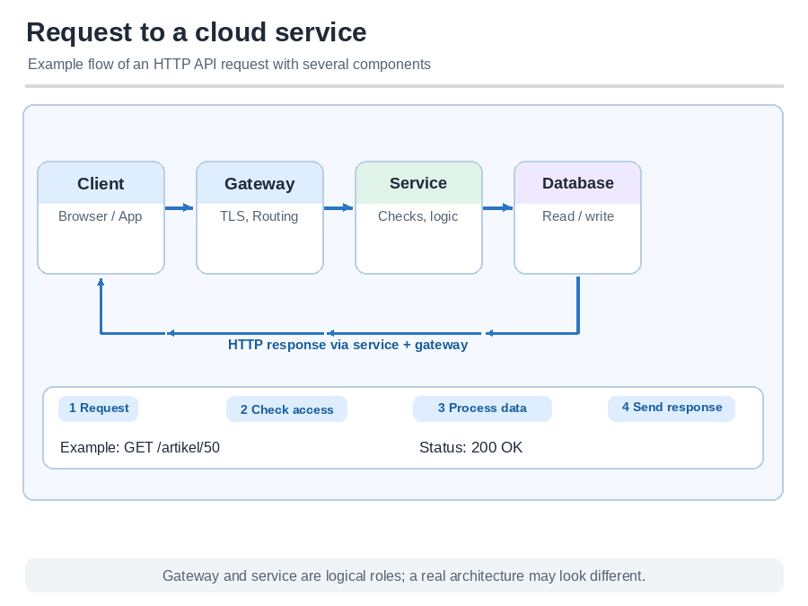
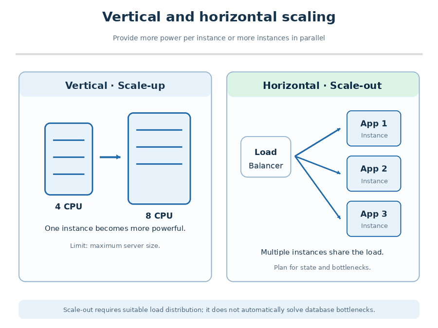

# M2-L5 – Cloud networks and application scaling {#L5}

**Course area:** M2 – Bachelor’s: Web, servers and hosting

**Level:** Bachelor’s

**Prior knowledge:** No fixed prerequisites specified.

## Overview: How does an application grow beyond a single server? {#S1}

In M2-L1, we made a computer publicly accessible. M2-L2 explained how browsers, interfaces, user accounts and background processing work together. M2-L3 compared hosting models; M2-L4 explained virtual machines and containers. The next question now arises: **What happens when a single server can no longer reliably meet demand – or when an outage is no longer acceptable?**

The obvious answer is more computing power. This may mean using a more powerful server, operating several application instances, caching frequently used content or moving long-running work into queues. However, these measures are not interchangeable solutions. An additional web server is of little help if the only database blocks all requests. A cache speeds up frequently read data but can deliver outdated responses. More instances increase the number of tasks that can be executed simultaneously, but introduce problems involving sessions and shared state.

**Scaling** here means adapting a system to a change in load. **High availability** means continuing to provide a service as far as possible despite certain failures. The two are related, but they are not the same: a powerful single server can handle many requests and still be a single point of failure. A redundant system can survive a server failure even though it is not particularly fast.

### Mini-architecture: From one server to several

``` text
Small application:

Browser ──► Web server + application ──► Database

Expanded application:

Browser
   │
   ▼
Load balancer
   ├──► Application server A ──┐
   ├──► Application server B ──┼──► Shared database
   └──► Application server C ──┘
```

The second diagram does not automatically solve all performance or reliability problems. To do that, the servers must share the same data state sensibly, and the individual components must be coordinated with each other.

## Data centre, region and availability zone {#S2}

A **data centre** is primarily a physical location with computer hardware, power supply, cooling and network connections. Cloud providers often organise their infrastructure into larger geographical areas. A **region** is a provider-defined geographical group of locations. An **availability zone (AZ)** is a distinct operating environment within a region on certain cloud platforms. The precise physical and technical boundaries vary according to the provider: a zone is not necessarily equivalent to a single building.

Why do these areas exist? Because it is undesirable to operate every server in the same room. Otherwise, if the power supply, fire compartment or network connection at one location fails, all copies of an application could be affected at the same time. If suitable components are distributed across several independent zones, the failure of one zone can be handled under certain conditions. However, a region can itself experience widespread problems; multiple zones therefore do not guarantee absolute availability.

``` text
Region: example region
│
├── Zone A
│     ├── Application instance 1
│     └── Database node / storage
│
└── Zone B
      ├── Application instance 2
      └── Database replica / storage
```

**When is it useful?** For services where failure of an individual location would be particularly damaging. **When is it excessive?** For a hobby website, a small internal tool or a service where occasional interruption is acceptable. Additional data transfer, separate resources, more complex database configuration and more demanding recovery after disruptions must be considered.

Location also has practical implications for latency and data protection. An application accessed mainly by European users may benefit from regional locations. However, the physical location of data alone does not answer all legal questions regarding backups, remote access or data processing on behalf of others. The specific legal situation must be assessed separately for a later real-world offering.

## Virtual private networks: An internal landscape within the cloud {#S3}

With a single rented server, one can imagine a machine with a public internet address. Once an application consists of a web server, database, workers and administration services, not every component should be publicly accessible. An internal network is needed in which certain systems can communicate with one another while other access is restricted.

A **virtual private cloud network (VPC)** is a logically separated virtual network within a cloud platform. It resembles an internal company network with address ranges, network segments, routes and firewall rules. Providers define the details differently, but the basic function is comparable. **A VPC guarantees neither complete physical isolation nor automatic security.** Accidentally making a database public or allowing excessively broad permissions can create considerable risks even with a private network.

Important components include:

- **Subnet:** A distinct IP address range for part of the network. Association with regions and zones varies by provider.
- **Routing:** Rules determining which network paths are used for which destination addresses.
- **Firewall:** Rules permitting or blocking particular connections.
- **Gateway:** A connection to other networks, such as the internet.
- **NAT (Network Address Translation):** Address translation, for instance allowing internal systems to make outbound internet connections without having a public IPv4 address of their own.

### Mini-architecture: Public entry point, internal services

{alt="Example HTTP request path from the client through the gateway and application service to the database, and back through the service and gateway to the client."}

Schematic request/response path through a cloud service. Roles and security checks are distributed differently depending on the system.

``` text
                          Internet
                             │
                        Public access
                             │
                   ┌─────────▼─────────┐
                   │    VPC network    │
                   │                   │
                   │   Load balancer   │
                   │        │          │
                   │  Web application  │
                   │        │          │
                   │     Database      │
                   │  (internal only)  │
                   └───────────────────┘
```

The aim is not to make all internal systems completely inaccessible. The application must be able to reach its database, but an arbitrary visitor on the internet must not. This distinction is normally implemented through network boundaries **and additionally** through database permissions and authentication. A firewall is therefore only one layer of the security architecture.

For a small website, a single virtual server with a locally bound database may be simpler. A virtual cloud network is especially worthwhile when several independently operated components exist and clear communication boundaries are required.

## Load balancer: Distributing incoming requests {#S4}

A **load balancer** accepts requests and forwards them to a suitable application server. This solves two problems: a single server does not have to bear the entire load alone, and under certain conditions a failed server can be excluded from handling new requests.

A simple distribution scheme could send requests alternately to server A and server B (*round robin*). Real systems can use additional criteria: existing connections, current utilisation, geographical proximity or defined rules for certain paths. A load balancer can operate at different network layers. For web applications, an **application load balancer** at the HTTP (Hypertext Transfer Protocol) layer is often especially illustrative: it can, for example, distribute requests to `/api/` differently from requests to the website.

``` text
100 simultaneous browser requests
                 │
                 ▼
            Load balancer
             │       │
       50 requests  50 requests
             │       │
          Server A  Server B
```

These figures are a simplified illustration, **not a guarantee** that the distribution will always be even. Some requests require considerably more work than others, and connections can remain open for longer periods.

### Health checks and failures

A load balancer can check its target servers regularly. Such **health checks** verify, for example, whether an application responds successfully at a defined endpoint. If a server is judged unhealthy, it can temporarily be excluded from selection. This assumes that other healthy servers are available and that the load balancer itself functions correctly. Furthermore, an endpoint that simply returns “200 OK” does not prove that the entire application or database is functioning correctly.

During updates, a server can be removed from the normal flow of requests so that ongoing connections can finish where possible (*connection draining*). What is actually possible depends on the platform and protocol. Long-lived WebSocket connections or active file transfers require particular attention.

### Difference from a reverse proxy

A **reverse proxy** is a front-facing server that accepts requests on behalf of downstream services. It can terminate encryption, forward requests, modify headers and cache content. A load balancer can function as a specialised reverse proxy; conversely, not every reverse proxy needs to distribute load across multiple servers. A single NGINX server in front of a PHP application can already be useful as a reverse proxy without any horizontal scaling taking place.

**Limits:** A load balancer is itself an additional component with costs, rules, logs, certificates and failure risks. Managed cloud products can take care of its redundancy, but this must be checked for the specific service. If all servers use the same overloaded database, the bottleneck simply moves there.

## CDN: Bringing content closer to users {#S5}

A **content delivery network (CDN)** is a distributed network for delivering content. It maintains suitable files or responses at several geographical locations. Frequently used content therefore does not have to be transferred from the original web server (*origin server*) for every visitor. This can reduce loading times and the load on the origin server.

A CDN is well suited, for example, to images, stylesheets, JavaScript files, videos or documents that remain unchanged for long periods. Different rules apply to personalised account data. If a shared cache delivered the private response of an authenticated user to another user, this would be a serious data protection and security failure. **Caching must therefore deliberately distinguish between publicly reusable and individual content.**

``` text
Visitor in Berlin ──► Nearby CDN location ──► Image from cache
                             │
                             └── On a cache miss:
                                  Origin server
```

A **cache hit** occurs when the requested content is present in the cache and can be delivered from there. On a **cache miss**, the cache must retrieve it from the original source. This is not an error, but normal operation.

### Keeping content up to date

Caches need rules governing how long a response may be used. The HTTP header `Cache-Control` contains various directives for this purpose. For example, `max-age` specifies a freshness lifetime. `no-store` instructs the cache not to store a response; `no-cache`, by contrast, does **not** mean that nothing may be stored, but requires revalidation before reuse. `private` indicates a response intended for private caches; these properties must be carefully observed with shared CDN caches.

A typical approach for static files is to use a new filename or content hash when changes are made. An old image can then remain in the cache while a new version is accessible under a different name. Other options include limited validity periods and targeted cache invalidation.

**When is it unnecessary?** A small regional website with few visitors does not necessarily need a CDN. A CDN can also introduce extra configuration, data protection issues, caching errors and vendor dependencies. Furthermore, it does not replace a database or automatically accelerate every dynamic request.

## Caching within an application {#S6}

A CDN is only one form of caching. A browser, web server, application or database can also retain frequently needed results. The shared principle is simple: **An expensive result is computed or loaded once and then reused as often as possible.**

Example: a statistics service needs ten seconds to analyse several million records for a public overview. If these statistics change only every five minutes, a cached result might suffice. The database then does not have to perform the same calculation for every page view.

``` text
Request for public statistics
              │
              ▼
        Application cache
           │       │
          Hit     Miss
           │       │
        Result     ▼
                Database
                   │
               Fill cache
```

However, caches introduce new decisions: how is outdated data identified? Who removes the entry after a change? Can a user accidentally see another user’s data? What happens if many requests simultaneously attempt to recompute the same expired entry (*cache stampede*)? A cache often increases performance, but also increases state complexity.

A separate in-memory service, such as a key-value store, can provide a shared cache for several application servers. This is useful in large systems. For small applications, simpler methods often suffice: well-designed database queries, appropriate indexes, local caching or static output of precomputed pages. A cache is not a substitute for a correct data model.

## Vertical and horizontal scaling {#S7}



*Illustration: More app instances increase capacity only with suitable load distribution and architecture. The database, session state and shared components must also be considered; horizontal scaling does not guarantee linear performance gains.*

**Vertical scaling (scale up)** means making the existing machine more powerful: more main memory, greater CPU capacity or faster storage. **Horizontal scaling (scale out)** means adding instances of the same task. Both methods can be combined.

| Property | Vertical: more powerful server | Horizontal: more instances |
| --- | --- | --- |
| Main idea | More resources in one place | Distribute load across several computers |
| Advantage | Often a simpler architecture | Additional capacity and possible redundancy |
| Limit | Hardware ceiling, single point of failure | Coordination, shared data storage, communication |
| Typical first step | Increase CPU/RAM | Add a second application instance |
| Operational effort | Usually lower | Usually higher |

As usage grows, a small online service may initially need only more RAM or an optimised database query. Building a cluster would be premature as long as the actual bottleneck has not been identified. **Scaling without measurement** is often costly speculation.

### Why horizontal scaling does not always work

Not every task can be divided arbitrarily. Suppose two web servers sell the last available ticket at the same time. If both independently see a local inventory of “1”, they can sell it twice. The number of servers does not help with such a correctness error. Both need coordinated data storage with suitable transactions or another correct reservation mechanism. We discuss this in more detail in module M3.

Furthermore, individual computationally intensive tasks do not automatically run faster simply because several servers exist. A program must be meaningfully divisible into independent parts or be able to serve several independent jobs simultaneously. Here we distinguish **throughput** (many jobs per time period) and **latency** (the waiting time of an individual job).

## Stateless: Why stateless web servers are easier to replicate {#S8}

A **stateless service** does not need to rely on data from a previous request still being present on the same machine. Each new request carries the necessary information, or the service retrieves it from shared storage. This allows a load balancer to send subsequent requests to any available instance.

A **stateful service**, by contrast, retains information about earlier processing. This is by no means inherently bad: databases are naturally stateful, and long-lived connections have state too. For horizontally scaled web applications, however, it is advantageous not to store especially short-lived state exclusively within a single web server process.

### Example: User sign-in

``` text
Browser with session cookie
          │
          ▼
      Load balancer
       /          \
  Web server A  Web server B
       \          /
        ▼        ▼
     Shared session/account data
                │
             Database
```

A **cookie** is a small piece of information that a browser sends with appropriate requests. A server-side **session store** can keep the corresponding session data centrally. Alternatively, there are approaches using signed tokens; these also require careful permission checks, secure storage and a revocation plan. Neither a cookie nor a token alone makes an application secure.

There are also **sticky sessions**, where a load balancer attempts to send a user back to the same server. This can make existing applications easier to scale in the short term. If that server fails or is replaced, however, local session information may be lost. In the long term, shared or otherwise correctly managed state is often more robust, although it in turn requires infrastructure and incurs costs.

### Sharing files and databases

A second web server does not automatically see files uploaded locally to the first. User uploads must be stored, for example, in shared object storage, a suitable shared file system or another coordinated data store. The same applies to database files: a local SQLite file on server A does not automatically become the identical file on server B. Simply copying a live database file is no substitute for correct replication or transaction coordination.

The proven basic design for many web services is therefore **replaceable web instances plus explicitly managed shared data storage**. The database itself can then become a bottleneck or a point of failure, however. The course therefore turns next to databases, replication and sharding.

## Autoscaling: Adapting capacity to demand {#S9}

**Autoscaling** means that a platform provisions additional resources or reduces capacity no longer needed, based on defined rules or metrics. Such a system observes, for example, CPU utilisation, the number of simultaneously open requests, response times or the length of a queue.

In Kubernetes, a **Horizontal Pod Autoscaler (HPA)** can change the number of pods – that is, deployed application instances – based on metrics. A separate system can ensure that additional computing nodes become available as required. These two processes are not identical: more desired pods do not create additional hardware if the cluster has no available space. **A particular feature of the Kubernetes HPA CPU metric:** With the corresponding HPA configuration, percentage *CPU utilisation* is measured relative to the CPU *requests* defined for the containers, not as a blanket percentage of an entire host processor. Missing required requests can prevent evaluation of this metric type; HPA also supports other resource, custom and external metrics. A value such as “70% CPU utilisation” is therefore only meaningful when its measurement reference is specified. This detail is described in the [Kubernetes HPA documentation](https://kubernetes.io/docs/concepts/workloads/autoscaling/horizontal-pod-autoscale/).

``` text
Metrics: Requests / utilisation
                │
                ▼
            Scaling rule
                │
       ┌────────┴────────┐
       ▼                 ▼
   More demand       Less demand
       │                 │
   Instances ↑       Instances ↓
```

Example: an online tool receives many requests during the day and hardly any at night. The platform could start additional application instances during the day and shut some down at night. This only works if startup times, data access and load measurements are appropriate. Containers may have to load images, initialise applications and establish database connections before they can serve any requests at all.

**Autoscaling is not an immediate guarantee against overload.** A sudden surge can arrive faster than new instances become available. Overly aggressive scaling rules can lead to continual scaling up and down. Minimum and maximum limits, sensible metrics, spare capacity and a strategy for orderly rejection of additional load are therefore needed.

A CPU measurement alone can be misleading: if an application spends most of its time waiting for a slow database, its CPU utilisation may remain low even though users wait a long time. Suitable metrics must correspond to the actual bottleneck.

## Rate limits, queues and backpressure: Controlling overload {#S10}

Not all demand should be passed immediately through to the database or AI model. If a system is subjected to more work than it can process, the result is increasing waiting times, full storage or memory, aborted requests and possibly a complete collapse. Three mechanisms help manage such load.

### Rate limiting – limiting request rates

A **rate limit** restricts the frequency of particular actions within a time period. An API service could, for example, limit the number of requests per user, access key or account. This protects infrastructure and other customers from unintentional overload or misuse. When a limit is exceeded, an HTTP server can return the status **429 Too Many Requests** and, where appropriate, indicate when another request would be reasonable.

The specific limit depends on computational costs, fairness, the contractual model and protection requirements. A single IP address is often insufficient as an identifier, since legitimate users can share an address. Conversely, multiple accounts or distributed attacks can circumvent a naive IP-based limit. Rate limits are protective rules, not a complete security strategy.

### Queue – accepting jobs and processing them later

A **queue** is a waiting line for jobs. Instead of executing a costly operation throughout the entire browser request, an application can store it as a job. A background process – a **worker**, or job processor – later retrieves it from the queue and processes it. In the meantime, the website can show the user a job identifier and status.

``` text
User ──► API ──► Job database / queue
                            │
                 ┌──────────┴──────────┐
                 ▼                     ▼
              Worker A              Worker B
                 │                     │
                 └──────────┬──────────┘
                            ▼
                          Result
                            │
                       Status query
```

This is particularly illustrative for video conversion, data analysis or AI image generation. An individual job may take many seconds or minutes. It does not have to block the web connection for its entire duration. More workers increase potential throughput as long as storage, GPUs, the database and other resources can keep up.

**Important:** Queues can redeliver jobs if acknowledgements are missing or a worker crashes. The application may need to handle the same message safely several times (**idempotency**). For example, a job must not be billed twice without detection. The exact delivery guarantee depends on the queue used.

### Backpressure – signalling a limit upstream

**Backpressure** describes the principle of not supplying an overloaded downstream component with an unlimited number of further tasks. In simplified terms: if the production rate exceeds the processing rate, the system must either slow the inflow, increase capacity, reject tasks in a controlled way or discard them according to clear rules.

A queue alone does not solve the problem. If 1,000 jobs arrive per minute but only 500 are processed, the queue keeps growing. Additional workers could help as long as they can be used effectively. Otherwise, the application needs admission limits and clear status messages. A “job accepted” response should only be issued when reliable storage of the job is actually ensured.

## How to identify the right bottleneck {#S11}

Before deciding on any scaling measure, one should ask **which resource is actually slowing the service down**. For a web application, there are several possible causes:

| Symptom | Possible bottleneck | Often a sensible first approach |
| --- | --- | --- |
| Server CPU heavily occupied for a long time | Computation | Inspect code/queries, more powerful CPU or additional instances |
| Many requests but low CPU utilisation | Database/network waiting times | Investigate slow queries and dependencies |
| Large images load slowly | File size/transfer | Optimise files, caching or CDN |
| Slow only with simultaneous use | Resource or lock conflicts | Examine concurrency, connection limits and database access |
| Long AI job waiting times | Too few workers/insufficient GPU capacity | Assess queue length, runtimes and capacity |
| Sporadic outage when a server fails | Single point of failure | Backups, recovery and redundant instances where appropriate |

**Metrics** (measurable quantities), **logs** (event records) and, where applicable, **traces** (tracking a request through several services) are useful here. A single number can be misleading. For instance, an average response time can look good even though a few users wait for minutes. For usability, high percentiles – such as the slower five per cent of requests – are also important.

For small services, simple measures are often sufficient: clear error logs, regular backups, a few comprehensible performance indicators and occasional capacity checks. A complete observability system with many specialised services might be excessive here. Operations also mean keeping complexity as low as possible.

## Three end-to-end application examples {#S12}

### Documentation website with images {#121-dokumentationswebsite-mit-bildern}

**Initial situation:** A website publishes articles, program files and screenshots. Visitors predominantly read and write little or nothing themselves. This is a favourable case for static content and caching.

**Possible architecture:** HTML files and images on a conventional web host or small server; optionally, a CDN later for larger, frequently retrieved files. There need not be a database, load balancer or container cluster. Security updates for the software used, reliable backups and domain management nevertheless remain necessary.

**Limit:** A complex cloud platform would not improve the actual content. It would become more attractive only for special requirements such as substantial global traffic, costly media processing or very high availability objectives.

### Small paid online analysis tool {#122-kleines-kostenpflichtiges-online-analysewerkzeug}

**Initial situation:** Customers upload data, start analyses and retrieve results. Personal data, customer accounts and jobs with different costs arise.

**Possible initial architecture:** A web application on a single VPS (Virtual Private Server), a suitable database and secure, bounded upload storage. A small queue with one worker for longer analyses. Roles, access control per customer, limits, backups and traceable billing data are more important than a premature multi-zone architecture.

**Growth path:** First optimise the program and database, then move workers out if appropriate and place several stateless web instances behind a load balancer. User data, sessions and uploaded files then require shared, correctly secured storage. Automatic scaling or redundant databases follow only when there is a specific need.

**Risk:** An accidentally publicly shared result cache would be more dangerous than a slow page. Unrestricted uploads and computations can also cause costs and storage requirements to increase uncontrollably.

### AI processing service with GPUs {#123-ki-verarbeitungsdienst-mit-gpus}

**Initial situation:** Users initiate image or video generation with varying runtimes. **GPU** means *Graphics Processing Unit*, a graphics processor suitable for many parallelisable AI computations. The actual processing is considerably more expensive than serving a status page.

``` text
Browser
   │
   ▼
Lightweight API / sign-in
   │
   ▼
Job acceptance and cost limit
   │
   ▼
Queue
   │
   ├──► GPU worker A
   └──► GPU worker B (as needed)
             │
             ▼
         Result store
             │
             ▼
         Secure delivery
```

The web interface may need little computing power, while individual AI jobs consume a large proportion of GPU capacity. Two separate scaling decisions are therefore useful: how many web instances are needed, and how many AI workers? GPU startup times, model loading times, memory consumption, waiting times and handling of cancelled jobs must also be considered.

**When is it unnecessary?** If an individual operator occasionally generates images locally or tests a small service of their own, a local GPU machine or a single continuously running worker can suffice. A cloud cluster is not a prerequisite for AI research or an initial offering.

## Operations, costs, security and consequences of failure {#S13}

The crucial problem in modern cloud architectures is rarely just starting additional servers. In the long term, all components must be managed together.

**Costs:** More instances and zones mean additional ongoing computing and storage costs. Load balancers, CDNs, public IP addresses, managed databases, transfers between zones and outbound data traffic can incur separate charges. A cache or autoscaling can reduce costs, but also increase them if incorrectly configured. Specific provider prices are deliberately not claimed here.

**Security:** Keep the public entry surface as small as possible; do not unnecessarily expose databases and administration services to the internet. Internal connections also require appropriate authentication, authorisation checks, encrypted transfers as needed and key management. Each new service increases the number of potential misconfigurations.

**Availability:** Running several web servers is only part of the solution. If the database, session store or load balancer remains a single point of failure, the entire service can still fail. A failure plan should consider which data can be rebuilt, what is reliably backed up and how long recovery may take.

**Data protection:** Logs, caches, uploads, backup copies and CDN locations can contain personal data. Storage, deletion, access protection and, where applicable, processing on behalf of others must be assessed for the specific application. Personal content does not belong in a publicly reusable CDN cache without appropriate safeguards.

**Maintenance and support:** More services require more configuration, updates, monitoring and fault diagnosis. For an individual developer in particular, not only the monthly infrastructure charge matters, but also the time available for operations and customer support.

## Decision rule: From simple to complex {#S14}

For a typical small online service, the following sequence is often more reasonable than building a cluster immediately:

1.  **Simple working application** on a suitable hosting service.
2.  **Measure what actually limits performance:** CPU, RAM, network, database, file access or user behaviour.
3.  **Remove obvious bottlenecks:** More efficient queries, better indexes, suitable files, bounded uploads and caching.
4.  **Scale vertically** as far as this is technically and economically appropriate.
5.  **Move slow tasks out**, for example into workers using a queue.
6.  **Use several replaceable application instances** only when there is a real load or availability requirement.
7.  **Consider automatic scaling and multiple zones** for services whose requirements justify additional operational effort.

This is not a rigid rule. A service with life-critical requirements needs different security and availability measures from the outset than a hobby website. Conversely, a complex distributed architecture is not a seal of quality if it solves problems that do not exist.

## Summary and transition to M3-L1 {#S15}

The main building blocks can be briefly distinguished from one another:

| Technology | Main task | Typical misconception |
| --- | --- | --- |
| Region / zone | Geographical and operational separation | Several zones guarantee survival of every failure |
| VPC | Logically separated network areas | “Private” automatically means secure |
| Load balancer | Distribute requests across instances | It removes every bottleneck |
| CDN | Provide suitable content close to users | All dynamic responses can safely be cached |
| Cache | Avoid repeated computation/transfer | It always delivers up-to-date data |
| Vertical scaling | Give one machine more resources | Computing capacity grows without limit |
| Horizontal scaling | Add further instances | Data and sessions are automatically shared |
| Autoscaling | Adjust capacity based on rules | New capacity is immediately available |
| Rate limit / queue / backpressure | Absorb and control overload | A queue has unlimited processing capacity |

**The most important connection:** A web application is easier to scale horizontally if its short-lived processes remain replaceable and shared data state is deliberately managed. Precisely this data storage becomes the next central technical topic.

M2-L5 completes the area **B – Servers, hosting and internet applications**. In **M3-L1 – A database on a server**, we examine what happens internally during a database query, why indexes are so important, what concurrent writes trigger and which limits even powerful individual servers face. From there, the path leads to replication, database clusters and sharding.

## Sources {#S16}


The sources serve to verify technical concepts. Vendor documentation describes the scope of the respective product; it is not a neutral economic assessment. Names and details may change.

1.  [Google Cloud – Regions and zones](https://docs.cloud.google.com/compute/docs/regions-zones) · Thematic relevance to lesson: S2: Data centre, region and availability zone · Last accessed: 2026-11-22
2.  [Google Cloud – VPC networks](https://docs.cloud.google.com/vpc/docs/vpc) · Thematic relevance to lesson: S3: Virtual private networks: An internal landscape within the cloud · Last accessed: 2026-11-22
3.  [Google Cloud – Subnets](https://docs.cloud.google.com/vpc/docs/subnets) · Thematic relevance to lesson: S3: Virtual private networks: An internal landscape within the cloud · Last accessed: 2026-11-22
4.  [AWS – Application Load Balancer, target groups and health checks](https://docs.aws.amazon.com/elasticloadbalancing/latest/application/load-balancer-target-groups.html) · Thematic relevance to lesson: S4: Load balancer: Distributing incoming requests · Last accessed: 2026-11-22
5.  [AWS – Health checks for target groups](https://docs.aws.amazon.com/elasticloadbalancing/latest/application/target-group-health-checks.html) · Thematic relevance to lesson: S4: Load balancer: Distributing incoming requests · Last accessed: 2026-11-22
6.  [Cloudflare – Introduction to CDN caching (updated 12.10.2026)](https://developers.cloudflare.com/cache/get-started/) · Thematic relevance to lesson: S5: CDN: Bringing content closer to users · Last accessed: 2026-11-22
7.  [Cloudflare – Cache concepts](https://developers.cloudflare.com/cache/concepts/) · Thematic relevance to lesson: S6: Caching within an application · Last accessed: 2026-11-22
8.  [MDN – `Cache-Control` and cache behaviour](https://developer.mozilla.org/de/docs/Web/HTTP/Reference/Headers/Cache-Control) · Thematic relevance to lesson: S6: Caching within an application (overview/metadata page) · Last accessed: 2026-11-22
9.  [Kubernetes – Workload autoscaling](https://kubernetes.io/docs/concepts/workloads/autoscaling/) · Thematic relevance to lesson: S9: Autoscaling: Adapting capacity to demand · Last accessed: 2026-11-22
10. [Kubernetes – Horizontal pod autoscaling](https://kubernetes.io/docs/concepts/workloads/autoscaling/horizontal-pod-autoscale/) · Thematic relevance to lesson: S9: Autoscaling: Adapting capacity to demand · Last accessed: 2026-11-22
11. [AWS – Amazon SQS and retries for queued jobs](https://docs.aws.amazon.com/AWSSimpleQueueService/latest/SQSDeveloperGuide/designing-for-outage-recovery-scenarios.html) · Thematic relevance to lesson: S10: Rate limits, queues and backpressure: Controlling overload · Last accessed: 2026-11-22

**Scope:** Cost and load examples are illustrative models. No specific currently available offers, guaranteed achievable availability levels or legally binding data protection assessments are claimed.
