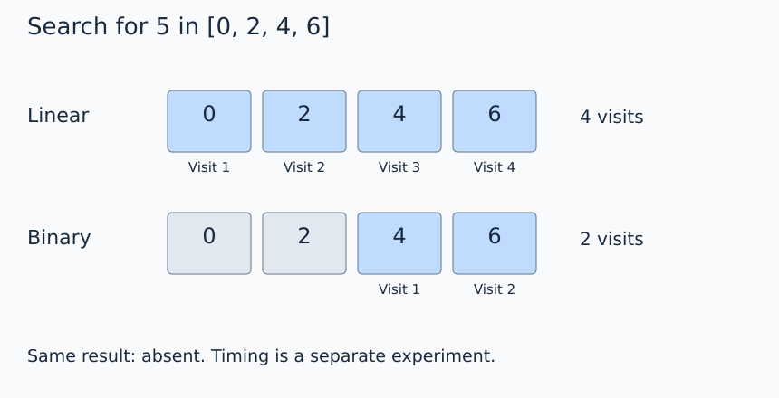

# M20-L1 – Reproducible computer science project and research report {#L1}

**Course area:** M20 – Project and research

**Level:** Bachelor’s/Master’s · Project

**Prerequisites:** [M7-L6](M7-L6.md), [M13-L1](M13-L1.md), [M12-L4](M12-L4.md).

## Learning objectives {#S1}

Formulate a testable research question, define comparison conditions, run a benchmark with raw data and reference checks, and distinguish repeatability, reproducibility and replicability.

## Research question and experimental design {#S2}

“Which search algorithm is better?” is not testable without a metric and an input class. Compare linear and binary search on pre-sorted ascending lists of distinct even integers. The task is solely membership testing. Hypothesis: as $n$ grows, the average number of elements visited by binary search decreases relative to linear search. The independent variable is $n$; dependent variables are visits and elapsed time for 100 queries. Both algorithms receive identical queries, including hits and misses. Sorting cost is excluded because sorted input is assumed. Unsorted input would require a different experiment.

One visit counts whether the program executes one or two comparison operators. On a miss, linear search visits $n$ elements. Binary search halves the remaining interval: after an unsuccessful visit its length is at most $\lfloor n/2\rfloor$. Induction gives at most $\lfloor\log_2 n\rfloor+1$ visits for $n\ge1$, and zero for $n=0$. This bound is a mathematical result, not a runtime measurement.

## Controlled benchmark and analysis {#S3}

For list $(0,2,4,6)$ and query 5, linear search visits four elements and binary search two (4, 6). A hit at the first element can instead be found immediately by linear search. One query cannot settle the overall result. Use sizes 16, 64, 256 and 1024 and at least five preselected seeds. Generate inputs outside the timed region and check both answers against a set reference. Repeat timings for each input; alternate the order of methods to reduce simple order effects. Record Python version, operating system, processor, background load and timing method.

For seven observations the median is the fourth sorted value. With times 12, 13, 12, 50, 11, 14, 13 µs, it is 13 µs. Retain individual values and the interval 11–50 µs; the median does not erase the outlier from raw data. Speedup $S=T_{linear}/T_{binary}$ requires comparable positive times. With 120 and 30 µs, $S=4$. These are illustrative numbers, not measured results. Actual runtime includes interpreter, cache and branch costs; it does not follow directly from visits. No SPEC certification is claimed.

{alt="Controlled search comparison: identical queries and different visit counts."}

## Research artifact and report {#S4}

A submission-ready project contains a README stating the question and exact run command, source code, runtime versions, input generator with seeds, unmodified raw data (CSV with size, seed, variant, repetition, visits and nanoseconds), analysis script, report and license. A hash demonstrates byte identity, not valid measurement or truth. Retain failed runs and reasons. Specify invalid-run criteria before experimenting (e.g. incorrect answers); do not discard inconvenient timings retrospectively.

In ACM terminology, repeatability concerns the same team obtaining results again under the same conditions. Reproducibility uses the supplied artifacts with a different team; replicability uses an independently developed implementation. A successful restart by the original author is not independent evidence. Separate methods, results, interpretation and limitations in the report. State when the hypothesis is supported only for the tested input classes; report negative results too.

## Executable project {#S5}

`trial` counts visits deterministically and `benchmark` records local timings. Input generation and reference checks are outside the timed region; producing the answer list is inside it. This is not a pure algorithm timing. Run both functions for the chosen sizes and seeds; record raw values, not just the median.

```python
from bisect import bisect_left
from statistics import median
from time import perf_counter_ns
import random

def linear(a, x):
    for i, y in enumerate(a):
        if y == x:
            return True, i + 1
    return False, len(a)

def binary(a, x):
    lo, hi, steps = 0, len(a), 0
    while lo < hi:
        mid = (lo + hi) // 2
        steps += 1
        if a[mid] == x:
            return True, steps
        if a[mid] < x:
            lo = mid + 1
        else:
            hi = mid
    return False, steps

def trial(n, seed):
    a = list(range(0, 2*n, 2))
    rng = random.Random(seed)
    queries = [rng.randrange(-1, 2*n+1) for _ in range(100)]
    ref = set(a)
    results = []
    for f in (linear, binary):
        answers = [f(a, q) for q in queries]
        assert all(found == (q in ref)
                   for q, (found, _) in zip(queries, answers))
        results.append(sum(s for _, s in answers))
    return tuple(results)

def benchmark(n, seed=42, repeats=7):
    if n < 1 or repeats < 1:
        raise ValueError('positive n and repeats required')
    a = list(range(0, 2*n, 2))
    rng = random.Random(seed)
    q = [rng.randrange(-1, 2*n+1) for _ in range(100)]
    fs = (linear, binary)
    members = set(a)
    ref = [x in members for x in q]
    for f in fs:
        assert [f(a,x)[0] for x in q] == ref
    raw = [[], []]
    for r in range(repeats):
        for k in ((0,1) if r%2==0 else (1,0)):
            t = perf_counter_ns()
            answers = [fs[k](a,x) for x in q]
            elapsed = perf_counter_ns()-t
            assert [found for found,_ in answers] == ref
            raw[k].append(elapsed)
    return raw, [median(xs) for xs in raw]

assert linear([0,2,4,6], 5) == (False,4)
assert binary([0,2,4,6], 5) == (False,2)
assert trial(16,42) == trial(16,42)
```

## Self-assessment {#S6}

### Exercises

1. State a measurable hypothesis for misses.
2. Compute the upper visit bound for $n=63$ and $n=64$.
3. Compute the median and range for 5, 7, 8, 6, 40.
4. Why must sorting be considered separately on unsorted input?
5. A colleague reruns your script; another implements search independently. Classify both experiments.

::: {.lc-solutions data-lc-section="S6"}
1. For misses, linear search requires exactly $n$ visits, binary search at most $\lfloor\log_2 n\rfloor+1$ for $n\ge1$; check this at each size.
2. 6 and 7 respectively.
3. Median 7, minimum 5, maximum 40, difference 35.
4. Sorting changes total cost and assumptions; for few queries it can outweigh the gain.
5. Given sufficiently consistent results, reproducibility and replicability respectively in ACM terminology; execution alone without comparing results is insufficient.
:::

## Sources {#S7}

- [ACM – Artifact Review and Badging v1.1](https://prod-www.acm.bloomreach.cloud/publications/policies/artifact-review-and-badging-current) · Terminology; Artifacts Evaluated (Review scope: Text) · Last accessed: 2026-11-24 · Content verified: 2026-11-24
- [SPEC CPU 2017 – Run and Reporting Rules](https://www.spec.org/cpu2017/docs/runrules.html) · §1.2.1–1.3.1 (Review scope: Text) · Last accessed: 2026-11-24 · Content verified: 2026-11-24
