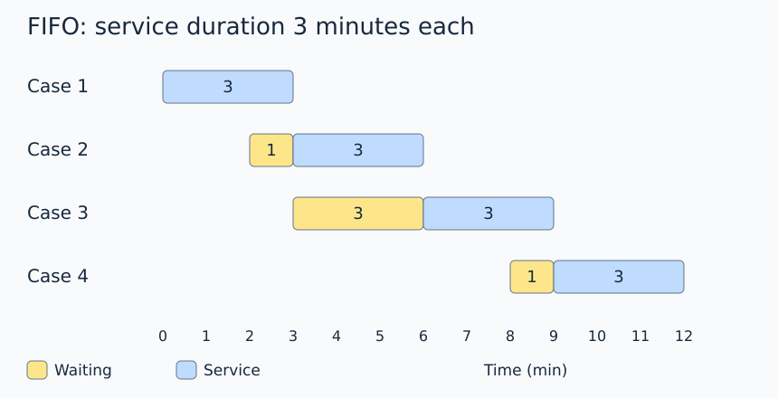

# M20-L2 – Interdisciplinary computer science project: models, data and responsibility {#L2}

**Course area:** M20 – Project and research

**Level:** Master’s · Elective specialization

**Prerequisites:** [M20-L1](M20-L1.md), [M4-L3](M4-L3.md).

## Learning objectives {#S1}

Translate an interdisciplinary problem into a testable model, document data quality and assumptions, distinguish verification from validation, and define acceptance criteria and limits with domain partners.

## Domain model and requirements {#S2}

A fictional municipal service center wants to understand waiting times at one counter. We study a simplified model, not staffing recommendations. Computing supplies event logic; operations research examines queueing assumptions; staff and visitors can explain how priorities, breaks and accessibility affect actual operations. A jointly agreed question is: how accurately does a single-counter model predict waiting times for a specified arrival sequence? Define units (minutes), observation start, arrival, service start and completion. Assume an initially empty counter, first-in-first-out (FIFO) service, no interruptions, no abandonment, positive service durations and input order for simultaneous arrivals. These assumptions are testable and may fail in reality.

With arrival $a_i$, service duration $s_i$ and previous completion $c_{i-1}$, set $b_i=\max(a_i,c_{i-1})$, $w_i=b_i-a_i$, $c_i=b_i+s_i$, with $c_0=0$. Since $b_i\ge a_i$ and $b_i\ge c_{i-1}$, waits are nonnegative and service intervals do not overlap. For arrivals 0, 2, 3, 8 and service durations 3 each, starts are 0, 3, 6, 9, completions 3, 6, 9, 12 and waits 0, 1, 3, 1. The mean wait is 1.25 minutes. The model uses one pass and $O(n)$ space for the output list.

## Data and validation protocol {#S3}

Verification checks whether code implements the specified model; validation asks whether its predictions are sufficiently accurate for their intended use. Correct software can implement an unsuitable model. Data checks include units, missing values, clock differences, selection bias and traceable provenance. Calibrate unknown parameters on development data only; reserve other days or shifts as test data. Avoid randomly splitting strongly dependent neighboring events. A domain partner must check that timestamps, service rules and metrics represent the real workflow.

For independently observed $y_i$ and predictions $\hat y_i$, define residuals $r_i=y_i-\hat y_i$, $MAE=\sum|r_i|/n$, and maximum absolute error $\max|r_i|$. Illustrative criteria fixed in advance are MAE at most 1 minute and maximum error at most 2 minutes. With predictions $(0,1,3,1)$ and synthetic observations $(0,2,4,1)$, residuals are $(0,1,1,0)$, MAE 0.5 and maximum 1; both criteria pass. Another synthetic shift $(0,4,8,2)$ gives MAE 2.25 and maximum 5; both fail. The first result demonstrates the exercise, not fitness for real data. Inspect residuals over time and across relevant operating conditions; a small average can obscure critical peaks.

{alt="Queue model: arrival, service and waiting time."}

## Responsibility and final project {#S4}

Before collecting real data, clarify purpose, access authorization, necessary fields, retention and privacy with the responsible organization. This exercise requires no personal data. Use synthetic case numbers and times. Do not infer individual performance or make automated decisions about staff or visitors. Check with domain partners whether relevant groups (e.g. people needing longer assistance) are inadequately represented. Specify escalation when assumptions fail or a threshold is exceeded. Do not use the model outside the agreed purpose.

Submission: requirements sheet with purpose, excluded uses, partner roles and criteria; data dictionary with units and provenance; model equations; code and verification tests; separate validation data; report with residuals and errors; risk list with consequences, mitigations and responsibility. If actual partners or data are unavailable, document validation as pending, not successful. Compare, for example, a second model including breaks; agree in advance how these will be measured. Repeat verification and validation after model changes.

## Executable model {#S5}

`queue` computes waits under the specified assumptions. `errors` compares exactly aligned nonempty sequences. Examples use synthetic data. A failed validation check is a result and must not be concealed by retrospective threshold changes.

```python
from fractions import Fraction as F

def queue(arrivals, service):
    if len(arrivals) != len(service):
        raise ValueError('length mismatch')
    if any(t < 0 for t in arrivals) or any(s <= 0 for s in service):
        raise ValueError('invalid time')
    if any(a > b for a,b in zip(arrivals, arrivals[1:])):
        raise ValueError('arrivals must be sorted')
    end = 0
    waits = []
    for a,s in zip(arrivals,service):
        start = max(a,end)
        waits.append(start-a)
        end = start+s
    return waits

def errors(predicted, observed):
    if not observed or len(predicted) != len(observed):
        raise ValueError('aligned nonempty sequences required')
    residual = [o-p for p,o in zip(predicted,observed)]
    return (F(sum(map(abs,residual)),len(residual)),
            max(map(abs,residual)),residual)

assert queue([0,2,3,8],[3,3,3,3]) == [0,1,3,1]
assert errors([0,1,3,1],[0,2,4,1]) == (F(1,2),1,[0,1,1,0])
assert errors([0,1,3,1],[0,4,8,2]) == (F(9,4),5,[0,3,5,1])
```

## Self-assessment {#S6}

### Exercises

1. Compute waits for arrivals 0, 1, 6 and service durations 2, 4, 1.
2. Compute MAE and maximum error for predictions 0, 2, 3 and observations 1, 2, 7.
3. Does case 2 pass the agreed criteria?
4. Why is calibrating on the same data used for final validation problematic?
5. Name two domain assumptions that could fail and corresponding checks.

::: {.lc-solutions data-lc-section="S6"}
1. Starts 0, 2, 6; waits 0, 1, 0.
2. Residuals 1, 0, 4; MAE $5/3$, maximum 4.
3. No, both thresholds are exceeded.
4. Fitting peculiarities of the data can make error appear overly optimistic; separate data test transferability.
5. For example, no breaks: check service logs against break times; FIFO: compare actual service order with arrivals. Document discrepancies and adapt the model or its intended scope.
:::

## Sources {#S7}

- [Sargent (2013) – Verification and validation of simulation models](https://ics-websites.science.uu.nl/docs/vakken/msosi/VerificationValidationSargent.pdf) · §1, §3, §10; p. 14 page image (Review scope: Text; PDF page 14 inspected) · Last accessed: 2026-11-24 · Content verified: 2026-11-24
