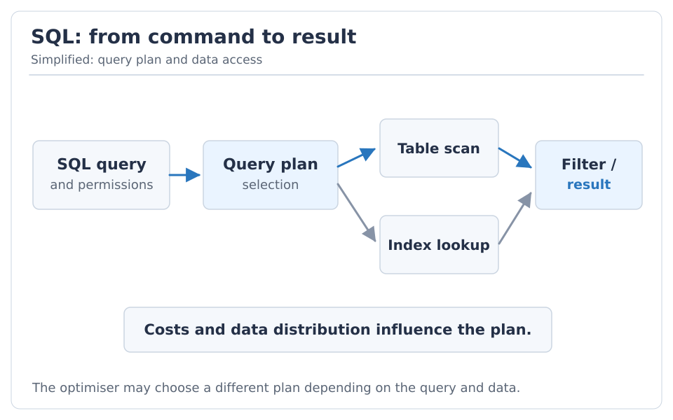
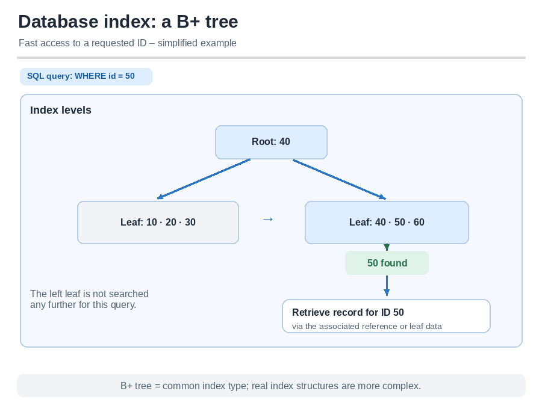

# M3-L1 – A database on a server {#L1}

**Course area:** M3 – Bachelor’s / transition: Database systems

**Level:** Bachelor’s

**Prior knowledge:** No fixed prerequisites specified.

## What this section is about {#S1}

In the introductory chapter M1-L5, we learnt about tables, keys, the database language **SQL** (*Structured Query Language*) and transactions. M2-L1 to M2-L5 then covered servers, applications and their distribution. Now we bring the two topics together: **What happens inside a database server when many users want to read or change data simultaneously?**

A database is not simply a large file with a search function. A modern **database management system (DBMS)** manages data formats and relationships, selects execution strategies, coordinates concurrent access, protects changes against certain failures and enforces permissions. It must also turn thousands of individual requests into an overall system that is as stable as possible.

For now, we **deliberately restrict ourselves to a single database node**. A node here means an independently operated database instance with its associated resources; the node can be a physical computer, a virtual machine or a managed single server. It does not have to be the web server as well. Only in M3-L2–M3-L6 do we distribute data and tasks across multiple database nodes.

## The initial problem: From a local table to an online service {#S2}

Imagine a small online service for managing analysis jobs. Each user has an account, uploads data and retrieves the results later. For an individual developer, this would initially be quite manageable: one application and one database. With two visitors, the load is low. However, when many users are active simultaneously, several difficulties can arise:

- Many requests want to read the same data.
- Two operations attempt to modify the same record.
- Some queries require substantial processing time or read enormous sections of tables.
- The database server has limited processor time, **RAM** (*Random Access Memory*, main memory), space on an **SSD** (*Solid State Drive*) and network bandwidth.
- If a power failure or crash occurs, the system needs to lose as little previously acknowledged work as possible.

The obvious question, “Do we need a distributed database immediately?”, is usually premature. First, we need to understand what a single database system can already achieve and which bottlenecks actually occur.

### Mini-architecture: A web service and a database

``` text
Browsers of many users
          │
          ▼
      Web application
          │  SQL queries
          ▼
┌────────────────────────────┐
│ A database server          │
│                            │
│ Access control             │
│ Query planner / execution  │
│ Transactions / locks       │
│ Buffer cache               │
│ Logging                    │
│                            │
│ Tables, indexes, log file  │
└─────────────┬──────────────┘
              │
          SSD / storage
```

The blocks represent functions and layers, not necessarily independent programs. A database instance can provide all these functions in a single server installation.

## What a table means internally {#S3}

From the application’s perspective, a relational table looks like an ordered list of columns containing many rows. However, the rows have **no generally guaranteed physical order**. Without an explicit sorting instruction, the application must not rely on any particular order in which query results appear.

A schematic table `auftraege` could look like this:

| auftrag_id | kunde_id | status | erstellt_am |
| ---: | ---: | --- | --- |
| 101 | 7 | wartend | 10:00 |
| 102 | 7 | fertig | 10:03 |
| 103 | 12 | verarbeitet | 10:05 |

**Record** and **row** refer to the same logical entry here. The `auftrag_id` can be the **primary key**: a unique identifier. The `kunde_id` can refer to the customer table. Such relationships and integrity rules help to prevent inconsistencies.

Physically, the database usually stores the data in **pages or blocks** – small, manageable units of storage. This is an important distinction from the idea that each record might be a separate file. A write operation can affect several rows on the same page, and the system must decide which pages to keep in main memory.

**Problem this organisation solves:** A DBMS can manage data, free space and changes more efficiently instead of leaving each application to invent its own file formats. **When is it unnecessary?** For a single immutable configuration file, a fully fledged server database is usually excessive.

## How an individual read query is processed {#S4}

A typical request in ordinary language is: “Show the last twenty jobs for this customer.” The application submits an SQL query. The following then happens, in simplified form:

{alt="Simplified path of an SQL read query: SQL and permissions, selection of the access plan, table scan or index access, execution and result."}

One possible path from SQL to the result set; real systems use different optimisations.

1.  The database checks whether the query is syntactically valid and whether the accessing role has the necessary permissions.
2.  It identifies the tables and columns accessed by the query.
3.  The **query planner** (or optimiser) assesses possible strategies: read the whole table, use an index or join tables in a different order.
4.  An **execution plan** defines an appropriate sequence of operations.
5.  The executor reads the necessary data from main memory or the SSD if required, filters and sorts it and returns the result.

With prepared queries, parts of this processing can be reused; a real database does not necessarily repeat every step from scratch for each query.

``` text
Application: “20 latest jobs for customer 7”
                     │
                     ▼
                  Parse SQL
                     │
                     ▼
              Check permissions
                     │
                     ▼
          Select suitable access path
              │              │
          Table scan      Index access
              └──────┬───────┘
                     ▼
             Load / filter data
                     │
                     ▼
               Sort / limit
                     │
                     ▼
               20 result rows
```

This already provides a major opportunity for improving performance: what matters is not merely the total amount of stored data, but **how many data blocks actually need to be read and processed for a particular query**.

## Table scans and indexes: Why a million rows are not automatically slow {#S5}

Without a suitable search aid, the database can inspect a table from beginning to end. This is called a **sequential scan**. With a large table and a rarely occurring customer number, this can be costly.

{alt="Simplified B+ tree index: For a search for ID 50, the root with separator value 40 leads to the right leaf containing 40, 50 and 60 and then to the record."}

A B+ tree can locate a requested key ID via the tree levels rather than scanning all rows in sequence.

An **index** is an additional data structure that associates search values with locations or other information important for the search. A common index type is the **B-tree**: a balanced search tree suited to many equality, range and sorting queries.

**Illustrative comparison:** You are looking for “transaction” in a textbook. Without an index, you might have to turn the pages of the entire book. With an index, you can locate relevant pages much faster. However, the index takes up extra space and must be maintained when the book changes.

``` text
Table with many jobs
┌──────────────────────────────────┐
│ 101, 102, 103, 104, 105, ...     │
└──────────────────────────────────┘
          │
     Index on kunde_id
          │
          ▼
     Customer 7 → matching entries
          │
          ▼
     Read only the required rows
```

An index is **not a magical way to speed up every query**. If almost every row is returned, a sequential scan may be cheaper. An index requires storage, increases backup sizes and can slow down changes because the index structure must also be updated. An index on a field that takes very few different values is not automatically advantageous. The benefit depends on query patterns and the data set.

### Composite indexes

For a typical query, “Jobs for one customer, newest first”, a **composite index** on `(kunde_id, erstellt_am)` may be useful. The data is then already organised favourably for certain search and sorting conditions. Which parts of a multicolumn index can be used in a specific query depends on the database system, operators and sort order.

For small data sets, such optimisation is often unnecessary. **A handful of useful indexes is better than reflexively indexing every column.**

## The query planner decides – not the programmer alone {#S6}

Even if an index exists, the database does not have to use it. The query planner assesses the estimated costs of different execution strategies, drawing on **statistics** about the number and distribution of values in a table, among other things.

For example, if almost all jobs have the status `fertig`, an index on that column might be of little use for the request “Show all completed jobs”. However, if the application searches for a very rare error status, the same index can be useful. **Selectivity** describes how strongly a condition restricts the number of candidate rows.

PostgreSQL provides a tool for this, `EXPLAIN`: it shows the planned execution strategy, such as a table scan or an index access. `EXPLAIN ANALYZE` actually executes the query and measures its execution. With SQL write statements, this can modify data; it is therefore not a harmless inspection-only operation.

The most important principle is: **Understand a slow query before optimising it.** There is no reason to reflexively purchase additional servers as long as an unsuitable search condition or a missing index is the main cause.

**Source:** [PostgreSQL: Using EXPLAIN](https://www.postgresql.org/docs/current/using-explain.html) and [Examining Index Usage](https://www.postgresql.org/docs/current/indexes-examine.html), checked on 03.11.2026.

## Caching: Data need not always come from the SSD {#S7}

Databases often have their own **buffer pools** or page caches. These hold data blocks that are currently needed in main memory. The operating system can also use a file cache. PostgreSQL uses the `shared_buffers` parameter for the shared database buffer, among other settings. The precise allocation is a technical configuration question; no universal percentage rule can set it correctly for every workload.

A **cache hit** means that a required memory page is already quickly accessible. A **cache miss** means that it must be fetched from a slower storage layer. The term “cache” here therefore does not simply refer to the web cache from M2-L5. Caches exist at different levels.

``` text
Database requests a data block
              │
              ▼
       Database buffer (RAM)
       │             │
      Hit           Miss
       │             │
       │             ▼
       │        File cache / SSD
       │             │
       └──────┬──────┘
              ▼
        Process records
```

**What does this improve?** Repeated accesses to the same data can become significantly faster. **When does it help little?** If every query reads entirely different, very large regions of data, the important data may no longer fit in memory. The I/O load (*Input/Output*, reading and writing data) is then crucial.

More RAM is therefore sometimes a good investment, but it does not replace sensible queries. Conversely, a poorly designed query can consume considerable CPU time and perform unnecessary sorting even with plenty of main memory.

## What happens when writing data {#S8}

A read query does not initially change anything. A write operation – such as “Set job 101 to completed” – has considerably more to consider:

- Is the change permitted, and does it satisfy the data types and integrity rules?
- Is another operation currently working on the same record?
- Which table and index pages will change?
- When is the change considered acknowledged?
- How can a consistent state be restored after a crash?

A widespread technique is called **Write-Ahead Logging (WAL)**, literally logging in advance. PostgreSQL records changes in a designated log structure before the corresponding modified data pages have to be written persistently. This allows the system to replay changes from the log after certain crashes. The precise guarantees depend on factors including the database configuration and reliability of the storage hardware.

``` text
Application changes job status
               │
               ▼
       Database checks change
               │
               ▼
       Change information to WAL
               │
               ▼
       Transaction COMMIT (confirm)
               │
               ▼
       Data pages are managed as
       appropriate and written later
```

This sketch shows the underlying idea, not the complete internal sequence of all steps. In particular, it **does not** mean that all modified table pages must already be written straight to the SSD when a change is acknowledged. Nor does the existence of a WAL **mean** that data is protected against accidental deletion, ransomware, loss of hardware or corruption of the entire storage environment.

**Important distinction:** WAL contributes to recoverability and durability, but it is **not an independent external backup**. We discuss backups and testing their recoverability in detail in M3-L6.

**Source:** [PostgreSQL: Write-Ahead Logging](https://www.postgresql.org/docs/current/wal-intro.html), checked on 03.11.2026.

## A transaction is more than an individual SQL statement {#S9}

A **transaction** groups related database operations into a logical unit. Example: A paid analysis package is credited to an account, and a corresponding accounting entry is stored at the same time. It would be problematic if only one of the two changes took permanent effect.

The well-known acronym **ACID** summarises important properties:

| Letter | Full form | Meaning in the example |
| --- | --- | --- |
| A | Atomicity | Either all related changes are applied or none are |
| C | Consistency | Defined integrity rules are preserved |
| I | Isolation | Concurrent operations are isolated from each other according to the chosen isolation level |
| D | Durability | Acknowledged changes should survive a crash according to the promised durability conditions |

This does not mean that the database automatically knows every business rule. If the application performs an incorrect calculation, “C” does not ensure a correct business model by itself. Business rules must be explicitly modelled and enforced.

A second widespread error is keeping transactions open for too long. While a transaction is active, locks can remain in place, storage or version cleanup may be hindered, or other operations may have to wait. **Short, clearly bounded transactions** are therefore often an important operational characteristic.

## What happens when many readers are active simultaneously? {#S10}

Suppose 1,000 people are logged into a website. This does **not** mean that 1,000 database queries are executed simultaneously. Many users are reading a page, thinking or inactive. What matters is how many requests arrive per unit of time, how long they take and which resources they require.

If many queries read the same frequently needed information, indexes and caches can save substantial work. However, if large tables are queried without suitable filters, the same data may have to be processed again and again. Utilisation then increases.

The database server also needs connections for concurrent access. A **connection** is a logical session or communication link to the DBMS. For systems with relatively high costs per connection, a **connection pool** can help: the application maintains a limited number of reusable database connections and distributes queries across them.

``` text
Many browsers
      │
      ▼
Web application with many calls
      │
      ▼
Connection pool (limited number of connections)
   │      │      │
   └──────┼──────┘
          ▼
      Database server
```

A pool does not provide unlimited acceleration. If all queries are competing for a small number of connections, queues develop. However, it often solves the problem of having to establish and close thousands of short-lived connections at considerable cost.

## Concurrent reading and writing: Versions instead of blanket blocking {#S11}

With several users, it becomes particularly important **which version of the data a reader sees while another user writes**. PostgreSQL uses **MVCC** (*Multi-Version Concurrency Control*), among other techniques. In simplified terms, different transactions can see different versions of a record depending on when their consistent view of the data was determined.

Example:

1.  User A reads the status of a job: `wartend` (waiting).
2.  User B sets the same job to `fertig` (completed) and commits the change.
3.  Depending on the isolation level and query time, user A may still see the old status or see the new status in a new query.

This seems strange at first, but it makes sense. It prevents every ordinary read query from having to block all write operations indiscriminately. Database rules determine which states an operation is allowed to observe.

``` text
Time ─────────────────────────────────────►

Transaction A: reads version “waiting”
Transaction B:              changes → “completed” → COMMIT
Transaction A: depending on isolation, still the old snapshot
               or a later query with a new view
```

The limitation is important: **MVCC does not eliminate all locks.** Two writes to the same record can still compete. For example, an account balance must not silently become incorrect because of two uncoordinated debits. Concurrent transactions can wait, fail because of each other or – with an unfavourable lock order – enter a **deadlock** (mutual blocking). Databases have mechanisms for handling such conflicts, but the application must deal correctly with errors and retry attempts.

Maintaining old data versions also involves work. PostgreSQL uses **VACUUM**, among other mechanisms, to clean up row versions or storage areas that are no longer needed. We examine the details in M3-L5. Already at this point, it is important to note that many long-running transactions can impair database health.

**Source:** [PostgreSQL: MVCC Introduction](https://www.postgresql.org/docs/current/mvcc-intro.html), checked on 03.11.2026.

## When many users write concurrently {#S12}

For read queries, an essential question is: how much must be read? For writes, there is an additional question: **Do several transactions want to modify the same resources?**

An example of less problematic concurrency: several customers independently create new analysis jobs. The database can process many operations simultaneously insofar as its architecture and resources allow.

An example of conflicts: thousands of jobs constantly update the same global statistics row. This creates a **hotspot** – a heavily contested record. Additional processors or more web servers do not automatically solve this problem. A different data model often helps: log individual events separately and aggregate the statistics later, provided business requirements allow it.

``` text
1000 independent writes
            │
            ▼
       Different records
            │
     often easily parallelised

1000 writes to the same row
            │
            ▼
       Conflicts / waiting
```

The figures are illustrative. Actual performance depends on factors including transaction duration, indexes, storage system, database implementation and hardware. **More concurrent work can initially improve throughput but may significantly worsen response times beyond a certain point.**

## Understanding performance: Latency, throughput and queues {#S13}

Two performance concepts should be distinguished:

- **Latency:** How long does it take for a particular request to be answered?
- **Throughput:** How many queries or jobs are processed in a given time?

A database can answer individual requests very quickly and still be overwhelmed by extreme concurrent load. Conversely, a data-intensive analysis can take a long time while a server successfully processes many such analyses over an hour.

When requests arrive faster than the system can complete them, a **queue** develops. Its length grows, response times rise and eventually connections or time limits may be exhausted. This is not an error in the database logic, but a consequence of limited capacity.

### Simplified load example

In a *purely hypothetical* example, a small database server can continuously process 100 similar queries per second. If only 20 arrive per second, spare capacity remains. If 120 arrive per second continuously, a backlog grows unless the load is limited or reduced. The fact that a query takes 10 milliseconds while the server is idle does not mean that a single server can continuously finish 100 concurrent requests in the same amount of time under arbitrary load.

These illustrative figures are **not benchmarks** for PostgreSQL, SQLite or any cloud provider. They merely show why capacity and waiting times must be considered together.

The main conclusion: a larger number of users does not necessarily require a second database server. It often helps first to limit requests, use caches sensibly, avoid unnecessary database calls or move time-consuming work into background jobs.

## The five typical resource bottlenecks {#S14}

A single database server has several limited resources. These can produce quite different symptoms.

| Bottleneck | Typical cause | Possible initial approach |
| --- | --- | --- |
| **CPU** (*Central Processing Unit*) | Many costly queries, sorts and calculations | Inspect query plans, avoid unnecessary computation |
| **RAM** | Working data exceeds buffer capacity, or sort/hash operations need substantial memory | Examine memory demand and workload, adjust RAM |
| **SSD / I/O** | Reading, writing or synchronising many data blocks with durability guarantees | Examine indexes, cache, storage latency and write patterns |
| **Network** | Large results or high communication overhead between application and DBMS | Transfer less data, combine queries |
| **Locks / conflicts** | Many transactions wait for the same rows or resources | Shorten transactions, examine hotspots and the data model |

A common misconception is: “CPU utilisation is only 15 per cent, so everything must be fast.” In fact, the server might spend most of its time waiting for the SSD or another transaction. Similarly, there may be substantial free RAM while the application still sends too much unnecessary data over the network.

**The measured cause of the bottleneck, not the largest server configuration, determines the appropriate action.**

## How to identify a bottleneck without optimising blindly {#S15}

Database systems provide diagnostic facilities. PostgreSQL, for example, supplies statistics about active sessions, table accesses and various I/O operations. The additional module `pg_stat_statements` can collect aggregate metrics for frequently executed SQL statements if it is configured appropriately.

Five questions provide a useful framework for analysis:

1.  **Which query is slow?** One specific query or every query?
2.  **What kind of load occurs?** Many readers, many writers or a few very large analyses?
3.  **What is the system waiting for?** Processor, storage, network, lock or free connection?
4.  **Which execution plan does it use?** Is a table scan appropriate or avoidable?
5.  **What has changed?** More data, a different index, a new software version, more users or a new background job?

Suitable measures can then be compared systematically. These include revising an index, changing an SQL query, adding a cache, using a more powerful single server or pooling database connections. Only when the bottleneck still cannot be resolved in a reasonable manner does a split across multiple database nodes become a serious option.

**Source:** [PostgreSQL: Monitoring Statistics](https://www.postgresql.org/docs/current/monitoring-stats.html) and [`pg_stat_statements`](https://www.postgresql.org/docs/current/pgstatstatements.html), checked on 03.11.2026.

## SQLite versus server databases: What changes in the architecture? {#S16}

**SQLite** is an embedded database system. The application uses a library that accesses a local database file; normally, no separately accessible database server process is running. This makes SQLite especially attractive for desktop software, local tools, catalogues and small, controlled applications.

**PostgreSQL** is a client-server system. Applications communicate with an independent database server that centrally manages connections, permissions, transactions and competing requests. This is especially helpful when many different application processes need to access shared data simultaneously.

``` text
Local application with SQLite:
Desktop program → SQLite library → Database file

Online application with PostgreSQL:
Browser → Web backend → PostgreSQL process → Storage device
```

SQLite also supports transactions and multiple concurrent readers. In **WAL mode** (*Write-Ahead Logging*), readers and one writer can be active at the same time. However, **only one write operation at a time** is possible, which can become a bottleneck for write-intensive applications. This distinction should not be confused with the claim that “SQLite cannot support multiple users at all”: that would be too broad and incorrect. What matters is how applications access the database and what concurrency is required. WAL mode and access via network file systems require particular caution; SQLite’s usual WAL mode is not intended for processes on different hosts using a shared network file system.

PostgreSQL permits multiple concurrent write transactions to the extent that they do not conflict with each other and sufficient resources are available. This does not mean that arbitrary levels of concurrency come at no cost.

**Source:** [SQLite: Write-Ahead Logging](https://www.sqlite.org/wal.html), checked on 03.11.2026.

### Decision aid

| Situation | Often an appropriate starting point |
| --- | --- |
| A local PureBasic media catalogue | SQLite |
| A small local utility with settings and lists | SQLite or a simple file |
| An online service with many separate backend processes and user accounts | A relational database server such as PostgreSQL |
| A small publicly accessible service on one host | PostgreSQL or, depending on write load and operational model, SQLite |
| A large organisation with very many transactions | Initially a carefully sized server DBMS; distribution only after requirements analysis |

These are architectural heuristics, not immutable product limits. Requirements concerning data protection, availability, data volume and backup processes can change the decision.

## The invisible work: Operations, security and costs {#S17}

A database server requires more than running DBMS software. Reliable operation involves at least the following:

- **Access permissions:** Application processes receive only the permissions they need; administrator and application accounts remain separate.
- **Network boundaries:** An internal database is generally not made directly accessible from the public internet without good reason.
- **Safe inputs:** Parameterised queries help prevent SQL injection – the introduction of foreign SQL commands via uncontrolled inputs.
- **Updates:** Security updates, scheduled maintenance windows where necessary and application compatibility with new versions.
- **Backups:** Verified backup copies with appropriate retention and restoration tests.
- **Monitoring:** Observing capacity, runtimes, errors, free storage space and unusual access patterns.
- **Data protection:** Consideration of personal data, retention periods, deletion and access permissions.

Even with a **managed database service**, the provider does not automatically take over all these tasks. The provider may, for example, manage hardware, the operating system and certain database updates; however, business data models, roles, secure application queries and backup suitability remain at least partly the operator’s responsibility. The exact scope depends on the contract and product.

Costs arise from server resources, SSD storage, I/O load, data backups, data transfer, monitoring and, above all, operating time or administrative effort. In many cases, a single appropriately sized database server is easier to operate than a database cluster distributed prematurely. Specific prices depend on the provider and the time; this chapter therefore uses no invented prices.

## Three examples: From a media catalogue to AI processing {#S18}

### Example A – Local media catalogue

You manage an extensive collection of metadata, file paths and keywords. An SQLite file with suitable indexes can be perfectly adequate for this. If searching slows down, the cause may be missing indexes or unsuitable queries, rather than “too little cloud”. A public server database could add complexity without a real benefit.

### Example B – Paid online analysis service

Many customers sign in, submit analysis jobs and query their status. A web backend with a central PostgreSQL server can manage these data consistently. Initially, the priorities are suitable indexes on `kunde_id` and job status, short transactions, sensible connection pools and reliable backups. As usage grows, measurements establish whether the database, rather than an external computation program, really is the bottleneck.

### Example C – AI job platform

A web service accepts requests. A database manages job statuses, access permissions and references to results. A **queue** and several **workers** (job processors) can take over time-consuming image or text generation. In this model the database server is primarily the **coordination and metadata instance** – not automatically the place where large models perform computations or image files must be permanently stored.

``` text
User → API → Database: create job
             │
             └→ Queue → AI worker → Result store
                          │
                          └→ Database: update status
```

If 20 AI workers finish simultaneously, the database needs to process 20 status changes. This usually creates a different load profile from 20 enormous model computations. With this separation, one database server can remain sufficient for a long time while computational processing grows independently. We examine how reliable queues and retries work in M4-L1 and M3-L5.

## When should we even consider multiple database servers? {#S19}

A single database instance has limits: it can fail, storage resources are finite and all changes must be coordinated according to the rules of that system. If a service has very high availability requirements, serves many geographically distant users or has a data volume that no longer fits economically on one node, additional database nodes can be useful.

However, **more nodes do not automatically create more usable write capacity.** They also raise new questions: which changes are copied where? What happens during network outages? Which node is authorised to write? When does a reader see a new version? How is a valid operational state restored after a failure?

We have thus arrived precisely at the boundary between an individual database server and a distributed system.

### Transition to the next lesson

In **M3-L2 – Replication and high availability**, we examine how data is maintained on additional servers, when a replica can help and why replication is **not a substitute for backups**. We then cover sharding in M3-L3 – the actual partitioning of data across separate nodes – and different architectural approaches to distributed databases in M3-L4.

## Summary {#S20}

- A database is an active system comprising data, indexes, query planning, memory buffers, transactions and access control.
- Many rows are not automatically a problem. Poor queries, missing indexes, unnecessary data transfer and hotspots can slow down even smaller data sets.
- Concurrent reading and writing requires explicit rules for visibility and conflict management. MVCC helps but does not eliminate all locks.
- WAL assists recovery after certain failures but **does not replace a backup**.
- More servers are one possible later solution – usually **not** the first measure to take when a database server seems slow.

## Sources {#S21}


**Review date: 03.11.2026.** Primary sources, using the current vendor or project documentation as the starting point in each case:

1.  [PostgreSQL – Introduction to Indexes](https://www.postgresql.org/docs/current/indexes-intro.html) · the purpose and maintenance of indexes and the selection of access paths. · Last accessed: 2026-11-22
2.  [PostgreSQL – Using EXPLAIN](https://www.postgresql.org/docs/current/using-explain.html) · query planning, plans and measured execution. · Last accessed: 2026-11-22
3.  [PostgreSQL – Multiversion Concurrency Control](https://www.postgresql.org/docs/current/mvcc-intro.html) · visibility of data versions and concurrency. · Last accessed: 2026-11-22
4.  [PostgreSQL – Write-Ahead Logging](https://www.postgresql.org/docs/current/wal-intro.html) · logging and recovery. · Last accessed: 2026-11-22
5.  [PostgreSQL – Resource Consumption](https://www.postgresql.org/docs/current/runtime-config-resource.html) · memory and I/O configuration. · Last accessed: 2026-11-22
6.  [PostgreSQL – Monitoring Statistics](https://www.postgresql.org/docs/current/monitoring-stats.html) · Diagnostics; current documentation for version 19 at time of access · Last accessed: 2026-11-22
6.  [PostgreSQL – pg_stat_statements](https://www.postgresql.org/docs/current/pgstatstatements.html) · Query statistics; current documentation for version 19 at time of access · Last accessed: 2026-11-22
7.  [SQLite – Write-Ahead Logging](https://www.sqlite.org/wal.html) · reader/writer concurrency and limits of WAL mode. · Last accessed: 2026-11-22

**Context:** The teaching examples and architectural decisions in this chapter are simplified educational models. They aim to make operating principles and typical trade-offs understandable, not to provide immutable performance figures, legal assurances or product recommendations.
