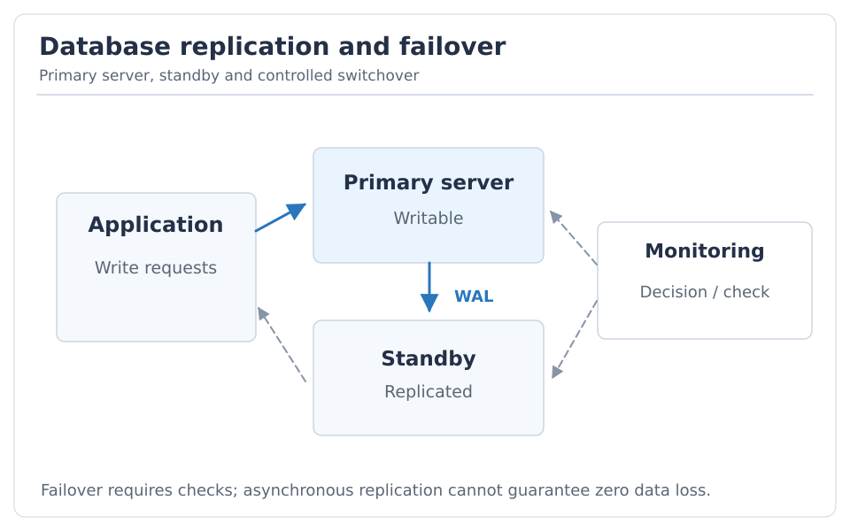

# M3-L2 – Replication and high availability {#L2}

**Course area:** M3 – Bachelor’s / transition: Database systems

**Level:** Bachelor’s

**Prior knowledge:** No fixed prerequisites specified.

## Overview: Why a second database becomes interesting in the first place {#S1}

In M3-L1, we saw how a single database server stores and retrieves information, speeds up queries with indexes and coordinates concurrent changes. This works remarkably well for many applications. But now imagine that the database contains the job data of a paid online service. The server fails because of a hardware fault, or the operating system urgently needs an update. Can users continue working?

One possible answer is to keep a **second database server ready** that follows the data and changes of the first. This is called **replication**. It can solve several problems: speeding up recovery after a failure, shifting read queries to other computers or making data available at other locations.

The crucial qualification is that **a second copy of the data is not yet a complete high-availability system.** The servers must receive changes, detect a failure, coordinate the transition to a replacement, redirect application traffic and prevent two machines from accepting conflicting changes without control. A replica is not a substitute for independent backups either.

This lesson covers the progression from a simple copy to a working, monitored failover strategy. We use PostgreSQL as a concrete, well-documented example; the fundamental problems also apply to other database systems. Individual terms and guarantees differ by product and configuration.

## The most important terms – clearly distinguished {#S2}

**Replication** means transferring data or changes from one system to another to establish a corresponding dataset there. It is a *method of transferring and synchronising data*, not in itself a guarantee of accessibility.

The **primary server** (*primary*) is the database node that accepts changes in our basic model. A **replica** or **standby** is another node that follows the primary server's data state. Not every type of replication is limited to this arrangement, but it is the easiest model to start with.

**High availability** (HA) describes the goal of providing a service despite certain failures, with interruptions as short as possible. It may involve redundant computers, resilient networks, monitoring, controlled switching and tested recovery procedures. High availability does *not* mean absolute continuity without interruption.

**Failover** is the transition from a failed primary server to a replacement. A **switchover**, by contrast, is a planned, controlled role change, for example before maintenance. A **read replica** is a replica that serves read requests; a standby instance does not necessarily have to accept user queries.

**Recovery** means restoring operation after a fault. It may involve restarting an individual process, having a standby take over or restoring a backup. These methods differ in duration and in their ability to restore earlier data states.

### Mini-architecture: Basic concept

``` text
                     Online application
                            │
                            ▼
                      Primary database
                      (reads + writes)
                            │
                            │ transfer changes
                            ▼
                         Replica
                    (replay data changes)
```

The two boxes may represent different physical servers, virtual machines or managed database instances. If they were merely two processes on the same faulty disk, there would be little protection from a storage device failure.

## What is actually copied? {#S3}

One might think that the primary server sends the entire database after each change. That would be inefficient for large datasets. Instead, many systems start with an initial dataset and subsequently transfer only further changes.

PostgreSQL supports **physical replication**, among other methods. A standby follows changes using the **Write-Ahead Log (WAL)**, a log of changes written in advance, which we encountered in M3-L1. WAL records can be sent continuously over a connection (*streaming replication*) or made available through archived log files (*log shipping*). The standby replays the changes and thus approaches the state of the primary server.

``` text
       Primary server                   Standby
  ┌──────────────────┐             ┌──────────────────┐
  │ Tables + indexes │             │ Tables + indexes │
  │ Transactions     │             │ WAL replay       │
  └────────┬─────────┘             └────────▲─────────┘
           │                                │
           ▼                                │
       WAL records ─── continuously ────────┘
```

In practice, a new standby does not start with an empty database. It first needs a consistent initial dataset, often obtained through a **base backup**. It can then replay subsequent WAL changes. Such a copy must correspond correctly to the log position; arbitrary file copies made while the system is running are insufficient.

In PostgreSQL, **physical replication** concerns the entire database cluster in the PostgreSQL sense: the associated server instance and its data directory. It is not the same as selectively distributing individual tables. Its advantage is that it follows the same database instance relatively directly. Its disadvantage is that an individual functional area cannot easily be handled independently; compatibility between different major versions is also limited.

### Logical replication – a different layer

PostgreSQL also offers **logical replication**. It transfers logical data changes to published data objects and typically follows a *publish–subscribe* model: a publisher makes data changes available, and a subscriber receives and processes them. This allows selected tables, for example, to be transferred selectively. It is useful for data integration or migrations, but **is not automatically a drop-in replacement for a physically replicated failover node**. Schema changes, sequence positions and conflicts may require additional handling.

``` text
Physical: Primary instance ── WAL / storage changes ──► Standby instance
Logical:  Selected table changes ─────────────────────► Subscriber
```

We examine the choice between these variants in more detail in M3-L4. For the following failure scenarios, we stay with the typical physical primary/standby configuration.

## Asynchronous replication – fast, but with a delay {#S4}

With **asynchronous replication**, the primary server does not have to wait for acknowledgement from the replica before confirming the successful completion of a transaction to the application. This reduces the waiting time of a normal write operation.

For example, a user saves a new order at 12:00:00. The primary server confirms that it has been saved. The replica may not yet have received or processed the change at that moment. It catches up a little later.

``` text
Time                Primary server               Replica
12:00:00            order saved                  previous state
12:00:00            ‘success’ to application     previous state
12:00:01            further work                 change applied
```

The one second in this example is **chosen purely for illustration**, not a guaranteed typical or maximum delay. In real systems, the delay may be very small but can also increase considerably under load, for example because of slow networks, limited resources or a disrupted connection.

This delay is called **replication lag**. It can be measured in different ways: changes have been generated but not sent; sent but not received; received but not durably written; durably written but not yet visible to read queries. The statement ‘the replica is only one second behind’ must therefore be defined precisely.

### What happens if the primary server fails at this exact moment?

If the primary server has already acknowledged a change but the standby has not yet received it, that change may be lost when switching servers. A small loss may be tolerable for an image gallery with occasional non-critical metadata changes. For a firmly confirmed order or payment transaction, it is often unacceptable.

**Advantage of asynchronous replication:** low additional waiting time for most writes, often practical over longer distances as well. **Disadvantage:** a possible data gap during an unplanned transition, and potentially outdated read results on replicas.

Asynchronous replication is not ‘wrong’; it represents a deliberate trade-off between response time, distance, tolerance of data loss and availability.

## Synchronous replication – stronger acknowledgements, but more dependencies {#S5}

With **synchronous replication**, for transactions configured accordingly, the primary server waits for feedback from one or more selected standbys before acknowledging completion. The goal is to protect the already acknowledged data state more effectively against the failure of an individual machine.

To illustrate:

``` text
   Application        Primary server               Synchronous standby
       │                    │                               │
       ├─ Write request ───►│                               │
       │                    ├── Transfer change ───────────►│
       │                    │◄──── Agreed acknowledgement ─┤
       │◄── ‘Success’ ──────┤                               │
```

The crucial word is **agreed** acknowledgement. PostgreSQL has different levels. With ordinary synchronous acknowledgement, for example, the primary server can wait until the corresponding change is durably stored in the WAL of the selected standby. With `remote_write`, a weaker acknowledgement of the write to the standby's operating system is sufficient; with `remote_apply`, the transaction additionally waits until the change is applied on the standby and becomes visible to read queries there. These levels offer different guarantees and introduce different delays.

The simplified statement ‘synchronous means that every table is immediately in the same visible state on all servers’ therefore does not hold. What matters is **which standbys participate and exactly what the acknowledgement waits for**. Other asynchronous replicas may still lag behind.

**A qualification regarding the actual failover:** even a successfully acknowledged synchronous transaction does not prove that *every possible* standby has the acknowledged state. If a replica that is not sufficiently up to date is accidentally selected for failover, acknowledged changes may be missing despite the previous use of synchronous replication. The acknowledgement rule, choice of new primary server, protected leadership role and protection against the returning old primary must therefore be designed as **one coherent procedure**. The exact degree of safety depends on the configuration and the assumed failure scenario. See [PostgreSQL: Synchronous Replication](https://www.postgresql.org/docs/18/warm-standby.html) and the following section on split-brain and fencing.

### The cost of stronger protection

The primary server now waits for a network connection and an acknowledgement from a second system. This can slow down writes. If the required synchronous standby fails and no suitable replacement is available, writes requiring acknowledgement may block. A decision in favour of stronger data protection can then reduce the availability of write operations.

Several potential standbys can be provided and selected by priority or a **quorum** (a required number of acknowledgements from a defined group). This offers additional flexibility but replaces neither carefully designed failure-handling logic nor protection against shared failures.

**When is it useful?** For valuable transactions requiring confirmation, where a single lost write would have serious consequences. **When is it unnecessary or unsuitable?** For inexpensive, distant additional reporting replicas, where a small update delay is acceptable and the response time of the main application matters more.

## Read replicas: More readers, but no additional write capacity {#S6}

Often the main problem is not writes but a very large number of analytical, reporting or catalogue queries. **Read replicas** can then help.

The application continues sending requests that change data to the primary server. Suitable read-only queries go to one or more replicas. A **read router** or the application logic decides which connection to use. This does not happen merely because a replica has been started.

``` text
                           Web application
                                 │
                     ┌───────────┴───────────┐
                     │                       │
                   Writes                  Reads
                     │                       │
                     ▼                   Read router
                Primary server             ┌─┴─────┐
                     │                     │       │
                     ├── Changes ─────────►R1      R2
                     └── Changes ─────────────────►│
```

This can keep reporting queries away from the primary server. But **write coordination initially remains with the primary server**. If almost the entire load consists of changes to the same table, additional read replicas provide little benefit. Other concepts are needed to distribute write data genuinely, including sharding (M3-L3) or specially designed distributed databases (M3-L4).

### The problem of the record that was ‘just saved’

Imagine a user changing their billing address. The application successfully saves it on the primary server. Immediately afterwards, it loads the account page from an asynchronous read replica. The old address may still be present there.

This looks like an application bug, even though both servers are working correctly from a technical perspective.

A simple countermeasure is to **route particularly important reads immediately after a change to the primary server**. Other possibilities include waiting and acknowledgement procedures or appropriate consistency mechanisms of the system in use. The technical term for the expectation of reading the new version again after one's own write operation is **read-your-writes consistency**.

Here too, the seemingly simple solution ‘more servers for reading’ requires additional software logic. Without careful separation, it can introduce new faults.

## High availability: When a replica must take over {#S7}

So far we have mainly considered copying data. **High availability** requires more: a replacement server must be able to assume the primary role, and the application must use the new connection.

{alt="The primary server replicates to the standby; monitoring checks for failures and coordinates a possible failover."}

Replication and controlled failover are different processes.

Suppose the primary server has failed. A standby is **promoted** to the new primary, meaning it takes on the write role. The application or a connection broker must then be directed to the new primary server. A further standby is subsequently set up to restore redundancy after the transition.

``` text
Before the failure:

App ──► Primary A ── Changes ──► Standby B

After the failure is detected and the takeover is controlled:

App ──────────────────────────► Primary B
                                  │
                                  └─► New standby C (later)
```

This may look simple, but it involves many individual steps:

1.  Monitoring detects that requests to A are no longer being answered reliably.
2.  The system decides whether A has actually failed or is merely temporarily unreachable.
3.  The selected standby is checked for its data state and suitability for taking over.
4.  A is prevented from continuing to accept writes at the same time.
5.  B is designated as the new primary server.
6.  Application traffic switches to B; existing connections and transactions must deal with errors or retries.
7.  An additional standby is set up and the new topology is monitored.

**Important:** PostgreSQL includes mechanisms for standby operation and promotion, but complete automatic cluster management, including failure detection, safeguards and connection switching, is an additional system task. A second PostgreSQL server alone does not fulfil it.

### Failover versus planned switchover

In a **failover**, the previous primary server has failed unexpectedly or can no longer be used reliably. The transition may involve interruptions and, with an asynchronous standby, data loss.

A **switchover**, by contrast, is prepared: manage write traffic in a controlled manner, align data states, change roles and redirect connections. This is suitable for maintenance, for example. Testing is also necessary here; a planned transition is not automatically risk-free.

### Who switches the connection?

A **proxy** (an intermediary for database connections) can provide a stable network name and forward connections to the currently responsible primary server. Alternatively, applications can re-establish their connection using a shared service address or cluster information. A simple **Domain Name System (DNS)** entry is not always sufficient for a rapid transition, because existing connections remain open and name resolutions may be cached.

Even with good switching procedures, the application must consider that a transaction already in progress may have been aborted. It must not blindly repeat failed bookings and thereby execute them twice. We cover idempotency and safe retry strategies in more detail in M3-L5.

## The most dangerous misconception: A failed server has not always actually failed {#S8}

Imagine two database servers in different buildings. Suddenly, the connection between them breaks. A no longer responds to B's control messages. Does that mean A is broken? **No.** Perhaps A is still working and only the network connection has been interrupted.

If B now becomes the primary server while A continues accepting changes, **two active primary servers with diverging data** may result. This undesirable state is called **split-brain** (literally, a divided brain).

``` text
             Network connection lost

       A                           B
  ‘I am the primary’          ‘I am the primary’
      │                            │
  Customer 1 writes            Customer 2 writes
      │                            │
  Data state A                 Data state B

      → Conflicts, possible data loss
```

To prevent this, a reliable authority must decide **who has permission to write**. Different cluster architectures use voting, quorum rules, external decision services or the technical shutdown or isolation of the old node.

One term used for this is **fencing**: the previous node is isolated so that it cannot continue writing to the same data. The dramatically named technique **STONITH** (*Shoot The Other Node In The Head*) refers to a variant in which the problematic system is deliberately shut down or reset.

A simple rule such as ‘if A does not respond for five seconds, use B’ is therefore insufficient as a general high-availability strategy. Network partitions in particular demonstrate that **failure detection, decision-making and protection against conflicting authority** are three separate tasks.

## High availability does not protect against every fault {#S9}

A failure may have different causes. Not every additional copy helps against all of them.

| Event | Does a replica help? | Further action needed |
| --- | --- | --- |
| Primary server hardware failure | Often yes, if in a different failure domain and failover is controlled | Switching, monitoring, new standby |
| Failure of the standby only | The primary server continues working for the time being | Repair the standby, restore redundancy |
| Network interruption between nodes | Not automatically | Network diagnosis, quorum/fencing, clear leadership |
| Accidental deletion of all customer data | Usually no: the deletion is replicated too | Independent backup, recovery |
| Faulty software migration | Not reliably: a change can affect all copies | Versioned backup, rollback/migration plan |
| Failure of an entire data centre | Only if the standby is genuinely independent | Another failure domain, routing, backup strategy |
| Compromised admin account | Not reliably | Limited permissions, separate backup, monitoring |

This illustrates a central insight: **multiple copies do not prevent logical errors that are copied correctly.** If an authorised person deletes a table by mistake, that deletion is typically passed on to the replicas.

We therefore distinguish strictly between:

- **Replication:** continuously transfer data or changes.
- **High availability:** reduce interruptions in operation for certain failures.
- **Backup:** be able to restore earlier, independently retained data states.
- **Disaster recovery:** rebuild a functioning environment after more extensive damage.

Backups require a controlled retention and recovery procedure. Replicas are not automatically suitable for this. The interaction between backups, log archives and point-in-time recovery is covered in M3-L6.

## Two metrics: What may be lost and how long may the service remain unavailable? {#S10}

Two abbreviations frequently arise in planning:

**RPO** stands for **Recovery Point Objective** – the target recovery point. It describes the maximum acceptable gap between the last backed-up or recoverable data state and the failure. A low RPO means a data-loss window that is as short as possible.

**RTO** stands for **Recovery Time Objective** – the target time to restore operation. It describes the time within which the service should be usable again after a disruption.

Suppose a company sets the following example objective for a service: after an incident, it should be operational again within an hour and lose no more than ten minutes' worth of recently changed data. That is a **planning objective**, not a guarantee. The values must suit the actual processes, risks and costs.

``` text
        Last recoverable state                 Failure        Service usable again
                       │                           │                    │
  Time ────────────────┼───────────────────────────┼────────────────────┼────►
                       ◄────────── RPO ────────────►
                                                   ◄─────── RTO ────────►
```

Importantly, very low replication lag does not automatically guarantee a correspondingly low RPO for every type of failure. If an erroneous deletion has long since reached all replicas, an *earlier, independent backup state* is decisive. Similarly, even with all the data available, the RTO may be exceeded if application servers, network routing or credentials do not work, for example.

## Practical example A: A small online service {#S11}

Imagine an application that analyses files and provides results to customers. Initially, only a few customers work at the same time. A small PostgreSQL instance with monitored backups may be entirely sufficient for this.

As usage grows, however, occasional interruptions for maintenance become more significant. One possible extension consists of a primary server and a standby. The standby follows changes. If a hardware failure occurs, it can take over the tasks after proper checks and switching.

``` text
Browser ─► Web app ─► Database proxy ─► Primary server
                                            │
                                            └──► Standby
Separately: tested, independently stored backup
```

For such a service, the first questions to examine are: what do two database instances cost, including storage and data traffic? Who monitors replication? Who detects failures at the weekend? How is failover tested? Is the application prepared for connection failures? Has the backup actually passed a successful test restoration?

If a particular short recovery time is not required, **a single well-maintained server with reliable backups** may be the better financial and organisational choice despite its lower availability. A second instance does not simply double every cost, but creates additional resource and operational tasks.

## Practical example B: Many readers, few changes {#S12}

A large public knowledge database or media catalogue receives numerous search requests but only occasional new entries. Read replicas may be useful here.

``` text
             Application interface
                   /       \
                Writes    Reads
                  │          │
               Primary     Read Replica 1
                  │        Read Replica 2
                  └─ Change stream ───► both
```

The application must define which queries require data that is as current as possible. Public search results often tolerate small delays. In many applications, user permissions or recently saved private settings require stricter handling.

The costs are not limited to instances and storage: transfer volumes, network connectivity, monitoring, patches, backups, fault handling and additional testing effort also count. A database cluster would probably be excessive for a rarely visited catalogue.

## Practical example C: AI job platform {#S13}

An AI platform processes image or text jobs using workers. The job database stores which customer started which job, how many resources were consumed and where the result is located. The actual computation takes place on other computers.

Switching on ten additional AI workers **does not** mean the database automatically needs ten primary servers. Workers may use the same logically central job database. Replicas could later serve reports and analyses of historical data, for example, while critical status transitions take place on the primary server.

``` text
User ──► Application ──► Job database (primary)
                │                 │
                │                 ├─► Standby for failure protection
                │                 └─► Read replica for reporting
                ▼
              Job queue
                ▼
        Several AI workers / graphics processors
```

Here, another question often matters more than the mere number of database nodes: **what happens if a worker finishes computing a job but does not receive the database response because of a failover?** The application then needs a clear model for job states, acknowledgement and safe retries. We explore this further in M3-L5.

## Monitoring – replication must be observed {#S14}

An architecture becomes operable only when its actual state is monitored. For replicated databases, this includes, for example:

- **Currency:** how far behind is a standby in receiving and applying changes?
- **Connection:** is the replication channel established, and is the connection experiencing errors?
- **Roles:** is there exactly the intended primary server, and are the standbys assigned correctly?
- **Storage:** are sufficient resources available for data, change logs and temporary processing?
- **Failover readiness:** can a standby actually take over, or does it exist in name only?
- **Connection switching:** do the application interface, proxy and background workers know where new connections should go?
- **Security:** are replication accounts, networks and data transfers adequately protected?
- **Recovery:** are independently retained backups and successful restoration tests available?

PostgreSQL offers views of replication status, among other facilities. In addition, **replication slots** can ensure that WAL segments that are still needed are not removed prematurely. This is useful but entails a risk of its own: if a replica falls behind for a long time, retained log data may exhaust the primary server's storage space. Protective mechanisms must therefore also be monitored and bounded.

Another reason not to rely blindly on a green status indicator is that a test under normal conditions does not yet prove that an unplanned failure under load or a network partition will be handled correctly. Planned switchover tests, documented recovery procedures and clear responsibilities are part of operations, not merely optional conveniences.

## What about multiple locations and ‘multi-region’? {#S15}

Greater geographical distance between computers helps against certain local failures, but often increases latency for synchronous acknowledgements and may incur additional data transfer costs. Two servers in the same rack may both be affected by the failure of a shared power supply. Two servers in geographically distant regions are more independent, but network interruptions become more relevant.

A **failure domain** is an area in which a shared fault can affect several components, for example the same power supply, network segment, availability zone or data centre. Redundancy is only as good as the independence of its failure domains.

An often appropriate progression is:

1.  A single server with tested backups and a clear recovery strategy.
2.  A primary server plus standby within a suitable environment, with protected switching.
3.  Distributed standbys across independent failure domains, with additional read replicas if needed.
4.  Only where there is a genuine requirement, geographically extensive multi-site operation, with careful analysis of latency, data-loss objectives, network partitions and costs.

This is not a rigid ranking for every system but a guide to weighing increasing complexity against a genuine need.

## Risks, security and financial decisions {#S16}

Additional database nodes mean additional operating systems or managed instances, storage devices, network traffic, certificates and credentials. Operators must plan version compatibility, security updates, replication permissions, backups, notifications and failure scenarios. It is particularly important that a replication stream can contain sensitive data; access should therefore be explicitly restricted and the transfer appropriately protected over insecure networks.

There are also **common causes of failure**: a faulty application writes incorrect data on all nodes; an attacker may have excessive privileges; a simultaneous infrastructure disruption affects several supposedly independent servers. A cluster is therefore not a universal remedy.

### Simple decision guide

| Goal / situation | Often appropriate approach | Additional effort |
| --- | --- | --- |
| Small application, short interruptions tolerable | Single server, monitoring, backup, recovery plan | Low to moderate |
| Shorter interruption required in the event of server failure | Primary + standby + controlled failover | Monitoring, role logic, tests |
| Very many reporting and search queries | One or more read replicas | Query routing, dealing with lag |
| Acknowledged transactions should survive an individual node failure with as little loss as possible | Suitable synchronous replication plus correct failover | Write latency, quorum/fencing, failure planning |
| Stricter requirements concerning entire sites | Redundancy across independent failure domains | Network, latency, higher running costs |

The examples describe **architectural principles**, not current offers or pricing recommendations. A specific system requires an analysis of its load profile, the importance of the data and the acceptable interruption time. The more components involved, the more opportunities there are for errors arising from misconfiguration or insufficient maintenance.

## Summary – five key points {#S17}

1.  **Replication** transfers data and changes between nodes; on its own it does not turn a database into an automatically available service.
2.  **Asynchronous replication** generally keeps writes independent of standby acknowledgements but allows delays and potential data loss during failover.
3.  **Synchronous replication** ties acknowledgement to defined feedback from other nodes; the resulting degree of safety depends on acknowledgement levels and configuration.
4.  **Read replicas** can take on read tasks but do not eliminate the single write primary. Outdated read results must be taken into account.
5.  **High availability and backups are different protective measures.** Safe role decisions are needed against split-brain, and independent backups against erroneous deletions.

### Transition to M3-L3

We have now considered **multiple copies of the same data** on different computers. **M3-L3 – Partitioning and sharding** introduces a fundamentally different idea: not every computer receives everything; instead, different partitions of data are deliberately distributed to different nodes. This can also distribute the data volume and, under certain conditions, the write load, at the cost of additional coordination.

## Terms and abbreviations in this lesson {#S18}

| Term | Meaning |
| --- | --- |
| HA | *High availability* |
| Primary / Standby | Write-leading primary server / replacement node following its state |
| WAL | *Write-Ahead Log*, a log of changes written in advance |
| Streaming Replication | Continuous transfer of changes over a connection |
| Log Shipping | Transfer of archived change-log segments |
| Read Replica | Replica that can handle read requests |
| Replication Lag | Delay between generated and applied changes |
| Failover / Switchover | Unplanned transition to a replacement / planned role change |
| Split-Brain | Two nodes simultaneously make conflicting claims to leadership |
| Fencing / STONITH | Isolation of a no-longer-authorised instance / technical shutdown |
| Quorum | Required number of acknowledgements from a group |
| RPO | *Recovery Point Objective*, target for the acceptable data-loss window |
| RTO | *Recovery Time Objective*, target time to resume operation |
| Read-Your-Writes | See one's own new changes in subsequent read queries |
| Failure Domain | Area with a common cause of failure |


## Sources {#S19}


**Researched and checked on 03.11.2026.** Specific examples refer to PostgreSQL 18 where product details are concerned. Other database systems may offer different methods and guarantees. No real system was set up or tested for this lesson.

1.  [PostgreSQL 18 – High Availability, Load Balancing, and Replication](https://www.postgresql.org/docs/18/high-availability.html) · overview and comparison of solutions · Last accessed: 2026-11-22
2.  [PostgreSQL 18 – Log-Shipping Standby Servers](https://www.postgresql.org/docs/18/warm-standby.html) · Streaming, synchronicity, replication slots and cascading replication · Last accessed: 2026-11-22
3.  [PostgreSQL 18 – Failover](https://www.postgresql.org/docs/18/warm-standby-failover.html) · promotion, handling the old primary and split-brain · Last accessed: 2026-11-22
4.  [PostgreSQL 18 – Logical Replication](https://www.postgresql.org/docs/18/logical-replication.html) · publish–subscribe and distinction from physical replication · Last accessed: 2026-11-22
5.  [PostgreSQL 18 – Restrictions of Logical Replication](https://www.postgresql.org/docs/18/logical-replication-restrictions.html) · schema and sequence limitations · Last accessed: 2026-11-22
6.  [PostgreSQL 18 – Backup and Restore](https://www.postgresql.org/docs/18/backup.html) · independent backups and continuous archiving · Last accessed: 2026-11-22
7.  [PostgreSQL 18 – Replication Configuration](https://www.postgresql.org/docs/18/runtime-config-replication.html) · synchronous standby selection and quorum variants · Last accessed: 2026-11-22

**Scope of the lesson:** the figures and times in examples are freely chosen illustrations, not measured or guaranteed delays. M3-L3 explains partitioning and sharding, M3-L4 other database systems, M3-L5 distributed correctness and M3-L6 backups/recovery in detail.
