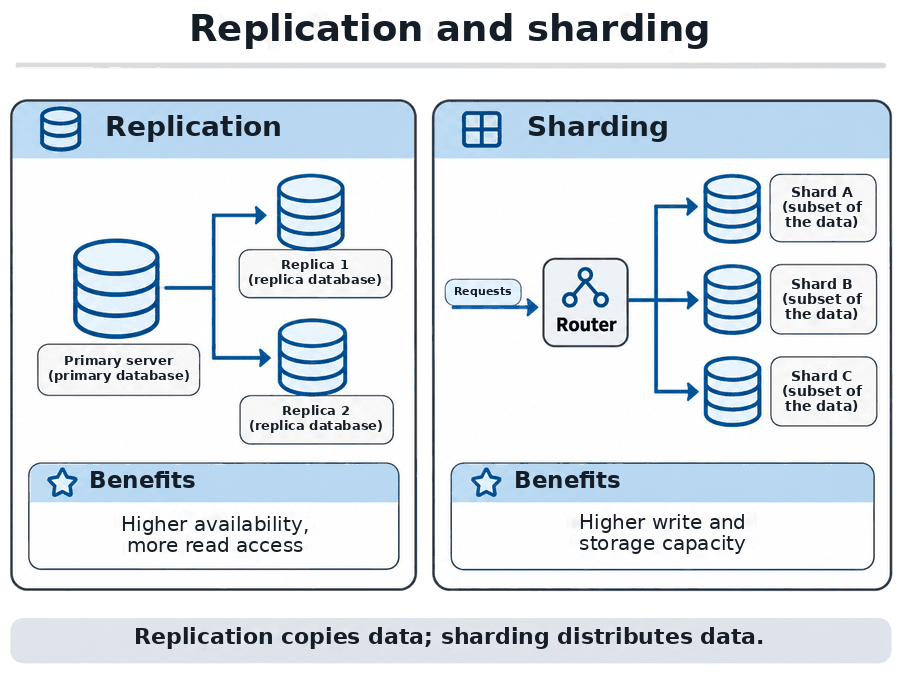

# M3-L3 – Partitioning and sharding {#L3}

**Course area:** M3 – Bachelor’s / transition: Database systems

**Level:** Bachelor’s / Master’s bridge

**Prior knowledge:** No fixed prerequisites specified.

## Initial question: Why is a second copy not always sufficient? {#S1}

In M3-L1, we examined how a single database server manages tables, indexes, transactions and concurrent queries. In M3-L2, we learnt how to transfer **copies of the same data** to other servers. This can help during failures and distribute read queries. Replication, however, does not solve every problem of scale.

Imagine an online service whose dataset grows over several years. It might contain customer data, jobs and analysis results. Eventually, storage on a single server becomes scarce. Or so many concurrent changes arrive that even an upgraded primary server becomes a bottleneck. Further read replicas then help only to a limited extent: the write workload is still concentrated on the primary server.

Another strategy is that **not all the data should reside on every computer**. Instead, we divide the dataset into carefully chosen sections. In a simple variant, these sections remain within one database instance. In a more advanced variant, the parts are distributed across **different database nodes**. The terms for these concepts are *partitioning* and *sharding*.

Initially, this sounds like a simple distribution task. The crucial questions only arise afterwards: where is a specific customer? What happens if their order is on another server? How do we calculate a grand total? How do we change the distribution if a server is overloaded? And how do we prevent inconsistent data in the event of a failure?

**Guiding idea of this lesson:** partitioning is primarily a way of organising data logically and physically; sharding is a form of horizontal distribution across separate data storage units or nodes. The gain in storage capacity and potentially write capacity comes at the cost of more complex coordination.

## First, the distinction: Partition, shard and replica {#S2}



*Figure: Simplified comparison: replicas hold copies of the data; shards hold different subsets. Replication and sharding can be combined, and both require additional measures for availability and fault tolerance.*

A **partition** is part of a larger dataset. For example, the entries in a single logical table `Bestellungen` (orders) can be stored in separate physical sections according to their order month. The table may still appear to an application as a single table.

A **shard** is a subset of data that is managed independently on a database instance or database node in the context of distributed database systems. A shard is often itself a collection of related table rows. A physical server may host several shards; a shard is therefore **not necessarily equivalent to an entire server**.

A **replica**, in turn, is an additional copy of data already held elsewhere. Sharding and replication can be combined: each shard can itself be replicated.

### Mini-architecture: Three different ideas

``` text
1) Table partitioning on ONE database server

             Logical table ‘Orders’
                      │
          ┌───────────┼───────────┐
          ▼           ▼           ▼
       January     February     March
          └───────────┴───────────┘
              One database server

2) Sharding across MULTIPLE database nodes

          All customers and orders
                      │
                   Routing
                      │
          ┌───────────┼───────────┐
          ▼           ▼           ▼
       Shard A      Shard B      Shard C
       Server 1     Server 2     Server 3

3) Replication of a shard

          Shard A (leading copy)
                      │
                 Copy changes
                      ▼
          Shard A (second copy)
```

In the first case, the organisation may help with maintenance and certain queries, but the hardware remains the same. In the second case, data and work are distributed across several nodes. In the third case, the same subset exists redundantly. The terms describe different properties and must not be treated as equivalent.

## What do horizontal and vertical partitioning mean? {#S3}

**Horizontal partitioning** divides the *rows* of a table. The sections generally have comparable columns but contain different records.

``` text
Customers (one logical table)

ID    Name       Country
10    Ada        DE
11    Ben        FR
12    Cem        DE
13    Dia        IT

Partition A: ID 10 and 11
Partition B: ID 12 and 13
```

**Vertical partitioning**, by contrast, separates *columns* or functional data areas. Frequently needed customer names and account balances, for instance, could be kept separately from large profile information that is rarely read. This can avoid unnecessary data access but may also require additional joins.

In everyday usage, whole functional areas are also distributed to their own databases, for example accounting and media management. This is more of a **functional separation** of systems, not automatically the sharding of a shared table.

In the following sections, we mainly consider horizontal partitioning. It allows a dataset to be divided into subsets according to a key and, where appropriate, distributed across several computers.

## Partitioned tables in a single PostgreSQL database {#S4}

PostgreSQL 18 supports **declarative table partitioning**: a parent, logically unified table is described, and a partition key specifies how the data is distributed across physical child tables. Range, list and hash partitioning are examples of the available methods.

Consider a shop's orders. One partition contains January orders, the next February orders and the third March orders. A query for February can then often skip the other months. This optimisation is called **partition pruning**, meaning the exclusion of irrelevant partitions.

``` text
Query: ‘Orders in February’
                 │
                 ▼
        PostgreSQL query planner
                 │
       ┌─────────┼──────────┐
       │         ▼          │
    January   February    March
      skip      search     skip
```

Partitioning can also simplify the removal of entire old time periods. Instead of deleting millions of individual rows, a suitable old partition can be detached or removed. Whether this can be done safely depends on the retention rule and the overall data model.

The limitations matter: not every query becomes faster. A query without an appropriate filter may have to examine all partitions. Too many small partitions may complicate planning and management. And a table partitioned on one server is **not automatically distributed across multiple servers** as a result.

A specific PostgreSQL characteristic shows that partitioning is more than a cosmetic division: on a partitioned table, a global `PRIMARY KEY` or `UNIQUE` constraint must include the partition key columns (subject to the other applicable requirements). Independent local indexes cannot simply establish uniqueness across arbitrary partitions on their own. A data model that previously used a single unique key without difficulty may therefore require adjustment when it is partitioned.

**When is it useful?** Large logs, event or measurement tables organised by time, frequent time-range queries and regular data archiving. **When is it excessive?** Small tables, freely combined search conditions unrelated to the partition key, or a system that is already fast enough with a suitable index.

## The basic problem in sharding: Who knows where a row is? {#S5}

With a single database server, an application does not usually have to know which disk holds a record. The database server organises access. With sharding, this is insufficient: some component must decide **which shard is responsible**.

This may be part of the application, a routing layer in front of it or a database system that largely manages the distribution itself. The **shard key**, or distribution key, determines which subset a record belongs to. This is often a stable customer number or tenant identifier.

``` text
      Web application: customer 2847 loads their jobs
                            │
                            ▼
                        Shard router
                     Key: customer 2847
                            │
              ‘Customer 2847 is on shard B’
                            │
                            ▼
                        Database B
                   Customer + their jobs
```

A well-chosen key enables targeted access. A poorly chosen key distributes data unevenly, produces unnecessary queries across several servers or makes subsequent changes expensive. The shard key should therefore be chosen according to **actual read and write patterns**, not an arbitrary existing column.

A single database node can contain several shards. This makes it easier to move smaller units when necessary instead of splitting a huge database each time.

## Four important distribution strategies {#S6}

### Range-based distribution (range sharding) {#61-bereichsbasierte-verteilung-range-sharding}

The value range of the key is divided into sections. For example, customer numbers from 1 to 9999 reside on shard A, and 10000 to 19999 on shard B. This is easy to understand and is suitable when *contiguous ranges* are queried frequently.

``` text
Customer ID 00001–09999  ──► Shard A
Customer ID 10000–19999  ──► Shard B
Customer ID 20000–29999  ──► Shard C
```

**Problem:** if new customers are particularly active and receive steadily increasing numbers, the new write load often concentrates on the latest range. A large customer can also generate significantly more records than many small customers combined.

### Hash-based distribution (hash sharding) {#62-hashbasierte-verteilung-hash-sharding}

Here, the key is converted using a **hash function** into a numerical value that can be used for distribution. A hash function produces another value from an input according to fixed rules. Based on this value, the system decides which section the row belongs to.

``` text
Customer 2847 ──► Hash function ──► Range B ──► Shard B
Customer 2848 ──► Hash function ──► Range A ──► Shard A
Customer 2849 ──► Hash function ──► Range C ──► Shard C
```

The advantage is often a more even spread of consecutive customer numbers. The disadvantage is that contiguous customer numbers are now unlikely to be located together. Range queries may have to visit many shards. A simple scheme such as `Hashwert modulo Anzahl Server` (hash value modulo number of servers) also makes adding new servers difficult: if the number of servers changes, many keys can change their assignment. Real systems therefore often use additional layers of abstraction such as virtual ranges.

### Directory-based or lookup sharding {#63-verzeichnissystem-oder-lookup-sharding}

A mapping table records which customer is located on which shard. The router queries this table and forwards the request. This allows targeted changes: a particularly large customer can move to a dedicated shard while the remaining customers stay where they are.

The cost is additional metadata management. The directory must be available, up to date and consistent. An incorrect entry leads to the wrong database node.

### Geographical distribution {#64-geografische-verteilung}

Data can be divided by region, for example when accesses from one region should mainly be handled there. This can shorten communication paths or accommodate special storage-location requirements. At the same time, other difficulties arise: one region may be used much more heavily than another; users travel; and data needed worldwide must remain accessible across regional boundaries.

**Important:** geographical storage location alone does not determine the legal permissibility of data processing. Access rights, provider roles, transfers and further requirements must be examined separately.

### Comparison

| Strategy | Strength | Typical risk |
| --- | --- | --- |
| Ranges | Related values remain close together, simple range queries | Hot latest range, unequal sizes |
| Hash | Often a better spread | Expensive range queries, redistribution |
| Directory | Flexible assignment of individual customers | Metadata, additional routing dependency |
| Geography | Regional proximity to data | Regional hotspots, global access |

Hybrid forms exist. For instance, the region can first determine the data location, and a hash function can distribute customers within that region.

## A running example: Customers and orders {#S7}

Consider a software-as-a-service offering (**SaaS**: software provided as an online service) with many business customers. For each customer, there are users, orders and billing data. A typical request is: ‘Show me the last 20 jobs from customer 2847.’

If **customers, users and jobs belonging to the same tenant** reside together on one shard, the database can handle this request locally. This is the principle of **co-location**: data that is frequently queried together is organised according to the same distribution key.

``` text
                 Shard router
                      │
          ┌───────────┴──────────┐
          │                      │
          ▼                      ▼
       Shard A                Shard B
       Customer 101           Customer 2847
       Users 101/*            Users 2847/*
       Jobs 101/*             Jobs 2847/*
          │                      │
       Local JOINs            Local JOINs
```

A **JOIN** is the relational combination of records from different tables using corresponding keys. Locally, this is relatively simple: a database server knows the participating tables and indexes. Across different nodes, it becomes harder because data has to be transferred over the network or subqueries have to run on multiple computers.

Note that **not every system provides this co-location automatically**. An application must maintain the keys correctly in its data model, or a distributed database system must configure the tables accordingly. Strict separation of customer data is also a separate security task: sharding by customer identifier **does not replace authorisation checks**.

## Why cross-shard JOINs can become expensive {#S8}

Suppose that the `Kunden` (customers) table is on server A and the corresponding `Bestellungen` (orders) table is on server B. A query that combines all customers with their latest orders can no longer simply operate on one storage device. The required rows must come together somewhere.

``` text
           Query: customers with order value
                         │
                     Coordinator
                     /         \
                    ▼           ▼
                Server A      Server B
                Customers     Orders
                    \           /
                     ▼         ▼
                      Merge data
                         │
                         ▼
                       Result
```

Every data transfer increases execution time and network load. Subqueries may have different execution times. If a participating shard fails, the entire query can fail. Sometimes it is cheaper to copy a small, rarely changed **reference table**, such as country codes, to several nodes. This avoids remote lookups but requires controlled updates to these copies.

A particularly problematic case is **fan-out queries**: a query cannot be sent to a specific shard and has to be distributed across all shards. Each node returns a partial result, and the coordinator combines or sorts them. This can be useful for an overall statistic. For every individual user interaction, it is often unnecessarily expensive.

**Key point:** a good sharding strategy is guided by the *most frequent queries*, not merely by achieving an equal number of stored rows.

## Searching, counting and sorting across many shards {#S9}

Individual customer searches are simple in the above model. But what if management wants to know the combined revenue from all customers?

Each shard can first calculate a local subtotal. The coordinator then adds the results. This principle is called **scatter/gather**: distribute work and collect partial results.

``` text
               ‘Revenue from all customers’
                         │
                     Coordinator
                ┌────────┼────────┐
                ▼        ▼        ▼
             Shard A   Shard B   Shard C
             12,000     7,000     9,000
                └────────┼────────┘
                         ▼
                     Total 28,000
```

The figures are purely illustrative. Addition is easy to break down in this way. Other operations are more complicated: to find the *ten largest orders worldwide*, local top lists and then a correct global merge may be necessary. With complex filters and nested joins, the volume of data transferred between nodes can grow substantially.

Some systems therefore separate ongoing user transactions from expensive analytics. Data may, for example, be transferred to a separate analytics environment after a delay. This is, however, a new copy with possible delays in freshness, not inherently an always-consistent live state.

## Writes and transactions across multiple shards {#S10}

A write operation that affects only data on a single shard can often be handled as a normal transaction by its local database. An operation that must change **two shards jointly** is more difficult.

Example: a balance is to be transferred from customer account A to customer account B. Account A is on shard 1, and account B is on shard 2. The amount must not disappear on one side and never appear on the other.

``` text
                ‘Transfer 50 units’
                         │
                  Transaction logic
                    /           \
                   ▼             ▼
                Shard 1        Shard 2
                Debit A        Credit B
                    \           /
                  Correct together?
```

A **local ACID transaction** (Atomicity, Consistency, Isolation, Durability) on shard 1 does not automatically guarantee complete execution on shard 2. Some distributed database systems support coordinated transactions with defined guarantees. Other architectures use separate bookings, events, retry logic and compensating steps. Which variant is acceptable for the business process depends strongly on the use case.

The classic **two-phase commit** (2PC) can involve multiple participants in a common decision: first prepare, then commit or roll back together. However, this increases network communication and creates new failure scenarios. We examine the precise interaction with failures, locks and recovery in **M3-L5 – Transactions and distributed correctness**.

Not every distributed system forgoes strict consistency. And not every system supporting sharding provides the same transaction guarantees. **Sharding describes data distribution, not automatically the consistency model.**

## Unique identifiers and foreign keys {#S11}

In a single database, a unique order number can easily be checked by a central index. When orders are distributed across multiple shards, the question arises: who prevents two nodes from assigning the same number simultaneously?

A common strategy is to design identifiers so that they are sufficiently unique without a central sequential numbering service, for example by using suitable composite identifiers or distributed ID schemes. Another option is to use a shared allocation service. Both approaches have their own advantages and disadvantages regarding complexity, availability and coordination requirements.

**Foreign keys**, which are rules such as requiring an order to belong to an existing customer, cannot be enforced as easily across server boundaries in every system as they can within a local database. When customers and their orders are located together, the check is significantly easier. Globally distributed relationships need additional database capabilities or application-level checks.

This does not mean that relational rules are inherently impossible in distributed databases. It means that the guarantees are **a specific system property** that needs to be checked.

## Hotspots: When one shard slows everything down {#S12}

Even data volume is not the same as even load. Perhaps ten small business customers together have as many records as one large customer. However, the large customer sends a thousand times as many queries. Its shard then remains under continuous load while other nodes do little work.

This is called a **hotspot**, a subset of data under disproportionately heavy load. Hotspots can arise because of:

- a very large or very active tenant;
- a monotonically increasing key that concentrates new writes in the latest range;
- a particularly frequently queried object or a global counter table;
- unevenly distributed time periods, regions or job types;
- poor query plans or missing local indexes.

Additional servers do not help if all hot writes continue to land on **the same single shard**. Possible countermeasures include a different distribution key, splitting an oversized shard, moving a large customer, a targeted cache for readers or redesigning write operations at the business-logic level.

All these changes can be expensive. A sharding design should therefore consider not only today's average but also realistic peaks and particularly large customers.

## Rebalancing: What happens when a fourth server is added? {#S13}

When a cluster grows, switching on a new computer is not enough. Initially, the new computer has no data and therefore no useful work. Parts of the existing dataset must move to it. This process is called **rebalancing**, meaning the redistribution of data and load to restore balance.

``` text
Before:
  Server A: Shard 1, 2, 3
  Server B: Shard 4, 5, 6
  Server C: Shard 7, 8, 9

After adding server D (example only):
  Server A: Shard 1, 2
  Server B: Shard 4, 5
  Server C: Shard 7, 8
  Server D: Shard 3, 6, 9
```

During the move, a record must not be modified independently on both nodes without control. Depending on the product, migration may temporarily restrict writes, replay changes and finally switch the routing metadata. This places additional load on the network, storage devices and processor. A move must be fault-tolerant: what happens if a connection fails during copying?

**Virtual shards** or many small sections often make this work more flexible. Instead of redistributing all customer data, only certain sections are moved between physical servers. How automatically this happens depends on the product.

### MongoDB as a concrete example

MongoDB distributes documents in a *sharded collection* across multiple shards using a shard key. Its documented architecture uses **chunks**, sections of the key space, and a **balancer** that can move suitable ranges between shards. MongoDB supports both range-based and hash-based strategies. This is a concrete product example, not the general definition of all distributed databases.

## Routing and the coordinator: Who becomes the new bottleneck? {#S14}

A distributed system needs a controlled answer to the question of which node is responsible for which data. The router may be integrated into the application or operate as a separate component. A distributed database system may also handle this task itself.

For example, the documentation of the PostgreSQL extension **Citus** describes an architecture with coordinator and worker nodes. The coordinator knows distribution metadata and can forward queries to a specific worker or parallelise them across multiple workers. The actual table rows are distributed across the workers.

``` text
                Application / SQL query
                         │
                         ▼
                  Coordinator / router
                   /        |        \
                  ▼         ▼         ▼
              Worker A  Worker B  Worker C
               Shards     Shards    Shards
```

**SQL** stands for *Structured Query Language*. Using SQL does not mean that every distributed query can be executed as cheaply as on a local database. For complex queries, the coordinator has to combine partial results and may itself become a load bottleneck or point of failure. Such systems therefore need suitable operation of their control and metadata layer.

The product distinction is important: **built-in PostgreSQL table partitioning does not by itself distribute data across independent database servers as a full-fledged sharding system**. Citus adds separate distributed features. MongoDB uses a different architecture. Further distributed SQL systems are compared in M3-L4.

## Considering sharding and replication together {#S15}

In a serious multi-node architecture, each shard can have its own redundant dataset. Instead of operating three independent database servers, one may then operate several groups of primary and replacement nodes.

``` text
                   Applications
                        │
                   Shard router
                 /      |      \
                ▼       ▼       ▼
             Shard A  Shard B  Shard C
             Primary  Primary  Primary
                │       │       │
                ▼       ▼       ▼
             Replica A Replica B Replica C
```

Here, **sharding** meets the objective of dividing the data. **Replication** meets a different objective: keeping copies of the respective parts. Actual availability also depends on failover, networks, quorum rules and application behaviour.

A failure of shard B might leave customers on A and C unaffected – **provided that** their queries are genuinely independent. If the home page needs global statistics from all three shards, the failure can still affect the entire user experience. Physically separating the data alone is therefore not sufficient. The application must have suitable fault boundaries.

## Operations: Monitoring, updates, backups and data protection {#S16}

Sharding increases the operational footprint of a system. Every additional node needs storage devices, memory, security updates, suitable access controls, monitoring and recovery procedures. Routers, metadata, network connections and possibly replicas are added to this.

It is not only CPU and memory that must be monitored, but also the **distribution**: how large are the individual shards? How many reads and writes reach them? Are there particularly slow nodes? How long do moves take? Do subqueries get stuck on a failed shard? Can queries be routed to specific shards, or do they cause unnecessary fan-outs?

**Backups** become more complicated. Every shard must be backed up, but for related business processes, the *common point in time* may also be crucial. If shard A is restored to Monday and shard B to Wednesday, relationships across shards can become inconsistent. Backups and their restoration should therefore be planned for the entire system and actually tested. Replicas do not replace these backups.

When the database schema changes, several shards must reach mutually compatible states. Data migrations may move sensitive records over additional network connections. Access must be authenticated, authorised and encrypted where necessary; logs should not contain unnecessary personal information. Multi-tenancy also requires that even an incorrectly routed request must not lead to another customer's data.

All of this generates costs: additional database instances, storage copies, data transfer, backups, monitoring and, above all, operational time. There is therefore no general rule such as ‘three smaller shards are cheaper than one large database server’. Actual pricing decisions would require current provider prices and a measured load profile.

## Three realistic application scenarios {#S17}

### A. Local media catalogue {#a-lokaler-medienkatalog}

A local tool manages hundreds of thousands of media files and metadata. Searches for file names, tags or project membership run on a single computer. **Sharding would usually be an unnecessary additional source of errors here.** Suitable SQLite indexes, full-text search if required, good query planning and tested backups are more useful. Even if the data is organised by year, this need not turn into a multi-server system.

### B. Paid online analysis service for many customers {#b-bezahlter-online-analysedienst-für-viele-kunden}

An online offering stores the results of different customers. If a single database can no longer handle the actual load profile, the customer number could serve as the shard key. A customer account and its analysis jobs would then reside together on one node. A small customer could share a shard with many others; a very large customer may need a dedicated area. Global business statistics must be explicitly considered as cross-shard queries.

The operational question is not just ‘How many customers do I have?’ but ‘How much data, how many concurrent accesses, how many changes per customer and how critical are failures?’ A small service with a few hundred inactive or low-activity customers may not need sharding at all.

### C. AI processing service with background jobs {#c-ki-verarbeitungsdienst-mit-hintergrundaufträgen}

A cloud application accepts image or text processing jobs. Several **workers**, independent background processes, handle them. Large files may reside in separate object storage. A database only holds job status, customer identifiers, references to results and billing entries.

Here the **computation** is often the initial bottleneck, not the metadata database. Additional workers can be started without sharding the database. Only when the central job or event table demonstrably reaches its limits does the question of partitioning or using multiple database nodes arise. A job register partitioned by tenant may make sense; a global priority queue, by contrast, requires special coordination and is not automatically solved by sharding.

These examples show that **more processing computers, more database replicas and more shards solve three different problems.** The infrastructure should be selected according to the actual bottleneck.

## Decision guide: When to use partitioning, and when sharding? {#S18}

| Initial situation | Examine first | Why not shard immediately? |
| --- | --- | --- |
| Small to medium-sized application | One server, well-designed indexes and queries | Simple operations and local transactions |
| Very large time-series table | Table partitioning by time | Data remains manageable in one instance |
| Many read queries, moderate write load | Caching and read replicas | No new distributed write path needed |
| Insufficient storage or write capacity on one node | Suitable shard distribution, measured load | More nodes are useful only with good routing |
| Largest load originates from one customer | Examine tenant isolation or repartitioning | Merely adding other shards does not resolve the hotspot |
| Many global JOINs and atomic operations | Review data model and transaction requirements | Sharding could make the dominant case worse |

A useful sequence is to **measure first, then improve queries and indexes, subsequently partition tables or distribute reads where appropriate, and distribute data that is written across multiple nodes only when genuinely needed.** This sequence is a rule of thumb, not a mandatory ranking for every system.

## Summary – six key points {#S19}

1.  **Table partitioning** organises a logical dataset and can take place on a single server.
2.  **Sharding** distributes subsets across separate database units or nodes; a shard need not correspond to a server.
3.  A good **shard key** keeps data that is frequently needed together in the same location and enables targeted routing.
4.  **Cross-shard JOINs, global analytics and distributed transactions** make operation more complex and often slower.
5.  **Hotspots and rebalancing** remain important problems even with many servers; equally sized shards do not automatically mean even load.
6.  **Sharding, replication and backup** are independent concepts that complement but do not replace one another.

### Transition to M3-L4

Today we have learnt the **basic mechanics of distribution**. In **M3-L4 – Distributed SQL / NoSQL / Oracle / PostgreSQL**, we compare systems that implement these mechanisms in different ways. We examine which data-distribution capabilities are already part of the database system, how relational guarantees are implemented and what compromises arise regarding consistency and availability.

## Terms and abbreviations in this lesson {#S20}

| Term | Meaning |
| --- | --- |
| Partitioning | Division of a dataset into physical/logical sections |
| Horizontal partitioning | Distribute different rows across different sections |
| Vertical partitioning | Keep columns or data areas separate |
| Shard | Independently managed subset of a distributed dataset |
| Shard key | Distribution key that helps determine the assignment of a record |
| Shard router | Routing component that directs queries to the responsible shards |
| Partition pruning | Skip unnecessary table partitions during a query |
| Co-location | Deliberately store data frequently needed together in the same location |
| JOIN | Relational combination of multiple tables |
| Fan-out / scatter-gather | Distribute a query to several nodes / collect partial results |
| Hotspot | Section or node under excessively heavy load |
| Rebalancing | Redistribute shards or sections when load changes |
| Reference table | Small dataset frequently needed together with other data, possibly copied to nodes |
| ACID | Atomicity, Consistency, Isolation, Durability: transaction properties |
| 2PC | Two-phase commit, a two-phase protocol for distributed commitment |
| SaaS | Software as a Service, software provided online |
| SQL | Structured Query Language, structured database query language |
| Worker | Background process for independently executable tasks |


## Sources {#S21}

**Last source review:** 03.11.2026

**Primary and project documentation, checked on 03.11.2026.** The product examples explain the capabilities of specific systems; they do not constitute a general guarantee, pricing research or a practical installation test.

1.  PostgreSQL 18, *Table Partitioning* – declarative partitioning, range/list/hash, partition pruning and constraints: [https://www.postgresql.org/docs/18/ddl-partitioning.html](https://www.postgresql.org/docs/18/ddl-partitioning.html)
2.  Microsoft Learn, *Sharding pattern* – range/hash/lookup/geography, key selection, routing, cross-shard queries, rebalancing and operational risks: [https://learn.microsoft.com/azure/architecture/patterns/sharding](https://learn.microsoft.com/azure/architecture/patterns/sharding)
3.  MongoDB, *Sharding* – shard keys, chunks, balancer, range-based and hash-based strategies: [https://www.mongodb.com/docs/manual/sharding/](https://www.mongodb.com/docs/manual/sharding/)
4.  MongoDB, *Choose a Shard Key* – cardinality, distribution and hotspots: [https://www.mongodb.com/docs/manual/core/sharding-choose-a-shard-key/](https://www.mongodb.com/docs/manual/core/sharding-choose-a-shard-key/)
5.  Citus, *Concepts* – PostgreSQL extension, coordinator/worker, distributed tables and co-location: [https://docs.citusdata.com/en/stable/get_started/concepts.html](https://docs.citusdata.com/en/stable/get_started/concepts.html)

**Source limitations:** the sources describe concepts and specific product features. The customer numbers, order amounts, server counts and example architectures in this lesson are freely constructed. Whether a system is suitable for an actual service can only be determined from requirements, documented guarantees and measurements.
