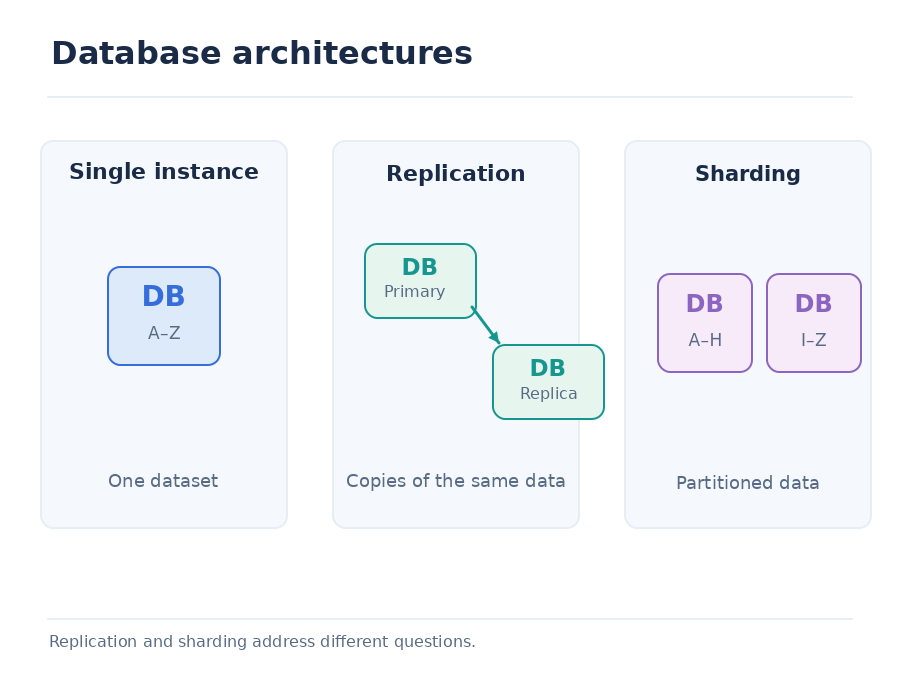

# M3-L4 – Distributed SQL, NoSQL, Oracle and PostgreSQL {#L4}

**Course area:** M3 – Bachelor’s / transition: Database systems

**Level:** Bachelor’s / Master’s bridge

**Prior knowledge:** No fixed prerequisites specified.

## Initial question: What kind of database do we need for many servers? {#S1}

In M3-L1, we became familiar with a single database instance. In M3-L2, we examined copies of the same database that are useful for read access or fault tolerance. In M3-L3, we divided datasets into individual sections called **shards**. The question now is: **which of these tasks does each database system already handle itself?**

A small PHP application can run with an SQLite file. For a larger web service, one might use PostgreSQL or another server-based database. Later, multiple locations, rapidly increasing write load or stricter fault-tolerance requirements may become relevant. It is therefore tempting to look for a ‘distributed database’. But this expression does not identify a single technology; it describes several fundamentally different architectures.

A database can, for example, *replicate* the same information across multiple servers. It can *distribute* its data across multiple servers. It may allow several instances to access **shared storage** in parallel. Or it may hide the distribution behind an SQL interface and perform complex coordination for transactions. Such systems solve different problems and have different limitations.

**Guiding idea:** the most important question is not initially ‘SQL or NoSQL?’ but: what data relationships and correctness guarantees does my application need, what load actually arises, and what operational responsibility can I handle?

## Keeping the terms clearly distinct {#S2}

**SQL** stands for *Structured Query Language*. It is used, among other things, to query or modify data in relational databases. **An SQL query is not a database server.**

{alt="Comparison of a single instance, replication and partitioning/sharding"}


A **relational database management system (RDBMS)** stores data in logically related tables and provides, among other things, keys, relationships and transactions. PostgreSQL and Oracle Database belong to this family. The word ‘relational’ describes the data model, not automatically the number of servers involved.

**NoSQL** is an umbrella term for database systems that do not primarily follow the classical relational SQL model or that also emphasise other models. It does not mean that the data must be ‘unstructured’, that transactions are impossible or that consistency is inherently weak. The properties vary considerably between products and settings.

**Distributed SQL** describes systems that combine an SQL interface and essential relational properties with data storage distributed across multiple nodes. These systems attempt to organise sharding, replication, query planning and transaction coordination largely within the database system. However, individual products differ regarding SQL compatibility, isolation levels, consistency guarantees and operational models.

### Mini-architecture: The same application, three different approaches to data storage

``` text
A) One relational database server

   PHP application ─── SQL ───> PostgreSQL server
                                     │
                                 All tables

B) Replicated relational database

                           ┌──> Standby (copy)
   PHP application ───> Primary server
                           └──> Standby (copy)

C) Distributed SQL database (schematic)

   PHP application ─── SQL ───> SQL access / coordinator
                                         │
                                  Plan and route query
                                         │
                              ┌──────────┼──────────┐
                              ▼          ▼          ▼
                            Node A     Node B     Node C
                            Subset     Subset     Subset
                            + copies   + copies   + copies
```

The three diagrams do not constitute a ranking of quality. The simplest solution can be the right one technically and economically. In the third architecture, substantial coordination is needed in addition to the actual database work.

## Relational tables, documents and key-value stores {#S3}

Choosing a database begins with the structure of the problem.

### Relational databases {#31-relationale-datenbanken}

An online service may have tables for `Kunden` (customers), `Aufträge` (jobs) and `Zahlungen` (payments). A job has a customer number that can be used to identify the corresponding customer. Such relationships can be evaluated using a **JOIN** (a combination of tables). Primary and foreign keys can help prevent invalid relationships.

The challenge is that when data is distributed, data from different tables or nodes may have to be read and changed together. Relational functions do not disappear, but their implementation becomes more difficult.

### Document-oriented databases {#32-dokumentenorientierte-datenbanken}

A **document database** such as MongoDB stores related data in documents, often in a JSON-like structure. JSON stands for *JavaScript Object Notation*, a widely used text format for structured data. A customer document might contain several addresses in addition to a name and identifier.

This can simplify an application when an entire object is usually read or modified. If many objects are frequently linked to one another, however, duplicated information, special query methods and update rules can create additional work. MongoDB now also supports multi-document transactions; the ‘document’ model therefore certainly does not mean ‘no transactions’.

### Key-value databases {#33-schlüssel-wert-datenbanken}

A **key-value store** associates a value with a unique key:

``` text
"auftrag:4812:status"  →  "fertig"
"nutzer:102:ansicht"   →  "kompakt"
```

This is attractive for simple and frequent accesses. Such a model is not automatically suitable for complex relationships and analytics. Some key-value systems are particularly often used as caches; others are persistent database systems.

### Further NoSQL families {#34-weitere-nosql-familien}

**Wide-column systems** often organise large amounts of data by partition keys and column-oriented or column-family-like structures. **Graph databases** primarily describe relationships between nodes and edges. Both solve specialised problems but do not inherently replace every relational database.

The label ‘NoSQL’ therefore says nothing by itself about actual availability, distribution or consistency. These properties must be checked for the specific product and operating mode chosen.

## Distributed SQL: A database that coordinates many nodes internally {#S4}

The goal of a distributed SQL database can be understood as **one logical database system with several physical computers**. The application continues to send SQL queries. Internally, the system determines which nodes hold the data and which copies must participate in an operation.

A typical design has several layers:

1.  **SQL layer:** receives queries, analyses them, plans joins and produces the execution steps.
2.  **Distribution and routing layer:** assigns records to ranges, shards or so-called tablets and finds their current storage locations.
3.  **Replication layer:** manages multiple copies of data ranges to enable continued operation during failures.
4.  **Transaction coordination:** where appropriate, ensures that changes across multiple data ranges are correctly committed or discarded.
5.  **Storage layer:** keeps data on storage devices, manages local indexes and performs recovery steps.

### Mini-architecture: A distributed booking

``` text
   Booking request: ‘Reserve seat 42 for customer 7’
                         │
                         ▼
                     SQL access node
                         │
                    Plan transaction
                         │
            ┌────────────┴────────────┐
            ▼                         ▼
    Data range ‘Seats’       Data range ‘Bookings’
       Node A (+ copies)        Node B (+ copies)
            │                         │
            └────────────┬────────────┘
                         ▼
                    Coordinated commit
                         │
                         ▼
                    Success or abort
```

Importantly, the diagram shows **one possible logical architecture**, not the precise internal process of every product. Some databases organise the layers differently, and not every SQL operation needs a transaction across multiple nodes.

### Consensus algorithms and majority decisions {#41-konsensverfahren-und-mehrheitsentscheidungen}

When several copies of a data range exist, writes often need to be confirmed in a common order. Some systems use a **consensus algorithm** such as *Raft* for this. In simplified terms, in a group of three replicas, a majority of two decides which log entries are committed. If one node fails, the two remaining nodes can often still form a majority. If a network failure separates the nodes into groups of one and two computers, the single-node group normally cannot perform new writes requiring majority confirmation.

It must not be inferred from this that a Raft protocol alone solves every database transaction. It orders changes within a particular replication group. If a transaction affects several data ranges, further coordination is required. The complete guarantees result from the interaction of the storage, replication and transaction protocols.

**When is it useful?** When a service genuinely needs multiple nodes for increasing data volumes or write load, while still requiring relational queries and strict correctness rules. **When is it unnecessary?** When a single server can easily handle the measured load. Additional distribution often comes at the cost of more network traffic, higher latency and more complicated operation.

## What distributed SQL does not automatically guarantee {#S5}

An SQL interface is not a certification of identical features. Even with PostgreSQL-like syntax, available data types, extensions, transaction details, query plans, system catalogues and administrative functions may differ. An existing PostgreSQL project is therefore not guaranteed to be transferable without changes simply because the network protocol is compatible.

The expression **‘horizontal scaling’** also deserves scrutiny. More nodes can provide additional storage capacity and parallel processing. A single global query, a transaction across many nodes or a highly contended record does not become arbitrarily fast as a result. Particularly difficult cases include:

- global sorting and analytics;
- frequent joins across distribution boundaries;
- unique identifiers and other integrity rules across nodes;
- simultaneous changes to the same information;
- redistribution during live operation;
- access across large geographical distances.

For applications with few users, the additional network often brings no benefit. For large services, distribution may be necessary even though individual accesses then become technically more demanding.

## PostgreSQL: A powerful single system, replication and external extensions {#S6}

**PostgreSQL** is a specific, freely available relational database system. It offers many of the features we have already examined: indexes, transactions, various isolation levels, declarative table partitioning, physical replication and logical replication.

**Physical replication** transfers, in particular, changes from the *Write-Ahead Log* (WAL, a log of changes written in advance) to standby systems. In the appropriate mode, these can also execute read queries. This extends availability or read capacity; in the usual primary–standby model, however, several independent primary servers for the same data are not transparently combined into a distributed write system.

**Logical replication** transfers selected data changes using logical data objects. It follows the publisher–subscriber principle: a publishing server makes changes available, and a subscribing server applies them. This helps, for example, with selective data transfer, migration or secondary analytical datasets. It is not automatically conflict-free multi-primary writing; write conflicts must be handled separately in more complex topologies.

Built-in **table partitioning** can divide a large table into internal sections. It does not replace automatic sharding across independent servers. Additional software exists for this, for example the PostgreSQL extension **Citus**, which provides coordinator/worker and sharding features. The specific support, version and operating model of such a solution must be examined independently.

### Mini-architecture: PostgreSQL with a read replica

``` text
        PHP application
              │
       ┌──────┴─────────┐
       ▼                ▼
     Changes         Read query
       │                │
       ▼                ▼
   PostgreSQL        Standby /
   primary server    read replica
       │                ▲
       └── WAL data ────┘
```

Such a system can cover a very broad range of applications and remain easier to operate than genuine sharding. Replication lag, switching during failures and independent backups nevertheless remain important tasks.

**Crucial distinction:** PostgreSQL itself, the PostgreSQL extension Citus and a separate distributed SQL product with PostgreSQL compatibility are **three different things**.

## Oracle: Single instance, RAC and globally distributed database {#S7}

When referring to ‘Oracle’, one must distinguish between the vendor, its traditional database product and an additional cluster architecture. In 2026, the product documentation uses, among other names, **Oracle AI Database 26ai**. The technical differences, not the marketing label, are what matter.

### Oracle Database as a single database system {#71-oracle-database-als-einzelnes-datenbanksystem}

A normal Oracle database can operate as a single instance on one server. In this basic model, an instance runs database processes and accesses the associated database files. In very simplified terms, this is comparable to the role of a single PostgreSQL instance, even though the products, capabilities and licensing models differ.

### Oracle Real Application Clusters (RAC) {#72-oracle-real-application-clusters-rac}

**RAC** stands for *Real Application Clusters*. This Oracle technology allows several database instances on different computers to access **the same logically shared database with shared storage** at the same time. This requires clusterware, coordinated shared storage, fast communication between nodes and coordination of buffer contents.

### Mini-architecture: RAC with a shared dataset

``` text
              Application
                  │
             Database service
                  │
         ┌────────┴────────┐
         ▼                 ▼
    Oracle instance A  Oracle instance B
       Computer 1         Computer 2
         │                 │
         └────────┬────────┘
                  ▼
           Shared, cluster-
            capable storage
            (the same files)
```

Several instances share **one common logical dataset** here. They do not simply maintain their buffers independently without coordination; the system organises buffer coherence. RAC can be useful for availability and certain load profiles but is operationally demanding. Shared storage and cluster coordination are central architectural features.

**RAC is not merely conventional read replication, but it is not equivalent to independent sharding either.** The data is not simply held as separate subsets on each server.

### Oracle Globally Distributed AI Database / sharding {#73-oracle-globally-distributed-ai-database-sharding}

The architecture officially named **Oracle Globally Distributed AI Database** distributes a **logically related database across independent physical Oracle databases**, called shards. Each shard holds part of the data and does not need shared storage with other shards. A *shard director* can route connections to the appropriate shard according to the distribution key.

``` text
                Application
                    │
               Shard Director
                    │
         ┌──────────┼──────────┐
         ▼          ▼          ▼
     Oracle DB A  Oracle DB B  Oracle DB C
     Customers    Customers    Customers
        1–?          ...          ...
     Own data     Own data     Own data
     Own storage  Own storage  Own storage
```

The division of customers is purely an illustrative example: actual distribution may use different keys and rules. With sharding, data and load capacity can extend across several independent units. But questions also arise about distributed queries, global transactions, placement and management.

**Direct comparison:**

| Variant | Basic idea | Essential difference |
| --- | --- | --- |
| Single Oracle instance | One database system with one instance | No automatic multi-node distribution |
| Oracle RAC | Several instances access the same dataset | Shared, cluster-capable storage |
| Oracle Globally Distributed AI Database | Distribute data across independent shards | Each shard has its own data and storage |

For a small web project, neither RAC nor a globally distributed Oracle architecture would be an obvious starting solution without a specific operational requirement. Nor are these systems adequately described merely by saying that ‘Oracle supports clusters’.

## Further real examples: MongoDB, CockroachDB and YugabyteDB {#S8}

### MongoDB – Document database with replication and sharding {#81-mongodb-dokumentendatenbank-mit-replikation-und-sharding}

MongoDB is a document database. It can use both **replica sets** for replication and fault tolerance and **sharded clusters** for dividing a collection. In the cluster architecture described, each shard is itself implemented as a replica set. A `mongos` router receives queries and determines their destinations using metadata; configuration servers manage the cluster information.

``` text
   Application
       │
       ▼
    mongos router
       │
  ┌────┴──────────┐
  ▼               ▼
Shard A         Shard B
(Replica set)   (Replica set)
```

The **shard key** influences whether queries can reach a specific node or have to be distributed across many shards. Depending on `readConcern`, `writeConcern`, session mode and read preference, MongoDB offers different consistency and durability guarantees. The blanket judgement ‘document databases are always only eventually consistent’ would therefore be incorrect.

### CockroachDB – SQL over distributed key-value storage {#82-cockroachdb-sql-über-verteiltem-schlüssel-wert-speicher}

CockroachDB is an example of distributed SQL. The SQL layer provides relational functions; underneath, the system distributes data in key ranges (*ranges*) across different nodes. Replication groups use Raft. The product supports distributed transactions and, by default, the **Serializable** isolation level, so that from the database's perspective, concurrently executed transactions should correspond to a permissible serial execution.

This is not a promise that every transaction prone to conflicts succeeds on the first attempt. Under contention, transactions may need to be retried or restarted by the application. CockroachDB also uses PostgreSQL-like interfaces but is not identical to the PostgreSQL database server or all PostgreSQL extensions.

### YugabyteDB – PostgreSQL-like SQL layer and distributed tablets {#83-yugabytedb-postgresql-nahe-sql-schicht-und-verteilte-tablets}

YugabyteDB combines a PostgreSQL-oriented SQL interface called **YSQL** with a distributed storage layer. Data is divided into *tablets*; according to the project documentation, these are typically managed using Raft replication groups. Here too, a logical database is constructed from several physical units.

YSQL compatibility can make it easier for developers experienced with PostgreSQL to get started. However, it does not mean that all features, extensions and versions are entirely identical. Whether a specific existing application works without changes must be checked explicitly.

### Do not select products merely by their labels {#84-produkte-nicht-nach-blossem-etikett-auswählen}

| System/family | Data model and interface | Distribution principle | Important limitation |
| --- | --- | --- | --- |
| PostgreSQL (core system) | Relational, SQL | Replication and table partitioning | No automatically transparent distributed SQL multi-node write cluster |
| PostgreSQL + Citus | Relational, SQL | Additional sharding/coordinator features | Extension with its own functional and operational scope |
| Oracle RAC | Relational, Oracle SQL | Multiple instances with shared storage | Cluster coordination and shared storage architecture |
| Oracle Globally Distributed AI Database | Relational, Oracle SQL | Independent shards | Distributed data and queries require additional coordination |
| MongoDB | Documents, its own query interface | Shards and replica sets | Key selection, query distribution and differentiated consistency settings |
| CockroachDB | Distributed SQL, PostgreSQL-compatible interfaces | Ranges, Raft replication, distributed transactions | Network and transaction coordination, not complete PostgreSQL equivalence |
| YugabyteDB (YSQL) | Distributed SQL, PostgreSQL-like interface | Tablets, Raft replication | Compatibility and distribution must be checked for each feature |

This table describes architectural principles, not a product evaluation or pricing recommendation. Product variants and supported functions may change; the sources at the end document the reviewed state.

## What does consistency actually mean? {#S9}

The word **consistency** has several meanings in the database world. Misunderstandings arise particularly in distributed systems when these meanings are confused.

**ACID consistency:** in the abbreviation **ACID** (*Atomicity, Consistency, Isolation, Durability*), ‘Consistency’ refers to compliance with defined data rules and integrity constraints before and after successful transactions. For example, an order number defined as unique must not occur twice. This is **not the same** as the meaning of consistency in the CAP theorem.

**Replica consistency:** which version of data is visible when the same data resides on several servers? Could a replica still display an earlier balance while the primary server has already acknowledged a change?

**Transaction isolation:** what do concurrently executed transactions observe of one another? A database may offer a particular transaction isolation level while some replicas nevertheless return delayed data. The two questions must be considered separately.

### Strong consistency and linearisability {#91-starke-konsistenz-und-linearisierbarkeit}

In the distributed context, **linearisability** means, in simplified terms, that each individual operation appears to have taken place at a particular point between its invocation and its response, respecting the actual order of non-overlapping operations. If an acknowledged change has completed in full and a corresponding new read operation starts afterwards, it should not simply return an older value.

This is a strong property. It may be necessary for important inventory, reservation or lock information. However, it may introduce waiting time and, during network problems, prevent an isolated subgroup from acknowledging writes.

**Serializable** and **linearizable**, in turn, are not synonyms. Serializable primarily assesses whether the result of concurrently executed transactions corresponds to a serial execution; linearisability also considers the real-time ordering of individual operations. The precise guarantees are product-specific.

### Eventual consistency – copies that ultimately converge {#92-eventual-consistency-letztlich-übereinstimmende-kopien}

**Eventual consistency** describes how, under suitable conditions, particularly when no further changes occur and communication resumes, copies converge towards the same value over time. Immediately after a change, different nodes may show different states.

For example, the counter ‘How many times has an image been viewed?’ may temporarily differ across a public gallery. For an available seat in a paid booking, however, the same delay may be unacceptable.

Eventual consistency therefore **does not** mean that a system can be arbitrarily incorrect or that no rules apply at all. The application must decide which temporary differences it tolerates and how conflicts are reconciled.

### Further important guarantees {#93-weitere-wichtige-garantien}

- **Read your writes:** a user sees their own acknowledged changes in subsequent corresponding reads.
- **Monotonic reads:** during successive reads, a user does not return to an older, already superseded state.
- **Causal consistency:** changes that causally depend on one another are observed in an appropriate order, even if independent events can be distributed more freely.
- **Quorum:** sufficient replicas must agree to certain decisions; the proportion required depends on the particular protocol.

The specific combination depends on the database and its settings. Document databases can offer strong operations; relational databases can return outdated values on delayed read replicas. The SQL/NoSQL label alone does not decide this.

## The CAP theorem – what it really says {#S10}

**CAP** stands for **Consistency**, **Availability** and **Partition Tolerance**. The theorem is often simplified to ‘You can only have two out of three properties’. This shorthand is misleading without further explanation.

In this context, the three concepts mean, in simplified terms:

- **C – Consistency:** in the usual CAP model, this refers to a strong, linearised view of data access, not merely compliance with table rules.
- **A – Availability:** every request to a participating node that has not failed should receive a valid response. A mere ‘Error: currently unavailable’ does not satisfy this strong availability requirement as a successful operation.
- **P – Partition tolerance:** the distributed system must take into account that messages between parts of the network may be lost or may not arrive in time. A **network partition** prevents nodes from communicating with one another.

### Mini-architecture: When the network splits

``` text
              Shared data state: stock = 1

           Server A          Server B
              │                │
              └── Network ─────┘

                  NETWORK PARTITION

           Server A       X       Server B
              │                      │
       User 1: ‘buy’          User 2: ‘buy’
              │                      │
       Connection between servers disrupted
```

If both sides independently sell the same last item and confirm both purchases, the shared stock state may become incorrect. If, by contrast, one side waits for sufficiently confirmed coordination or rejects a request, the strict availability requirement that ‘every non-failed node responds successfully’ is violated.

**The core of the theorem:** under the assumptions investigated by Gilbert and Lynch, a distributed system cannot simultaneously guarantee unrestricted linearisable consistency and this strong form of availability for all affected operations during a network partition. It is a *conflict arising during communication failures*, not an ordinary menu from which to select three properties during normal operation.

### What two typical responses look like {#101-wie-zwei-typische-reaktionen-aussehen}

A system can favour strict consistency when nodes are separated: only a sufficiently coordinated side confirms critical changes. The isolated other part may temporarily be unable to complete corresponding writes successfully. Such an architecture is often informally called **CP-oriented**.

Alternatively, a system can continue allowing local responses and changes on separated sides and require subsequent reconciliation. Strict consistency may then be lost during the partition; this is often called **AP-oriented** in simplified terms. How conflicts are detected and resolved is part of the specific application design.

**Important:** many databases offer different guarantees depending on operation, settings and topology. It is often imprecise to label an entire product ‘the CP database’ or ‘the AP database’ without these qualifications.

### What CAP does not explain {#102-was-cap-nicht-erklärt}

CAP does not predict which database is fastest, how expensive it becomes or which query language it supports. Nor does CAP state that a system must always disable one of the three properties when the network is functioning normally. The practically important trade-off between low latency and stronger coordination exists even without a network partition; this additional trade-off is described, among other things, by **PACELC**. Selecting an actual product therefore requires more than its CAP label.

## The geographical factor: Multiple data centres do not change the physics {#S11}

Distributed data storage becomes particularly demanding when nodes are located in different cities or countries. Within a data centre, communication paths are usually relatively short. Between distant regions, signals and data packets take more time, and connections may fail independently of one another.

If a write counts as acknowledged only after several geographically distributed replicas agree, the application must wait for their communication. More nodes therefore do not automatically increase the speed of an individual transaction. At the same time, geographical distribution may help survive a larger regional failure, provided that placement, replication and recovery have been planned appropriately.

Legal questions can also play a role. The location of personal data, the use of external processors, transfers to other countries and deletion or retention obligations must be examined for the specific service. The technical ability to replicate data across continents does not automatically constitute permission under data protection law.

## Three practical examples – the appropriate architecture for each {#S12}

### Local media catalogue {#121-lokaler-medienkatalog}

A local program manages several hundred thousand entries relating to images, videos and metadata. Much of the work consists of searching, sorting and occasional changes. **A local SQLite database** can be very useful here. The size of the table alone is not a reason to operate a distributed database system. Good indexes, a comprehensible data structure and reliable backups usually solve the more important problems in this scenario.

### Small paid web service {#122-kleiner-bezahlter-webdienst}

A PHP tool offers customers analytical services. It has accounts, job data and results. As long as the load is manageable, **one application server and one PostgreSQL database** make a reasonable starting architecture. If availability or read volume becomes more important later, standby or read-replica replication may be useful. A complete distributed SQL cluster would initially be additional complexity without a measured bottleneck.

### Booking service across multiple regions {#123-buchungsdienst-mit-mehreren-regionen}

A large service manages a limited number of reservation places for users at different locations. The same place must not be sold twice with binding confirmation. Strict correctness, unambiguous write authority, transactional guarantees and defined responses to failures become more important here. A well-designed central database with failover may be sufficient; a distributed SQL architecture is **one possible**, but not necessarily the best, solution. What matters is which response is acceptable during failures: ‘booking currently unavailable’ may be better for the business process than an incorrectly confirmed double booking.

An **AI job queue** has different requirements again: the job database needs clear states and unique job identifiers, but expensive image or model processing takes place on workers. Additional GPU computers do not automatically mean that the database also has to be sharded.

## Operations, risks and costs {#S13}

A technically sophisticated database architecture rarely solves all operational problems by itself. At least the following questions must be examined:

| Question | Why is it important? |
| --- | --- |
| Who updates the nodes? | Security vulnerabilities and version differences may jeopardise operation. |
| Who monitors replication and quorum? | An apparently functioning application may be unable to confirm new changes safely. |
| How is data restored? | Replication also propagates erroneous deletions; independent backups remain necessary. |
| How is a schema changed? | Distributed environments may involve longer migrations and version differences. |
| Where are data and copies located? | Data protection, latency and regional failures are affected. |
| Which transactions require multiple shards? | Network coordination and contention can worsen response times. |
| How are credentials protected? | Additional nodes and services increase the attack surface. |
| What does ongoing operation cost? | Compute nodes, storage, replicas, data traffic, monitoring and support incur continuing costs. |

A provider may take on some of this work as a **managed service**. That does not remove responsibility for the functional data model, permissions, backup objectives, abuse prevention and correct handling of application errors. Managed services also incur running costs and can create dependencies on particular functions or licensing models.

**No cost ranking without measurements:** a small server may be cheaper and simpler than a multi-node cluster. With very high actual load, on the other hand, a cluster may become technically or economically necessary. The decision requires real requirements, observed bottlenecks and a comparison of the full operational costs, not merely a marketing term.

## Decision questions before a database migration {#S14}

Before rebuilding an existing application around distributed databases, five questions should be answered:

1.  **What is the demonstrated bottleneck?** Reading, writing, storage, availability or geographical distance?
2.  **Which data must never be inconsistent?** For example, inventory, payments, reservations or access rights.
3.  **What may temporarily be outdated?** For example, statistical counters, public search indexes or derived views.
4.  **Which interfaces does the new database actually need to support?** SQL syntax, transactions, drivers, extensions, data types, migration tools.
5.  **Who operates, backs up and pays for the system?** Monitoring, updates, recovery, fault diagnosis, data protection and user support.

If an existing, well-maintained single database already satisfies all requirements, a migration is above all one thing: **an unnecessary risk**.

## Summary and outlook for M3-L5 {#S15}

In this lesson, we have distinguished several levels:

- **SQL** is a query language; **PostgreSQL** and **Oracle Database** are specific relational database systems.
- **NoSQL** is an umbrella family of different data models, not a uniform statement about consistency.
- **PostgreSQL replication** copies data; **PostgreSQL table partitioning** divides tables internally; additional sharding solutions must be distinguished from these.
- **Oracle RAC** operates with several instances on shared storage; **Oracle Globally Distributed AI Database** distributes data across independent shards.
- **Distributed SQL** combines SQL and relational functions with internally coordinated data distribution, but not without network, transaction and operational effort.
- **CAP** describes a fundamental trade-off during network partitions, not a general ranking of all databases or a simple, freely chosen ‘two out of three’ rule.

We now know the basic architectural variants. In **[M3-L5 – Transactions and distributed correctness](M3-L5.md)**, we next examine more closely how to correctly process concurrent changes, retries, duplicate messages and multi-stage transactions. Particularly in reservations, payments and AI job chains, this level determines whether an application genuinely works reliably.


## Sources {#S16}

**Documented source status:** 03.11.2026

All product features mentioned refer to the **source status as of 03.11.2026**. The official documentation may change later. The following links are primary sources; the key statements in this lesson were checked against them:

1.  PostgreSQL 18, *High Availability, Load Balancing, and Replication*: [https://www.postgresql.org/docs/18/high-availability.html](https://www.postgresql.org/docs/18/high-availability.html)
2.  PostgreSQL 18, *Logical Replication*: [https://www.postgresql.org/docs/18/logical-replication.html](https://www.postgresql.org/docs/18/logical-replication.html)
3.  PostgreSQL 18, *Table Partitioning*: [https://www.postgresql.org/docs/18/ddl-partitioning.html](https://www.postgresql.org/docs/18/ddl-partitioning.html)
4.  Oracle Database 26ai, *Overview of Oracle RAC Architecture and Processing*: [https://docs.oracle.com/en/database/oracle/oracle-database/26/racad/introduction-to-oracle-rac/overview-of-oracle-rac-architecture-and-processing.html](https://docs.oracle.com/en/database/oracle/oracle-database/26/racad/introduction-to-oracle-rac/overview-of-oracle-rac-architecture-and-processing.html)
5.  Oracle Database 26ai, *Oracle Globally Distributed AI Database – Architecture and Components*: [https://docs.oracle.com/en/database/oracle/oracle-database/26/shard/architecture-components.html](https://docs.oracle.com/en/database/oracle/oracle-database/26/shard/architecture-components.html)
6.  Oracle Database 26ai, *Oracle Globally Distributed AI Database Overview*: [https://docs.oracle.com/en/database/oracle/oracle-database/26/shard/overview1.html](https://docs.oracle.com/en/database/oracle/oracle-database/26/shard/overview1.html)
7.  MongoDB, *Sharding*: [https://www.mongodb.com/docs/manual/sharding/](https://www.mongodb.com/docs/manual/sharding/)
8.  MongoDB, *Read Isolation, Consistency, and Recency*: [https://www.mongodb.com/docs/manual/core/read-isolation-consistency-recency/](https://www.mongodb.com/docs/manual/core/read-isolation-consistency-recency/)
9.  CockroachDB, *Developer Basics* (SQL compatibility, isolation levels, retries): [https://www.cockroachlabs.com/docs/stable/developer-basics.html](https://www.cockroachlabs.com/docs/stable/developer-basics.html)
10. YugabyteDB, *Architecture* and *DocDB Replication*: [https://docs.yugabyte.com/stable/architecture/](https://docs.yugabyte.com/stable/architecture/) and [https://docs.yugabyte.com/stable/architecture/docdb-replication/](https://docs.yugabyte.com/stable/architecture/docdb-replication/)
11. Gilbert, Seth / Lynch, Nancy (2002), *Brewer’s conjecture and the feasibility of consistent, available, partition-tolerant web services*, ACM SIGACT News 33(2): [https://apice.unibo.it/bin/view/Publication/CapproofSigactnews33](https://apice.unibo.it/bin/view/Publication/CapproofSigactnews33)

**Reading note:** technical properties differ by product version, configuration, operating environment and specific operation. The simplified examples (booking numbers, customer distribution, node counts) are not claims about the performance limits of any particular vendor.
