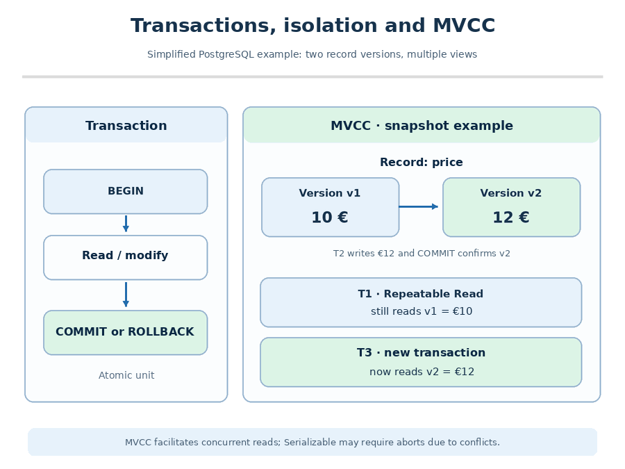
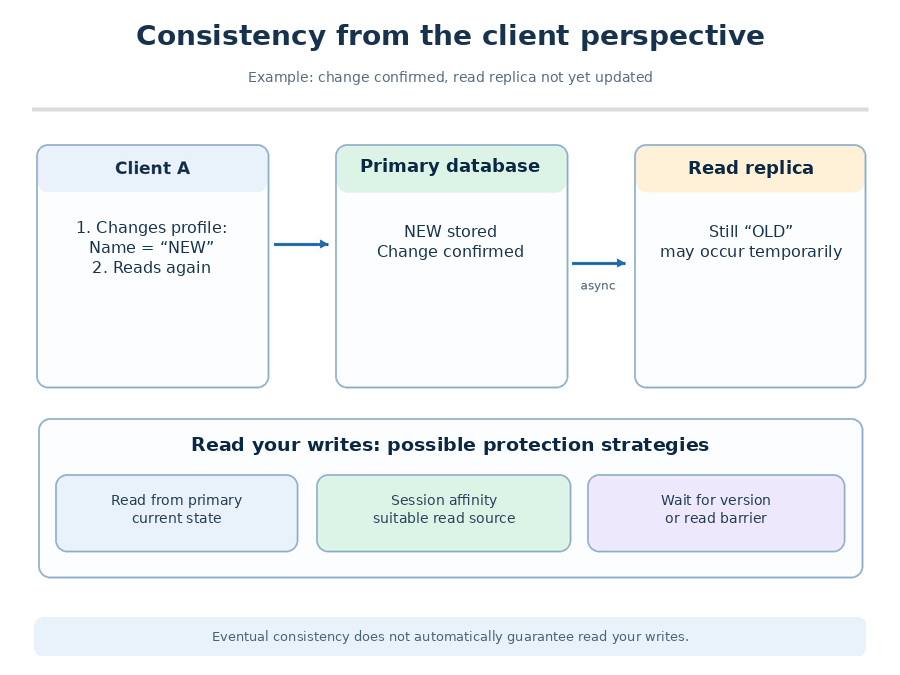

# M3-L5 – Transactions and distributed correctness {#L5}

**Course area:** M3 – Bachelor’s / transition: Database systems

**Level:** Bachelor’s / bridge to Master’s

**Prior knowledge:** No fixed prerequisites specified.

## The initial problem: A successful request does not automatically mean a correct change {#S1}

A database with only one user is easy to imagine: an application reads a value, changes it and writes it back. As soon as several users, background processes or servers act simultaneously, this simple model is no longer sufficient. One part of the system might read data that has changed in the meantime. A message might arrive twice. Or server A confirms a change while server B knows nothing about it yet.

The fundamental problem is **correctness under concurrent and distributed changes**. An application should not merely respond in some way: its business rules must remain valid even when operations overlap and individual components fail.

An easily understood example is seat reservation. Two requests for the last available seat arrive simultaneously. Both initially read “one seat available”. If both then independently store “reserved”, we have two confirmations for a single seat. Every individual program instruction may have been technically correct; the *overall effect* would be wrong.

``` text
Request A ── reads “1 seat free” ─┐
                                 ├── both want to reserve
Request B ── reads “1 seat free” ─┘
                                 ↓
                      correctness decision needed
                                 ↓
                      at most one valid confirmation
```

Which technique solves this problem depends on whether both requests use the same database or the data resides on independent servers. We begin with the simpler case and gradually increase the complexity.

## What a database transaction guarantees {#S2}

A **transaction** is a logically related sequence of database operations treated under certain guarantees. It often begins, performs several changes and receives final confirmation only at the end (*commit*). If it fails before then, the database can undo the changes that have not yet been committed (*rollback*).

A transaction can be understood as a complete business operation. When 20 euros are transferred from one account to another, “debit 20 euros” and “credit 20 euros” belong together. The first change without the second would be problematic from a business perspective.

``` text
Transaction “transfer 20 euros”
       │
       ├── Account A: -20 euros
       ├── Account B: +20 euros
       │
       └── COMMIT: both changes take effect
            or
           ROLLBACK: both are discarded
```

The familiar properties of such processing are summarised as **ACID**:

| Abbreviation | Full term | Meaning in everyday language |
| --- | --- | --- |
| A | *Atomicity* | Either the entire transaction or none of its changes takes effect. |
| C | *Consistency* | The database preserves its defined integrity rules; additional business rules must be modelled correctly. |
| I | *Isolation* | Concurrent transactions should not affect one another in impermissible ways. |
| D | *Durability* | Committed changes should survive the guaranteed failure scenarios, subject to configuration and the failure model. |

**Important:** ACID consistency does not mean that the database itself knows every business rule. If the system defines no protection against duplicate ticket reservations, it may atomically store a state that is wrong from a business perspective. Business rules must be implemented as constraints, appropriate changes or verifiable transaction logic.

**When is it unnecessary?** Displaying a static information page does not require a write transaction. By contrast, it is often central to related changes involving monetary amounts, orders or permissions.

## Why concurrent access can cause errors {#S3}

Imagine a counter with the value 10. Two processes each want to add 1.

``` text
Initial value: 10

Process A: reads 10       Process B: reads 10
Process A: calculates 11  Process B: calculates 11
Process A: writes 11      Process B: writes 11

Final value: 11           Expected: 12
```

This is a classic example of a **lost update**. The second write overwrites the result of the first. Depending on the database system, isolation level and form of the update, the database can prevent this or report an error. The decisive factor is whether the application first reads the value outside the database and then writes it back without protection, or uses, for example, an appropriate atomic update and correct conflict handling.

Another difficulty is a **non-repeatable read**: one operation reads a row, another changes it and commits the change, and the first reads a different value in a later execution of the same query. With **phantom reads**, instead of a particular row changing, the set of results changes because matching records have been added or removed in the meantime.

With **write skew**, even transactions that modify different rows can jointly violate a business rule. Example: two doctors must ensure that at least one is always on call. Both read “the other person is staying on duty” and independently remove themselves from the schedule. If the isolation used does not sufficiently prevent this conflict, nobody is on duty afterwards. The rows do not conflict directly; the *jointly evaluated rule* does.

The lesson is that it is not sufficient to store each individual row correctly. Relationships between several rows or conditions spanning entire data sets often need to be preserved.

## Isolation: How strongly should transactions be separated? {#S4}

**Isolation** describes which effects of parallel transactions an operation may see. SQL defines several classical isolation levels. Their implementation is database-specific; the following terms initially serve as orientation.

| Isolation level | Guiding idea | Typical trade-off |
| --- | --- | --- |
| Read Uncommitted | Weakest classical level; reading uncommitted changes is possible in principle | Risk of unreliable intermediate values; PostgreSQL treats this level as Read Committed |
| Read Committed | Changes read are committed; new commits may become visible between two queries | Good for many standard operations, but not every multi-step rule |
| Repeatable Read | A more consistent view throughout the transaction | Product-specific handling of conflicts and anomalies |
| Serializable | The result corresponds to a possible serial ordering of complete transactions | Additional checks, conflict-related aborts and retries |

**Serialisability** does not necessarily mean that everything actually runs sequentially. The system may process operations in parallel as long as the final result is as if a permitted order had occurred.

PostgreSQL 18 uses **Multi-Version Concurrency Control (MVCC)**: under appropriate conditions, readers and writers can see different record versions instead of blocking one another on every operation. At *Serializable*, PostgreSQL can abort transactions if an impermissible overlap is imminent. Applications must then be prepared for a clean retry.

**PostgreSQL-specific clarification:** In PostgreSQL, `Repeatable Read` also prevents classical phantom reads, but still allows certain **serialisation anomalies**. The *write skew* described above can be particularly relevant to a business rule spanning several rows. `Serializable` performs additional checks and may in this case reject one of the affected transactions with a serialisation failure. The application may then need to restart the **entire transaction** using current data. A high isolation level replaces neither correct integrity rules nor sensible access patterns. Reference: [PostgreSQL 18 – Transaction Isolation](https://www.postgresql.org/docs/18/transaction-iso.html).



*Figure: Simplified **PostgreSQL Repeatable Read** example: T1 already has an older snapshot and continues to see version v1 (€10) after T2 commits the change to v2 (€12). A subsequently started T3 sees v2. Snapshot timing and isolation are decisive; MVCC alone does **not** guarantee serialisability, and `Serializable` can require retries following conflict-related aborts.*

``` text
Two transactions at once
             │
             ▼
     Database tracks versions
     and possible conflicts
             │
       ┌─────┴─────┐
       ▼           ▼
   Safe sequence   Conflict detected
       │           │
     Commit        Abort
                   │
                   ▼
          Retry entire transaction if needed
```

**Practical implication:** The strictest isolation is not required for every query. It may be appropriate for critical rules, but depending on load it leads to additional conflict-handling work and aborts. The appropriate level should derive from the business risk, not from a desire for the strongest-sounding guarantees.

## Locks, optimistic conflict checks and deadlocks {#S5}

Databases use various mechanisms to coordinate concurrent changes. **Locks** are one of them: a transaction can reserve a row or other resource so that conflicting operations must wait.

With a **pessimistic strategy**, appropriate locks prevent the conflict early. With an **optimistic strategy**, operations may initially proceed and check on completion whether someone has changed the same relevant state in the meantime. A version field or the database system’s conflict detection can help.

Neither strategy is universally better. Locks can cause waiting and blocking; optimistic methods can cause frequent retries under high contention.

A **deadlock** arises when several transactions wait for one another:

``` text
Transaction A locks record X
Transaction B locks record Y

A now wants Y ───────► waits for B
B now wants X ───────► waits for A

                  Standstill
                    │
          Database detects deadlock
                    │
           One transaction is aborted
```

PostgreSQL detects such deadlocks and aborts one of the participating transactions. Applications should then not blindly re-execute every type of failed operation, but retry the entire operation where appropriate. The risk can often be reduced by accessing multiple resources in a consistent order and keeping transactions short.

**When is it excessive?** A private single-user catalogue with few changes does not normally require complex custom lock management. The transaction guarantees of the database used may be sufficient. With concurrent reservations, stock levels or payment assignments, however, the importance increases substantially.

## Why “try again” can be dangerous in a distributed system {#S6}

A network call has at least three possible outcomes: the destination processes the request successfully, rejects it, or the connection fails along the way. In the third case, the caller may not know *whether the change has already occurred*.

Suppose a customer clicks “Order”. The application creates the order. The connection then fails before the confirmation reaches the browser. The browser retries the request. Without protection, a second order can be created.

``` text
Browser ── “create order 4711” ─────► Server
   ▲                                   │
   │                 Database stores   │
   │                                   ▼
   └──── Response lost in network    [stored]

Browser ── Same request again ──────► Server
                       Risk: second order
```

A repeated attempt is called a **retry**. Retries are useful during temporary failures, but do not themselves resolve uncertainty. A timeout proves neither that the original operation failed nor that it succeeded.

Important write operations therefore often require an **idempotency strategy**. **Idempotent** means that performing the same intended operation several times has the same business-level final effect as performing it once.

Example: each order receives a unique **operation identifier** reliably established by the caller or application. The server stores this identifier with the result under a uniqueness constraint. If the same identifier arrives again, the existing operation is recognised instead of creating a second order.

``` text
Request + operation identifier K123
               │
               ▼
      Identifier already stored?
           /             \
          No             Yes
          │               │
     Commit operation   Associate previous
     once               result with K123
                        (no duplicate effect)
```

For a robust implementation, the identifier and result must be stored consistently. The system also needs rules concerning validity periods, use of the same identifier with different payloads and concurrency when two identical requests arrive simultaneously. A volatile list in working memory is often insufficient across restarts.

In the **Hypertext Transfer Protocol (HTTP)**, the methods `GET`, `PUT` and `DELETE` are regarded as safe or idempotent in different respects according to their defined semantics; `POST` is not generally idempotent. The actual business implementation remains decisive, not merely the method name. `GET` should not cause a business-level change; a carelessly implemented `GET /zahlung-ausloesen` contradicts precisely this idea.

## Duplicate messages are more normal than one might think {#S7}

Online services do not communicate only directly via HTTP. They often send events or jobs to a **message broker**, which buffers them and delivers them to **workers** (background processes). A worker may crash after processing a message but before acknowledging its successful receipt. The broker may then deliver the message again.

**At-least-once delivery** means that under the respective operating assumptions at least one delivery is sought; duplicates are possible. **At-most-once delivery** tends to avoid duplicates under the respective semantics at the cost of possible losses. Comprehensive *exactly-once* behaviour across message delivery, the database and external side effects is not guaranteed simply by enabling a broker option.

``` text
Job queue
        │
        ▼
     Worker A ── Processes job ──────► Database
        │
        └── Crash before acknowledgement
                    │
           Broker delivers again
                    │
                    ▼
                 Worker B
                    │
          Checks processing identifier
          and avoids duplicate effect
```

A common method is the **inbox or processing table**: the database stores the unique message identifier together with the business-level change in one transaction. When a job arrives again, the system recognises that its effect has already been applied.

Furthermore, messages do not automatically travel in the order in which they were generated. With multiple workers, responses and changes can arrive in a different order. If order matters, we need suitable keys, sequence numbers, versions or processing ordered per customer/object.

For a local batch process with only one controlled execution path, this infrastructure may be unnecessary. However, once servers, queues and external APIs are involved, duplicate processing becomes a fundamental issue.

## Updating two systems: The dual-write problem {#S8}

An online service stores an order in its database and then wants to send an “order created” message. A naïve procedure consists of two independent steps:

``` text
1. Database: store order                        ✓
2. Message broker: publish event               ✗ Failure

Result: the order exists,
        other services were not informed.
```

Reversing the order does not reliably help: if the message is sent first and the database access subsequently fails, a notification may exist for an operation that was never stored. This fundamental problem is called **dual write**.

### Transactional outbox

A common countermeasure is the **transactional outbox**. The application writes the actual change and a dispatch request **within the same local database transaction**. A separate process sends the outbox entry later.

``` text
Web application
     │
     ▼
One local database transaction
     ├── Store order
     └── Store outbox event
     │
     ▼
   COMMIT
     │
     ▼
Outbox worker ──► Message broker ──► Recipient
                             │
                  On retry: detect duplicates
```

This closes the critical gap between a *local change* and a *durably recorded message awaiting dispatch*. However, it does not itself guarantee exactly-once processing at the recipient. An acknowledgement can be lost during dispatch; the outbox process may then send again. **An outbox and an idempotent recipient therefore belong together.**

The technical effort is not free: dispatch status, pending entries, failures, backlogs and clean-up must be monitored. For a single program without external message dispatch, the pattern is not normally worthwhile.

## Distributed transactions: When several databases must decide together {#S9}

Now we distribute an operation across **two independent databases**. Server A should debit an amount of money and server B should credit it. Starting an ordinary ACID transaction on each is not sufficient: initially, the two transactions know nothing of each other.

A higher-level method is needed for the joint decision. A classical approach is **Two-Phase Commit (2PC)**. A **coordinator** consults several participants.

1.  **Preparation phase:** The coordinator asks whether every participant can durably prepare and later commit its planned changes. The participants agree or reject.
2.  **Decision phase:** If all agree, the coordinator decides to commit; otherwise, to roll back. This decision must reliably reach all participants.

``` text
              Transaction coordinator
                      │
        ┌─────────────┴─────────────┐
        ▼                           ▼
     Database A                  Database B
      “ready?”                    “ready?”
        │                           │
      Yes/No                      Yes/No
        └─────────────┬─────────────┘
                      ▼
                  Joint decision
                      │
        ┌─────────────┴─────────────┐
        ▼                           ▼
   Commit/Rollback             Commit/Rollback
```

**Why is 2PC not the default everywhere?** During preparation, resources may remain reserved. If the coordinator fails at a critical moment, participants may have to wait for recovery of the decision. The method requires support from all participating systems and additional operational logic.

PostgreSQL 18 supports prepared transactions for an external transaction manager. This does **not** mean that two arbitrary PostgreSQL servers automatically become a correctly coordinated transaction system through a simple switch. The coordinator and the failure/recovery procedure remain essential components.

Modern distributed SQL databases also coordinate transactions, but using product-specific mechanisms. It would be wrong to assume the same 2PC implementation everywhere.

**Limit of applicability:** If a small application requires only one database, a local transaction is usually much simpler, easier to understand and less expensive.

## Sagas and compensation: Business processes instead of one large lock {#S10}

Not every long-running operation can or should occur within one global transaction. An order can reserve goods, initiate payment processing, create a shipping request and later trigger an email. Such steps often involve different services or external partners.

A **saga** divides a related business process into several local transactions. After every successful step, the next one starts. If a later step fails permanently, suitable **compensations** (*compensating actions*) follow, such as “release the reservation again”.

``` text
1. Create order        ──► successful
2. Reserve items       ──► successful
3. Authorise payment   ──► failed
                             │
                             ▼
                    Release reservation
                    Set order to “cancelled”
```

**Compensation is not the same as database rollback.** A completed local transaction has already been committed and may have been seen by other operations in the meantime. The subsequent counteraction is a new business operation. A shipped parcel cannot simply be “rolled back”; a return may need to be arranged. Payments, notifications and external side effects also have their own rules.

Sagas can be **orchestrated**: a central process manager decides which step to trigger next. Or they can be **choreographed**: services react to events from other services. Both models must handle partial failures, retries, missing responses and uncertain intermediate states.

A saga is particularly suitable when a business operation runs over a longer period and across several independent systems and temporary intermediate states are acceptable. Where an invalid intermediate state must never become visible, a local or suitable strict distributed transaction may instead be required.

## Eventual consistency: Why temporarily differing views can be acceptable {#S11}

**Eventual consistency** roughly means that, if no new changes are added and the necessary communication functions again, the relevant copies converge towards a consistent state according to the system’s guarantees. It does **not** mean that every arbitrary delayed change eventually becomes correct at the business level automatically.

An image portal might store a new image description immediately in the application’s primary store and update the public search function only later. For a few seconds, search then shows an older state. This is acceptable to many users.

In an ordering system, by contrast, an outdated account balance or a reservation allocated twice can cause considerable damage. Here one must distinguish which information may appear with a delay and which decisions must be made immediately on an unambiguous, current basis.

``` text
Image portal:                   Booking system:
Upload image                    Reserve last seat
    │                                 │
    ▼                                 ▼
Database commits                Strict availability check
    │                                 │
    ├── Search index later            ▼
    └── Preview image later     Unambiguous reservation

Delay usually tolerable         Duplicate confirmation intolerable
```

An application can use **both strategies at once**: a strictly correct booking decision, but delayed email confirmation or search index updates. This separation reduces complexity and avoids unnecessarily rigid overall architectures.

Important consistency questions include: Does the user see their own committed change (*read your writes*)? Are dependent events processed in the correct order? Can a second server return older data? And what should happen if a location is currently unreachable?



*Figure: A deliberately simplified example of asynchronous replication and **eventual consistency**. A committed write may not yet be visible in a subsequent query through a delayed replica server. **Read your writes** therefore requires a suitable read source or version coordination; this is distinct from the transaction isolation levels explained earlier.*

## Continuous example: Three servers, two orders, one remaining unit {#S12}

Consider an online tool that sells a limited number of processing credits. A customer account has **one credit** remaining. Two browser windows simultaneously send an AI image job that costs one credit each.

### Variant A: Uncoordinated processing

Server 1 and server 2 both read the credit balance of 1. Both start their AI worker and later each deduct one credit. The result might be a negative balance, a lost update or two paid services for the price of one. The decisive point is that reading and the subsequent decision were not sufficiently coupled.

### Variant B: One database as the authoritative decision point

``` text
Browser A ──► Web server 1 ─┐
                             ├──► Same database
Browser B ──► Web server 2 ─┘          │
                                       ▼
                           Reserve credit atomically
                           only if balance sufficient
                                       │
                            ┌──────────┴─────────┐
                            ▼                    ▼
                          Success             Rejection
                            │
                      Job in queue
                            │
                            ▼
                         AI worker
```

The important idea is that all web servers may run in parallel while **one consistent database operation** authoritatively decides which job is valid. A suitable unique job identifier additionally protects against accidental duplicate submission. The job is accepted only after successful reservation.

### Variant C: Distributed processing with an outbox

If job creation, credit reservation and recording the queue event are combined in one local database transaction, the handover to the worker can be made more reliable. The outbox dispatch takes place later. The worker handles repeated message deliveries idempotently.

If the AI worker fails, the system can rerun the job or refund credits depending on the business rule. Whether a partially generated image file is retained, deleted or charged for must be decided at the business level: database technology alone does not answer this question.

### Variant D: Multiple independent account databases

If the credit balances of different customers are distributed across separate shards, operations affecting only **one** customer can often be handled within one shard. If credits must instead be transferred between customers on different shards, a new coordination problem arises. The choice of shard key from M3-L3 is therefore not only about speed, but also about transaction boundaries.

**Insight:** A scalable architecture does not need maximum distribution everywhere. It helps to keep the critical business decision as local and unambiguous as possible and deliberately execute downstream work asynchronously.

## Operation, security, costs and troubleshooting {#S13}

With every additional instance and service, not only capacity but also the number of possible failure states increases. For correct distributed processing, operators must therefore consider several aspects:

**Observability:** Operations need unique identifiers that can be found again in the database, message and application. Otherwise, duplicate or lost processing is difficult to reconstruct.

**Monitoring:** Alongside general server utilisation, conflict-related aborts, deadlocks, retry rates, queue backlogs, old outbox entries and long-running transactions are important signals. Low CPU utilisation does not rule out a serious locking bottleneck.

**Security boundaries:** Servers may only access the data and messages needed for their task. A lack of tenant isolation can expose data even if transactions are technically correct. Idempotency keys must not allow users to retrieve other users’ job results; they must be bound to authorised identities and operations.

**Backups and recovery:** A transaction does not protect against every kind of data loss. If incorrect changes have been stored correctly, they remain correctly stored – and can be replicated. Independent backups and tested recovery remain necessary. Details follow in M3-L6.

**Costs:** Strict isolation, coordinated multi-node transactions, additional tables, queue infrastructure and continuous monitoring consume computing time, storage, network traffic and maintenance. Troubleshooting also becomes more demanding. Costs arise not only from rental prices but also from development and operational hours.

**Operational decision:** If the entire application works reliably with one database and a few clearly defined transactions, this is often the more economical architecture compared with a distributed transaction apparatus. A complex mechanism should only be used when concrete business or operational requirements justify it.

## Guidance for choosing the right mechanism {#S14}

| Situation | Usually suitable starting solution | Additional caution |
| --- | --- | --- |
| Change two fields of a local database together | Ordinary ACID transaction | Define business constraints correctly |
| Concurrent reservation of the same seat | Atomic decision, suitable isolation or lock | Handle conflicts and retries correctly |
| Same web job sent twice | Unique operation identifier and idempotent processing | Store result, identifier and permissions consistently |
| Database change should later trigger a message | Transactional outbox with idempotent recipient | Dispatch can occur repeatedly |
| Two independent databases must decide atomically | Appropriate coordinated distributed transaction, if supported | Recovery, locks and coordinator failure |
| Long-running job across several external services | Saga with documented states and compensation | Not all real-world actions can be undone |
| Public search index lags behind an image change | Eventual consistency often acceptable | Keep the delay visible and limited |
| Payment or booking decision | Authoritative, correctly coordinated data basis | Permit neither duplicate effects nor conflicting confirmations |

The table is deliberately not a universal product recommendation. It first separates the **correctness problem** from the question of whether to solve it with PostgreSQL, SQLite, a managed service or a distributed database.

## Summary and transition to M3-L6 {#S15}

Operating databases across several servers is not just a problem of speed and data distribution. The more difficult question is often: **What must under no circumstances happen during concurrent changes and partial failures?**

- **ACID transactions** group related local changes; business rules must be described correctly.
- **Isolation and locks** coordinate concurrent access, but can cause conflicts, waiting and deadlocks.
- **Retries** are important, but must not trigger the same business action multiple times in an uncontrolled way.
- **Idempotency** and unique operation identifiers protect against unwanted duplicate effects.
- A **transactional outbox** couples a data change and a recorded pending message in one local transaction; recipients must handle duplicates.
- **Two-Phase Commit** coordinates atomic decisions across systems but adds considerable operational requirements.
- **Sagas** coordinate multi-step business processes using local transactions and possible compensating actions.
- **Eventual consistency** may be useful for less critical data views, but does not replace strict decisions where duplicate confirmations are impermissible.

M3-L6 deals next with **data durability**: independent backups, snapshots, point-in-time recovery and the question of how much data loss and downtime a system can tolerate in the first place.

## Terms and abbreviations at a glance {#S16}

| Term | Full term / meaning |
| --- | --- |
| ACID | Atomicity, Consistency, Isolation, Durability – transaction guarantees |
| Commit / Rollback | Commit a transaction definitively / undo uncommitted changes |
| MVCC | Multi-Version Concurrency Control |
| Lock / Deadlock | Lock / mutual blocking of transactions |
| Serializable | Isolation guarantee: effect as if some serial execution had occurred |
| Retry | Deliberate repetition of a potentially failed operation |
| Idempotency | Repeated identical request without repeated business-level effect |
| HTTP | Hypertext Transfer Protocol – web communication protocol |
| Outbox / Inbox | Stored outgoing / incoming messages or processing identifiers |
| 2PC | Two-Phase Commit – two-phase confirmation of a distributed transaction |
| Saga | Sequence of local transactions with documented compensation steps |
| Eventual consistency | Eventual convergence of copies under suitable conditions |
| Shard | Independent part of a partitioned database |
| Worker | Background process that processes messages or jobs |


## Sources {#S17}

**Last source review:** 03.11.2026

**Reviewed on 03.11.2026.** Relevant primary documentation and standards:

1.  PostgreSQL 18, *Transaction Isolation*: [https://www.postgresql.org/docs/18/transaction-iso.html](https://www.postgresql.org/docs/18/transaction-iso.html) — standard isolation levels, anomalies, Serializable and PostgreSQL-specific characteristics.
2.  PostgreSQL 18, *Explicit Locking*: [https://www.postgresql.org/docs/18/explicit-locking.html](https://www.postgresql.org/docs/18/explicit-locking.html) — locks, deadlocks and conflict avoidance.
3.  PostgreSQL 18, *Serialization Failure Handling*: [https://www.postgresql.org/docs/18/mvcc-serialization-failure-handling.html](https://www.postgresql.org/docs/18/mvcc-serialization-failure-handling.html) — retrying entire transactions after serialisation failures.
4.  PostgreSQL 18, *Two-Phase Transactions*: [https://www.postgresql.org/docs/18/two-phase.html](https://www.postgresql.org/docs/18/two-phase.html) — support for prepared transactions with an external coordinator.
5.  RFC 9110, *HTTP Semantics*, section 9.2.2: [https://www.rfc-editor.org/rfc/rfc9110.html#section-9.2.2](https://www.rfc-editor.org/rfc/rfc9110.html#section-9.2.2) — idempotency of HTTP methods and retry semantics.
6.  Microsoft Learn, *Compensating Transaction pattern*: [https://learn.microsoft.com/en-us/azure/architecture/patterns/compensating-transaction](https://learn.microsoft.com/en-us/azure/architecture/patterns/compensating-transaction) — limitations and significance of compensating transactions and their relation to sagas.
7.  Microsoft Learn, *Transactional Outbox pattern* (Azure Cosmos DB): [https://learn.microsoft.com/en-us/azure/architecture/databases/guide/transactional-out-box-cosmos](https://learn.microsoft.com/en-us/azure/architecture/databases/guide/transactional-out-box-cosmos) — durably recorded pending events and asynchronous publication.
8.  Microsoft Learn, *Implement the Transactional Outbox pattern with Dataverse*: [https://learn.microsoft.com/en-us/power-platform/architecture/reference-architectures/transactional-outbox-pattern](https://learn.microsoft.com/en-us/power-platform/architecture/reference-architectures/transactional-outbox-pattern) — duplicate message delivery and idempotent recipients.

**Note:** The lesson compares architectural principles. Which isolation level, delivery guarantee or configuration a particular product actually provides must be verified separately for its version and operating mode. No independent load tests or production payments, bookings or clusters are carried out here.
