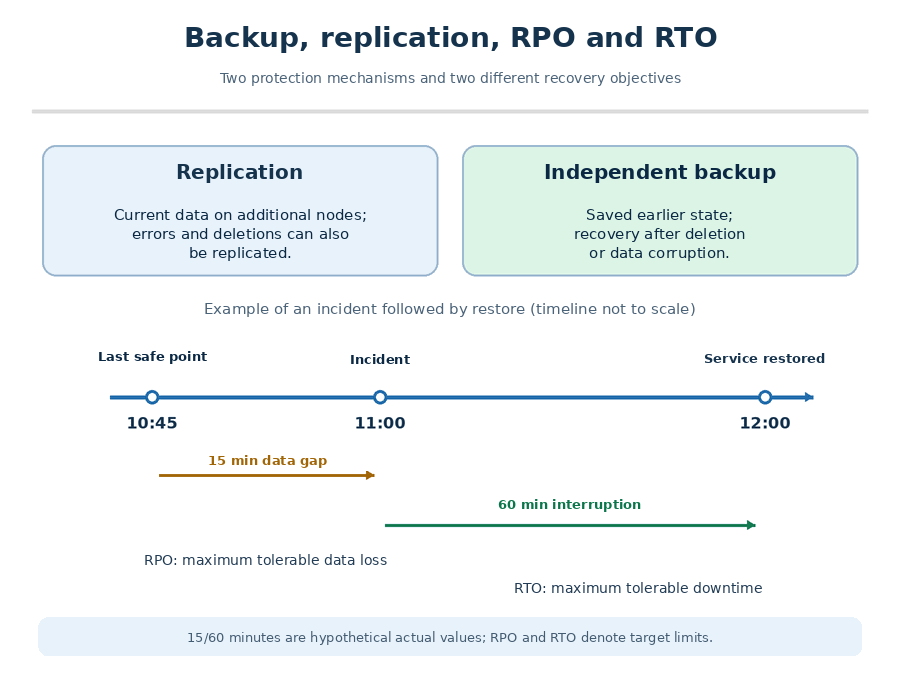

# M3-L6 – Data durability: Backups, recovery and failure preparedness {#L6}

**Course area:** M3 – Bachelor’s / transition: Database systems

**Level:** Bachelor’s

**Prior knowledge:** No fixed prerequisites specified.

## The initial problem: Data must survive a failure {#S1}

A database is not secure simply because it runs on a reliable server. A computer can fail, a storage device can be damaged, human error can delete thousands of records, a software fault can overwrite content incorrectly, or an attacker can encrypt data and attack backups. Even a perfectly functioning database server can permanently store a deletion that is *technically valid but wrong from a business perspective*.

**Data durability** initially means that committed changes survive certain technical failures. In practice, this property is not sufficient: an operator must also be prepared to recover the data after accidental or malicious changes. That is precisely the purpose of independent **backups** and planned **recovery procedures**.

A small media catalogue, a SaaS service (Software as a Service, software delivered over the internet) and a paid AI job processing service require different degrees of protection. The greater the damage caused by interruption or data loss, the more extensive the backup arrangements, monitoring, testing and organisational responsibilities usually become.

``` text
Running application
        │
        ▼
Production database ───────► Independent backup
        │                          │
        │ Technical failure        │ Retained, verified copy
        ▼                          ▼
Data missing / incorrect ──► Recovery
                                   │
                                   ▼
                             Verified data
```

This lesson does not explain how to administer a particular server using commands. Instead, it discusses the available protection mechanisms, the failures they address and the new responsibilities they introduce.

## Four things that look similar but serve different purposes {#S2}

In everyday use, **replication**, **backups**, **snapshots** and **archiving** are often confused. However, they answer different questions.

| Method | Main purpose | Typical strength | Typical limitation |
| --- | --- | --- | --- |
| Replication | Keep data on other running nodes up to date | Faster takeover in certain server failures; potentially additional readers | Incorrect changes and deletions can also be replicated |
| Backup | Retain older, preferably independent and recoverable data states | Recovery after deletion, corruption or failure | Recovery takes time; the backup may be incomplete |
| Snapshot | Capture the state of a storage system or service at a particular point in time | Often very quick to create | Without appropriate consistency and independent retention, not a reliable substitute for a backup |
| Archiving | Retain data or backups over the long term | Historical traceability and long-term preservation | An archive is not necessarily quickly recoverable or recoverable as a running database |

For example, if the customer table is accidentally deleted at 14:00, a second database server maintained through synchronous replication can receive the same deletion. It remains technically available, but contains the same error. An independent backup from 13:00 could save the data. However, changes between 13:00 and 14:00 would be missing if no supplementary change logs had been retained.

**When is it unnecessary?** A purely public, immutable demonstration project whose data can be regenerated entirely from version control or other original sources might not require extensive database backups. Nevertheless, application recovery and the original sources must be protected.

## How a database makes its changes durable in the first place {#S3}

In M3-L1 we encountered **Write-Ahead Logging (WAL)**: in many systems, database changes are first recorded in a log before the affected data pages are updated durably at a later point. This helps in the event of a sudden crash. After restarting, the server can determine which changes are considered complete and restore a consistent state using the log.

However, WAL alone is **not an external backup**. If the data files and logs are lost together, it offers no benefit. Nor does the log automatically protect against a deletion correctly executed by the database system. The distinction is this: *crash recovery* restores internal consistency after a particular system failure; *backup recovery* reconstructs data from separately retained backups.

``` text
                 Transaction
                      │
                      ▼
                Change log (WAL)
                      │
          ┌───────────┴───────────┐
          ▼                       ▼
        Commit                Data files
                                  │
                             Later write

External backup: separate copy + archived WAL segments if required
```

Precisely how a commit (final confirmation of a transaction) is protected depends on the database system, its settings and the storage hardware. The operating system, file system, storage controller and behaviour during a power failure remain relevant parts of the protection chain.

## Simple backups: A complete copy or logical export {#S4}

A **full backup** contains a complete, recoverable starting state. In PostgreSQL such a backup can take different forms.

A **logical backup** exports database objects and data in a form from which they can be reconstructed. PostgreSQL provides `pg_dump` for this purpose; `pg_dumpall` additionally covers multiple databases and global objects such as roles. Such an export is suitable, among other things, for smaller data sets, migrations and recovery of selected database objects. However, it is not the same as a physical backup of an entire database cluster.

A **physical backup** retains the database files in a form usable by the system. In PostgreSQL, `pg_basebackup` is a tool intended for creating a consistent base backup. An advantage can be faster recovery of large data sets; version compatibility, completeness of files and matching change logs are particularly important in return.

The official PostgreSQL documentation distinguishes three basic strategies: SQL dump, file system backup and continuous archiving. The methods are not arbitrarily interchangeable.

``` text
                  PostgreSQL
                      │
          ┌───────────┴───────────┐
          ▼                       ▼
      Logical export        Physical backup
      Tables + schema        Database files
          │                       │
          ▼                       ▼
        Reimport             Cluster restore
```

**Limitation:** An export that nobody can import successfully is merely a file, not a backup with proven functionality. With large databases, both export and import can take a long time. The backup should also account for the required software version, credential management and configuration.

## Snapshots: Quick to create, but useful only under certain conditions {#S5}

A **snapshot** captures a state, for example of a storage device or a cloud storage volume. Many storage systems can create such states quickly and subsequently manage changed blocks separately. This makes snapshots attractive for short rollbacks, maintenance or extra layers of protection.

The critical concept is **consistency**. A database often writes several interrelated files and logs. If only some of them are captured at an unsuitable moment, the result may not be a usable database state. Depending on the database system, a *crash-consistent* snapshot may be usable with the system’s own recovery log; an *application-consistent* backup additionally takes account of the specific requirements of the database. Whether a snapshot is usable must be verified for the particular platform.

``` text
Database running ──► Coordinated snapshot
                           │
                           ▼
                       Captured state
                           │
                           ▼
                     Separate retention
                           │
                           ▼
                       Test recovery
```

A snapshot stored exclusively on the same storage system as the production database is often insufficiently protected against the complete loss of that system. Cloud snapshots may likewise share access permissions, account risks or failure domains with the original. **A separately retained backup whose recoverability can be tested is more important than the name of the method.**

## Full, incremental and differential backups {#S6}

Not every backup needs to transfer all the data again. This leads to three fundamental strategies.

**Full backup:** At a particular time, all the required data is backed up. Recovery is comparatively straightforward, but backup duration and storage requirements can increase.

**Incremental backup:** After an initial backup, only certain changes since an earlier backup state are retained. This can save space but creates dependencies: recovery requires the appropriate base and the necessary sequence of changes.

**Differential backup:** Usually the changes since a particular full backup are collected. Recovery then requires, for example, the full backup and a subsequent differential backup. Not every product uses these terms or methods in the same way.

``` text
Full backup on Monday
     │
     ├── Tuesday: changes A
     ├── Wednesday: changes B
     └── Thursday: changes C

Incremental: Full + A + B + C (depending on the method)
Differential: Full + combined changes A/B/C
```

The PostgreSQL 18 project documentation also describes **incremental physical base backups**. They require suitable previous backups and reconstruction using appropriate tools; the project explicitly points out that the required backup dependencies are not automatically managed on behalf of the operator. For small databases, regular full backups are therefore often simpler and more economical. Incremental strategies can help with large data sets that change relatively little.

**Operational risk:** A missing intermediate backup or a damaged required file can render an entire recovery chain unusable. More complex backup methods require careful retention rules and checks.

## Point-in-time recovery: Returning to a specific point in time {#S7}

**Point-in-Time Recovery (PITR)** means recovery to a selected earlier point in time. It is particularly helpful when one knows *when* an error began but does not simply want to reset all the data to the last daily backup.

Consider a small online service: at 14:07 a faulty update deletes a table. The last full backup dates from 02:00. Without further backups, the service would have to return to its state at 02:00. Changes from twelve hours and seven minutes would be lost. With a suitable physical base backup and **continuously archived WAL files**, PostgreSQL can replay changes up to the moment immediately before the error.

``` text
02:00       10:00       14:06       14:07       15:00
  │            │           │            │           │
  ▼            ▼           ▼            ▼           ▼
Base backup ───────── WAL change sequence ──────►
                           ▲            ▲
                           │            └─ Incorrect deletion
                           └─ Possible recovery target

Recovery = suitable base + complete WAL chain
           + deliberately selected stopping point
```

The mechanism has several prerequisites. The base backup must match the WAL logs. The required segments must all be present and readable, without gaps. The correct target time must also be identifiable. PostgreSQL can stop during recovery at a specified timestamp or named recovery point.

**Important limitation:** An ordinary `pg_dump` cannot simply be combined with later WAL segments to form a PITR chain. The base used for this purpose is an appropriate physical backup. And a stopping point that is too late would replay the incorrect deletion.

PITR also does not mean that the work involved is trivial. A large data set may first have to be restored in full and then many changes replayed. This can significantly increase recovery time. That is precisely why backup and recovery should be planned together.

## RPO and RTO: Two distinct requirements {#S8}



*Figure: Example with the last recoverable state at 10:45, a failure at 11:00 and service restoration at 12:00. The illustrated intervals of 15 and 60 minutes are assumed actual intervals and **not** guaranteed RPO/RTO objectives. Replication alone does not reliably protect against logically incorrect or deliberately deleted data.*

Computer science uses two metrics to specify the acceptable consequences of a failure.

**RPO – Recovery Point Objective:** the target for how far back a recovered data state may be relative to the moment of failure. Intuitively, it is the maximum acceptable data loss measured in time. An RPO of one hour, for example, means that the operator *aims to tolerate* the loss of no more than approximately one hour of changes in a specified failure scenario. This is a requirement, not an automatic guarantee.

**RTO – Recovery Time Objective:** the target for the time required for a system to return to a usable state after a failure. An RTO of four hours means that recovery is intended to take place within that time frame. This too must be demonstrated technically and organisationally.

``` text
RPO – How OLD may the recovered data be at most?

Last reliably recoverable change               Failure
              │                                    │
              └──────────── Data gap ──────────────┘

RTO – How LONG may recovery take?

             Failure                    Service usable again
                │                               │
                └──────── Interruption ─────────┘
```

| Hypothetical service | Example RPO target | Example RTO target | Rationale |
| --- | --- | --- | --- |
| Private media catalogue that rarely changes | 24 hours | 1–2 days | Changes can be reconstructed if necessary |
| Small online administration tool | 1 hour | 4 hours | Users expect limited data loss and a manageable interruption |
| Booking or credit balance service | Very low, possibly close to zero | Very low | Confirmed bookings may be financially binding |

These values are **freely chosen teaching examples** and explicitly not industry standards. Even an RPO close to zero does not automatically require sharding or very many servers, but an architecture tailored to specific failures. An RTO of zero is practically unattainable for most failure models.

A short interruption and low data loss are **two separate objectives**. Switching to a replica can restore operations quickly and still lose some of the most recent committed changes. Conversely, a full backup can provide all the required data but take many hours to restore.

## Offsite backups, 3-2-1 and protection against shared failures {#S9}

An **offsite copy** is a backup retained outside the primary operating location or failure domain. The central idea is to prevent all copies from being lost through the same cause. If the production data and backup reside on the same server and storage device, a single fault can destroy both.

A familiar mnemonic is **3-2-1**: three copies of important data (including production data), on two different storage media or systems, one of which is geographically or technically separate. For modern online services, it is more important than a rigid number to have **independent failure, access and deletion paths**. A cloud backup under the same administrative identity can also be at risk if access is compromised.

``` text
Production database
       │
       ├── Local backup (quick recovery)
       │
       └── Separate backup (offsite)
                │
                ├── Restricted write/delete permissions
                ├── Immutable retention period if needed
                └── Verified recoverability
```

An **immutable backup** means that a retained backup state cannot readily be overwritten or deleted during a specified protection period. An **offline backup** refers to a copy temporarily or permanently disconnected from the running system. Both properties can help protect against attacks, but they are not identical.

The US agencies FBI and NIST emphasise separate or immutable backups and practical recovery tests in their security guidance. Such recommendations serve as orientation; the specific strategy needed depends on the data and risks.

## A backup must account for more than a database file {#S10}

Suppose an online service’s database has been recovered. The website still does not start because configuration is missing, a key is unavailable, uploaded files were not backed up or the application version is incompatible with the data. In that case, *only part* of the service has been recovered.

Complete recovery planning may also require:

- Database schema, database roles, permissions and required extensions.
- Application version, configuration, infrastructure description and documentation.
- Uploaded files, images, documents or external object storage data.
- Secrets and encryption keys – securely separated and with controlled access.
- Domain/network configuration, external dependencies, identity and payment services.
- A comprehensible sequence for restoring and testing the application.

Not every component must be retained using the same backup method. Program code, for instance, can be recovered from version control provided that access and versions are also protected. Irreplaceable customer data normally needs stronger protection than static application files.

**Particular risk: encryption keys.** If data is stored encrypted but the only decryption key is lost, it may no longer be possible to read even a technically intact backup. The key, in turn, must not be left completely unprotected right beside the backup.

## Security and data protection in backups {#S11}

A backup often contains the same sensitive content as the production system: customer data, internal documents and possibly access information. Every additional copy creates another opportunity for access and another retention obligation.

Useful protection principles include:

**Access minimisation:** Only explicitly authorised persons and services may read, restore or delete backups. This protects in particular against accidental and malicious deletion.

**Encryption:** Transmission and storage can be encrypted. Key management and the recoverability of keys are part of the overall solution.

**Retention period:** Do not keep copies indefinitely without a purpose. Longer histories help with late-discovered corruption but can cause data protection and storage problems.

**Separation:** Where possible, protect particularly valuable backups separately from the same administrative permissions, the running server and shared causes of failure.

**Traceability:** Who created, deleted, verified or restored which backup, and when? Logs themselves require protection.

Personal data may raise questions of deletion and retention under data protection law. A backup is not a separate collection exempt from legal obligations; specific requirements must be assessed according to country, legal basis, contract and technical design. This chapter is not legal advice.

## Restore testing: The central practical test {#S12}

A file called `backup-2026-11-03.zip` initially proves only that a file exists. It does not establish whether it is complete, readable, correct and recoverable on another system. Even a successful checksum verifies only a limited subset of the required properties.

A genuine **restore test** (*recovery test*) restores a backup into a suitable test environment. Data and application are then checked: Are the tables present? Are the expected records and relationships correct? Do login, essential queries and business processes work? How long did the entire procedure take?

``` text
Backup
      │
      ▼
Integrity check (files/manifest)
      │
      ▼
Recovery in test environment
      │
      ▼
Start database + application
      │
      ▼
Business-level test + time measurement
      │
      ▼
Documented evidence
```

PostgreSQL provides `pg_verifybackup`, a tool that verifies suitable physical base backups against a backup manifest. However, the project documentation explicitly warns that such checks **cannot replace a complete restore test**. Errors may exist that only become visible during startup or business-level queries.

A useful test separately assesses **data integrity** (is the backup technically correct?), **business-level plausibility** (is it the required data state?) and **operability** (can users actually use the service again?).

## A recovery plan needs decisions, not just technology {#S13}

During a failure, not every step is immediately clear. Should the old server be repaired or a new system built? Which backup state should be used? Must particular payments or changes be reconciled manually afterwards? How can users be prevented from creating further contradictory data during a partial recovery?

A realistic procedure might look like this:

1.  **Detect and isolate the failure:** A hardware failure only, a lost database file, an incorrect change or an attack?
2.  **Prevent further damage:** Restrict problematic write access where possible without additional data loss; protect unchanged backups.
3.  **Select the recovery target:** Last intact state, a defined point in time or a still-intact replica?
4.  **Prepare the new environment:** Provide suitable software version, configuration, keys and storage capacity.
5.  **Restore data:** From a complete backup and any necessary change logs.
6.  **Verify technically and at business level:** Is the data consistent, are expected records present and are application functions usable?
7.  **Restore service in a controlled way:** Inform users, reconcile pending operations and document events afterwards.

This sequence is guidance, not a universal emergency manual. If an attack is suspected, a compromised system must not automatically be treated as a trusted starting point. Financially binding operations may require further coordination and documented decisions.

## Three continuous practical cases {#S14}

### Case A: Local media catalogue with SQLite

A locally developed media catalogue stores file paths, categories, ratings and notes in SQLite. The database resides in a file on a single computer. For a manageable application, this is often a very good, simple solution.

**Backup problem:** If the SSD fails, personally created categories and notes are lost. Copying the file every night can be problematic while the database is being accessed, depending on the journal mode and procedure. The official SQLite documentation provides the **Online Backup API** (an application programming interface for consistent online copies) for backups during operation and alternatively `VACUUM INTO`. Both can create a consistent database copy without requiring an installation project here.

``` text
SQLite database
       │
       ▼
Consistent online backup
       │
       ├── Local copy
       └── Separate archive
                │
                ▼
          Open as a test
```

It is also necessary to consider whether the catalogued media files themselves require backups or whether they can be recovered from an existing archive. **A backed-up SQLite catalogue file does not automatically protect the catalogued media.**

### Case B: Small online service with PostgreSQL

A service receives customer settings, jobs and status information. A small rented server and a single PostgreSQL database may be sufficient for operation.

An obvious backup strategy consists of regular database exports or suitable physical backups, a separate copy and a documented restore. If a few hours of data loss are unacceptable, a combination of physical base backups and continuous WAL archiving may become useful. The price is storage, monitoring, more complex recovery and recurring tests.

``` text
Web application → PostgreSQL
                     │
              Base backup + WAL archive
                     │
              Separate backup destination
                     │
                 Controlled restore
```

An additional standby can mitigate certain failures more quickly but replaces neither this backup nor the correction of business-level errors. For a service that generates only a few changes every day, a simpler backup may be more economical.

### Case C: AI job processing service with database and object storage

An online AI service manages user credit balances, image/video uploads, processing jobs and finished results. Important information is not exclusively stored in a database. Job data might reside in PostgreSQL, input and output files in separate object storage, and actual processing might run on one or more GPU servers (Graphics Processing Units, graphics/parallel processors).

``` text
           User
             │
             ▼
      Job management
        │          │
        ▼          ▼
   PostgreSQL   Object storage
        │          │
        └────┬─────┘
             ▼
          AI worker
             │
             ▼
       Result + status

Backups: DB state + files + associations
```

If only the database is restored from the previous night but object storage files are retained in their current state, records may refer to non-existent files or other files may no longer have associated metadata. A sound recovery strategy must account for **consistent relationships across multiple stores**. This may require a shared backup strategy, traceable object versions and verifiable job identifiers.

**Cost trap:** Large image and video files, multiple backup versions and transfers from remote storage can generate substantial recurring costs. Not every generated intermediate result must be retained forever. Particularly for a small service, it is important first to establish which data is truly indispensable.

## How to choose the right backup strategy {#S15}

Five guiding questions are useful for a specific application:

| Question | Implication |
| --- | --- |
| Which data is irreplaceable? | The harder it is to reconstruct, the more important an independent backup becomes |
| How much data loss is acceptable? | This determines the RPO requirement |
| How long may the service be unavailable? | This determines the RTO requirement |
| Which failures must be addressed? | Hardware failure, human error, deletion, attack and data centre failure require partly different measures |
| Who operates and verifies the procedure? | Backup without responsible operators, alerts and restore testing remains risky |

For a private project, a consistent daily database export with a separate copy may be sufficient. For a service with paying customers, more frequent backups, longer histories or a verified recovery procedure may be necessary. For particularly critical data, multiple independent methods may be appropriate.

However, one should **not automatically choose the most expensive architecture**. More backups, more replicas and more automation also increase the number of potentially misconfigured components. A simple, tested backup is more valuable than a complex system that nobody can reliably recover.

## Operating costs and typical misconceptions {#S16}

The cost of a backup architecture is not simply a matter of gigabytes of storage. It also includes computing and input/output load during creation, network traffic, possible data retrieval fees, retention periods, monitoring, key management and staff time for testing. With large databases, recovery duration can also substantially affect operational effort.

Typical misconceptions include:

- **“We have a replica, so we have a backup.”** No; many errors are also replicated.
- **“Snapshots are always complete backups.”** No; consistency, retention and independence must be verified.
- **“A daily export guarantees zero data loss.”** No; changes since the last protected state may be missing.
- **“A successful backup means a successful restore.”** No; only an actual verified recovery attempt demonstrates much of its practical usability.
- **“Encrypted automatically means secure.”** No; key loss and compromised permissions remain risks.
- **“Cloud data is always fully protected by the provider.”** No; contractual service limits and shared operational responsibility must be examined.
- **“A backup concerns only the database.”** No; files, configuration, secrets and external services can be just as important.

The goal is **appropriate, demonstrably functional recoverability**, not maximum complexity.

## Summary and transition to M4-L1 {#S17}

Data durability consists of several interacting properties. The database itself protects committed transactions against certain crashes. Replication increases availability under suitable conditions. Backups retain independent recovery states. Snapshots can help, but without consistency checks and independent storage they do not provide complete protection. Point-in-time recovery can reconstruct changes up to a point before an error if the base backup and log chain are complete and compatible.

**RPO** answers the question of acceptable data loss, whereas **RTO** concerns acceptable recovery time. Both are objectives that must be verified through genuine recovery tests. The most important practical insight is this: **A backup is only truly useful if the required data can be recovered within an appropriate time.**

This concludes the particularly detailed section **C – Distributing databases across multiple servers**. In the next section, **M4-L1 – Distributed processing**, we move beyond data storage alone and examine how message brokers, queues and workers coordinate complex tasks across multiple computers. Especially for automated media and AI workflows, this forms the bridge from the database to actual service operation.


## Sources {#S18}


The following official and specialist sources were reviewed on **03.11.2026**; details may change with software versions. The teaching examples are independent illustrations, not production configuration instructions.

1.  [PostgreSQL 18, Backup and Restore](https://www.postgresql.org/docs/18/backup.html) · SQL dumps, file system backups, continuous archiving. · Last accessed: 2026-11-22
2.  [PostgreSQL 18, Continuous Archiving and Point-in-Time Recovery](https://www.postgresql.org/docs/18/continuous-archiving.html) · WAL base, PITR, physical/incremental backups, dependencies and limitations. · Last accessed: 2026-11-22
3.  [PostgreSQL 18, pg_verifybackup](https://www.postgresql.org/docs/18/app-pgverifybackup.html) · verification of backup manifests; explicit limitations compared with actual restore tests. · Last accessed: 2026-11-22
4.  [PostgreSQL 18, pg_dumpall](https://www.postgresql.org/docs/18/app-pg-dumpall.html) · global database objects, roles and multiple databases. · Last accessed: 2026-11-22
5.  [SQLite, Online Backup API](https://www.sqlite.org/backup.html) · consistent online backups and the alternative `VACUUM INTO`. · Last accessed: 2026-11-22
6.  [NIST, Recovery Point Objective](https://csrc.nist.gov/glossary/term/recovery_point_objective) · concept and scope of the data recovery objective. · Last accessed: 2026-11-22
7.  [NIST, Recovery Time Objective](https://csrc.nist.gov/glossary/term/Recovery_Time_Objective) · concept and scope of recovery time. · Last accessed: 2026-11-22
8.  [FBI, Ten Actions to Improve Cyber Resiliency](https://www.fbi.gov/investigate/cyber/ten-actions-to-improve-cyber-resiliency) · separate/immutable backups and restore tests. · Last accessed: 2026-11-22

**Technical limitations:** Example RPO/RTO values are hypothetical. PostgreSQL and SQLite procedures depend on versions and configuration. No production recoveries, cost measurements or case-specific legal assessments were carried out.
