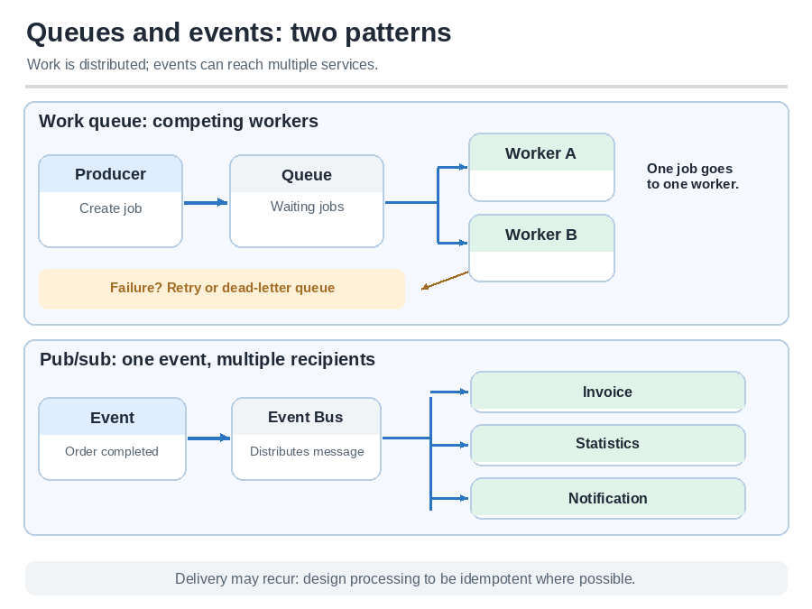
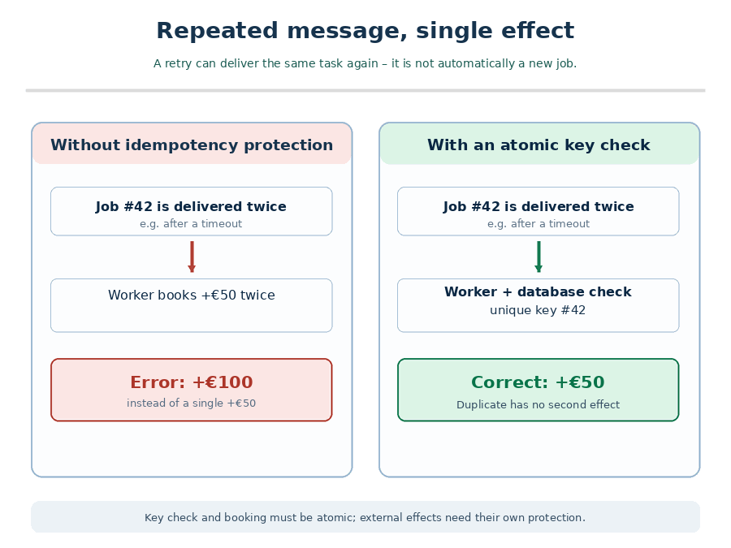

# M4-L1 – Distributed processing: Queues, workers and AI jobs {#L1}

**Course area:** M4 – Bachelor’s / transition: Cloud operations

**Level:** Bachelor’s / Master’s bridge

**Prior knowledge:** No fixed prerequisites specified.

## Why a program should not always do its work itself {#S1}

A small desktop program can open a file, analyse it and display a result immediately. A simple web service can also operate synchronously: the browser sends a request, the server performs the calculation and returns its response immediately. For a database query or a brief text conversion, this is often the most obvious and best architecture.

Things are different when processing takes minutes. A server may need to convert a long video, analyse a thousand documents or generate an image using artificial intelligence for a customer. Meanwhile, more users log in. If all the computations took place directly within their web requests, connections could time out, response times could vary considerably and the web server could become blocked by lengthy tasks. More difficult still: what happens if the responsible process crashes during a job?

This is where **asynchronous processing** helps. The application accepts the job, stores it and has a separate process deal with it later. This process can run on the same computer or on another machine. **Distributed processing** extends the idea by distributing work among several independent processes or computers when doing so is actually beneficial.

``` text
SYNCHRONOUS
Browser ──► Web server ──► Lengthy computation ──► Result
           (Browser waits until the end)

ASYNCHRONOUS
Browser ──► Web server ──► Job/queue
   ▲                           │
   │                           ▼
   └──── Status/result ◄── Background process
```

The advantage is not automatically a shorter overall computing time, but above all **decoupling**: the web application can respond quickly while the demanding work is processed in a controlled manner. However, a new queue means more administration. For very short, infrequent and non-critical tasks, it is unnecessary.

## Four basic concepts: Job, queue, worker and scheduler {#S2}

A **job** is a defined unit of work. Examples include 'convert file 753', 'generate the daily report' or 'generate an image from this prompt'. A well-defined job has a unique identifier, a task type, parameters and a traceable status. Large input files are often kept in separate storage; the job then contains only a controlled reference to them.

A **queue** is a buffer for jobs that have not yet been executed. It separates the time of acceptance from the time of processing. A queue may be implemented as a database table, as a feature of a message broker or as a managed cloud service. Its durability, maximum length and ordering guarantees depend on the particular system.

A **worker** is a process that takes on and executes jobs. One worker might generate PDF files, another process videos and a third run an AI model on a graphics card. Some workers run continuously and process many jobs in sequence; others are started afresh for each job.

A **scheduler** determines when a task starts or to which computer it is assigned. A time-based scheduler, for example, starts an analysis every morning. A resource scheduler finds a computer with sufficient main memory or a suitable graphics card. These two scheduling tasks are related but not identical.

``` text
                     Job intake
                         │
                   ┌─────▼─────┐
                   │   QUEUE   │
                   └─────┬─────┘
                         │
             ┌───────────┼───────────┐
             ▼           ▼           ▼
          Worker A    Worker B    Worker C
            Text        Video      AI image
             └───────────┼───────────┘
                         ▼
                     Result store
```

**What problem does this solve?** Different computing tasks can be accepted, allocated and executed independently. **When unnecessary?** A local program that carries out a single short task does not need a specialised resource scheduler.

## The lifecycle of a job {#S3}

A background job is not simply 'there' or 'gone'. A reliable application requires a state model. The following sketch is a teaching example, not a prescribed standard:

``` text
ACCEPTED ──► WAITING ──► IN_PROGRESS ──► SUCCESSFUL
                 │              │
                 │              ├──► RETRY ──► WAITING
                 │              └──► PERMANENTLY_FAILED
                 └──► CANCELLED
```

When a request arrives, the user-facing application first checks permissions, file sizes and whether the requested processing is permissible in principle. It stores a record with a **job ID (job identifier)**. A worker reserves the job, carries out the work, stores its result and reports completion. The browser can query the status using the job ID. Alternatively, a service can send a message or notification when the status changes.

An **Application Programming Interface (API)** does not then have to wait until a lengthy AI computation is finished before responding. It can immediately report: 'Job 753 accepted'. The result is made available via the API later. However, a job must not be accessible merely by knowing its number: the server must also check whether the requesting user has access to that specific job.

Much can go wrong between 'accepted' and 'executed'. A process may crash, a file may be missing, an external model may fail to respond or a computation may be cancelled. Status management must make these cases visible rather than leaving a job marked 'running' indefinitely.

## Message brokers: Intermediaries between programs {#S4}

A **message broker** accepts messages from sending programs and makes them available to suitable recipients. The sending program is called a **producer** and the receiving program a **consumer**. RabbitMQ is an example of such a broker. Other products offer components that appear similar, but not necessarily the same delivery and storage rules.

``` text
Web application (producer)
          │
          ▼
      Message broker
          │
       Work queue
          │
       ┌──┴──┐
       ▼     ▼
    Worker  Worker
      1       2
```

The broker can buffer messages, route them to consumers and, depending on the method, redeliver them if processing has not been acknowledged. This decouples the runtime of the web application from that of the worker. However, it does not mean that messages are automatically stored safely and indefinitely. Persistent storage, replication, retention periods, maximum sizes and acknowledgement mechanisms must be selected appropriately.

**A broker does not replace the business database.** The database contains, for example, owners, user permissions, prices, status and references to results. The broker distributes the work to be performed. Large videos, model weights or entire image series are not usually sent as message payloads; instead, they are placed in suitable storage and only a reference is transmitted.

The disadvantage is the additional operational burden: a broker needs resources, updates, access rules, monitoring and a strategy for its own failure. For a few jobs on one server, a properly coordinated database queue may be simpler and more robust.

## Distinguishing work queues, pub/sub and event buses {#S5}

In a classical work queue, several workers should *share the pending tasks among themselves*. This is known as **competing consumers**. One worker is selected for each individual delivery. This does not automatically mean that a job can never be executed more than once; retries are possible in the event of failures.

{alt="Comparison between a work queue that distributes jobs to competing workers and publish/subscribe, where an event reaches several recipients via an event bus. Failures may require retries and a dead-letter queue."}

A queue distributes work to one worker; pub/sub informs several independent recipients. Failures may require retries and a dead-letter queue.

The situation differs with **publish/subscribe (pub/sub)**: an event is of interest to several independent recipients. For example, the message 'Order completed' should reach an invoicing service, a statistics function and a notification service. An **event bus** routes such events according to types or rules. An **event stream** is often a continuously readable history of events retained for a longer period, from which different consumers can read independently.

``` text
QUEUE / DIVISION OF WORK
Job 1 ──► Queue ──► One of the available workers

PUB/SUB / DISTRIBUTION OF INFORMATION
"Order completed"
                │
                ▼
             Event bus
         ┌──────┼──────┐
         ▼      ▼      ▼
       Invoice Stats  Email
```

A queue therefore typically processes work that needs doing, while pub/sub makes the same event available to several independent recipients. An event stream often supports repeated processing of historical events. Real products can combine several patterns; this does not mean that all the terms are interchangeable.

**When unnecessary?** A program with a single background worker does not need a separate event bus. Large event architectures create additional data flows that must be observed, documented and traced when failures occur.

## Concurrency, parallelism and distribution {#S6}

**Concurrency** means that several tasks can make progress during the same period. For example, a process waits for a network response and uses the intervening time to do other work. This is possible even with a single processor core.

**Parallelism** means that several computational tasks actually take place simultaneously, for example on different CPU cores. The crucial question is whether the work can sensibly be divided into mutually independent parts.

**Distributed processing** uses several independent computers that cooperate over a network. Each computer can itself work in parallel. However, distribution incurs additional overhead through data transfer, synchronisation and possible partial failures.

``` text
CONCURRENT:   One core switches A ── B ── A ── B
PARALLEL:     Core 1: AAAAAAAA
              Core 2: BBBBBBBB
DISTRIBUTED:  Computer 1: AAAAAAAA
                   Network
              Computer 2: BBBBBBBB
```

An example: a thousand independent images can be distributed among several workers. If, on the other hand, every computation necessarily depends on the result of the preceding one, multiplying the number of computers brings little benefit. **Amdahl's law** describes this effect: a serial portion limits the possible speed-up through parallelisation. Real systems also incur network and coordination costs.

More servers therefore provide no automatic promise of performance. Sometimes a powerful single computer is faster, cheaper and easier to administer than a complicated cluster.

## CPU and GPU workloads {#S7}

A **Central Processing Unit (CPU)** is suitable for general program logic, database work, file processing and a wide variety of tasks. A **Graphics Processing Unit (GPU)** is particularly efficient at performing many similar computations in parallel. AI models often use large matrix operations and can therefore benefit substantially from suitable GPU hardware.

This does not mean that every AI computation requires a GPU or that CPU work automatically becomes faster through distribution. A preparatory step such as file validation or metadata analysis can run on a CPU. Demanding image generation may require a GPU and a large amount of graphics memory. It is important to know the properties of the task and select the appropriate worker.

``` text
                   Job intake
                     │
              Task classification
                ┌────┴─────┐
                ▼          ▼
          CPU worker    GPU worker
          Metadata      Image model
          Parsing       Inference
                └────┬─────┘
                     ▼
                   Result
```

**Inference** means running an already trained model on new inputs; **training**, by contrast, changes the model parameters using data. The two processes can differ considerably in memory requirements, execution time and suitability for distribution. Training large models may require complex coordination of computations and memory, which we explore in M5-L3 and M6-L6.

A framework such as **Ray** can assign computing jobs to appropriate nodes based on logical CPU/GPU requirements. This allocation does not guarantee that any given task will actually consume only that amount of physical memory. Actual monitoring and appropriate resource limits are also needed. Some workloads also require particular model versions or large files to be locally available on the target computer beforehand.

**Cost implications:** GPU instances may cost money while idle; on the other hand, starting models and loading weights take time. There is a trade-off between resources that are constantly available and longer waiting times at startup. For manageable experiments of your own, an existing local AI machine may be more practical than a permanently rented GPU server.

## Short jobs, continuous services and time-based scheduling {#S8}

A **short job** ends once a specific task has been processed, for example creating a thumbnail. A **continuous service** remains active to process requests on an ongoing basis, for example a web server or a model server. A **scheduled job** starts according to a timetable, for example every night. A persistent worker can execute many short jobs in sequence; these are different levels.

The container orchestration system **Kubernetes** provides the *Job* object, which executes specified tasks until successful completion, and *CronJob*, which creates jobs regularly according to a schedule. However, a CronJob is not automatically a complete business process system; under certain circumstances, multiple jobs can also be created. Retry and concurrency rules therefore remain relevant.

``` text
Schedule ──► Scheduler ──► "Nightly report" ──► Worker

Continuously running model server ◄── Repeated inference requests
```

For a simple daily report over a local SQLite database, an operating system scheduler and a small program may suffice. A large container cluster becomes interesting only when actual requirements for restarting, allocation, parallelism and changing machines justify it.

## Batch, streaming, low latency and real time {#S9}

**Batch processing** processes a collection of data in batches. An application might analyse a thousand records overnight or work through all new videos in a queue. The advantages are simplicity, repeatability and often good resource utilisation; the disadvantage is that results appear with a delay.

**Streaming** processes continuously arriving data or events, such as sensor measurements or log events. Ordering, late messages, errors and the state of ongoing analyses play a greater role here.

**Low latency** means a short response time, for example in a chat. This is not equivalent to **hard real time**: in that setting, certain actions must be completed within defined deadlines. An ordinary cloud connection and a general-purpose operating system cannot readily provide such guarantees. Time-critical robotic control loops require suitable local hardware and real-time mechanisms.

  Processing type   Objective                            Example                         Typical limitation
  ----------------- ------------------------------------ ------------------------------- ------------------------------------
  Batch             Process many tasks collectively      Update media catalogue          Results only later
  Streaming         Analyse continuously arriving data   Sensor and event data           Ordering and state
  Low latency       Respond quickly                      Interactive chat                Variable waiting time
  Hard real time    Guarantee a deadline                 Safety-critical motor control   Missing a deadline is unacceptable

This distinction becomes particularly important in the robotics section. AI may plan a longer-term task while actual motor control must be executed independently and in a temporally predictable manner.

## How large should jobs be? {#S10}

A million individual messages for a million tiny image operations can cause disproportionately high coordination overhead. A single enormous job, on the other hand, may occupy only one worker and require a great deal of work to be repeated after a failure. An intermediate division often makes sense, for example batches of several dozen files. The optimal batch size depends on computing time, file sizes, retry costs and hardware.

Some tasks are independent; others require preparatory work. A workflow can be represented as a **Directed Acyclic Graph (DAG)**: steps and their dependencies are described as nodes and arrows, without circular dependencies.

``` text
             Input file
                 │
            Read metadata
                 │
         ┌───────┴─────────┐
         ▼                 ▼
    Generate preview   Recognise speech
         │                 │
         └───────┬─────────┘
                 ▼
             Build index
```

The advantage is that individual substeps can be resumed in a traceable way. The difficulty is that the system must know which intermediate results are valid and what must be regenerated after a partial failure. Elaborate workflow engines are not essential as long as there are only a few clearly defined steps.

## Failures, acknowledgements, retries and idempotence {#S11}



*Illustration: Multiple deliveries cannot always be avoided. In the protected arrangement, reservation of the key and the accounting entry take effect within suitable atomic processing; external side effects such as payments need their own idempotency or reconciliation mechanisms.*

Jobs can be lost or executed twice at several points. The web application might store a record and crash before sending the message. A worker may save the result but fail before reporting completion. A redelivered message may then start the work again.

An **acknowledgement (ACK)** tells the messaging service that a message has been completed according to its delivery model. If the acknowledgement is missing, redelivery can occur. Amazon **Simple Queue Service (SQS, a managed queue service)** uses, among other things, a *visibility timeout*: during this period, a received message is normally hidden from other consumers. With standard queues, this is not an absolute exactly-once guarantee.

**Idempotence** describes processing in which repeating the same business job does not produce an unwanted second effect. For example, AI job ID 753 must not be billed twice. Even if image generation may recompute a result and thereby consume resources, the business logic must decide which result applies and which billing entry is permitted. **Important when two workers start simultaneously:** merely asking 'Has job 753 already been completed?' is not an atomic duplicate-prevention mechanism. Both workers may receive the same answer, 'no', before either finishes. For a billing entry that may occur only once, one needs, for example, a unique job identifier as a database constraint and an atomically protected insertion, or a suitable transaction or locking mechanism. PostgreSQL documents `INSERT ... ON CONFLICT` for this purpose, for example; the specific process must be designed according to the business requirements to prevent not just a second row but also unwanted second side effects. [PostgreSQL – INSERT](https://www.postgresql.org/docs/18/sql-insert.html).

``` text
Worker receives job 753
        │
        ▼
Has job 753 already been completed successfully?
      │ Yes                   │ No
      ▼                       ▼
Use existing result       Computation
                              │
                              ▼
                         Save result
                              │
                              ▼
                      Status + acknowledgement
```

A **retry** is a repeated attempt. A limited retry can resolve temporary network failures. Unlimited retries, by contrast, could put an overloaded service under additional strain. Therefore, waiting periods that increase after several failures (*backoff*) are often used. Persistently faulty messages can be stored in a **dead-letter queue (DLQ)**, a holding queue for messages that cannot be processed, where they can be investigated and, if needed, resubmitted after correction.

From lesson M3-L5, we are familiar with the **transactional outbox pattern**. The business modification and the request to send a message later are first recorded in a shared database transaction. A separate process sends the message. This reduces the gap between a successfully stored job and an unsent queue message. Multiple transmissions must nevertheless be handled at the receiving end.

## Overload protection and backpressure {#S12}

A queue can absorb load spikes, but it is not an infinite buffer. If more jobs arrive over time than all the workers can process together, the backlog grows. Waiting times and possibly storage requirements and costs then increase.

A deliberately simple example: a worker takes an average of 30 seconds per job and always processes only one at a time. Under idealised conditions, it completes two jobs per minute; three identical workers complete six. If twelve jobs arrive continuously per minute, the backlog grows by approximately six per minute. After ten minutes, assuming no initial backlog or exceptional cases, around 60 additional jobs would be pending. This is merely a model calculation, not a real performance promise.

Countermeasures include **rate limits**, maximum queue lengths, fair allocation among customers, capacity limits, early rejection and **backpressure**: an overloaded system signals to earlier stages that they should send less or send more slowly. Increasing the number of workers helps only if the database, file storage, external APIs and graphics cards can also cope with the additional load.

``` text
Requests ──► Limits / validation
                    │
          Capacity available?
             │           │
            Yes          No
             │           └──► Reject/defer in a controlled manner
             ▼
          Bounded queue ──► Worker ──► Database / GPU
                                   ▲
                             Monitor capacity
```

Important metrics include queue length, the age of the oldest message, time until processing starts, processing duration, error rate, number of retries and CPU/GPU utilisation. Monitoring, alerting and reliability objectives are covered in detail in M4-L2.

## Three practical solutions {#S13}

### Local media catalogue {#131-lokaler-medienkatalog}

A local program is to analyse a thousand video files. An SQLite table can store the state of each file and its analysis jobs. A local background process takes the next pending tasks and records its results. If two processes are used, reservations and state transitions must be coordinated properly. A messaging service or Kubernetes would often be unnecessary here.

``` text
Desktop program ──► SQLite job table
                          │
                          ▼
                      Local worker
                          │
                          ▼
                    Media archive / result
```

The advantages are few dependencies and good controllability. The disadvantage: when the computer is switched off, no work takes place. Important metadata need backups; jobs started during a crash must be checked at the next startup.

### Small online analysis service {#132-kleiner-online-analysedienst}

A PHP web application accepts files and analysis jobs. The web component manages login, access rights and status queries, while a worker carries out the actual computation. Protected file storage holds the input and result. More workers can be added later if necessary.

``` text
Browser ──► PHP web application ──► Job database
                    │
                    ▼
                   Queue
                    │
                    ▼
                 CPU worker ──► Result store
```

Size limits, file type checks, separation of data by customer, deletion deadlines, status messages, transparent costs and a rule for failed jobs are important. A single well-maintained server may be more economical for low demand than a complex platform. The operator remains responsible for correctness in the application domain, even when renting individual infrastructure services.

### AI job service with several specialists {#133-ki-auftragsdienst-mit-mehreren-spezialisten}

A more demanding pipeline might transcribe video material, summarise it, generate metadata and create image drafts from it. Different workers require different hardware. A simple workflow controller tracks which steps are complete and releases dependent jobs only when their prerequisites are satisfied.

``` text
Customer ──► Job / authorisation / budget
                     │
               Workflow controller
                     │
          ┌──────────┼──────────┐
          ▼          ▼          ▼
       CPU job  Language model Image model
                    (CPU/GPU)    (GPU)
          └──────────┼──────────┘
                     ▼
                  Result review
                     │
                     ▼
                Protected storage
                     │
                     ▼
                 Status / billing
```

Organisationally, an **AI agent** can also be a worker: it receives a limited task and uses tools where appropriate. Its model-driven decisions are not, however, a substitute for fixed permission rules, safety checks, cost budgets or human approval for risky actions. How an LLM (Large Language Model) works and how agents use tools are covered in modules M5 and M6.

The development path is not necessarily 'local → Kubernetes'. Instead, it may be: **one local background process → one separate worker on the web server → several specialised workers**. Every additional step should be justified by measured demand.

## Classifying products correctly {#S14}

  Category                Example                    Typical benefit                                    Often unnecessary when …
  ----------------------- -------------------------- -------------------------------------------------- ---------------------------------------------------------------
  Job table               SQLite/PostgreSQL          Simple job management                              The task can be completed directly and quickly
  Message broker          RabbitMQ                   Route messages between processes                   A single local worker suffices
  Managed queue           Amazon SQS                 Partially outsource queue infrastructure           No ongoing online job processing is needed
  Task framework          Celery                     Organise tasks with worker pools                   A few simple custom processes suffice
  Job orchestration       Kubernetes Jobs/CronJobs   Schedule/monitor many container jobs               A small server suffices
  Distributed computing   Ray                        Assign computing tasks to suitable cluster nodes   There is no substantial computing need suited to distribution

The names are examples, not purchasing or architectural prescriptions. A queue is not a complete workflow controller. A container orchestrator does not guarantee exactly-once processing of business operations. And a broker replaces neither a database nor a backup.

## Security, maintenance and economic limits {#S15}

A distributed system has more access points and potential points of failure. Workers should receive only the permissions needed for their tasks. Job messages must not contain unnecessary passwords, secret keys or complete personal data. Large inputs belong in protected storage areas, not uncontrolled in messages. If external AI services are involved, it is necessary to check which data are transmitted and how they are processed, stored and deleted. Legal questions depend on the individual case and are not answered here in a binding manner.

A job that has been sent is not yet a successfully executed job. In addition to the queue, the database, workers, model servers, external interfaces and result stores must therefore be monitored. The system must be prepared for restarts, lost connections, duplicates and persistently faulty jobs. This includes appropriate backups and recovery tests, as described in M3-L6.

Costs arise through **CPU and GPU computing time, main memory, storage space, transfers, queue operations, external API calls, monitoring, backups and support**. Some systems incur fixed costs even while idle; others charge for usage. Faster parallel processing can cost more in the short term even when the total amount of computation remains the same. Specific provider prices are deliberately not carried over from older teaching texts.

The decisive question for every architectural feature remains: *What real problem does it solve and is its maintenance worthwhile?* A small robust service can be superior to a large, elaborate architecture if demand is still low.

## Summary and outlook {#S16}

A **queue** buffers jobs; a **worker** executes them; a **broker** routes messages; a **scheduler** plans their execution or resource allocation. These roles can reside on one computer or be distributed across a network. Concurrency, parallelism and distribution are different concepts. Batch, streaming, low latency and hard real time satisfy different timing requirements.

Reliable job processing requires more than computing power: states, unique identifiers, idempotence, limited retries, protection against overload and verifiable results. An additional infrastructure component makes sense only if its advantages outweigh the operational overhead.

**Next lesson: [M4-L2 – Deployment and reliability](M4-L2.md).** There we address deployment, infrastructure as code, logs, metrics, monitoring, alerting, rollbacks and availability objectives.


## Sources {#S17}

**Last source review:** 03.11.2026

Official technical documentation, checked for key statements and accessibility on **03.11.2026**. The examples illustrate general architectural principles; product details and prices must be checked again before specific use.

1.  Microsoft Learn: *Queue-Based Load Leveling Pattern* – queue as buffer, backlog, retention and idempotence. [https://learn.microsoft.com/en-us/azure/architecture/patterns/queue-based-load-leveling](https://learn.microsoft.com/en-us/azure/architecture/patterns/queue-based-load-leveling)
2.  Microsoft Learn: *Competing Consumers Pattern* – multiple workers, queues and publish/subscribe. [https://learn.microsoft.com/en-us/azure/architecture/patterns/competing-consumers](https://learn.microsoft.com/en-us/azure/architecture/patterns/competing-consumers)
3.  RabbitMQ: *Tutorial One* – producers, consumers, brokers and messages. [https://www.rabbitmq.com/tutorials/tutorial-one-python](https://www.rabbitmq.com/tutorials/tutorial-one-python)
4.  Amazon Web Services: *Amazon SQS Visibility Timeout* – message reservation, repeated delivery. [https://docs.aws.amazon.com/AWSSimpleQueueService/latest/SQSDeveloperGuide/sqs-visibility-timeout.html](https://docs.aws.amazon.com/AWSSimpleQueueService/latest/SQSDeveloperGuide/sqs-visibility-timeout.html)
5.  Kubernetes: *Jobs* – finite and parallel container jobs. [https://kubernetes.io/docs/concepts/workloads/controllers/job/](https://kubernetes.io/docs/concepts/workloads/controllers/job/)
6.  Kubernetes: *CronJob* – regularly scheduled jobs. [https://kubernetes.io/docs/concepts/workloads/controllers/cron-jobs/](https://kubernetes.io/docs/concepts/workloads/controllers/cron-jobs/)
7.  Ray: *Tasks* – remote tasks and CPU/GPU requirements. [https://docs.ray.io/en/latest/ray-core/tasks.html](https://docs.ray.io/en/latest/ray-core/tasks.html)
8.  Ray: *Key Concepts* – tasks, actors and distributed resource scheduling. [https://docs.ray.io/en/latest/ray-core/key-concepts.html](https://docs.ray.io/en/latest/ray-core/key-concepts.html)

**Cross-references:** M2-L2 (web applications and APIs), M2-L5 (scaling), M3-L5 (distributed correctness), M3-L6 (recovery), M4-L2 (monitoring) and M6-L4/M6-L6 (agents and distributed AI).
