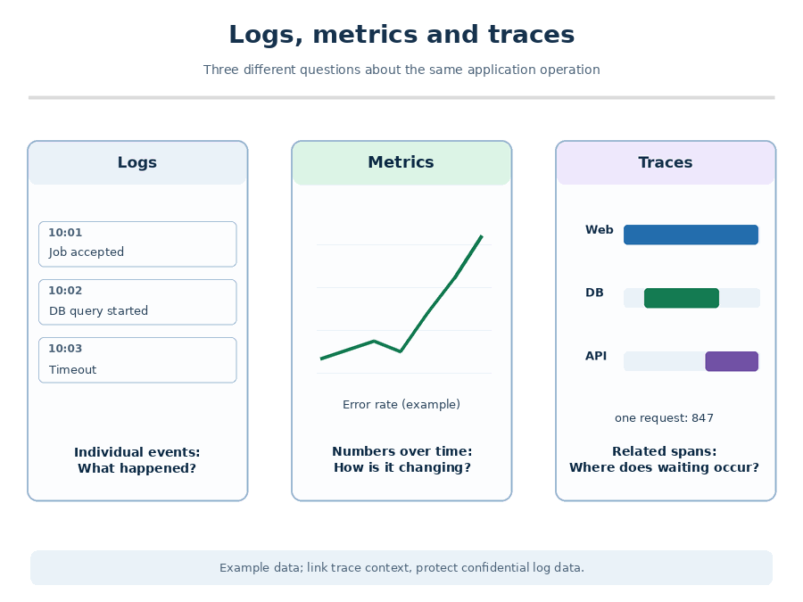

# M4-L2 – Deployment and reliability {#L2}

**Course area:** M4 – Bachelor’s / transition: Cloud operations

**Level:** Bachelor’s / Master’s bridge

**Prior knowledge:** No fixed prerequisites specified.

## The initial problem: Programming an application is only the beginning {#S1}

A desktop program can be built, tested and started locally. If it crashes, the impact is initially limited to your own computer. A publicly available service, however, may be in use when a new software version is installed. In that situation, errors are not merely inconvenient: a user might lose a job, receive an invoice twice or be unable to access their data for a prolonged period.

**Deployment** is the process of making a particular program version available for use in its intended environment. It involves not only the program files but also settings, required services, access arrangements and, where applicable, database changes. **Reliability** means that a service functions as expected under defined conditions over a period of time, handles disruptions in a controlled manner and can be restored after failures.

The two topics belong together: software can run without errors during testing and still fail during release because, for instance, a required configuration value is missing. Conversely, a well-monitored server is of little use if every release is manual and unpredictable.

``` text
Development ─► Testing ─► Release ─► Running service
                                          │
                        Measurement ◄─────┘
                            │
                   Detect and fix failures
                            │
                     Improve / roll back
```

**What problem does this solve?** Changes become traceable, disruptions detectable and recovery predictable. **When is a large-scale solution unnecessary?** A private website that changes infrequently does not require an extensive operations centre. A traceable release process and a usable backup are nevertheless worthwhile.

## Distinguishing three things: Application, configuration and infrastructure {#S2}

Imagine a small online analysis service. Its **application code** processes uploaded files. Its **configuration** determines, for example, how large files may be, which database is accessed and which external services are used. Its **infrastructure** includes the computer or cloud service, network, data storage and other operational resources.

``` text
       Application code: "What does the program do?"
                          │
       Configuration: "How does it run here?"
                          │
       Infrastructure: "What does it run on?"
                          │
               Running online service
```

In a small project, all three may reside on a single virtual server. Larger systems separate them more clearly, for example by storing program code in a container image and operating the database as a managed service. However, the distinction remains important even with simple web hosting.

A typical mistake is to write credentials, server addresses or secret keys directly into the published program files. Confidential information may then enter the version archive or even appear on a public download page. Separate settings and appropriate **secrets management** for passwords, keys and access tokens are preferable. A *secret* is a confidential configuration value; merely converting it to another text format does not protect it. Further questions of access and data protection are discussed in [M4-L3](M4-L3.md).

## What exactly is replaced during a release? {#S3}

A good release package is **reproducible**: it is possible to trace which source code and dependencies produced it. In the case of a compiled program, this is an executable file together with the required libraries. For a PHP application, it may be a defined set of files; for a containerised application, a **container image** as a versioned package of the application and runtime components.

It is important to distinguish between the **build** (creation of the package) and **deployment** (installation in the target environment). Ideally, a package that has been tested once should reach the production environment without modification. Otherwise, the production version may differ from what was actually tested.

``` text
Source code (version X)
       │
       ▼
Build + tests ──► verified artefact X
                          │
                  Approval / deployment
                          │
                          ▼
                  Production environment
```

An **artefact** here is the finished, distributable result of the build process. The version identifier should be unambiguous. For containers, immutable image digests can be used for this purpose, for example; a mere label such as `latest` is insufficient for identifying an exact version in the long term.

Even the most reliable package is of little help if the configuration and database state do not match the version. These additional dependencies must therefore be part of release planning.

## Development, test and production environments {#S4}

A **development environment** is used for experimentation and modification. A **test or staging environment** is intended to reproduce important characteristics of subsequent operation without affecting real users. The **production environment** (*production*) is the application actually being offered.

This does not mean that three separate servers must be rented immediately. For very small projects, the test environment can run locally or temporarily. What matters is **what** is tested: do the program logic, network settings, database schema, permissions and external connections work together?

**Limitation:** A test environment is rarely identical to production. Data volumes, load, actual browsers, network outages and permissions may differ. Tests therefore replace neither monitoring nor the ability to reverse an update in a controlled manner. Conversely, a test environment must not copy actual customer data or production keys without protection.

## CI/CD: Testing and deploying changes automatically {#S5}

The abbreviation **CI/CD** stands for *Continuous Integration* and, depending on usage, *Continuous Delivery* (software that is continuously ready for release) or *Continuous Deployment* (automated release). The latter two terms are not identical: with delivery, manual approval may precede the production step; with deployment, this step takes place automatically after successful checks.

CI ensures that newly merged changes are, for example, built, checked for syntax errors and tested. A defined **workflow** executes individual steps sequentially or in parallel. GitHub Actions is a particular product that can execute such workflows through jobs on so-called runners; the underlying principle is not tied to GitHub.

``` text
Change in the version repository
          │
          ▼
        CI: Build ─► Tests ─► Security and quality checks
                                         │
                                      Approval
                                         │
                            CD: deploy the verified version
                                         │
                                 Observe operations
```

Such processes help prevent accidentally uploading an old folder or overlooking obvious test failures, among other things. They do not guarantee freedom from errors: a successful test suite may overlook an error in a rarely used combination.

**When unnecessary?** A small, rarely updated script does not need a comprehensive pipeline. A documented process alone — which version was tested, which files are published, and how can we revert? — is valuable. As releases become frequent or several people make changes, the benefit of automated checks increases considerably.

## Infrastructure as code: A traceable description of the environment {#S6}

**Infrastructure as Code (IaC)** means defining servers, networks or other resources through versionable, machine-readable descriptions. Instead of repeating a long sequence of clicks for every new installation, you describe the desired target environment and let a tool plan or execute the necessary changes.

For example, you specify: ‘There is a private network segment, an application server and a managed data store.’ The tool compares this description with existing resources. **Terraform** is an example of such a platform. Its central approach can be summarised as *Write – Plan – Apply*: describe, review planned changes, implement changes.

``` text
Versioned infrastructure description
                 │
                 ▼
            Change preview
                 │
           Review / approval
                 │
                 ▼
           Cloud API / host
                 │
                 ▼
          Actual infrastructure
```

IaC offers a real advantage for repeatable environments, multiple locations and teamwork. But it also introduces risks: an incorrect change may modify or delete many resources at once. Tools often maintain a **state** (information about the resources they manage), which itself must be protected and backed up. **IaC is neither automatically a backup nor a guarantee of security.** Secrets must not be included in the infrastructure definition or its state file without appropriate controls.

For a single VPS (Virtual Private Server, a rented virtual server), simple written installation documentation may be more economical than a complete IaC project.

## Container deployment and orchestration {#S7}

An application can be packaged as a container image. With a simple container runtime or a small Compose setup, an operator can start several related services. In larger installations, **orchestrators** such as Kubernetes manage the placement, updating and monitoring of numerous container instances.

In Kubernetes, a **Deployment** manages, among other things, the desired state of an application. A release can gradually replace the previously running **Pods** (groups of containers forming execution units) with new ones. Kubernetes provides **rolling updates** for this purpose. After a failure, it is possible under certain conditions to revert to an earlier Deployment revision.

``` text
           Desired version B
                   │
                   ▼
              Orchestrator
                   │
     old Pod A ───► new Pod B
     old Pod A ───► new Pod B
                   │
           Load balancing / users
```

The technology primarily addresses recurring operational tasks involving many instances. But it does not turn a faulty application into a correct one. Kubernetes can restart containers and redirect traffic; it does not automatically recognise an invoice calculated incorrectly according to business rules. And reverting a container image does not reverse database changes that have already been made.

**When unnecessary?** For a small online tool, conventional web hosting, a VPS or a simple managed platform is often sufficient. Kubernetes introduces network, storage, permissions, monitoring and maintenance tasks of its own. Orchestration should solve an existing problem, not be an end in itself.

## Health checks: Is the application running or actually usable? {#S8}

A process can be active and yet fail to deliver usable results. Perhaps it is stuck in an infinite loop, waiting for a failed database or has not yet loaded its AI model. Modern operating environments therefore distinguish several types of **health check**:

- **Liveness:** Is the process in a state in which restarting it might help?
- **Readiness:** Can the instance accept new requests *now*?
- **Startup:** Has the longer initial phase finished, so that ordinary checks are meaningful?

The Kubernetes project explicitly documents these three checks. The distinction is useful even without Kubernetes.

``` text
Service starts ─► Startup check ─► Ready for user requests
                        │                    │
                        ▼                    ▼
                    Not ready yet       Readiness check
                                             │
                                  On failure: no new requests

Liveness check: possible restart if a blockage is detected
```

A poorly designed health check can itself amplify an outage. If the database slows down briefly, causing all web servers to restart simultaneously, additional load is created. Moreover, **a successful health check does not prove that the business function is correct.** The response ‘HTTP 200’ may be returned even though some customers can no longer retrieve files. Additional tests and meaningful operational data are needed for this.

## Monitoring: Avoid operating blindly {#S9}

**Monitoring** means continuously collecting selected signals from a system and responding to unusual conditions. Typical questions are: is the website reachable? How long do responses take? Are errors becoming more frequent? How full is the queue? Is available storage running low?

The obvious temptation is to monitor everything that can be measured. However, this can easily lead to thousands of figures of no value for decision-making. It is better to begin with the functions important to users. For a file service, this may be successfully accepting and making files available; for an AI service, completing jobs correctly.

``` text
Application ─► Measurements ─► Evaluation ─► Alert if needed
    │                                            │
    └─────────── User behaviour ◄────────────────┘
```

Monitoring detects known patterns of failure and breached thresholds. **Observability** goes further: its aim is to allow conclusions about initially unknown causes to be drawn from observable outputs. The two terms are related but not synonymous.

## Logs, metrics and traces – three different perspectives {#S10}

**Logs** record individual events associated with a time: ‘Job accepted’, ‘Login denied’, ‘Database connection failed’. They tell us *what* a program reported.

**Metrics** are series of numerical values: requests per minute, the proportion of erroneous responses, memory usage, duration of a calculation. They make changes over time visible.

**Traces** connect related processing steps. A single browser request may first arrive at the web service, then trigger a database query and finally contact a worker. A trace shows where time was spent or an error occurred within this chain. Individual operations within a trace are called **spans**.

``` text
User request 847
       │
       ├── Web server: 30 ms ──┐
       ├── Database: 90 ms     ├── Related trace
       └── External service: ...┘

Logs:    "Timeout at the external service"
Metric:  "Proportion of failed requests rises"
Trace:   "Delay originates in the external call"
```

The figures are invented solely for illustration. **OpenTelemetry** is a vendor-neutral framework of tools and specifications for collecting and transmitting such telemetry data. It is not automatically the database in which the data is stored permanently, nor is it a complete alerting centre.

**Operational implication:** Logs and traces may contain personal data, file names, requests or secrets. Data minimisation, access protection and an appropriate retention period are therefore necessary. Detailed logging of every request may also create high storage and transmission costs.



*Figure: Three perspectives on the same operations: logs are events, metrics are time series, and traces connect the spans of a call. All illustrated values are hypothetical; sensitive information must not enter telemetry data unfiltered.*

## Alerting: An alert must make a response possible {#S11}

**Alerting** means triggering a notification when a relevant condition occurs. A useful alert might read: ‘For ten minutes, many users have been unable to retrieve their jobs.’ A less useful one would read: ‘CPU usage briefly exceeded 65 per cent’ — without reference to harm or a necessary intervention.

Alerts should reach the person responsible for operations and make it possible to identify an action. Otherwise, **alert fatigue** develops: when many meaningless notifications arrive every day, important warnings are overlooked.

A simple hierarchy helps:

- **Information:** An unusual condition is logged; no immediate action required.
- **Warning:** A threshold is approaching; review capacity or the error trend later.
- **Critical:** An essential user workflow is disrupted; act promptly.

For a small private service, an automated availability check with an email notification may initially be enough. Anyone operating a paid service with binding commitments, however, needs a realistic way to handle disruptions outside normal development hours. A notification alone does not repair an application.

## Updates without unnecessary disruption: Four strategies {#S12}

The simplest approach is called **Recreate**: stop the old application and start the new one. There is usually a brief interruption. For smaller services with acceptable maintenance windows, this may be entirely appropriate.

In a **rolling update**, instances are replaced gradually. One prerequisite is that old and new versions can work together temporarily. A **blue-green deployment** maintains two separate environments: the new version is first tested on the non-public environment, then traffic is switched. In a **canary release**, only a small proportion of users or requests receive the new version initially, before the release is expanded.

``` text
RECREATE:      [Version A] ──Stop──► [Version B]
ROLLING:       [A A A] ─► [A A B] ─► [A B B] ─► [B B B]
BLUE-GREEN:    Users ─► [Blue / A]    [Green / B ready]
                               └── Switch ─► [Green / B]
CANARY:        95 % to A  +  5 % to B (example values only)
```

These methods reduce some release risks but do not prove continuous availability. Running several versions simultaneously may incur additional server costs. Canary distributions need enough actual requests to produce meaningful error statistics. For an application with few users, a deliberate maintenance window is sometimes preferable.

## Feature flags: Enabling functions independently of the program package {#S13}

A **feature flag** allows a function to be included in the software without immediately making it available to all users. For example, a new export function may initially be visible only to internal testers or selected customers. The flag controls behaviour at runtime and can often be changed more quickly than a complete deployment.

``` text
Same program version
       │
       ├── Flag OFF ─► Existing workflow
       └── Flag ON  ─► New function
```

Flags are particularly useful when release and activation need to be separated. However, they offer no magical way back: if the new function has already modified data or triggered chargeable actions, turning off a flag does not undo those consequences.

Furthermore, each flag adds possible combinations that must be tested and later tidied up. A single small web service therefore does not automatically need a professional feature flag system.

## Rollback: Why an old program does not automatically mean old data {#S14}

**Rollback** means reversing a change to return to a previous working state. For a simple website, redeploying the previous files may be sufficient. Databases make things more complicated: a new version might have renamed a column, converted data to a different format or processed new jobs.

The old version may then suddenly be unable to work with the new data. Restoring the entire data set to an earlier point in time would in turn be dangerous, because customer actions performed in the meantime would be lost.

One common approach is a **backwards-compatible database migration**: first, the data structure is extended so that both old and new program versions can work with it; obsolete parts are removed only at a later stage. This basic idea is often called *Expand and Contract*. It increases maintenance effort in the short term but can facilitate safe, gradual releases.

``` text
1. Extend the database schema (old version keeps running)
2. Deploy the new program version
3. Switch data / user access in a controlled manner
4. Remove obsolete fields and paths only later
```

**Distinction from M3-L6:** A rollback is not a regular data backup. Backups and recovery need a strategy of their own. Data consistency must be checked even after an apparently successful rollback.

## Measuring reliability: SLI, SLO and SLA {#S15}

When a service is supposed to be ‘reliable’, the question is: what does this mean in concrete terms? Three terms help:

- **Service Level Indicator (SLI):** A measurable quantity, such as the proportion of successful uploads or a service's response time.
- **Service Level Objective (SLO):** A deliberately defined target for an indicator, for example ‘at least 99.5 per cent of uploads successfully completed within a month’; this value is merely an example.
- **Service Level Agreement (SLA):** An agreement with customers on promised services and any consequences of failing to meet them.

``` text
What do we measure? SLI: successful uploads / all uploads
What quality do we want? SLO: e.g. 99,5 % in a calendar month
What do we promise? SLA: contractual commitment with conditions
```

An SLO is not automatically a legally guaranteed commitment. A purported ‘99.9 per cent availability’ rate is also of little significance without a precise measurement definition: does a broken upload function count as an outage even if the home page remains reachable? Which user regions and time period are included? Are announced maintenance windows taken into account?

An **error budget** is the calculated deviation permitted within the framework of an SLO. It helps weigh up whether new features should be released quickly or whether stabilisation should take priority. It is not a credit balance with which errors should deliberately be ‘spent’. Google describes this separation of indicators, objectives and agreements in its materials on Site Reliability Engineering (SRE, systematic reliability engineering).

For a small free service, a few realistic internal goals may suffice initially. Binding SLA commitments without staff, an emergency plan and reliable measurements, on the other hand, may have substantial support and liability implications.

## One server or multiple availability zones? {#S16}

A single rented server may be reliable enough for many applications — particularly if an operator can tolerate downtime and has a tested recovery process. Nevertheless, it has an obvious **single point of failure**: if the machine or its location fails, the service may become unreachable.

Multi-zone operation distributes suitable resources across separate **availability zones** within one cloud region. This may mitigate the effects of certain infrastructure failures. A prerequisite, however, is that the database, load balancing, network access and dependent services also match the desired fault tolerance. Two web servers in separate zones are of little help if both need the same failed database.

``` text
SMALL SERVICE
Users ─► One VPS ─► Database + backup elsewhere

MULTI-ZONE OPERATION (simplified)
                          ┌──► Zone A: Web + data access
Users ─► Load balancing ──┤
                          └──► Zone B: Web + data access
                                      │
                               Coordinated data storage
```

Multi-zone operation also means additional network connections, replication where applicable, failover tests and often higher fixed costs. **Availability** and **data durability** are different objectives: a service may continue handling requests during a failure while still losing individual data items — or retain all data while remaining unreachable for hours. The database aspects were discussed in M3-L2 and M3-L6.

## How incident handling is organised {#S17}

A technical failure requires not only tools but also decisions. A manageable incident process looks like this:

``` text
Incident detected
      │
      ▼
Identify affected functions and users
      │
      ▼
Limit damage (e.g. pause new jobs)
      │
      ▼
Restore / activate a safe state
      │
      ▼
Check data and business workflows
      │
      ▼
Document causes and improve protection
```

Anyone operating a service should know where relevant logs are located, who has access, which changes were released most recently and which recovery measures actually work. With several people involved, clear allocation of responsibilities becomes important. Without these arrangements, an apparently small disruption may persist for a long time.

This does not mean that an individual developer needs an incident command centre staffed around the clock. But they should not promise customers availability that they cannot realistically guarantee without an appropriate organisation. Particularly with paid jobs, clear status messages and a practical support channel also contribute to reliability.

## Three application examples: From simple to distributed {#S18}

### Example A: Private documentation website

An information website that changes infrequently is operated by a conventional web hosting provider. Changes are tested locally and uploaded as clearly named versions. The domain and TLS certificate are monitored; the contents are also stored in an independent archive. If a change fails, the previous set of files is published again.

**Appropriate:** Little infrastructure, simple control, low maintenance. **Excessive:** Kubernetes, multi-zone database clusters, tracing between ten microservices. **Residual risk:** Provider outage and delays in manual recovery.

### Example B: Small paid online analysis tool

The application consists of a web interface, a backend and a database. Git manages the source code. Automated basic tests run before releases. The operator checks whether a new version requires database migrations and subsequently monitors error rates, response times and successful jobs.

``` text
Users ─► Web/API service ─► Database
                    │
                    └──► Monitoring / alert
Development ─► Testing ─► Versioned deployment
```

**Appropriate:** Simple CI, a few measurements, recovery test, clear maintenance information. **Excessive:** Two additional cloud regions and an elaborate canary process for a few requests per day. **Operational implications:** Security updates, user permissions, backups, customer communication and support.

### Example C: Distributed AI processing service

A web service accepts jobs and a queue distributes them to workers with suitable hardware. Some of these workers load large models into graphics memory and therefore take longer to start. A new version should accept jobs only once the model is actually available. In the event of a failure, the same job must not inadvertently be executed and charged twice.

``` text
Users ─► API ─► Job database
                 │
                 ▼
               Queue
          ┌──────┴──────┐
          ▼             ▼
     GPU worker A  GPU worker B
          └──────┬──────┘
                 ▼
           Result store
                 │
             Status + logs + metrics + traces
```

Queue length, job waiting time, failed jobs, model loading failures and costs per successful job are often more informative here than just the web server's CPU usage. A worker restart must be accompanied by a safe resumption or deliberate repetition of a job. With expensive GPU resources, a further crucial question may be whether a second worker remains available continuously or starts only when needed.

**Appropriate:** Clear job records, idempotency, health checks, traceable versions and cost alerts. **Excessive:** A global Kubernetes fleet if the actual workload can be processed reliably and economically on a single local GPU.

## Comparison: Which level of operation suits which need? {#S19}

| Operating model | Typical deployment | Typical monitoring | Additional effort |
| --- | --- | --- | --- |
| Local tool | Manually approved program version | Functional test, version archive | Updates and local data backup |
| Small static website | Version-specific file upload | Availability, certificate, content | Hosting and recovery |
| Small VPS web service | Controlled deployment, CI if appropriate | Logs, error rate, backups | Operating system, security, support |
| Managed application platform | Provider-supported deployment | Application metrics, external dependencies | Usage fees, platform limitations |
| Distributed container platform | Orchestration, rolling/canary releases | Traces, SLOs, multi-level alerts | Many infrastructure and data dependencies |

This table is not a rigid progression. An application does not have to move to Kubernetes at some point simply because user numbers grow. Performance requirements, the consequences of outages, data protection, operating hours and available staffing capacity together determine the architecture.

## Summary and transition to M4-L3 {#S20}

**Deployment** is the controlled release of a particular program version together with suitable settings and dependencies. CI/CD and Infrastructure as Code can improve repeatability if their additional complexity is justified. Containers and orchestrators facilitate operating many instances but replace neither business logic nor database correctness.

**Reliability** does not arise simply from having more servers. It requires meaningful tests, good health checks, logs, metrics and traces, clear alerts, a realistic recovery process and honest service level objectives. Rollbacks, blue-green and canary methods can reduce release risks but are no substitute for backups or the testing of data migrations.

The practical guiding question is: **Which disruption would really cause problems for users — and which simple, verifiable measure prevents or limits precisely that disruption?**

Next comes **M4-L3 – Security, data protection and responsibility**. There we examine identity and permissions management, secrets management, attacks on publicly accessible interfaces and responsibility for personal data, among other topics.

## Sources {#S21}


**Verification date: 03.11.2026.** The following project and vendor pages are sources for the technical principles described. Some literature on SLOs is older but remains a fundamental definition of the concepts. Provider prices and specific product commitments are not part of this lesson.

1.  [GitHub Docs – Understanding GitHub Actions](https://docs.github.com/en/actions/get-started/understand-github-actions) · CI/CD workflows, jobs, runners and automation · Last accessed: 2026-11-22
2.  [HashiCorp Developer – What is Terraform?](https://developer.hashicorp.com/terraform/intro) · IaC, versioned infrastructure, Write/Plan/Apply and state · Last accessed: 2026-11-22
3.  [Kubernetes Docs – Deployments](https://kubernetes.io/docs/concepts/workloads/controllers/deployment/) · rolling updates, revisions and rollback · Last accessed: 2026-11-22
4.  [Kubernetes Docs – Configure Liveness, Readiness and Startup Probes](https://kubernetes.io/docs/tasks/configure-pod-container/configure-liveness-readiness-startup-probes/) · different types of health check · Last accessed: 2026-11-22
5.  [OpenTelemetry – Observability Primer](https://opentelemetry.io/docs/concepts/observability-primer/) · logs, metrics, traces and observability · Last accessed: 2026-11-22
6.  [OpenTelemetry – What is OpenTelemetry?](https://opentelemetry.io/docs/what-is-opentelemetry/) · vendor-neutral collection and transmission of telemetry data · Last accessed: 2026-11-22
7.  [Google – Site Reliability Engineering – Service Level Objectives](https://sre.google/sre-book/service-level-objectives/) · SLI, SLO, SLA and error budget · Last accessed: 2026-11-22
8.  [Microsoft Learn – Safe deployment practices](https://learn.microsoft.com/en-us/azure/well-architected/operational-excellence/safe-deployments) · canary, blue-green and gradual release · Last accessed: 2026-11-22
9.  [Kubernetes Docs – Secrets](https://kubernetes.io/docs/concepts/configuration/secret/) · confidential values and limitations of simple encoding · Last accessed: 2026-11-22
