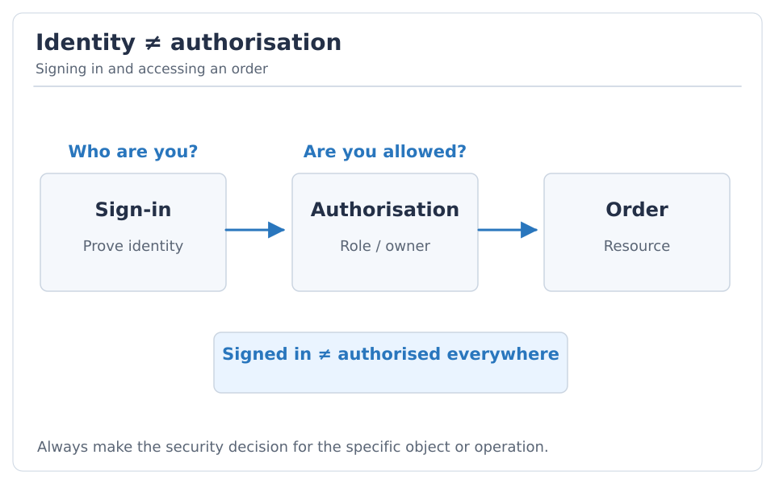

# M4-L3 – Security, data protection and responsibility {#L3}

**Course area:** M4 – Bachelor’s / transition: Cloud operations

**Level:** Bachelor’s / Master’s bridge

**Prior knowledge:** No fixed prerequisites specified.

## The initial problem: An accessible service also presents an attack surface {#S1}

In the previous lessons, we made applications accessible over the internet, distributed them across several servers and prepared them for reliable operation. An additional task now arises: not everyone who can reach the service may use it without restrictions. And even an authorised user is not normally permitted to access other users' data.

**Information security** aims to protect information and systems against unauthorised access, unwanted modification and outages. The three frequently cited fundamental objectives are **confidentiality** (not everyone may read the information), **integrity** (data and processes should not be altered without detection) and **availability** (authorised users should be able to use a service). **Data protection** additionally asks whether the processing of *personal data* is justified, transparent, limited to a purpose and appropriate. A technically secure service may nevertheless violate data protection rules if it collects more data than necessary.

An example: a customer's analysis is correctly transmitted over an encrypted connection. Nevertheless, a programming error might allow a logged-in customer to download another customer's file by changing a job number. The encryption works; the **authorisation check** is missing.

``` text
Public internet
        │
        ▼
    Web service / API
        │
  Who is accessing it? ──► Verify identity
        │
  What may they do?    ──► Check permission for this exact object
        │
        ▼
   Business function ──► Protected database
        │
        └──────────────► Traceable security events
```

**What problem do security measures solve?** They limit access, misuse, data loss and operational disruptions. **When is a large security platform excessive?** For a purely local, offline tool that does not handle other people's data. Nevertheless, backups and basic system hygiene remain important even there. The appropriate level of protection depends on the potential harm, not on how modern the system is supposed to look.

## Understanding the risk first: Assets and threat models {#S2}

A **threat model** is a structured examination of what needs protection, who might cause harm and how, and where the relevant interfaces are located. Initially, this does not require complicated software.

For a small online service, the assets might include customer files, accounts, API keys, financial balances and the application's availability. Risks range from accidental misconfiguration and stolen credentials to automated abuse. Not every disruption is a deliberate attack: an incorrectly assigned database permission or a publicly accessible storage bucket can have equally serious consequences.

It helps to think in terms of *trust boundaries*. Between a public browser and a server, transmitted data must never be assumed correct merely because the interface has already checked them. Between the application server and the database, permissions must be restricted. Between your own AI worker and an external model provider, a further boundary involving its own data transfer may arise.

``` text
[Unknown browser] ─┬─ Trust boundary ─► [Own application]
                   │                           │
          Validate inputs              Check rights and data
                                               │
                                      Database trust boundary
                                               │
                                      [Customer data / jobs]
                                               │
                                   Possibly another external boundary
                                               ▼
                                     [External service provider]
```

The security question is not only ‘Can someone break in?’ but also ‘What happens if a single error occurs, and how far do its consequences extend?’ Consistently limiting permissions ensures that a compromised component does not automatically control the entire system.

## Authentication and authorisation are two different tasks {#S3}

**Authentication** means that a system checks whether someone can prove their claimed identity. **Authorisation** means that the system decides what this identity is permitted to do. The two steps often occur in sequence, but they must not be confused.

{alt="Schematic access process: verify identity, then check permission for an order. A valid login does not automatically permit access to other people's orders."}

Authentication answers ‘Who?’; authorisation determines ‘Is this person allowed to do that?’

A user may be correctly logged in and still lack permission to open someone else's order. Conversely, a public article may deliberately be readable without a login. The two questions are independent.

The abbreviation **IAM** (*Identity and Access Management*) refers to the management of identities and access rights. It includes user accounts, machine identities, role assignments, login mechanisms and the withdrawal of rights that are no longer needed.

**Least privilege**, or the *principle of least privilege*, means that each identity receives only the access it actually requires, preferably for no longer than necessary. A web process that must read customer files therefore does not automatically need permission to delete all database tables. An automated image worker should not have the same extensive administrator key as the operator.

A common method is **role-based access control** (RBAC): roles such as ‘customer’, ‘support’ or ‘administrator’ receive different permissions. With **attribute-based access control** (ABAC), additional characteristics such as ownership, project membership or data classification may be decisive.

| Access scenario | Identity verification | Additional authorisation check required |
| --- | --- | --- |
| Customer reads their own job | Logged-in session or valid access token | Does this exact job belong to the customer? |
| Employee handles a support case | Employee identity | Is access to this case and this data category permitted? |
| AI worker loads an input file | Machine identity | Is this exact file authorised for this exact job? |
| Operator changes server settings | Strongly protected administrator account | Is the appropriate operational permission present? |

A particularly important technical consequence is that the check must take place **in the backend for every relevant action**. A hidden button or a file number that is not displayed is not access protection. The Open Worldwide Application Security Project (OWASP) calls such object-level authorisation failures *Broken Object Level Authorization* in its API security overview.

## Passwords, MFA and passkeys {#S4}

A password is a secret used to log in, either alone or together with other evidence. An insecure login system can undermine all the other measures even when the database is otherwise well protected.

**Multi-factor authentication** (MFA) combines different types of evidence, for example knowledge (a password) and possession (a device or security key). Two passwords, by contrast, are not automatically two independent factors. MFA reduces the risk posed by stolen passwords but does not guarantee complete protection against every form of deception or account takeover.

**Passkeys** typically use the FIDO2/WebAuthn standards and cryptographic key pairs. With an appropriate implementation, users can log in without a reusable website password; the private key does not leave the corresponding authenticator in the usual authentication process. This can be particularly resistant to conventional phishing sites. The precise design can vary between devices, synchronisation mechanisms and providers.

**NIST SP 800-63B-4**, published in 2025 (*National Institute of Standards and Technology, Special Publication*, a guideline on authentication), is a current technical reference. Its requirements apply directly to the scope defined in the guideline, not universally as a law for every private web application. Nevertheless, it provides useful guidance on strong, user-friendly authentication methods.

``` text
User ─► Login method ─► Verified identity
                              │
                              ▼
                       Short-lived session
                              │
                              ▼
                      Authorise each action
```

**Why not every project should develop its own login system:** Secure authentication also requires account recovery, protection against automated attempts, session expiry, revocation of lost access credentials and handling of stolen credentials. An established authentication solution may help avoid errors, but it also creates operational and provider dependencies. A public documentation project without user accounts may not need a login at all.

## Storing passwords: Hash instead of plaintext {#S5}

If a service processes passwords, they must not end up in a database as plaintext. Simple reversible encryption is also not normally the correct underlying principle for password verification.

Instead, a deliberately computationally expensive **hash algorithm** specifically suited to passwords is used. A *hash* here is a one-way verification value; a random **salt** (an individual additional value) and suitable cost parameters make large-scale guessing more difficult. The server then stores the values required for verification but not the original password. Modern methods include **Argon2id**, **scrypt** and, for certain requirements, **PBKDF2** (*Password-Based Key Derivation Function 2*). An ordinary, very fast SHA-256 hash alone is unsuitable for password storage.

``` text
New password ─► Salt + suitable password hash ─► Store verification value

Login password ─► Same verification procedure ─► Compare ─► Yes / no
```

The precise algorithm and its parameters must suit the runtime environment, expected load and current recommendations. Even a correctly stored hash is of no help if the password appears in a log or error message beforehand. The OWASP password storage guideline provides specific technical recommendations that can be reviewed regularly.

## Sessions, cookies and access tokens {#S6}

After a login, a service must be able to recognise the user during later requests. This often takes place through a **session** and a **cookie** transmitted by the browser. Ideally, the cookie should contain only a session identifier that is difficult to guess, while the actual authorisation information is kept under control on the server side.

A **token** is digital evidence of a particular access right. API access tokens may have permissions and validity periods. The format alone does not prove that a token is secure: it must be verified for authenticity, restricted, stored securely, appropriately revocable or short-lived, and associated with the correct recipient.

A typical browser session needs further protective rules, for example `Secure` for encrypted transmission only and `HttpOnly` so that browser scripts cannot directly read a cookie. `SameSite` can make certain cross-site request scenarios more difficult; it does not replace every necessary measure against **Cross-Site Request Forgery** (CSRF, forced requests through other websites). The appropriate settings depend on the type of application.

**When unnecessary?** A public, entirely static document without user functionality requires neither sessions nor personalised access tokens. Every additional login mechanism also introduces new risks and maintenance burdens.

## Machine identities, secrets and key management {#S7}

Humans are not the only ones who log in. An application accesses a database, a worker loads files and a service uses an external model through a programming interface. This often requires **secrets** — confidential values such as database passwords, API keys or private cryptographic keys.

Such values should not appear in public source code, Git repositories or permanently distributed container images. Base64 encoding is not encryption either. A **secret manager** or *key vault* can centrally manage storage, permissions, traceability and replacement of secrets. For small installations, restrictively protected configuration files may suffice if the risk and environment permit it. Environment variables are frequently used, but they too can be exposed through careless diagnostics or process inspection.

Important terms:

- **API key:** A secret or identifier for programmatic access; depending on the system, it may represent authentication alone or be combined with other evidence.
- **Access token:** Evidence of access limited by time or purpose.
- **Rotation:** Scheduled or incident-related replacement of a secret, for example after suspected compromise.
- **Key management:** Generating, storing, using, renewing and destroying cryptographic keys.

``` text
Application ─► Restricted machine identity
                         │
                         ▼
                   Secrets management
                      ├── DB access only for this application
                      └── API access only for this external service
```

The principle is that not all services should use the same master key. The effects of a single failure can then at least be confined to a limited area. However, this requires documentation and regular review of permissions.

## Encryption: In transit and at rest {#S8}

**TLS** (*Transport Layer Security*, transport encryption) typically protects confidentiality and integrity during transmission when connections are established correctly. **HTTPS** combines the HTTP web protocol with TLS. This is indispensable for login and customer data, but it does not protect against every security vulnerability *within* the recipient system.

**Encryption at rest** protects stored contents against certain attacks, such as access to lost storage devices or unauthorised storage images. Whether it also helps against a compromised, running application server strongly depends on where the key is located and who may use it. If the application and the attacker have the same access to the key, a substantial part of the risk remains.

**End-to-end encryption** is a stronger, independent architectural principle: only the intended endpoints should be able to read the plaintext. This is not automatically the case merely because data are transmitted to a cloud application via HTTPS. If a server must analyse customer files, the application usually requires access to their contents; this has consequences for its data protection and security architecture.

``` text
Browser == TLS ==► Application ─► Database with storage encryption
                         │                      │
                  Possible plaintext here    Key access
```

**Which technology solves which problem?** TLS protects the transmission route, disk encryption protects against certain storage losses, permissions management controls permitted access, and backups enable recovery. No single measure replaces the others.

## Security updates, backups, monitoring and incident response {#S9}

Security is not a one-off installation. Operating systems, libraries, application dependencies and devices need updates. A project's dependencies — for example a PHP library or a container base image — can also become vulnerable. An update must therefore be tested and applied promptly without carelessly damaging production data.

**Backups** are explicitly part of security, particularly availability. However, a backup archive is useful only if it is protected, complete and recoverable. The details of recovery objectives and testing were discussed in M3-L6. Particularly important: a backup may also contain personal data and credentials; its own retention must be taken into account.

**Security monitoring** should detect unusual login activity, large numbers of failed authorisation checks or unexpectedly high levels of API calls. At the same time, logs must not themselves become an unprotected collection of sensitive customer data. Instead of complete file contents or password values, event type, time, technical identifier and a limited error description are often sufficient.

**Incident response** comprises detection, containment, assessment, remediation and follow-up. If, for example, an API key has become public, deleting the affected file later is not enough. The key must be treated as compromised and revoked or replaced; access and possible consequences must be investigated.

## Public APIs: Data leakage, spam and cost attacks {#S10}

A public **API** (*Application Programming Interface*) provides programmatic entry points through which automated clients can also submit requests. The greatest danger is not merely overloading a server. With an AI API, even a small number of expensive jobs can incur substantial external costs.

The OWASP **API Security Top 10 from 2023** identifies, among other things, failures in object authorisation and authentication, unauthorised function calls, resource consumption, server-side request forgery and unsafe processing of external API responses. The year is important: this is a specific edition of a maintained security overview, not a claim that 2023 will remain the only authoritative version in the future.

Typical countermeasures include:

| Risk | Basic defensive principle | Limitation |
| --- | --- | --- |
| Customer retrieves another person's job | Server-side object authorisation for every request | A login alone is insufficient |
| Bot generates millions of calls | **Rate limit**, i.e. limiting calls per identity/time period | Distributed abuse may use multiple identities |
| AI job incurs enormous computing costs | Size limits, balance/cost budget, quota before job acceptance | Prices and actual consumption may fluctuate |
| Uploaded file contains malicious content | Format and size checks, isolated processing, restricted permissions | A scanner does not detect every danger |
| API accesses an address supplied by the user | Restrict destinations and control server-side network requests | Openly configured redirects remain dangerous |
| Spam or mass account creation | Graduated abuse checks, suitable quotas | Excessively strict barriers burden legitimate users |

In **Server-Side Request Forgery** (SSRF), a server is induced to access unintended network destinations. This is particularly relevant if a service loads arbitrary URLs or sends webhooks to freely entered destinations. AI systems introduce additional risks, such as prompt injection: untrusted text tries to influence the behaviour of an AI workflow. Actual access rights must therefore not be enforced solely through verbal instructions to a model.

A **cost attack** in this context means that someone uses a function in such a way that the operator incurs high bills or experiences resource shortages. A general rate limit is often insufficient if individual calls have very different computing costs. Limits must also address the actual resource — for example upload size, computing time, token consumption or the number of jobs permitted to run concurrently.

``` text
Unknown client
       │
       ▼
  Rate limit / input checks
       │
       ▼
  Login + object authorisation
       │
       ▼
  Size, cost and job budget
       │
       ▼
   Job in queue ─► Restricted worker ─► Result
```

A blanket recommendation that ‘more cloud = more security’ would be mistaken. More components also mean more security configuration, keys, interfaces and monitoring.

## Data protection: When are data personal data? {#S11}

The European **General Data Protection Regulation** (GDPR; German: DSGVO) regulates, among other things, the processing of personal data. Personal data are information relating to an identified or identifiable natural person. Typical examples may include a name, email address, customer identifier, IP address or certain usage data if they can be associated with a person.

The context matters. An apparently harmless internal number may be personal data if the service uses it to identify a customer account. Conversely, genuinely anonymised data must generally be assessed differently from merely **pseudonymised** data. A pseudonym may, for example, replace a name with an identifier, but does not completely rule out possible re-identification.

**Data protection is therefore not merely a question of database encryption.** It begins with deciding whether and why data are collected. For a free web calculator without user accounts, for example, it may be unnecessary to create complete user profiles. A personal history function, by contrast, may need data — but preferably only the data required for that purpose.

The following principles help with design: purpose limitation, data minimisation, transparency, storage limitation, integrity/confidentiality and accountability. Processing requires an appropriate **legal basis**; a blanket statement that ‘everything always requires consent’ would be inaccurate. Which legal basis is suitable in each individual case must be assessed.

## Controller and processor: Who decides and who carries out the processing? {#S12}

A **controller** within the meaning of the GDPR decides on the purposes and essential means of processing. A **processor** processes personal data on behalf of the controller and in accordance with the controller's documented instructions, insofar as the respective contractual and legal relationship actually provides for this.

Consider a small online tool: the operator determines which customer data are needed to process jobs and how long they are stored. If the operator uses a hosting provider, that provider may act as a processor in relation to certain hosting activities. Under the relevant conditions, a data processing agreement (DPA; in EU law a contract under Article 28 GDPR) is required. **Not every cloud provider involved is automatically merely a processor in every respect**; the roles depend on the particular activity.

``` text
Customer ─► Online service operator
                │ decides purposes and means
                ▼
              Controller
                │ commissions processing
                ▼
            Hosting/cloud provider
              (possibly a processor)
                │
                └── Possibly further sub-processors
```

Particularly with AI services, an external model provider may also be involved. It is then necessary to establish whether uploaded texts or files are transmitted there, whether the provider uses them for its own purposes, how long they are retained and which contractual rules apply. Without this information, the data protection role cannot be assessed reliably.

**Practical consequence:** A GDPR obligation does not disappear merely because another provider operates the computers. At the same time, the operator cannot control everything that happens in external data centres; contracts, technical settings and verifiable documentation therefore matter.

## Storage location, international transfers and erasure {#S13}

The physical location of a database matters but is not the only data protection issue. Data may reach other parties during backups, support access, through subcontractors or via an external AI API. ‘EU server’ therefore does not automatically mean that all processing takes place exclusively within the European Union.

Special requirements apply to certain transfers of personal data outside the **European Economic Area** (EEA). Legal instruments may include adequacy decisions by the European Commission or appropriate safeguards including **standard contractual clauses**. Which option is sufficient in each case depends on the destination country, the parties involved and further circumstances. Lists and legal situations may change; decisions should be assessed against the current position.

**Erasure** sounds simple but becomes complicated in real online services: data may reside in the primary database, a search index, a worker, temporary files, log data and backups. A traceable erasure concept must take these storage locations into account and — where required — incorporate statutory retention obligations and the technically and legally appropriate treatment of existing backups. Merely removing data from the user interface is insufficient.

``` text
Customer file
   ├── Active database
   ├── Temporary processing
   ├── Search index or result cache
   ├── Logs (ideally without file contents)
   └── Backup copies with their own retention period
```

**Privacy by design** and **privacy by default** mean providing for data-minimising architecture and settings from the outset. This includes, for example, retaining an uploaded job after completion only for as long as necessary for the specified purpose and legally permitted.

## Information obligations, rights and security incidents {#S14}

Anyone processing personal data must, under the applicable legal conditions, inform the data subjects who processes the data, for what purposes, on what legal basis and for what retention period. Data subject rights may also become relevant, particularly access, rectification or erasure; each right is subject to conditions and possible exceptions.

If personal information is accidentally disclosed, altered, destroyed or rendered inaccessible, a **personal data breach** may have occurred. Not every technical failure is automatically a reportable personal data breach. Under the GDPR, a controller must generally notify the competent supervisory authority of a relevant personal data breach without undue delay and, where feasible, within **72 hours of becoming aware of it**, **unless the breach is unlikely to result in a risk to the rights and freedoms of natural persons**. Where a high risk is likely, notifying the affected individuals may additionally be required. Personal data breaches that are not reported must also be documented under Article 33(5). This must be assessed in light of the particular incident.

This sounds formal but has a direct technical prerequisite: if no one can determine which data were affected, it is also difficult to assess an incident appropriately. Limited logging, defined responsibilities and a simple emergency procedure are therefore important even for small services.

**Economic consequence:** Data protection may entail costs for design, documentation, contract review, support for access and erasure requests, and secure handling of failures. A software idea of little benefit that would require processing particularly sensitive data should therefore be critically assessed for its economic and organisational scope.

## Three applications: From a local tool to an AI service {#S15}

### Example A: A local media archive

A program catalogues files and metadata on your own computer. Without public accessibility or other users, the risk is typically more manageable. System updates, reliable local permissions and separate backups remain worthwhile. If images or information about identifiable people are stored or published, additional data protection and personality rights issues may arise.

**When is a large security solution unnecessary?** If only your own user account actually accesses purely local data, a complete cloud IAM service is usually unnecessary. Simplicity is then itself a security advantage.

### Example B: A small paid online analysis tool

A customer registers, uploads a file and receives an analysis. The service now needs secure login, careful object assignment, limited file sizes, protection against other people's files, an erasure rule and possibly a DPA with the hosting provider. If payment data are processed, it must be assessed whether a specialist payment service can take over the storage of payment information requiring particular protection.

``` text
Customer ─► Login ─► File upload ─► Job check
                                       │
                               Own customer area
                                       │
                               Isolated processing
                                       │
                               Result + erasure rule
```

A small conventional VPS or a managed service may suffice. Costs arise not only from the server but also from security updates, user enquiries and the risk of faulty upload processing.

### Example C: An AI service with multiple workers and external models

In AI workflows, the number of trust boundaries increases. A job server receives data, a scheduler distributes work, and workers use GPU resources (*Graphics Processing Unit*, graphics processor) or send data to external models. Some jobs may be expensive; some input data may contain personal information.

``` text
Customer
  │
  ▼
API + quota + customer permissions
  │
  ▼
Job database ─► Queue
                  │
            ┌─────┴───────────────────┐
            ▼                         ▼
      Local AI worker          External model provider
            │                         │
            └─────────────┬───────────┘
                          ▼
                Result only for the customer
                          │
                  Storage/erasure rules
```

Limits on model calls, specific machine access credentials, documentation of data flows and careful assessment of external providers become additionally important here. Texts, URLs or suggested commands generated by the model must not be executed without control as administrative instructions. For a small initial version, it may be more economical to offer **just one worker and a tightly restricted API** instead of immediately combining complex agent systems and multiple cloud services.

## The central economic question: Which risks can I manage in the long term? {#S16}

A secure system is not simply the one with the most products and certificates. Security measures must suit actual operations. An individual developer can often understand and maintain a simple application better than an architecture of many independently updated services.

For every product idea of your own, at least five questions should be answered: What data are processed? Who may access what? Which external providers receive data or keys? How are misuse and unexpected costs limited? How are data backed up, erased and handled during security incidents?

Recurring operating costs arise from updates, security checks, log storage, access controls, backup, possible external specialist advice and support. Managed services can reduce workloads, but they cannot simply remove responsibility for designing your own application and selecting its settings.

## Summary and transition to M4-L4 {#S17}

**Security** protects systems and information against unauthorised interference, alterations and outages. **Data protection** additionally requires that the processing of personal data be justified and restricted legally and organisationally. Authentication, authorisation, secrets management, encryption, abuse protection and backup solve different problems; none of these measures replaces the others.

For a small online service, a few consistently implemented principles are often more important than a large security platform: as little stored data as possible, server-side authorisation checks, separate secrets, limited resources, traceable updates and tested recovery. With increasing user numbers and external integrations, the requirements for operations and documentation increase.

**In M4-L4 – Understanding costs**, we consider the economic implications of these and other technical decisions: fixed and variable cloud costs, data traffic, GPU time, budgets and the choice between a small server, a platform and a complex cluster.

## Sources {#S18}

**Last source check:** 03.11.2026

All the following primary or project sources were checked on **03.11.2026** for accessibility and relevance. They provide guidance for this lesson; a further check for currency is necessary for specific production or legal use.

1.  NIST, *SP 800-63B-4 – Digital Identity Guidelines: Authentication and Authenticator Management* (2025 edition): [https://csrc.nist.gov/pubs/sp/800/63/b/4/final](https://csrc.nist.gov/pubs/sp/800/63/b/4/final)
2.  OWASP, *API Security Top 10 – 2023*: [https://api-security.owasp.org/editions/2023/en/0x11-t10/](https://api-security.owasp.org/editions/2023/en/0x11-t10/)
3.  OWASP, *Password Storage Cheat Sheet*: [https://cheatsheetseries.owasp.org/cheatsheets/Password_Storage_Cheat_Sheet.html](https://cheatsheetseries.owasp.org/cheatsheets/Password_Storage_Cheat_Sheet.html)
4.  OWASP, *Secrets Management Cheat Sheet*: [https://cheatsheetseries.owasp.org/cheatsheets/Secrets_Management_Cheat_Sheet.html](https://cheatsheetseries.owasp.org/cheatsheets/Secrets_Management_Cheat_Sheet.html)
5.  OWASP, *Cryptographic Storage Cheat Sheet*: [https://cheatsheetseries.owasp.org/cheatsheets/Cryptographic_Storage_Cheat_Sheet.html](https://cheatsheetseries.owasp.org/cheatsheets/Cryptographic_Storage_Cheat_Sheet.html)
6.  European Commission, *Data protection explained* (roles and personal data): [https://commission.europa.eu/law/law-topic/data-protection/data-protection-explained_en](https://commission.europa.eu/law/law-topic/data-protection/data-protection-explained_en)
7.  European Commission, *Obligations* (information obligations): [https://commission.europa.eu/law/law-topic/data-protection/information-business-and-organisations/obligations_en](https://commission.europa.eu/law/law-topic/data-protection/information-business-and-organisations/obligations_en)
8.  European Data Protection Board, *Secure personal data* / guide for small businesses: [https://www.edpb.europa.eu/sme/be-compliant/secure-personal-data_de](https://www.edpb.europa.eu/sme/be-compliant/secure-personal-data_de)
9.  European Data Protection Board, *Data breaches*: [https://www.edpb.europa.eu/sme/assess-the-risks/data-breaches_en](https://www.edpb.europa.eu/sme/assess-the-risks/data-breaches_en)
10. European Data Protection Board, *Be compliant* (Privacy by Design): [https://www.edpb.europa.eu/sme/be-compliant/be-compliant_en](https://www.edpb.europa.eu/sme/be-compliant/be-compliant_en)
11. European Commission, *Rules on international data transfers*: [https://commission.europa.eu/law/law-topic/data-protection/international-dimension-data-protection/rules-international-data-transfers_en](https://commission.europa.eu/law/law-topic/data-protection/international-dimension-data-protection/rules-international-data-transfers_en)
12. European Commission, *Adequacy decisions*: [https://commission.europa.eu/law/law-topic/data-protection/international-dimension-data-protection/adequacy-decisions_en](https://commission.europa.eu/law/law-topic/data-protection/international-dimension-data-protection/adequacy-decisions_en)
